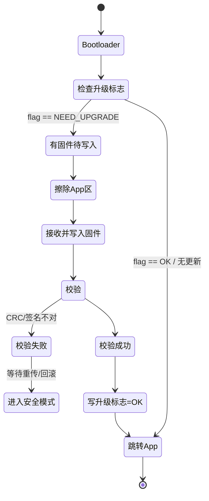

> 范围：通用（Cortex-M / RISC-V 都覆盖）· 结合本项目 **CH582M（KeyGo BLE OTA）** 与 **STM32H743（AHRS 板）** 实例
> 更新日期：{{ git_revision_date_localized }}

---

## 一句话结论

**IAP（In-Application Programming，在应用编程）的本质是：让芯片在“跑着自己程序”的时候，还能把新的程序写进自己的 Flash。** 它通常靠一个常驻的 **Bootloader** 来实现——上电先跑 Bootloader，判断要不要升级，要就收固件、写 Flash、校验，再跳到 App 去跑。

- **ISP** 是“进特殊模式用外部工具烧录”（芯片厂 BootROM + 串口/USB/SWD），属于**出厂/返修**手段。
- **OTA** 是“**通过无线把固件传过来**”，它**不是**和 IAP 并列的另一种机制，而是 IAP 的一种**传输通道**（OTA = 无线版的 IAP 投递方式）。

> ⚠️ 很多人（包括一些 AI 回答）把 IAP / ISP / OTA 写成三选一，这是不准确的说法。正确关系是：**ISP 是厂测工具，IAP 是运行期自升级能力，OTA 是 IAP 的无线实现方式。**

## 1. 为什么需要 IAP

| 场景 | 没有 IAP 会怎样 | 有 IAP 怎么做 |
|------|----------------|---------------|
| 已部署的设备（车钥匙、传感器、无人机） | 必须拆壳、接烧录器，成本极高 | 远程/现场一键升级 |
| 批量设备发现 Bug | 全部召回 | 推送补丁固件 |
| 产品功能迭代 | 用户买新硬件 | OTA 推新版本 |
| 现场参数/配置更新 | 人工改写 | 随固件一起下发 |

本项目里两处都用得上：

- **KeyGo（CH582M BLE 钥匙）**：手机 App 通过 BLE 把新固件推给钥匙，钥匙自己写 Flash 完成升级——典型的 **IAP + OTA**。
- **AHRS 板（STM32H743）**：调试期走 SWD（ISP 思路），但量产后若要做现场固件维护，同样需要 IAP（经 UART/CAN/以太网等通道）。

## 2. 核心架构：Bootloader + App 两段式

最经典、最稳的 IAP 是**两段式**：Flash 里常驻一个 Bootloader，平时跑 App，升级时由 Bootloader 接管写 Flash，写完跳回 App。

### 2.1 Flash 分区三种典型布局

| 布局 | 示意 | 优点 | 缺点 / 风险 |
|------|------|------|-------------|
| **单区（就地升级）** | `[Bootloader][App]` | 省 Flash，最简单 | 升级中途断电/失败 → App 损坏 → **变砖** |
| **双区 / A-B 分区** | `[Bootloader][App A][App B]` | 可回滚，断电安全 | 占用 2 倍 App 空间 |
| **外部 Flash 缓存** | `[Bootloader][App][外部 QSPI/SD 放新固件]` | MCU 内部 Flash 省着用 | 需外置存储器 + 校验搬运逻辑 |

> ✅ 本项目 CH582M 的 EVT 例程里就是“**备份升级**”思路（主 App 区 + 备份/下载区），属于双区/缓存的变体，详见 [CH582M Flash 存储与 SNV 详解](BLE%20MCU&SOC/WCH/CH58(2)3M/CH582M%20Flash%20存储与%20SNV%20详解.md)。

### 2.2 启动与升级流程



关键点：

1. **升级标志（flag）放在不掉电易失区之外**——通常写在独立的 Flash 扇区 / DataFlash，断电不丢，用来告诉 Bootloader “上电该不该进升级”。
2. **写完一定要先校验，再清标志、再跳 App**；顺序反过来一旦出错就回不去了。

## 3. 关键技术点（最容易踩坑的地方）

### 3.1 Flash 只能“先擦后写”

Flash 物理特性是：**写只能把 1 变 0，不能把 0 变 1；要改必须整块擦除（页/扇区）把整块还原成 1，再写。**

- CH582M：CodeFlash 最小擦除单位 **4 KB**，写前必擦。
- STM32H7：按扇区擦除（不同扇区大小不同），且 H7 有写缓冲/并行位，但有等待时序要求。

> ⚠️ **擦除会抹掉整块**——升级时若 Bootloader 和 App 在同一扇区边界没划清，擦 App 可能误伤 Bootloader 自身，导致再也起不来。分区时要保证 **Bootloader 占独立、不被升级擦除的扇区**。

### 3.2 中断向量表必须重定位

芯片上电后，硬件从 Flash 头部（或 `0x00000000` 映射处）的**中断向量表**取第 0 项当初始栈指针 MSP、第 1 项当 Reset 入口。App 不在 0 地址时，**向量表也得跟着挪**，否则中断一触发就跳到 Bootloader 的死地址。

- **Cortex-M（STM32H743 等）**：把 `SCB->VTOR` 指向 App 基地址。
  ```c
  SCB->VTOR = APP_ADDR;   // App 向量表新位置
  ```
- **RISC-V（CH582M 青稞 V4）**：向量表位置由 `mtvec` CSR 控制；但 QingKe 内核另有厂商特定的映射/跳转机制（WCH EVT 的 OTA 例程里用 `JumpIAP` 之类的封装），**不要直接照搬 Cortex-M 的 VTOR 写法**。❓ 具体寄存器细节以 CH582M 手册 + 官方 OTA 例程为准。

> App 工程侧也要改两处：① **链接脚本**把 `FLASH` 起始地址改成 `APP_ADDR`；② 启动代码里把 `VTOR`（或 `mtvec`）设成同样的值（STM32 的 `system_stm32xxxx.c` 里 `VECT_TAB_OFFSET` 就是干这个的）。

### 3.3 跳转到 App 的标准动作

跳过去之前，必须让“世界安静下来”，否则 Bootloader 用过的外设在 App 里乱触发中断会 HardFault：

```c
typedef void (*app_entry_t)(void);

void jump_to_app(uint32_t app_addr) {
    uint32_t sp = *(volatile uint32_t*)app_addr;          // 向量表[0] = 初始 MSP
    uint32_t pc = *(volatile uint32_t*)(app_addr + 4);    // 向量表[1] = Reset_Handler
    app_entry_t entry = (app_entry_t)pc;

    __disable_irq();          // 1. 关全局中断
    SysTick->CTRL = 0;        // 2. 停 SysTick（不然 App 还没初始化就进滴答中断）
    // 3. 反初始化用过的外设、停 DMA、清定时器（按 Bootloader 实际用到的来）
    // 4. 若开了独立看门狗且停不掉，App 必须尽快接管喂狗，否则跳过去就被复位

    SCB->VTOR = app_addr;     // 5. 向量表指到 App
    __DSB(); __ISB();         //    保证后续取指用新向量表

    __set_MSP(sp);            // 6. 切到 App 的栈
    entry();                  // 7. 跳！
}
```

> ⚠️ **顺序坑**：`__set_MSP` 必须在调用 `entry()` **之前**执行，且 `VTOR` 设置后最好加 `DSB/ISB`，否则流水线可能还用旧向量。不同厂商例程顺序略有差异，但“关中断 → 设 VTOR → 设 MSP → 跳”这条主线不变。

### 3.4 校验与安全：别只信 CRC32

| 手段 | 防什么 | 说明 |
|------|--------|------|
| CRC32 | 传输/写入**意外损坏** | 最基础，发现“写歪了” |
| SHA-256 | 内容完整性 | 比 CRC 更强，但仍不防“被替换” |
| **数字签名（ECDSA/RSA）** | **有人故意刷恶意固件** | 用公钥验签，私钥离线保管 ✅ 量产设备必须做 |
| AES 加密 | 固件被逆向/抄板 | 密文下发，设备内解密 |
| **防回滚版本号** | 把设备刷回有漏洞的旧版 | 新固件带 monotonic version，Bootloader 拒绝降级 |

> ✅ **本项目 KeyGo 已经在做 HMAC-SHA256 的密钥派生**，说明安全模型已经是“认证优先”。固件 OTA 也应沿用同一思路：**Bootloader 验签通过才允许烧录**，否则任何人都能拿个假固件把钥匙变成后门。

### 3.5 可靠性工程：断电不能变砖

- **独立看门狗（IWDG）**：升级全程喂狗；写一半卡死就复位，Bootloader 重新来。
- **掉电保护**：写 App 前先确认有“能回滚的备份”（双区 / 外部 Flash），失败了下次上电还能跑旧的。
- **失败重试 / 安全模式**：校验不过就停在 Bootloader 等重传，而不是跳进半截 App。
- **双区原子切换（STM32H7 利器）**：H7 支持 **双 Bank Flash + BFB2 选项位**，可以把“已校验好的新固件”所在 Bank 一键映射成从 0 地址启动——**切换是原子的，不存在“写了一半的 Bank 被设成启动 Bank”的窗口**，是最稳的防变砖方案。

### 3.6 H7 特有坑：跳前必须失效 Cache

STM32H7 带 **指令 Cache（ICache）和数据 Cache（DCache）**。Bootloader 把新固件写进 Flash 后，Cache 里可能还缓存着**旧指令**；如果不清，App 一跑就执行到 stale 指令 → HardFault。

```c
SCB_InvalidateICache();          // 跳 App 前清指令缓存
SCB_CleanInvalidateDCache();     // 清数据缓存（若有写缓冲）
__DSB(); __ISB();
```

> ⚠️ 这是很多“在 F1/F4 上跑得好好的跳转代码，搬到 H7 就 HardFault”的隐藏原因。AHRS 板用的就是 H743，做 IAP 必须记得这一步。

## 4. 常见升级协议 / 通道

| 通道 | 协议/方式 | 典型场景 |
|------|-----------|----------|
| 串口 | **YMODEM / XMODEM** | 产线、调试，最简单 |
| USB | **DFU（Device Firmware Upgrade）** | 键盘/手柄，免烧录器 |
| CAN | **UDS ISO 14229**（0x34/0x36/0x37 例程） | 汽车 ECU 刷写，标准流程 |
| BLE | 厂商 GATT OTA Service | **KeyGo 这类手机钥匙** |
| 以太网/WiFi | **HTTP / MQTT 分块下发** | 网关、IoT 设备 |

> 不管走哪条通道，到“写 Flash”这步都是同一套：**收一块 → 擦对应扇区 → 写 → 记 offset → 收下一块**，区别只在“块从哪来”。

## 5. 本项目实战对照

### 5.1 CH582M（KeyGo）—— BLE OTA

- 芯片内部分区（来自 [CH582M 特性与概览](BLE%20MCU&SOC/WCH/CH58(2)3M/CH582M%20特性与概览.md)）：448 KB CodeFlash + 32 KB DataFlash + 24 KB BootLoader + 8 KB InfoFlash。
- ⚠️ 注意：**那 24 KB 是 WCH 出厂的 ISP BootLoader（给 USB/串口下载用的）**，和我们自己写的“BLE OTA Bootloader”不是一回事。BLE 无线升级靠的是 EVT 里的 **OTA 例程（备份升级 / 固定库升级，含 IAP、JumpIAP、用户固件三件套）**。
- 升级通道 = BLE GATT，手机 App 把固件分包推过来，钥匙端 Bootloader 收包、写 CodeFlash、校验后跳转。
- ❓ CH582M 是 RISC-V，向量表重定位走 QingKe 特定机制（见 3.2），具体实现以官方 OTA 例程为准，不要套 Cortex-M 的 `VTOR` 写法。

### 5.2 STM32H743（AHRS 板）

- Cortex-M7，2 MB 双 Bank Flash → 天然适合 **A-B 双区 + BFB2 原子切换**（见 3.5）。
- 跳转前务必做 **ICache/DCache 失效**（见 3.6），这是 H7 专属坑。
- `SCB->VTOR` 重定位标准可用；App 链接脚本 `FLASH` 起点改到 `APP_ADDR`，`VECT_TAB_OFFSET` 同步。
- 调试期走 SWD 烧录（ISP 思路），量产/现场维护可加 UART/CAN/ETH 的 IAP 通道。

## 6. 关于 AI 初稿的纠偏与补充

（写给同样拿 AI 回答当起点的同学——下面几条是本项目视角下必须补或改的）

1. **“IAP/ISP/OTA 三选一”是错的**：OTA 是 IAP 的无线通道，不是并列机制（见开头）。
2. **`VTOR` 不是通用写法**：只适用于 Cortex-M。RISC-V（CH582M）用 `mtvec` + 厂商机制，别照抄。
3. **只提 CRC32 不够**：量产/联网设备必须验签（ECDSA/RSA）+ 防回滚，否则等于给后门留口子。KeyGo 已用 HMAC-SHA256 做认证，OTA 应一脉相承。
4. **漏了 H7 的 Cache 失效**：在 F1/F4 验证过的跳转代码搬到 H743 会 HardFault，跳前必清 ICache/DCache。
5. **“24 KB BootLoader”别误会**：CH582M 那 24 KB 是出厂 ISP 用的，不是你的 BLE OTA Bootloader。
6. **单区升级“断电变砖”是真风险**：给了“双区/外部 Flash/BFB2 原子切换”三条出路，别只讲单区。

## 参考链接

- [CH582M 特性与概览](BLE%20MCU&SOC/WCH/CH58(2)3M/CH582M%20特性与概览.md)
- [CH582M Flash 存储与 SNV 详解](BLE%20MCU&SOC/WCH/CH58(2)3M/CH582M%20Flash%20存储与%20SNV%20详解.md)
- [KeyGo（BLE 手机钥匙）](../../硬件与半导体/汽车电子/KeyGo-BLE手机钥匙.md)
- [AHRS 板固件仿真与验证](../../工作与项目/AHRS板固件仿真与验证/index.md)
- ST AN4657《STM32 微控制器中的 IAP》（双 Bank / 安全启动参考）
