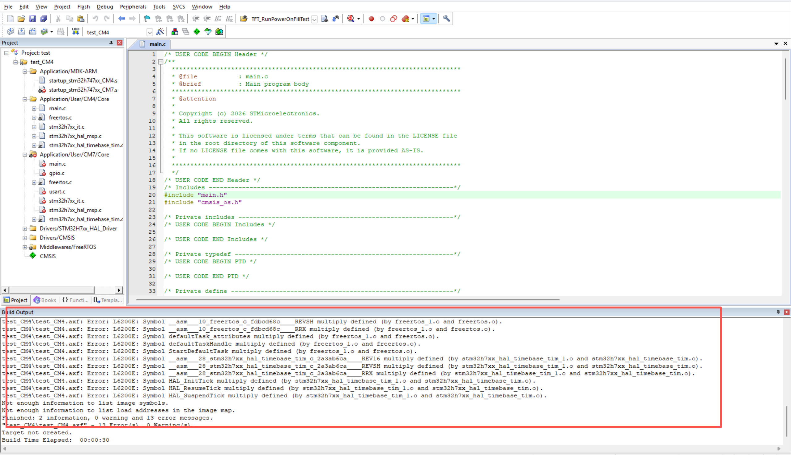
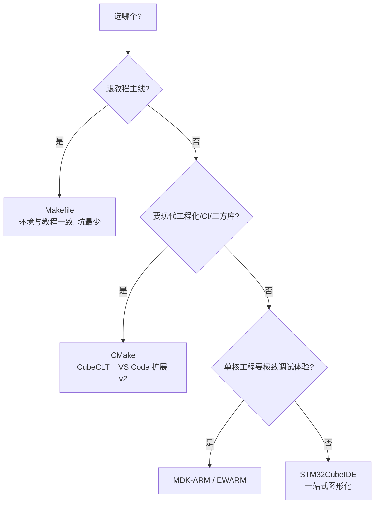

# CubeMX 五种工程形态对比（EWARM · MDK-ARM · STM32CubeIDE · Makefile · CMake）

> 芯片：STM32H747 / H757（双核 CM7 + CM4）
> 教程对应：**1.2 为什么使用 Makefile 而不是 MDK** · 1.3 Makefile 环境搭建流程 · 1.4 调试环境配置 · 8.5 把 LVGL 加入编译 · 18 调试技巧
> 所属块：[00 工具链与工程构建](../index.md)（环境版本基线见块首页"环境基线"一节）
> 更新日期：{{ git_revision_date_localized }}

---

## 一句话结论

CubeMX 的 Toolchain/IDE 下拉框有 5 个选项，它们生成的**用户代码完全相同**（同一份 `.ioc`），真正的差异只有五处：**工程描述文件、启动文件汇编语法、链接脚本、构建系统、调试链路**。对双核 H7 而言，这不是口味问题——教程实测 MDK 生成的 CM4/CM7 工程会**互相包含导致编译失败**，这是教程主线选 Makefile 的直接原因。

## 1. 五种形态一览

| 形态 | 构建系统 | 编译器 | 工程描述文件 | 链接脚本 | 命令行构建 |
|------|----------|--------|--------------|----------|------------|
| **EWARM**（IAR） | IAR Build | ICCARM | `.ewp` / `.eww` / `.ewd` | `.icf` | `IarBuild`（有 Linux 版） |
| **MDK-ARM**（Keil） | uVision 内置 | Arm Compiler（AC6） | `.uvprojx` / `.uvoptx` | `.sct`（散列文件） | `UV4 -b`（仅 Windows） |
| **STM32CubeIDE** | Eclipse CDT 托管构建（内部仍调 make） | arm-none-eabi-gcc | `.project` / `.cproject` / `.launch` | `.ld` | 支持 headless 构建 |
| **Makefile** | GNU Make | arm-none-eabi-gcc（自备） | `Makefile` | `.ld` | `make`（原生） |
| **CMake** | CMake + Ninja / Make | arm-none-eabi-gcc | `CMakeLists.txt` + `cmake/` | `.ld` | `cmake --build`（原生） |

> 💡 教程主线用的是 **Makefile**：GCC 选 xPack 发行版，make 用 ezwinports 版，调试链路是 VS Code + Cortex-Debug + OpenOCD（教程 1.3 / 1.4）。

## 2. 真正的差异只有五处

### 2.1 用户代码完全相同

`Core/Src`、`Core/Inc`、`Drivers/`（HAL + CMSIS）、`Middlewares/` 五个形态逐字节一致，`/* USER CODE BEGIN */ ... /* USER CODE END */` 保护区机制也一致。**`.ioc` 是唯一真源**，工程文件全部是生成物——这决定了后面"重新生成覆盖"行为才是迁移工具链时最需要实测的点，而不是代码本身。

### 2.2 启动文件：同一芯片、三套汇编语法

CubeMX 会**按所选工具链生成不同语法**的 `startup_stm32h747xx.s`：

| 工具链 | 启动文件语法 |
|--------|--------------|
| MDK-ARM | ARMCLANG 汇编 |
| Makefile / CMake / CubeIDE | GCC 汇编 |
| EWARM | IAR 汇编 |

**不要跨工具链复制启动文件**——这是把 Keil 工程搬到 GCC 工程时最常见的第一个坑。语法对照见副线《启动文件与链接脚本》（[块首页](../index.md)）。

### 2.3 链接脚本：`.sct` / `.ld` / `.icf`

| 工具链 | 链接脚本 | 语法家族 |
|--------|----------|----------|
| MDK-ARM | `.sct`（scatter file，散列文件） | Arm |
| Makefile / CMake / CubeIDE | `.ld`（linker script） | GNU ld |
| EWARM | `.icf`（ILINK configuration file） | IAR |

教程 11.3 讲的是 `.ld`；外部 Bootloader 全系列教程讲的是 `.sct`。**同一份 Flash 分区方案，三种写法**——做 Bootloader 分区时先过一遍副线《启动文件与链接脚本》的对照表。

### 2.4 构建系统与"加一个源文件"的方式

| 形态 | 添加源文件的位置 |
|------|------------------|
| Makefile | `C_SOURCES`（源文件）、`C_INCLUDES`（头文件路径）、`ASM_SOURCES` |
| CMake | `CMakeLists.txt` 的 `target_sources` / `target_include_directories` |
| MDK / EWARM / CubeIDE | IDE 内右键添加（写进 `.uvprojx` / `.ewp` / `.cproject`） |

教程第 8 章把 LVGL 加进编译时分了三套步骤（Keil MDK / CubeIDE / Makefile 各一节），本质就是这张表。

> ⚠️ Makefile / CMakeLists 都是**生成物**：重新 Generate Code 时手改内容是否保留，必须实测（见第 5 节待办），不能想当然。

### 2.5 调试链路

| 形态 | 调试方式 |
|------|----------|
| MDK-ARM | uVision + ST-Link 插件 / J-Link，图形化体验最完整 |
| EWARM | C-SPY 调试器 |
| STM32CubeIDE | 内置 GDB，开箱即用 |
| Makefile / CMake | **OpenOCD + VS Code Cortex-Debug**（`.vscode/tasks.json` + `launch.json`，教程 1.4） |

教程 1.4 的调试环境里有两个高频坑：`serverpath` 要填 `openocd.exe` 的**完整路径**（`where openocd` 查不到时）；OpenOCD 脚本要按你的探针/型号选——接口脚本 DAP-Link 用 `interface/cmsis-dap.cfg`、ST-Link 用 `interface/stlink.cfg`，目标脚本双核 H7 用 `target/stm32h7x_dual_bank.cfg` 并配 `set DUAL_CORE 1`。细节归 04 篇。

### 2.6 `tasks.json` / `launch.json` 不是魔法：自己写时查哪些官方文档

教程 1.4 直接给了两个能跑的样例文件，但它们**不是 CubeMX 生成的**（Makefile 工程目录里没有 `.vscode/`），而是 VS Code 的通用配置文件。自己从零写，只需要三个第一手来源：

| 文件 / 内容 | 作用 | 官方文档 |
|-------------|------|----------|
| `.vscode/tasks.json` | 定义"任务"：调 `make -j` 编译、调 OpenOCD / Programmer CLI 烧录 | VS Code 官方 [Tasks](https://code.visualstudio.com/docs/editor/tasks)（`command` / `args` / `group` / `problemMatcher` 字段含义都在这里） |
| `.vscode/launch.json` | 定义"怎么启动调试"，由 **Cortex-Debug 插件**读取 | 机制看 VS Code 官方 [Debugging](https://code.visualstudio.com/docs/editor/debugging)；**字段清单以插件文档为准**：[Cortex-Debug 全部可用属性](https://github.com/Marus/cortex-debug/blob/master/debug_attributes.md)（[插件市场页](https://marketplace.visualstudio.com/items?itemName=marus25.cortex-debug)） |
| `interface/stlink.cfg`、`target/stm32h7x.cfg` | 调试 server 侧的硬件/目标描述 | [OpenOCD User's Guide](https://openocd.org/doc/html/index.html)；这两个文件就在 OpenOCD 安装目录的 `scripts/` 下，**直接打开读**是最快的理解方式 |

从零手写的最小顺序（三份文档各负责一段）：

1. **先写 `tasks.json`**：一个构建任务——`type: shell`、`command: make`、`args: ["-j"]`、`group: {"kind": "build"}`（字段含义查 VS Code Tasks 文档）；
2. **再写 `launch.json`**：`type: cortex-debug` + `servertype: openocd` + `executable` 指向 `build/*.elf` + `configFiles` 两个 cfg（字段查 Cortex-Debug 属性文档）+ `preLaunchTask` 指向第 1 步的任务名（查 VS Code Debugging 文档）；
3. **`serverpath`** 填 `openocd.exe` 完整路径（教程 1.4 的坑）；**`svdFile`** 决定外设寄存器视图，SVD 文件来自 CMSIS 设备包（`Keil.STM32H7xx_DFP` 内含 `STM32H747xI.svd` 这类文件）；
4. `device` / `runToEntryPoint` / `rttConfig` 等进阶字段全部在 Cortex-Debug 属性文档里，**不用抄别人的配置**。

> 💡 另一条路：ST 官方 **VS Code 扩展 v2**（见第 4 节）会替你生成这套配置。推荐顺序是"先手写一遍理解机制（教程路线），后期切官方扩展提效"。两份文件的完整写法与逐字段解释见 [04 调试与烧录链路](04_调试与烧录链路.md)。

## 3. 教程为什么选 Makefile（以及它牺牲了什么）

教程 1.2 给的完整动机，展开如下：

1. **双核工程最怕配置互相污染**——CubeMX 生成的 MDK 工程会互相包含对方的文件，导致编译失败；Makefile 可以按 `CM4/Core/Src`、`CM7/Core/Src` 精确控制每个核编译什么。
2. **不依赖图形界面**——装好 `arm-none-eabi-gcc` 和 `make`，一条命令就能编译，适合自动化 / 批量 / 服务器构建。
3. **和 VS Code 配合**——`Makefile + GCC + VS Code` 是目前很常见的一套组合。
4. **便于理解编译原理**——写 Makefile 的过程就在学：编译器怎么工作、链接脚本有什么作用、`elf/hex/bin` 是怎么来的。

> 图源：教程 1.2——Makefile 对 CM4 / CM7 各自编译内容的精确控制

**牺牲的**：图形化调试体验。Cortex-Debug 能补上大部分，但寄存器视图、外设寄存器批量监视、RTOS 感知调试的顺滑程度仍不如 uVision。

**不要把结论扩大化**：教程说"不用 MDK"不等于"MDK 不好"——单核工程里 Keil 的 AC6 优化、Pack 生态、调试效率仍是第一梯队；本系列后续写单核外设实验时，如果 Makefile 链路遇到调试瓶颈，允许用 Keil 对照验证。

## 4. 五种形态的取舍结论

**CMake 的官方新路线值得单独说**：CubeMX 现在可直接生成 **native CMake 工程**；配套的 **STM32CubeCLT**（1.15.0 起内置 CMake 与 Ninja，工具链/GCC、OpenOCD、STM32_Programmer_CLI 一包带走）；**STM32 VS Code 扩展 v2.0.0** 直接对接 Cortex-Debug、不再依赖 CubeIDE。也就是说，教程 1.3/1.4 里手工装的 xPack GCC + 单独下载 OpenOCD，官方一体化包已经覆盖——这是 05 篇要验证的内容。另外 CubeMX 6.15 起支持 **ST Arm Clang**（hybrid 口味，可与现有 GCC 工程直接切换试用）。

| 场景 | 建议 |
|------|------|
| 跟本教程主线、双核工程 | **Makefile**（环境已搭好，与教程 1.x 完全一致） |
| 想上 CI、集成 LVGL/FreeRTOS 等三方库、双核一次构建 | **CMake**（官方路线，05 篇） |
| 单核工程、纯图形化调试效率优先 | **MDK-ARM**（AC6）或 **EWARM** |
| 不折腾工具链、一站式图形 IDE | **STM32CubeIDE** |

## 5. 待实测清单（后续笔记回填数据）

- [ ] **重新生成覆盖矩阵**：5 种形态下分别重新 Generate Code，列出"被覆盖 / 保留（USER CODE 区）/ 完全不受影响"的文件清单——重点是 Makefile 与 CMakeLists 本身有没有保护区
- [ ] **双核差异实测**：MDK 的"互相包含"是教程结论；EWARM / CMake / CubeIDE 在 CM4/CM7 双核下的表现逐项验证
- [ ] **三脚本对照**：同一份 H747 内存布局 + Bootloader 分区方案，写出 `.sct` / `.ld` / `.icf` 三份等价脚本（与副线《启动文件与链接脚本》合并）
- [ ] **调试体验对比**：Cortex-Debug 与 uVision 在断点、寄存器监视、RTOS 感知上的实测差异

## 6. 展望：Makefile → CMake（后期副线）

跟随教程走完第 1 章后，CMake 作为副线并行验证。迁移时真正要动的只有 6 件事：

| # | 动作 | 说明 |
|---|------|------|
| 1 | CubeMX 换 Toolchain 重新生成 | `.ioc` 不变，重新 Generate Code 出 CMake 工程（`CMakeLists.txt` + `cmake/` 工具链文件）；用户代码与 USER CODE 区不受影响 |
| 2 | 装 STM32CubeCLT | 一体化命令行包（GCC 工具链 + CMake + Ninja + OpenOCD + Programmer CLI），替代教程 1.3 手工装的 xPack GCC + ezwinports make |
| 3 | 换构建命令 | `cmake -B build -G Ninja` → `cmake --build build`（替代 `make -j`） |
| 4 | 三方库集成 | LVGL / FreeRTOS 用 `add_subdirectory` + `target_link_libraries` 管理，对比 Makefile 手工罗列 `C_SOURCES` 的方式 |
| 5 | 双核 | CM7 / CM4 两个 target 一次 configure、分别构建——正好对照 MDK 双工程的"互相包含"问题 |
| 6 | 调试配置 | ST 官方扩展自动生成 Cortex-Debug 配置；手写的话字段与 2.6 节完全一致（只是 `executable` / 产出目录换成 `build/`） |

官方入口：[CMake 官方文档](https://cmake.org/documentation/) · [STM32CubeCLT](https://www.st.com/en/development-tools/stm32cubeclt.html) · [STM32 VS Code 扩展](https://www.st.com/content/st_com/en/campaigns/stm32-vs-code-extension-z11.html)。完整实操与实测数据归 05 篇。

## 7. 关联

- 同块：[02 环境搭建与工具链排错（Windows）](02_环境搭建与工具链排错.md)——工具下载、版本兼容与 6 个 Windows 坑
- 上一篇：[03 Makefile 工程逐段解剖与手改指南](03_Makefile工程逐段解剖与手改指南.md)——含教程 1.5 `.mk`、1.6 产物、1.7 优化选项
- 下一篇：[04 调试与烧录链路（Cortex-Debug 从零配置）](04_调试与烧录链路.md)——本文 2.6 节的完整落地；副线（按需补写）：启动文件与链接脚本、CMake、Keil 对照（触发条件见[块首页](../index.md)）
- [IAP 与固件升级基础](../../IAP与固件升级基础.md)——Bootloader 分区方案决定链接脚本怎么写
- [Bootloader 全系列教程](https://fcnibdv283e3.feishu.cn/wiki/H5ckwZ45Qiduhuk3zwAcMRnsn3b)（`.sct` 视角，计划搬运）
- [仿真踩坑实录（Keil Simulator 对 H7 不可用）](../../../../工作与项目/AHRS板固件仿真与验证/仿真踩坑实录_KeilSimulator对H7不可用.md)

### 参考文献

**芯片与内核（ST 官方）**

- [RM0399：STM32H745/755 & STM32H747/757 参考手册](https://www.st.com/resource/en/reference_manual/dm00176879-stm32h745755-and-stm32h747757-advanced-armbased-32bit-mcus-stmicroelectronics.pdf)——外设寄存器、FLASH/Option Bytes、双核架构的唯一权威
- [PM0253：Cortex-M7 编程手册](https://www.st.com/resource/en/programming_manual/DM00237416.pdf)——MPU、Cache、指令集、异常模型（体系结构篇的底稿）
- [STM32H7 系列文档中心](https://www.st.com/en/microcontrollers-microprocessors/stm32h7-series/documentation.html)——手册 / 应用笔记总入口
- [STM32H747XI 产品页](https://www.st.com/en/microcontrollers-microprocessors/stm32h747xi.html)——数据手册、勘误表入口

**工具链（ST 官方）**

- [STM32CubeMX](https://www.st.com/en/development-tools/stm32cubemx.html) · [STM32CubeCLT 命令行工具集](https://www.st.com/en/development-tools/stm32cubeclt.html) · [发行说明（1.15.0 起内置 CMake / Ninja）](https://www.st.com/resource/en/release_note/rn0132-stm32cube-commandline-toolset-release-v1200-stmicroelectronics.pdf)
- [STM32 VS Code 扩展（v2.0 原生 CMake 生成 + Cortex-Debug 集成）](https://www.st.com/content/st_com/en/campaigns/stm32-vs-code-extension-z11.html)
- [STM32CubeProgrammer](https://www.st.com/en/development-tools/stm32cubeprog.html)——命令行烧录（`-w` / `-v` / `--start`）
- [STM32CubeH7 固件包](https://www.st.com/en/embedded-software/stm32cubeh7.html)——HAL 源码、例程、`.ld` 与启动文件模板（03 篇直接读它）
- [STM32Cube Clang/LLVM 支持公告（CubeMX 6.15 起 ST Arm Clang）](https://qa-community.st.com/developer-news-136/stm32cube-further-facilitates-code-development-with-clang-llvm-support-153936)

**构建与调试链路**

- [VS Code Tasks](https://code.visualstudio.com/docs/editor/tasks) · [VS Code Debugging](https://code.visualstudio.com/docs/editor/debugging)——`tasks.json` / `launch.json` 的机制与字段定义
- [Cortex-Debug 全部可用属性](https://github.com/Marus/cortex-debug/blob/master/debug_attributes.md) · [插件市场页](https://marketplace.visualstudio.com/items?itemName=marus25.cortex-debug)——`launch.json` 字段权威清单
- [OpenOCD User's Guide](https://openocd.org/doc/html/index.html)——`.cfg` 配置与命令行
- [GNU Make 手册](https://www.gnu.org/software/make/manual/)（03 篇底稿） · [CMake 官方文档](https://cmake.org/documentation/)（05 篇底稿）
- [xPack arm-none-eabi-gcc 安装文档](https://xpack-dev-tools.github.io/arm-none-eabi-gcc-xpack/docs/install/)——教程 1.3 用的发行版 · [Arm GNU Toolchain 官方下载](https://developer.arm.com/downloads/-/arm-gnu-toolchain-downloads)

**教程（引用来源）**

- [STM32H747XIH6 基础教程及项目开发（20 章完整版）](https://i1ggz3h8own.feishu.cn/wiki/QHU6wyUkuiYeajknjHccwiJunag)——本系列所有"教程对应"字段指向它
- [Bootloader 全系列教程（`.sct` 视角）](https://fcnibdv283e3.feishu.cn/wiki/H5ckwZ45Qiduhuk3zwAcMRnsn3b)
- 系列内：[系列首页](../index.md)——含 20 章直达链接、引用与素材规范