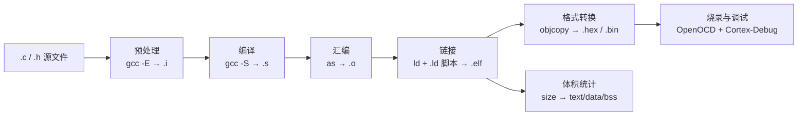
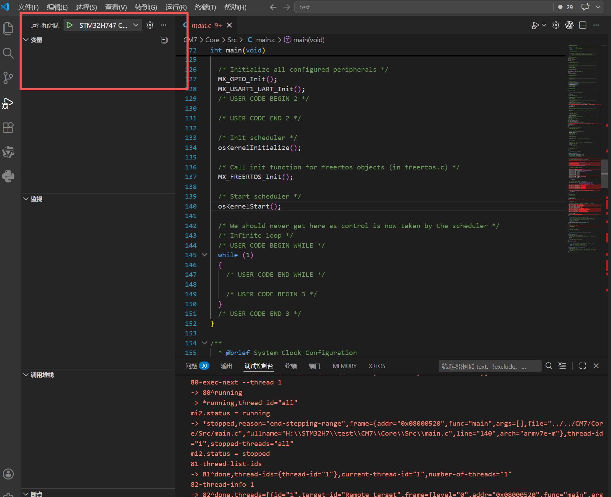

# 环境搭建与工具链排错（Windows）

> 芯片：STM32H747 / H757（双核 CM7 + CM4）
> 教程对应：**1.3 Makefile 环境搭建流程** · **1.4 调试环境配置**（另含 1.1 编译流程作为背景）
> 所属块：[00 工具链与工程构建](../index.md)｜版本回填处：[块首页环境基线表](../index.md)
> 更新日期：{{ git_revision_date_localized }}

---

## 一句话结论

教程 1.3 / 1.4 给了"能跑"的步骤，但**没给版本约束，也没提 Windows 特有坑**——而这两类问题恰恰是第一次搭建卡住时间最长的（我自己在 GCC 版本上就栽过一次）。本文按 **工具清单 → 版本兼容 → 6 个坑 → SOP → 验收清单** 重写，目标只有一个：**能编译 → 能烧录 → 能断点**。

## 1. 背景：一次构建到底发生了什么



每一步对应一类工具，全部来自 `arm-none-eabi` 工具链（除烧录）。**关键点**：决定 `.ld` 链接脚本语法兼容性的是 **binutils（`arm-none-eabi-as` / `arm-none-eabi-ld`）**，不是 gcc 前端版本号——"版本过低"的报错大多出自这里（第 3 节）。

## 2. 工具清单与安装

> 教程 1.3 / 1.4 的安装步骤只在飞书文档里（**需授权才能访问**），所以本文把可复制的完整命令落到 wiki，保证**自包含**：即使教程链接失效，照着本文也能把环境搭起来。

### 2.1 工具清单与来源

| 工具 | 用途 | 教程来源（1.3） | 官方 / 替代 | 备注 |
|------|------|----------------|-------------|------|
| arm-none-eabi-gcc | 交叉编译（gcc / g++ / as / ld / objcopy / size / gdb 全家桶） | [xPack GNU Arm Embedded GCC](https://xpack-dev-tools.github.io/arm-none-eabi-gcc-xpack/docs/install/) | [Arm GNU Toolchain](https://developer.arm.com/downloads/-/arm-gnu-toolchain-downloads)（zip 托管在 [gitlab.arm.com](https://gitlab.arm.com/tooling/gnu-toolchains-for-arm)，解压加 PATH） | **版本必须与 CubeMX 生成的 `.ld` 兼容**（第 3 节） |
| make | 执行 Makefile | [ezwinports](https://sourceforge.net/projects/ezwinports/)（解压即用） | MSYS2 / Git for Windows 自带 | Windows 下注意同名冲突（坑 6） |
| Git for Windows 或 MSYS2 | 提供 `rm` 等 Unix 命令 | 教程未提，**实际必装** | [Git for Windows](https://git-scm.com/download/win) / [MSYS2](https://www.msys2.org/) | `make clean` 依赖 `rm`（坑 1） |
| OpenOCD | 调试 / 烧录 server | xPack OpenOCD（教程用 0.12.0） | xPack / 官方 | 目标脚本 `target/stm32h7x_dual_bank.cfg`（双核配 `set DUAL_CORE 1`）；接口脚本按探针选（DAP-Link → `cmsis-dap.cfg`、ST-Link → `stlink.cfg`） |
| VS Code + Cortex-Debug | 编辑 + 调试前端 | VS Code + 插件市场 | [Cortex-Debug](https://marketplace.visualstudio.com/items?itemName=marus25.cortex-debug) | `tasks.json` / `launch.json` 字段查[属性文档](https://github.com/Marus/cortex-debug/blob/master/debug_attributes.md) |
| STM32CubeProgrammer（可选） | 命令行烧录 / 读写 Option Bytes | 教程未提 | [ST 官网](https://www.st.com/en/development-tools/stm32cubeprog.html) | 救砖、批量烧录、读 Option Bytes |

### 2.2 逐步安装（Windows，命令可直接复制）

> 全部在**普通 PowerShell**里执行；winget 源里包的可用性随版本/镜像变化，**先 `search` 再 `install`，命令里的 ID 以你机器上的搜索结果为准**。

**① winget 自检**

```powershell
winget --version        # 无输出 → 去微软商店更新"应用安装程序"
```

**② arm-none-eabi-gcc**（xPack 官方推荐 xpm 路线，与教程 1.3 一致）

```powershell
winget install --id OpenJS.NodeJS.LTS -e --accept-source-agreements --accept-package-agreements
npm install --global xpm
xpm install @xpack-dev-tools/arm-none-eabi-gcc@latest --global --verbose
```

备选 A（不装 Node，xPack zip）：从 [xPack 安装页](https://xpack-dev-tools.github.io/arm-none-eabi-gcc-xpack/docs/install/)下载 zip，解压到固定目录（例如教程示例的 `D:\Tools\xpack-arm-none-eabi-gcc`），把其 `bin` 加入 PATH。

备选 B（**Arm 官方 GNU Toolchain**，同样是"下载 zip → 解压 → bin 加 PATH"）：[gitlab.arm.com/tooling/gnu-toolchains-for-arm](https://gitlab.arm.com/tooling/gnu-toolchains-for-arm) 是 Arm 官方发布空间（原 developer.arm.com 下载页的托管位置）——进入对应 `releases/<版本>` 分支 → 下载 Windows 版 `arm-gnu-toolchain-<版本>-mingw-*.zip` → 解压到固定目录 → `bin` 加入 PATH。版本按需选择，**注意与 CubeMX 生成的 `.ld` 兼容**（第 3 节）。

**③ make**

```powershell
winget search --query make      # 先看你机器上的 winget 源提供哪些 make
```

- 教程路线：[ezwinports](https://sourceforge.net/projects/ezwinports/) 下载 `make-4.x-without-guile-w32-bin.zip`，解压到 `D:\Tools\make`（教程示例路径），把 `bin` 加入 PATH；
- 备选：MSYS2 里 `pacman -S make`。

**④ Unix 命令行工具（`make clean` 依赖 `rm`）**

```powershell
winget install --id Git.Git -e --accept-source-agreements --accept-package-agreements
```

Git 自带的 `usr\bin` 提供 `rm` / `bash`（坑 1 的直接对策）；MSYS2（`winget install --id MSYS2.MSYS2 -e` 或 [官网](https://www.msys2.org/)）同样可用。**装完必须新开终端**，PATH 才会生效。

**⑤ OpenOCD**（教程 1.4 原文步骤，逐条保留）

1. 打开 PowerShell
2. 检查 winget 是否可用：`winget --version`
3. 搜索 OpenOCD：`winget search --query openocd --accept-source-agreements`
4. 安装：`winget install --id xpack-dev-tools.openocd-xpack --exact --accept-source-agreements --accept-package-agreements --disable-interactivity`
5. 安装完成后，关闭当前 PowerShell 和 VS Code
6. 重新打开 PowerShell，验证安装：`openocd --version`
7. 能看到版本号即安装成功

> 💡 若 `openocd` 只在旧终端里找不到、VS Code 里也起不来：把 `openocd.exe` 的**完整路径**填进 `launch.json` 的 `serverpath`（教程 1.4 的坑，细节归 04 篇）。

**⑥ VS Code + Cortex-Debug**

```powershell
winget install --id Microsoft.VisualStudioCode -e --accept-source-agreements --accept-package-agreements
code --install-extension marus25.cortex-debug
```

**⑦（可选）STM32CubeProgrammer**——命令行烧录、读写 Option Bytes（救砖 / 量产），从 [ST 官网](https://www.st.com/en/development-tools/stm32cubeprog.html)安装。

### 2.3 装完自检

装完先跑四条命令，这是后面所有排错的前提（也是[环境基线表](../index.md)要回填的内容）：

```powershell
arm-none-eabi-gcc --version    # gcc 前端版本
arm-none-eabi-ld --version     # ★ binutils 版本：.ld 兼容性看它
make --version                 # 确认是自己期望的那份 make
openocd --version
```

再加一条 `where make` / `where openocd`，看**实际命中**的是哪一份（对应第 4 节坑 6）。

## 3. 版本兼容：最容易翻车的地方

| 现象 | 触发条件（实测） | 判断方法 | 对策 |
|------|------------------|----------|------|
| `ld: xxx_FLASH.ld:105: non constant or forward reference address expression for section .ARM.extab` | **GCC 10.3** + **新版 CubeMX** 生成的 `.ld`（F103 工程实测；H747 同理） | 报错前缀是 `ld.exe` 且定位到 `.ld` 的行号 → 是**链接脚本语法 vs binutils 版本**问题，不是 C 代码问题 | A. 升级工具链到更新的 binutils（首选，本次成功方案）；B. 打开 `.ld` 删除新语法关键字先跑通 |

> ⚠️ 机制待复核：该报错通常归因于新版 `.ld` 使用了较新 binutils 才支持的输出段关键字（如 `(READONLY)`）。复核方法：`grep -n "READONLY" xxx.ld` + `arm-none-eabi-ld --version` 对照；**复核后把结论定稿到本表**。

**操作原则**：

1. 工具链版本不追求"最新/最旧"，而是**与 CubeMX 版本配对**；换芯片系列（F1 → H7）或升级 CubeMX 后，先重跑一遍"编译 → 烧录 → 断点"再动业务代码。
2. `arm-none-eabi-gcc --version` 和 `arm-none-eabi-ld --version` **两个版本都记录**（bis 决定 `.ld`，gcc 决定 C 语法/优化行为）。
3. 报错定位口诀：**看最后一段报错 → 是 ld 还是 gcc → 定位文件与行号 → 查该行语法是否属于你的工具链版本**。

## 4. Windows 特有坑（6 个，全部实测过）

### 坑 1：`make clean` 报 `CreateProcess failed`（找不到 `rm`）

- **现象**：执行 `make clean` 时 `rm -fR $(BUILD_DIR)` 报 `CreateProcess(rm, …) failed` / "系统找不到指定的文件"。
- **原因**：CubeMX 生成的 Makefile 是跨平台 Linux 语法，`clean` 目标直接调 `rm`；Windows 原生没有 `rm`（只有 `rd` / `del` / `rmdir`）。
- **对策**（三选一）：
  1. **推荐：改 Makefile**，把 `clean` 换成 Windows 原生命令——零依赖、不用装 Git Bash（展开下面的折叠块）；
  2. 装 Git for Windows / MSYS2 并确保其 `usr\bin` 在 PATH，`rm` 可用后 `make clean` 保持原样；
  3. 手动删（临时救急，PowerShell）：

     ```powershell
     Remove-Item -Recurse -Force .\CM7\build   # 双核工程两个 build 都要删
     ```

??? tip "零依赖改法：把 clean 的 rm 换成 Windows 原生命令"

    CubeMX 默认生成的 `clean`（纯 Windows 环境必然失败）：

    ```makefile
    clean:
    	-rm -fR $(BUILD_DIR)
    ```

    改成：

    ```makefile
    clean:
    	-rmdir /S /Q $(BUILD_DIR)
    ```

    - `rmdir /S /Q`：cmd.exe 原生命令——`/S` 递归删除目录树、`/Q` 静默模式，**零依赖**；
    - 行首 `-`：忽略该命令的报错——`build/` 不存在时 `rmdir` 会失败，忽略后 `make clean` 仍算成功；
    - 定位要改的行：`Select-String -Path .\Makefile -Pattern 'clean:' -Context 0,2`；若你的模板走的是 `$(RM)` 变量（`Select-String -Path .\Makefile -Pattern 'RM '`），改那一处也可以。

    > ⚠️ 一个例外要实测：如果 PATH 里有 `sh.exe`（装过 Git Bash / MSYS2），make 会改用 sh 执行命令，此时 `rmdir /S /Q` 会命中 Unix 的 `rmdir`（只删空目录）→ 加上行首 `-` 就是"**看似成功、实际没删**"。判断方法：`make clean` 后看 `build/` 是否真的消失；是这种情况就回退 `rm -fR`（此时 `rm` 已可用），或先确认 `where sh` 无结果。

### 坑 2：`Nothing to be done for 'all'` + `input file 'xxx.elf' is empty`

- **现象**：make 提示"无事可做"；objcopy 报 `build/xxx.elf` 为空（0 字节）。
- **原因**：make 按**时间戳**判断是否重编——上次失败残留的 0 字节 `.elf` 比源文件新，make 认为"已编译过"，跳过编译直接 objcopy。
- **对策**：彻底删除 `build/`（失败过的 `clean` 不能信）；成功后**必须检查 `.elf` 大小非 0**（写进 SOP）。

### 坑 3：删除 `build/` 报"文件正由另一进程使用"

- **原因**：`make.exe` / `arm-none-eabi-gcc.exe` / `openocd.exe` 进程残留，或 VS Code 调试会话未结束、插件后台进程锁定文件。
- **对策**：`Shift + F5` 停止调试 → 关闭 VS Code → 任务管理器结束上述进程 → 再删。

### 坑 4：链接报 `.ARM.extab` 语法错误

即第 3 节的版本兼容问题，是这条链路上**最核心的坑**：编译（`.c → .o`）全过、只在链接（`.o → .elf`）失败，就要立刻怀疑 `.ld` 语法与 binutils 版本不匹配，而不是回头改 C 代码。

### 坑 5：`make -j16` 输出交错，看起来"编译乱了"

- **现象**：日志里命令被截断/拼接（如 `Core/Src/stm32f1xx_hal_msc -o build/stm32f1xx_hal_msp.o` 两条命令粘在一起）。
- **原因**：多进程并行时多个编译命令的输出**交错写进同一个终端**；H7 双核工程文件多，更容易发生。
- **对策**：**首次构建用单线程**（`make all` 不加 `-j`）——目的是排除输出干扰、暴露真实依赖错误；确认能整体编过后再加并行提速（`make -j`，需要整洁日志时加 `-O` / `--output-sync`）。

### 坑 6：`make` 与 `make32` 到底哪个在跑

- **现象**：机器上 `make` 可能指向 MinGW 的 `mingw32-make`，`make32` 是别名/另一份 make（如 ezwinports）——不同终端 PATH 不同，行为就可能不同。
- **对策**：`where make` 看 PATH 顺序、`make --version` 看来源版本；**固定用哪一份后写进环境基线表**，不要混用。

## 5. SOP：每次改完代码后的标准动作

1. **清**：手动删 `build/`（双核工程每个核的 build 都要删）——最稳的 clean；
2. **编**：单线程 `make all`，观察结尾是否输出 `arm-none-eabi-size` 的 text / data / bss 统计；
3. **验**：`build/*.elf` 存在且大小合理（几十 KB 量级），`.hex` / `.bin` 已生成；
4. **烧**：VS Code 按 `F5` 启动 Cortex-Debug；双核工程确认调试的是目标核（下图）；
5. **排**：异常时回到第 4 节按"现象 → 原因 → 对策"对照。



> 图源：教程 1.4——VS Code 调试面板中可选择对应的核心（CM7 / CM4）进行调试

## 6. 验收清单

- [ ] 四个版本（gcc / **ld** / make / openocd）已回填[块首页环境基线表](../index.md)
- [ ] 手动删 build → 单线程编译 → `.elf` 非 0 且 `.hex` / `.bin` 生成
- [ ] `F5` 断点命中；双核下能分别调试 CM7 / CM4
- [ ] `make clean` 可用（`rm` 就位）或已替换为 Windows 等价命令
- [ ] 第 3 节"机制待复核"项已查证并定稿

## 7. 关联与参考文献

- 上一篇：[01 CubeMX 五种工程形态对比](01_CubeMX五种工程形态对比.md)｜下一篇（计划中）：**03 Makefile 工程逐段解剖与手改指南**
- 同块：[块首页](../index.md)（环境基线表 + 篇目清单）

**参考文献**

- [GNU Make 手册](https://www.gnu.org/software/make/manual/)——`-j` / `-O` 语义、时间戳判断规则
- [GNU binutils 文档（ld）](https://sourceware.org/binutils/docs/ld/)——`.ld` 语法；判断报错是否版本问题
- [Cortex-Debug 全部可用属性](https://github.com/Marus/cortex-debug/blob/master/debug_attributes.md) · [OpenOCD User's Guide](https://openocd.org/doc/html/index.html)
- [Git for Windows](https://git-scm.com/download/win) · [MSYS2](https://www.msys2.org/) · [ezwinports make](https://sourceforge.net/projects/ezwinports/) · [xPack GCC](https://xpack-dev-tools.github.io/arm-none-eabi-gcc-xpack/docs/install/) · [Arm GNU Toolchain](https://developer.arm.com/downloads/-/arm-gnu-toolchain-downloads)
- 教程：[1.1 什么是 Makefile](https://i1ggz3h8own.feishu.cn/wiki/QHU6wyUkuiYeajknjHccwiJunag#PV5SdvtifoHtpdxxa0GchsUQnVe) · [1.2 为什么用 Makefile](https://i1ggz3h8own.feishu.cn/wiki/QHU6wyUkuiYeajknjHccwiJunag#KXW9d0707ofAcBxGNd9ccACnnSb) · [1.3 环境搭建流程](https://i1ggz3h8own.feishu.cn/wiki/QHU6wyUkuiYeajknjHccwiJunag#HqEkdxuB3or1gWxTBs3czvQKnfg) · [1.4 调试环境配置](https://i1ggz3h8own.feishu.cn/wiki/QHU6wyUkuiYeajknjHccwiJunag#GoAZdqhDuoFLW7xWrKscjuNTn2d)