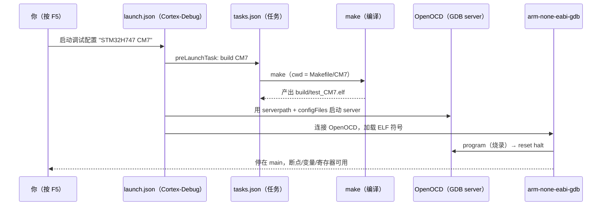

# 调试与烧录链路（Cortex-Debug 从零配置）

> 芯片：STM32H747 / H757（双核 CM7 + CM4）｜调试器：DAP-Link（CMSIS-DAP）
> 教程对应：**1.4 调试环境配置** · 18 调试技巧（map / 断点 / 反汇编部分）
> 所属块：[00 工具链与工程构建](../index.md)｜上一篇：[03 Makefile 工程逐段解剖与手改指南](03_Makefile工程逐段解剖与手改指南.md)
> 更新日期：{{ git_revision_date_localized }}

---

## 一句话结论

调试链路就是**两个文件的分工**：

- **`tasks.json` = 手脚**：执行外部命令（`make` 编译、`openocd` 烧录），自己不懂调试；
- **`launch.json` = 大脑**：告诉 Cortex-Debug 怎么连、调哪个核、加载哪个 ELF 的符号、寄存器视图用哪个 SVD；
- **`preLaunchTask` 是唯一的接口**：把"编译任务"的名字填进调试配置，于是 `F5` 就等于"编译 → 连接 → 烧录 → 停在 `main`"。

> 📌 **本文完整收录教程 1.4 的两份配置文件原文**（4 个任务 + 5 套调试配置，可直接复制使用），字段解释与排错表作为补充。唯一需要你替换的是 **OpenOCD 的绝对路径**（教程原文是作者机器上的路径，用 `where openocd` 查你自己的）。

## 1. 分工与数据流



| 组件 | 角色 | 配置文件 | 官方文档（字段权威） |
|------|------|----------|----------------------|
| VS Code 任务系统 | 跑外部命令 | `tasks.json` | [VS Code Tasks](https://code.visualstudio.com/docs/editor/tasks) |
| VS Code 调试系统 | 调试会话机制 | `launch.json` | [VS Code Debugging](https://code.visualstudio.com/docs/editor/debugging) |
| Cortex-Debug 插件 | GDB 前端（读 `launch.json`） | `launch.json` | [全部可用属性](https://github.com/Marus/cortex-debug/blob/master/debug_attributes.md) |
| OpenOCD | GDB server + 烧录器 | `interface/*.cfg`、`target/*.cfg` | [OpenOCD User's Guide](https://openocd.org/doc/html/index.html) |

## 2. `.vscode/tasks.json`（手脚）

> 作用（教程原文）：**调试前自动编译工程**。

### 2.1 完整文件（教程 1.4 原样）

```json
{
  "version": "2.0.0",
  "tasks": [
    {
      "label": "build CM7",
      "type": "shell",
      "command": "make",
      "args": [],
      "options": {
        "cwd": "${workspaceFolder}/Makefile/CM7"
      },
      "group": {
        "kind": "build",
        "isDefault": true
      },
      "problemMatcher": []
    },
    {
      "label": "build CM4",
      "type": "shell",
      "command": "make",
      "args": [],
      "options": {
        "cwd": "${workspaceFolder}/Makefile/CM4"
      },
      "problemMatcher": []
    },
    {
      "label": "flash CM7",
      "type": "shell",
      "command": "C:/Users/<你的用户名>/AppData/Local/Microsoft/WinGet/Packages/xpack-dev-tools.openocd-xpack_Microsoft.Winget.Source_8wekyb3d8bbwe/xpack-openocd-0.12.0-7/bin/openocd.exe",
      "args": [
        "-s",
        "C:/Users/<你的用户名>/AppData/Local/Microsoft/WinGet/Packages/xpack-dev-tools.openocd-xpack_Microsoft.Winget.Source_8wekyb3d8bbwe/xpack-openocd-0.12.0-7/scripts",
        "-f",
        "interface/cmsis-dap.cfg",
        "-f",
        "target/stm32h7x_dual_bank.cfg",
        "-c",
        "set DUAL_CORE 1",
        "-c",
        "init",
        "-c",
        "reset halt",
        "-c",
        "program Makefile/CM7/build/test_CM7.elf verify",
        "-c",
        "reset run",
        "-c",
        "shutdown"
      ],
      "options": {
        "cwd": "${workspaceFolder}"
      },
      "problemMatcher": []
    },
    {
      "label": "flash CM4",
      "type": "shell",
      "command": "C:/Users/<你的用户名>/AppData/Local/Microsoft/WinGet/Packages/xpack-dev-tools.openocd-xpack_Microsoft.Winget.Source_8wekyb3d8bbwe/xpack-openocd-0.12.0-7/bin/openocd.exe",
      "args": [
        "-s",
        "C:/Users/<你的用户名>/AppData/Local/Microsoft/WinGet/Packages/xpack-dev-tools.openocd-xpack_Microsoft.Winget.Source_8wekyb3d8bbwe/xpack-openocd-0.12.0-7/scripts",
        "-f",
        "interface/cmsis-dap.cfg",
        "-f",
        "target/stm32h7x_dual_bank.cfg",
        "-c",
        "set DUAL_CORE 1",
        "-c",
        "init",
        "-c",
        "reset halt",
        "-c",
        "program Makefile/CM4/build/test_CM4.elf verify",
        "-c",
        "reset run",
        "-c",
        "shutdown"
      ],
      "options": {
        "cwd": "${workspaceFolder}"
      },
      "problemMatcher": []
    }
  ]
}
```

> ⚠️ 两处要改成你自己的：`command` 与 `-s` 后面的 **OpenOCD 绝对路径与 scripts 目录**（`where openocd`；查不到就去 `C:\Users\<用户名>\AppData\Local\Microsoft\WinGet\Packages\` 里找，这是教程 1.4 的坑）。烧录目标文件名 `test_CM7.elf` / `test_CM4.elf` 对应 CubeMX 工程名 `test`，换成你的工程名。

### 2.2 字段逐个解释

| 字段 | 作用 | 常见取值 |
|------|------|----------|
| `label` | 任务名，**`preLaunchTask` 靠它引用** | 任意唯一字符串 |
| `type` | 任务类型，跑外部程序用 `shell` | `shell` |
| `command` + `args` | 真正的命令与参数（分开写，避免引号转义地狱） | `make` / `openocd.exe` 绝对路径 |
| `options.cwd` | 命令的工作目录（**决定 Makefile 里相对路径的基准**） | `${workspaceFolder}/Makefile/CM7` |
| `group.kind: build` | 标记为"构建任务"：可被 `Ctrl+Shift+B` 触发、可被 `preLaunchTask` 默认选择 | `build` |
| `problemMatcher` | 从输出提取错误 → 问题面板（教程留空即可用；可选改进见 6.2） | `[]` |

### 2.3 `openocd` 参数逐条解释（烧录标准流程）

| 参数 | 含义 |
|------|------|
| `-s <scripts 目录>` | 指定 OpenOCD 脚本搜索路径（xPack 安装目录下的 `scripts/`），找不到 `interface/target` 脚本时必需 |
| `-f interface/cmsis-dap.cfg` | 调试器接口：**DAP-Link 用 `cmsis-dap.cfg`** |
| `-f target/stm32h7x_dual_bank.cfg` | 目标芯片脚本；**双 Bank Flash 用 `_dual_bank` 变体** |
| `-c "set DUAL_CORE 1"` | 告诉目标脚本这是双核 H7（**必须在 `init` 之前**） |
| `-c init` | 初始化探针与目标 |
| `-c "reset halt"` | 复位后立即停住（保证可写 Flash） |
| `-c "program <elf> verify"` | 烧录并校验 |
| `-c "reset run"` / `-c shutdown` | 复位运行、关闭 server |

## 3. `.vscode/launch.json`（大脑）

> 作用（教程原文）：**配置 Cortex-Debug**。

### 3.1 调试器接口的选择（按你的探针改）

教程原文：

> 你现在用的是 **DAP-Link**，所以接口文件要用 `interface/cmsis-dap.cfg`；
> 若用 **ST-LINK**，则要修改接口文件为 `interface/stlink.cfg`。

即两份文件里的 `interface/*.cfg` 与 `configFiles[0]` **必须同步替换**（tasks.json 和 launch.json 都要改），目标脚本不动。

### 3.2 完整文件（教程 1.4 原样，5 套配置）

```json
{
  "version": "0.2.0",
  "configurations": [
    {
      "name": "STM32H747 CM7",
      "cwd": "${workspaceFolder}",
      "executable": "${workspaceFolder}/Makefile/CM7/build/test_CM7.elf",
      "request": "launch",
      "type": "cortex-debug",
      "servertype": "openocd",
      "serverpath": "C:/Users/<你的用户名>/AppData/Local/Microsoft/WinGet/Packages/xpack-dev-tools.openocd-xpack_Microsoft.Winget.Source_8wekyb3d8bbwe/xpack-openocd-0.12.0-7/bin/openocd.exe",
      "device": "STM32H747XIHx",
      "interface": "swd",
      "configFiles": [
        "interface/cmsis-dap.cfg",
        "target/stm32h7x_dual_bank.cfg"
      ],
      "searchDir": [
        "C:/Users/<你的用户名>/AppData/Local/Microsoft/WinGet/Packages/xpack-dev-tools.openocd-xpack_Microsoft.Winget.Source_8wekyb3d8bbwe/xpack-openocd-0.12.0-7/scripts"
      ],
      "runToEntryPoint": "main",
      "preLaunchTask": "build CM7",
      "showDevDebugOutput": "raw",
      "postRestartCommands": [
        "monitor reset halt"
      ]
    },
    {
      "name": "STM32H747 CM7 Flash Only",
      "cwd": "${workspaceFolder}",
      "executable": "${workspaceFolder}/Makefile/CM7/build/test_CM7.elf",
      "request": "launch",
      "type": "cortex-debug",
      "servertype": "openocd",
      "serverpath": "C:/Users/<你的用户名>/AppData/Local/Microsoft/WinGet/Packages/xpack-dev-tools.openocd-xpack_Microsoft.Winget.Source_8wekyb3d8bbwe/xpack-openocd-0.12.0-7/bin/openocd.exe",
      "device": "STM32H747XIHx",
      "interface": "swd",
      "configFiles": [
        "interface/cmsis-dap.cfg",
        "target/stm32h7x_dual_bank.cfg"
      ],
      "searchDir": [
        "C:/Users/<你的用户名>/AppData/Local/Microsoft/WinGet/Packages/xpack-dev-tools.openocd-xpack_Microsoft.Winget.Source_8wekyb3d8bbwe/xpack-openocd-0.12.0-7/scripts"
      ],
      "preLaunchTask": "build CM7",
      "showDevDebugOutput": "raw",
      "runToEntryPoint": "main",
      "postLaunchCommands": [
        "monitor reset run",
        "disconnect"
      ]
    },
    {
      "name": "STM32H747 CM4",
      "cwd": "${workspaceFolder}",
      "executable": "${workspaceFolder}/Makefile/CM4/build/test_CM4.elf",
      "request": "launch",
      "type": "cortex-debug",
      "servertype": "openocd",
      "serverpath": "C:/Users/<你的用户名>/AppData/Local/Microsoft/WinGet/Packages/xpack-dev-tools.openocd-xpack_Microsoft.Winget.Source_8wekyb3d8bbwe/xpack-openocd-0.12.0-7/bin/openocd.exe",
      "device": "STM32H747XIHx",
      "interface": "swd",
      "configFiles": [
        "interface/cmsis-dap.cfg",
        "target/stm32h7x_dual_bank.cfg"
      ],
      "searchDir": [
        "C:/Users/<你的用户名>/AppData/Local/Microsoft/WinGet/Packages/xpack-dev-tools.openocd-xpack_Microsoft.Winget.Source_8wekyb3d8bbwe/xpack-openocd-0.12.0-7/scripts"
      ],
      "runToEntryPoint": "main",
      "preLaunchTask": "build CM4",
      "showDevDebugOutput": "raw",
      "postRestartCommands": [
        "monitor reset halt"
      ]
    },
    {
      "name": "STM32H747 CM4 Flash Only",
      "cwd": "${workspaceFolder}",
      "executable": "${workspaceFolder}/Makefile/CM4/build/test_CM4.elf",
      "request": "launch",
      "type": "cortex-debug",
      "servertype": "openocd",
      "serverpath": "C:/Users/<你的用户名>/AppData/Local/Microsoft/WinGet/Packages/xpack-dev-tools.openocd-xpack_Microsoft.Winget.Source_8wekyb3d8bbwe/xpack-openocd-0.12.0-7/bin/openocd.exe",
      "device": "STM32H747XIHx",
      "interface": "swd",
      "configFiles": [
        "interface/cmsis-dap.cfg",
        "target/stm32h7x_dual_bank.cfg"
      ],
      "searchDir": [
        "C:/Users/<你的用户名>/AppData/Local/Microsoft/WinGet/Packages/xpack-dev-tools.openocd-xpack_Microsoft.Winget.Source_8wekyb3d8bbwe/xpack-openocd-0.12.0-7/scripts"
      ],
      "preLaunchTask": "build CM4",
      "showDevDebugOutput": "raw",
      "runToEntryPoint": "main",
      "postLaunchCommands": [
        "monitor reset run",
        "disconnect"
      ]
    },
    {
      "name": "STM32H747 CM4 Attach",
      "cwd": "${workspaceFolder}",
      "executable": "${workspaceFolder}/Makefile/CM4/build/test_CM4.elf",
      "request": "attach",
      "type": "cortex-debug",
      "servertype": "openocd",
      "serverpath": "C:/Users/<你的用户名>/AppData/Local/Microsoft/WinGet/Packages/xpack-dev-tools.openocd-xpack_Microsoft.Winget.Source_8wekyb3d8bbwe/xpack-openocd-0.12.0-7/bin/openocd.exe",
      "device": "STM32H747XIHx",
      "interface": "swd",
      "configFiles": [
        "interface/cmsis-dap.cfg",
        "target/stm32h7x_dual_bank.cfg"
      ],
      "searchDir": [
        "C:/Users/<你的用户名>/AppData/Local/Microsoft/WinGet/Packages/xpack-dev-tools.openocd-xpack_Microsoft.Winget.Source_8wekyb3d8bbwe/xpack-openocd-0.12.0-7/scripts"
      ],
      "numberOfProcessors": 2,
      "targetProcessor": 1,
      "openOCDPreConfigLaunchCommands": [
        "set DUAL_CORE 1"
      ],
      "postLaunchCommands": [
        "monitor halt"
      ],
      "showDevDebugOutput": "raw"
    }
  ]
}
```

### 3.3 字段逐个解释

| 字段 | 作用 | 备注 |
|------|------|------|
| `serverpath` | **OpenOCD 可执行文件路径** | 必须能定位到；`where openocd` 查不到就去 `WinGet\Packages\` 里找 |
| `searchDir` | OpenOCD 脚本搜索目录 | 等价于命令行的 `-s` |
| `executable` | **要调试的 ELF**（符号 + 断点 + 变量来源） | 调试哪个核就指哪个核的产物 |
| `configFiles` | 同 tasks.json 的两个 cfg | 双核需要 `set DUAL_CORE 1`（放 `openOCDPreConfigLaunchCommands`） |
| `device` / `interface` | 目标型号 / SWD 或 JTAG | 主供 J-Link 等 server 使用，OpenOCD 下保留无害 |
| `runToEntryPoint` | 启动后运行到的位置 | 填 `main`：F5 后直接停在主函数 |
| `preLaunchTask` | **调试前自动跑的任务名** | 必须与 tasks.json 的 `label` 完全一致 |
| `postRestartCommands` | 点"重启"时的附加命令 | `monitor reset halt` 保证每次重启都停在复位态 |
| `postLaunchCommands` | 启动完成后执行 | 用于 "Flash Only"（烧完就跑并断开） |
| `openOCDPreConfigLaunchCommands` | OpenOCD `init` 之前的命令 | 双核 Attach 时放 `set DUAL_CORE 1` |
| `numberOfProcessors` / `targetProcessor` | 多核选择 | 教程 CM4 Attach 用 `2` / `1`（含义以属性文档为准） |
| `showDevDebugOutput` | 打印 GDB 交互 | 排错时开 `raw`，平时可关 |
| `svdFile`（教程未配，可选） | 外设寄存器视图的数据源 | SVD 来自 CMSIS 设备包（`Keil.STM32H7xx_DFP` 内含 `STM32H747xI.svd`） |

### 3.4 五套配置的用途（为什么需要这么多）

| 配置名 | request | 用途 | 关键字段 |
|--------|---------|------|----------|
| `STM32H747 CM7` | `launch` | 日常调试 CM7 | `preLaunchTask: build CM7`、`runToEntryPoint: main` |
| `STM32H747 CM7 Flash Only` | `launch` | 只烧录不调试（烧完就跑） | `postLaunchCommands: ["monitor reset run","disconnect"]` |
| `STM32H747 CM4` | `launch` | 调试 CM4（先由 CM7 启动它） | `executable` 指 CM4、`preLaunchTask: build CM4` |
| `STM32H747 CM4 Flash Only` | `launch` | 只烧 CM4 | 同上 |
| `STM32H747 CM4 Attach` | **`attach`** | **附到已经在运行的 CM4**（不停机、不下载） | `numberOfProcessors: 2`、`targetProcessor: 1`、`openOCDPreConfigLaunchCommands: ["set DUAL_CORE 1"]`、`postLaunchCommands: ["monitor halt"]` |

**双核调试的姿势**（H7 关键机制）：CM4 上电后由 CM7 启动（取决于 `BCM4` 选项位与 CM7 里的启动代码），所以调试 CM4 常用两种方式：

1. **launch CM4**：正常启动调试，但要求 CM7 已在运行并释放了 CM4（否则 CM4 停在复位、断点无意义）；
2. **attach CM4**：让 CM7 先把系统跑起来，再附上去——这就是 `STM32H747 CM4 Attach` 存在的原因。

## 4. 从零搭建的顺序（先跑通，再理解）

1. **先命令行验证硬件链路**：`openocd -s <scripts> -f interface/cmsis-dap.cfg -f target/stm32h7x_dual_bank.cfg -c "set DUAL_CORE 1" -c init -c "reset halt"`——能识别目标，才轮到 VS Code；
2. **套用 tasks.json**：先只留 `build CM7`，`Ctrl+Shift+B` 能编过、产物非 0；
3. **套用 launch.json 的 `STM32H747 CM7`**：F5 能停在 `main`；
4. **补齐 flash 任务与 CM4 的 4 套配置**：双核都能烧、能调、能 attach；
5. **最后加增强项**：`svdFile`（寄存器视图）、`showDevDebugOutput` 平时关掉、RTT 按需。

## 5. 常见报错 → 定位

| 症状 | 大概率原因 | 对策 |
|------|-----------|------|
| 启动即失败：找不到 OpenOCD | `serverpath` 路径错 | `where openocd` 查真实路径并替换（两份文件都要改） |
| `Error: open failed` / `init mode failed` | 接口文件选错（ST-Link 用了 cmsis-dap.cfg 等）、接线、目标未供电 | 换 `interface/*.cfg`；`-c init` 单独跑一次看报错 |
| 找不到 GDB / 无符号 | 工具链 `bin` 不在 PATH | 设 `armToolchainPath`（字段名以[属性文档](https://github.com/Marus/cortex-debug/blob/master/debug_attributes.md)为准） |
| 断点是灰的、不命中 | ELF 与芯片里的固件不一致；或编译没成功 | 先看 `preLaunchTask` 输出；确认 `build/` 下 ELF 是新的 |
| 变量显示 `<optimized out>` | 优化等级过高 | 调试构建用 `-Og`（[03 篇 2.3](03_Makefile工程逐段解剖与手改指南.md)） |
| 外设寄存器窗口空白 | 没配 `svdFile` | 指向 `STM32H747xI.svd` |
| CM4 断点无反应 | CM4 未启动（由 CM7 释放） | 先用 CM7 跑起来 → 用 `CM4 Attach` 配置 |
| 一按 F5 就报错但看不懂 | GDB 交互被隐藏 | `showDevDebugOutput: "raw"`（教程已默认开） |

## 6. 可选改进（不影响跑通，按需采用）

### 6.1 减少硬编码路径

`C:/Users/<你的用户名>/...` 可以写成 `C:/Users/${env:USERNAME}/...`（VS Code 支持环境变量替换），避免换机器时报错。

### 6.2 让编译错误可点击

把 tasks.json 里两个 build 任务的 `"problemMatcher": []` 换成 `["$gcc"]`：编译错误会进"问题"面板、双击跳转到源码行。

### 6.3 OpenOCD 在 PATH 里时的简化写法

若 `openocd` 已加入 PATH，`command` 可直接写 `"openocd"`、并去掉 `-s <scripts 目录>`（`searchDir` 同理可省）——但**教程用绝对路径是有原因的**（GUI 环境的 PATH 与终端不一致），推荐保持原样。

## 7. 命令行烧录（不开 IDE，批量/CI 用）

```powershell
# 方案 A：STM32_Programmer_CLI（ST 官方，读 Option Bytes / 批量也用它）
STM32_Programmer_CLI -c port=SWD -w build/test_CM7.hex -v --start

# 方案 B：OpenOCD（与调试链路同源）
openocd -s <scripts 目录> -f interface/cmsis-dap.cfg -f target/stm32h7x_dual_bank.cfg `
  -c "set DUAL_CORE 1" -c init -c "reset halt" `
  -c "program Makefile/CM7/build/test_CM7.elf verify" -c "reset run" -c shutdown
```

## 8. 待实测清单

- [ ] 把两份文件里的 `<你的用户名>` 换成实际路径后，`build CM7` + `STM32H747 CM7` 全流程跑通
- [ ] `svdFile` 就位后，外设寄存器视图能出值
- [ ] CM4 单独调试必须用 `attach`？（记录 CM7 未释放 CM4 时的现象）
- [ ] 可选改进 6.1 / 6.2 逐项验证
- [ ] 确认本板调试器（DAP-Link 还是 ST-Link？——决定 `interface/*.cfg`）

## 9. 关联与参考文献

- 上一篇：[03 Makefile 工程逐段解剖与手改指南](03_Makefile工程逐段解剖与手改指南.md)｜[01 篇 2.6 节](01_CubeMX五种工程形态对比.md)（本文的官方文档索引版）
- [02 环境搭建与工具链排错](02_环境搭建与工具链排错.md)（OpenOCD 安装 / `serverpath` 坑）｜[块首页](../index.md)

**参考文献**

- [VS Code Tasks](https://code.visualstudio.com/docs/editor/tasks) · [VS Code Debugging](https://code.visualstudio.com/docs/editor/debugging)
- [Cortex-Debug 全部可用属性](https://github.com/Marus/cortex-debug/blob/master/debug_attributes.md) · [插件市场页](https://marketplace.visualstudio.com/items?itemName=marus25.cortex-debug)
- [OpenOCD User's Guide](https://openocd.org/doc/html/index.html)（`program` / `verify` / `monitor` 语义）
- [STM32H7 系列文档中心](https://www.st.com/en/microcontrollers-microprocessors/stm32h7-series/documentation.html)（双核启动与 `BCM4` 选项位：RM0399）
- 教程：[1.4 调试环境配置](https://i1ggz3h8own.feishu.cn/wiki/QHU6wyUkuiYeajknjHccwiJunag#GoAZdqhDuoFLW7xWrKscjuNTn2d)