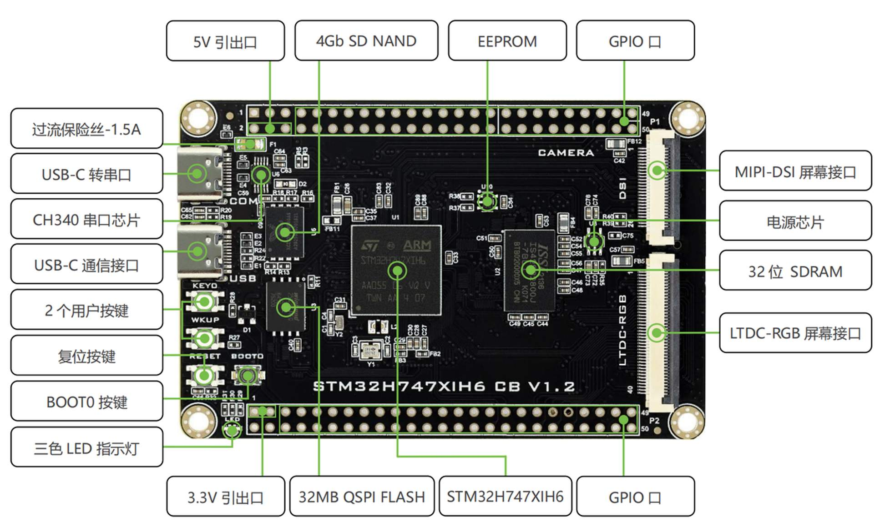

# STM32H7x7 学习系列（STM32H747 / H757 双核）

> 学习板：STM32H757 开发板（具体型号待补）
> 教程主线芯片：STM32H747XIH6
> 主教程：[STM32H747XIH6 基础教程及项目开发 — B 站·技术探索者（20 章完整版）](https://i1ggz3h8own.feishu.cn/wiki/QHU6wyUkuiYeajknjHccwiJunag)
> 学习状态：🚧 第 1 章 Makefile 环境搭建
> 更新日期：{{ git_revision_date_localized }}

---

## 1. 这个系列是什么

- **一次从头到尾的双核 H7 学习复盘**：跟着教程从工具链搭起，走完外设 → 显示 → Bootloader/OTA → 企业项目实战。
- **只写增量**：教程没说清的原理、我自己踩的坑、我的验证方法和实验数据——不做教程的文字搬运。
- **H747 → H757 的落地**：教程板卡是 H747XIH6，我的板子是 H757（= H747 + 加密加速），大部分内容 1:1 适用，差异单独成篇。

## 2. 板卡信息卡

| 项目 | 内容 |
|------|------|
| 芯片型号 | STM32H757（开发板型号待补） |
| 内核 | Cortex-M7 @ 480 MHz + Cortex-M4 @ 240 MHz（双核） |
| 程序存储 | 2 MB Flash（双 Bank，0x08000000 / 0x08100000） |
| 内存 | ITCM 64 KB · DTCM 128 KB · AXI SRAM 512 KB · SRAM1/2/3 288 KB（D2）· SRAM4 64 KB（D3）· Backup 4 KB |
| 调试器 | 待确认（教程用 **DAP-Link**，接口脚本 `cmsis-dap.cfg`；本板待实测） |
| 工具链 | 教程主线：arm-none-eabi-gcc + make + VS Code(Cortex-Debug) + OpenOCD |
| 参考手册 | [RM0399（H745/755 & H747/757）](https://www.st.com/resource/en/reference_manual/dm00176879-stm32h745755-and-stm32h747757-advanced-armbased-32bit-mcus-stmicroelectronics.pdf) |
| CubeMX / FW_H7 版本 | 待补（每次升级后记录，HAL 行为随版本变化） |

### 教程板卡资源地图（STM32H747XIH6 CB V1.2）

> 图源：教程（B 站·技术探索者）。**教材板卡 ≠ 我的板卡**：我的板子是 H757，教程实验的硬件基线是这块 H747 板——板载外设与教程章节的对应关系如下，方便按章节找资源：

| 板载资源 | 教程对应 | 说明 |
|----------|----------|------|
| 三色 LED + 2 个用户按键 + 复位键 | 4.1 GPIO | 第一个实验的硬件 |
| 含 **BOOT0 按键** | 4.27 / 4.31 | BOOT0 拉高 = 进 ROM Bootloader（启动流程篇展开，含我的板子踩坑） |
| CH340 USB 转串口 | 4.3 USART | 串口实验 / 串口重定向 |
| EEPROM（BL24C16F） | 4.15 | I2C 读写实验 |
| 32MB QSPI Flash | 4.17 | QSPI 实验 |
| 4GB SD NAND | 4.21 / 4.28 | FatFs / 虚拟 U 盘 |
| 32 位 SDRAM | 4.19 | 显存与 LVGL 帧缓冲（教程 8.11） |
| LTDC-RGB / MIPI-DSI 接口 | 第 5、6 章 | 屏幕 + 触摸 |
| 1.5A 过流保险丝 + 5V / 3.3V 引出口 | 硬件参考 | 外接负载时注意限流 |

## 3. 教程路线图与 wiki 落点

教程共 20 章，wiki 按**知识类型**重组为 7 个块（不照抄教程顺序，但每篇笔记头部标注教程出处）：

| 教程章节 | 内容 | wiki 落点 | 状态 |
|----------|------|-----------|------|
| 1 | Makefile 环境搭建 / .mk 文件 / 编译产物 / 优化选项 | `00_工具链与工程构建` | 🚧 进行中 |
| 2、3 | 双核介绍 / CubeMX 创建基础工程 | `01_芯片与体系结构`、`00` | ⏳ |
| 4.1 ~ 4.20 | GPIO、中断、USART、TIM、ADC、DMA、I2C、SPI、QSPI、SDRAM、双核通信…… | `02_外设实战` | ⏳ |
| 4.4、4.5、4.6、4.10、4.27、4.30、4.31 | 内存布局 / MPU / Cache / 时钟树 / 内部 Flash 与 Option Bytes / VMA-LMA / 启动流程 | `01_芯片与体系结构` | ⏳ |
| 4.21、4.22、4.24 ~ 4.26、4.28、4.29 | SDNAND / FatFs / 环形缓冲 / JSON / CRC / 虚拟 U 盘 / 双缓冲 | `03_中间件与存储` | ⏳ |
| 5、6、8 | LTDC + DMA2D / 触摸屏 / LVGL 移植 | `04_显示与图形` | ⏳ |
| 4.23、4.32 | USB-OTG / 以太网(W5500·LAN8720)、RS485、CAN | `05_通信与网络` | ⏳ |
| 11 ~ 15 | 网络编程基础 / LWIP / MQTT / HTTP / WebSocket | `05_通信与网络` | ⏳ |
| 7 | Bootloader / IAP(A-B 分区) / OTA | `06_系统与工程实践` + 外部 Bootloader 系列 | ⏳ |
| 9、10、16、17、19、20 | 企业项目实战 / 模块化与 OOP / Shell / FreeRTOS / RTThread / 软件架构 | `06_系统与工程实践` | ⏳ |
| 18 | 调试技巧（map / 断点 / 反汇编 / 栈回溯） | `00_工具链与工程构建` | ⏳ |

> 🧭 **两条推进线**：**主线**跟随教程学习进度——第 1 章对应 `00_工具链与工程构建`，第 4 章起进入 `01_芯片与体系结构`（内存布局 → MPU → Cache → 时钟树 → …）；**副线**（按需补写，不编号）：CMake、启动文件与链接脚本、Keil 对照——到实际需要时再写（触发条件见 `00` 块首页），不打乱主线顺序。

> ⚠️ 教程自身编号有重复和跳号（`4.32` 出现三次、缺 `4.12`），本系列笔记一律用**教程标题**而非编号做锚。

## 4. 学习进度

| 阶段 | 内容 | 状态 | 备注 |
|------|------|------|------|
| 工具链 | Makefile 环境搭建（教程 1.x） | 🚧 学习中 | GCC + make + VS Code + OpenOCD |
| 工程 | CubeMX 生成工程结构 | ⏳ | Makefile 主线，5 种形态对比已整理 |
| 体系结构 | 内存布局 / MPU / Cache | ⏳ | 教程 4.4 ~ 4.6 |
| 外设 | GPIO 起逐个外设 | ⏳ | |
| 显示 | LTDC + LVGL | ⏳ | |
| 实战 | Bootloader / OTA / 工业仪表 | ⏳ | 结合外部 Bootloader 教程 |
| CMake | 工具链副线（按需补写） | ⏳ 计划中 | 官方路线：CubeMX 原生 CMake + STM32CubeCLT + VS Code 扩展 |

## 5. 下一步（当前阶段的行动清单）

> 原则：**先把工具链数据跑实，再进入第 4 章主线**。按顺序执行，完成一项勾一项。

**A. 跑通并回填（现在 → 教程第 3 章）**

- [ ] 按 [04 篇](00_工具链与工程构建/04_调试与烧录链路.md)替换 `<你的用户名>`，跑通"编译 → 烧录 → 断点"全链路
- [ ] 回填 [00 块环境基线表](00_工具链与工程构建/index.md)：CubeMX / FW_H7 / gcc / **ld（binutils）** / make / OpenOCD 六个版本
- [ ] 完成 [03 篇 6 项待实测](00_工具链与工程构建/03_Makefile工程逐段解剖与手改指南.md)（重生成覆盖矩阵、`-MMD`、`flash` 目标、`DEBUG/OPT` 形式、`.ld` 保护、`size` vs `.bin`）
- [ ] 完成 [04 篇 5 项待实测](00_工具链与工程构建/04_调试与烧录链路.md)（含"本板调试器是 DAP-Link 还是 ST-Link"）

**B. 双核部分（教程第 2、3 章）**

- [ ] 写 `01_芯片与体系结构` 第 06 篇《双核架构与启动关系》（CM7/CM4、D1/D2/D3 域、HSEM/IPCC 概览）
- [ ] 教程第 3 章 CubeMX 双核工程创建 → 数据直接回填 03 篇"重生成覆盖矩阵"

**C. 主线启动（教程第 4 章起）**

- [ ] 《内存布局》（4.4）→《MPU》（4.5）→《Cache 与 DMA 一致性》（4.6）：**三篇连做**（同一主题链，互相引用）
- [ ] 《时钟树》（4.10）→《Flash 与 Option Bytes》（4.27）→《启动流程与 BOOT 配置》（4.31，把 BOOT0 踩坑写成注意框）→《VMA/LMA》（4.30）
- [ ] 外设篇从《GPIO》（4.1）起一篇一实验，进入 `02_外设实战`

**D. 每篇的取证习惯（记录质量的关键）**

- 每个实验留三类证据：① 调试器 / 串口输出（截图或文本）② 寄存器视图或示波器 / 逻辑分析仪数据 ③ 适用的 `size` 对比
- 坑当场记进对应篇的"踩坑 / 待实测"节，集中定稿；图解优先 Mermaid 自绘，操作截图用自己的环境

## 6. 外部资源与关联

**主教程**（同一份教程的两个版本，新版为 20 章完整版）：

- [20 章完整版（i1ggz3h8own 租户）](https://i1ggz3h8own.feishu.cn/wiki/QHU6wyUkuiYeajknjHccwiJunag)
- [早期 7 章版（my 租户）](https://my.feishu.cn/wiki/HpalwOtG3iav7Bk95qecUTdwn74)

**计划搬运**：

- [Bootloader 全系列教程](https://fcnibdv283e3.feishu.cn/wiki/H5ckwZ45Qiduhuk3zwAcMRnsn3b)——Keil（`.sct` 散列文件）视角的原理系列：启动文件、内存映射、`.data/.bss`、链接脚本、Flash 编程、最简 Bootloader、Ymodem。与本教程第 7 章（Makefile/`.ld` 视角）互补，搬运时先做 `.sct ↔ .ld` 语法桥（见 `00_工具链与工程构建` 副线篇目《启动文件与链接脚本》）。状态：**计划中**。

**教程章节直达**（点击跳到对应章节；block ID 直达链接，若某客户端不识别则用目录定位）：

| 章 | 章节 | 章 | 章节 |
|----|------|----|------|
| 1 | [makefile 环境搭建](https://i1ggz3h8own.feishu.cn/wiki/QHU6wyUkuiYeajknjHccwiJunag#GJsLd1Kk4ojlyfxNwiicPA8Mn5e) | 11 | [网络编程基础](https://i1ggz3h8own.feishu.cn/wiki/QHU6wyUkuiYeajknjHccwiJunag#Ou1hdSBv4o9SUmxpyARcAPHdnKc) |
| 2 | [STM32H747 双核单片机介绍](https://i1ggz3h8own.feishu.cn/wiki/QHU6wyUkuiYeajknjHccwiJunag#Up8TdW9nSoZpp4xShlUc1j1nnsb) | 12 | [LWIP 网络协议栈](https://i1ggz3h8own.feishu.cn/wiki/QHU6wyUkuiYeajknjHccwiJunag#DQjNdJOCNozAj8xHGk6cyrQpngh) |
| 3 | [CubeMX 创建基础工程示例](https://i1ggz3h8own.feishu.cn/wiki/QHU6wyUkuiYeajknjHccwiJunag#Qrb4dHxQQoipvfxNNYscnUz2nHb) | 13 | [MQTT 协议](https://i1ggz3h8own.feishu.cn/wiki/QHU6wyUkuiYeajknjHccwiJunag#EWCCddLkdod59HxiNaycPW3GnSc) |
| 4 | [基础外设开发（4.1~4.33）](https://i1ggz3h8own.feishu.cn/wiki/QHU6wyUkuiYeajknjHccwiJunag#HZXid1LgKou05pxdIUXcaqiTnBd) | 14 | [HTTP 协议](https://i1ggz3h8own.feishu.cn/wiki/QHU6wyUkuiYeajknjHccwiJunag#SIzfd9BM2oqZKSxpWYwcWV6mnVc) |
| 5 | [驱动 RGB 显示屏（LTDC/DMA2D）](https://i1ggz3h8own.feishu.cn/wiki/QHU6wyUkuiYeajknjHccwiJunag#RzdjdpTwooQImmxMfLXchv3Pnrg) | 15 | [WebSocket 协议](https://i1ggz3h8own.feishu.cn/wiki/QHU6wyUkuiYeajknjHccwiJunag#VbuDdWSygoJTKGxoKcPcZ9h0nCe) |
| 6 | [触摸屏驱动开发](https://i1ggz3h8own.feishu.cn/wiki/QHU6wyUkuiYeajknjHccwiJunag#PzmSddtB3oKivBx81ObcjQYUnkh) | 16 | [Shell 控制台](https://i1ggz3h8own.feishu.cn/wiki/QHU6wyUkuiYeajknjHccwiJunag#NxQzd0cNQoc8LLxWzT9cCYSRnEe) |
| 7 | [Bootloader OTA](https://i1ggz3h8own.feishu.cn/wiki/QHU6wyUkuiYeajknjHccwiJunag#SZHYd9TJRoIbNkxgFkdcX38GnVd) | 17 | [FreeRTOS 配置](https://i1ggz3h8own.feishu.cn/wiki/QHU6wyUkuiYeajknjHccwiJunag#TA8pdSrvYo1WNVxtSVscqF4anHh) |
| 8 | [移植 LVGL](https://i1ggz3h8own.feishu.cn/wiki/QHU6wyUkuiYeajknjHccwiJunag#Cms2dULiJomQZbxKECncQdHSn2e) | 18 | [调试技巧](https://i1ggz3h8own.feishu.cn/wiki/QHU6wyUkuiYeajknjHccwiJunag#SSsTdnEkto5I7CxnTvrcpLIWn7g) |
| 9 | [工业控制仪表企业项目实战](https://i1ggz3h8own.feishu.cn/wiki/QHU6wyUkuiYeajknjHccwiJunag#M0yVd0fVeoRaxFxtG6BcCohmnuf) | 19 | [RTThread](https://i1ggz3h8own.feishu.cn/wiki/QHU6wyUkuiYeajknjHccwiJunag#TtP3dLbD3ohQU0xq3xQc8zcbn4c) |
| 10 | [项目开发必备知识点](https://i1ggz3h8own.feishu.cn/wiki/QHU6wyUkuiYeajknjHccwiJunag#DwwudHqexoxiY4xBT9MczDzvncc) | 20 | [单片机软件架构设计](https://i1ggz3h8own.feishu.cn/wiki/QHU6wyUkuiYeajknjHccwiJunag#X71SdtLpcoSw2Sx6RWncQxW4nPg) |

**教程内容引用与素材规范**（教程是已购课程，允许用于个人学习笔记复盘；按此执行）：

- **原理图（流程 / 结构 / 时序）**：优先**自绘** Mermaid / SVG——可检索、可修改、和笔记一起进版本管理，写到对应章节时逐张补。
- **截图类（界面 / 工具 / 现象）**：教程原图用 `lark-cli docs +media-download` 下载到 `STM32H7x7/assets/`，命名 `教程<章节>-<内容>.png`，图下标注来源；自己的操作截图同样存放于 `assets/`。
- **文字**：短引用标注章节 + 直达链接；整段引用写明出处。
- **锚点写法**：笔记头部"教程对应"用标题 + 上表直达链接，不用编号（教程编号有重复和跳号）。

**关联笔记**：

- [IAP 与固件升级基础](../IAP与固件升级基础.md)——IAP/ISP/OTA 概念族、CH582M 与 STM32H743 对照，本系列 Bootloader 篇的先行笔记
- [H743 移植指南](../../../惯性导航/04_拆解PSINS篇/PSINS_STM32嵌入式/14_H743移植指南.md)——同族芯片的工程移植经验
- [仿真踩坑实录（Keil Simulator 对 H7 不可用）](../../../工作与项目/AHRS板固件仿真与验证/仿真踩坑实录_KeilSimulator对H7不可用.md)——工具链选型篇的反例来源

## 7. 写作约定

1. 每篇头部固定信息块：芯片 / 教程对应（标题而非编号）/ 环境版本（CubeMX、FW_H7、GCC、OpenOCD）/ 更新日期。
2. 正文七段式：一句话定位 → 原理（够用那一层 + 数据流图）→ CubeMX 配置清单 → 代码骨架 → 验证方法 → 踩坑清单 → 关联。
3. 坑和实验数据优先写：教程讲过的概念不重抄，只写"教程没说清的"和"我实测出来的"。
4. 涉及版本敏感的行为（HAL、工具链、Option Bytes），一律标注实测环境并写明验证方式。
5. 新增笔记同时补 `mkdocs.yml` 的 nav 条目（本 wiki 的 nav 为手工维护）。
6. **自包含（原文级）**：教程链接可能失效或需授权才能访问——凡沿用教程的步骤与配置文件（安装命令、`tasks.json` / `launch.json` 等配置清单、操作顺序），一律**原文完整收录**（只把机器相关的路径改为占位符并标注替换方法）；任何简化写法只能作为"可选改进"附注，不能替代原文。
7. **站内链接写法**：指向同目录 `index.md` 时必须写成 `../index.md`（本站 roamlinks 插件会把裸 `index.md` 改写成错误路径，构建时告警）。