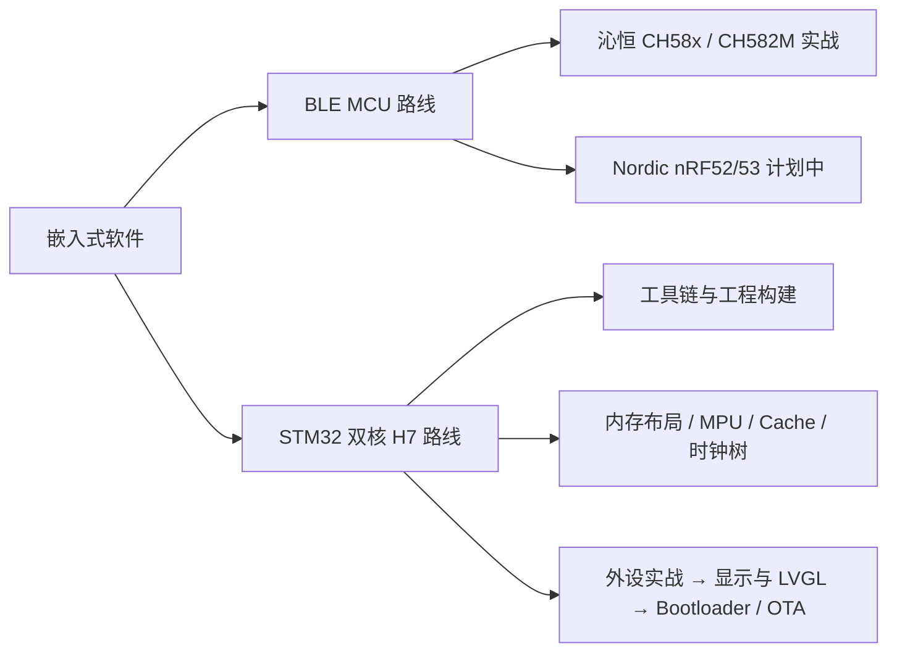

# 嵌入式开发

这里记录我的嵌入式开发学习笔记，两条主线：**BLE MCU / SoC**（沁恒 CH58x 起步）与 **STM32H7x7 双核**（H747/H757 学习系列）。

## 学习路线图

## 当前进度

| 平台 | 芯片 | 状态 | 备注 |
|------|------|------|------|
| 沁恒 WCH | CH582M | 🚧 学习中 | RISC-V + BLE 5.3 |
| Nordic | nRF52840 / nRF5340 | ⏳ 计划中 | ARM Cortex-M + BLE 5.3/5.4 |
| ST | STM32H757（教程为 H747XIH6） | 🚧 学习中 | 双核 CM7 + CM4，工具链主线 Makefile |

## 基础概念

- [IAP 与固件升级基础](IAP与固件升级基础.md) — IAP/ISP/OTA 区别、Bootloader+App 架构、跳转流程、校验安全、CH582M 与 STM32H743 实战对照

## 笔记目录

### STM32H7x7（H747 / H757 双核）学习系列

- [系列首页（路线图 · 板卡信息 · 进度）](STM32H7x7/index.md) — 20 章教程的 wiki 落点映射、环境版本基线、外部资源
- [00 工具链与工程构建](STM32H7x7/00_工具链与工程构建/index.md) — 5 种 CubeMX 工程形态、Makefile/CMake/Keil 取舍、调试链路
- [01 CubeMX 五种工程形态对比](STM32H7x7/00_工具链与工程构建/01_CubeMX五种工程形态对比.md) — 生成物差异矩阵、教程选 Makefile 的完整论证、待实测清单
- [02 环境搭建与工具链排错（Windows）](STM32H7x7/00_工具链与工程构建/02_环境搭建与工具链排错.md) — 工具下载来源、GCC/binutils 版本兼容、6 个 Windows 坑与 SOP
- [03 Makefile 工程逐段解剖与手改指南](STM32H7x7/00_工具链与工程构建/03_Makefile工程逐段解剖与手改指南.md) — 生成文件逐段解剖、`.mk` 外置接线、手改配方与重生成覆盖矩阵
- [04 调试与烧录链路（Cortex-Debug 从零配置）](STM32H7x7/00_工具链与工程构建/04_调试与烧录链路.md) — `tasks.json`/`launch.json` 逐字段、双核 launch/attach 姿势、排错表与命令行烧录
- [01 芯片与体系结构](STM32H7x7/01_芯片与体系结构/index.md) — 内存布局 / MPU / Cache / 时钟树 / 启动流程（跟随教程第 4 章主线，篇目表已就位）

### BLE MCU & SoC

- [CH582M 特性与概览](BLE%20MCU&SOC/WCH/CH58(2)3M/CH582M%20特性与概览.md) — 核心规格、外设速查、系列选型对比
- [CH582M Flash 存储与 SNV 详解](BLE%20MCU&SOC/WCH/CH58(2)3M/CH582M%20Flash%20存储与%20SNV%20详解.md) — Flash 分区地图、配对绑定机制、外接存储扩展方案
- [CH582M DataFlash 地址偏移实践](BLE%20MCU&SOC/WCH/CH58(2)3M/CH582M%20DataFlash%20地址偏移实践.md) — 自定义配置区与 BLE SNV 共存时的地址规划

---

> 💡 **学习资源**
> - 沁恒官网：[https://www.wch.cn](https://www.wch.cn)
> - Nordic DevZone：[https://devzone.nordicsemi.com](https://devzone.nordicsemi.com)
> - BLE 核心规范：[Bluetooth SIG](https://www.bluetooth.com/specifications/)
> - STM32H747/757 参考手册 RM0399：[st.com](https://www.st.com/resource/en/reference_manual/dm00176879-stm32h745755-and-stm32h747757-advanced-armbased-32bit-mcus-stmicroelectronics.pdf)