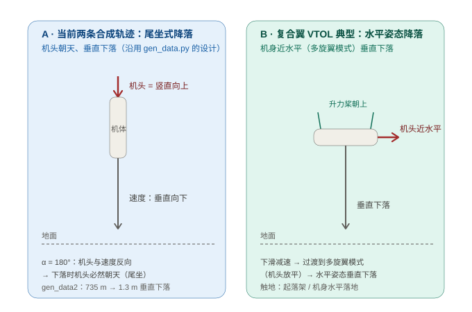

# VTOL 降落几何与合成轨迹的结尾：为什么"机头朝天"？

> 出处：在 `sim/sil_pc` 用 `plot3d_traj` 画新轨迹 `sim_data2.bin` 时，发现结尾阶段机体坐标显示**机头竖直向上（俯仰接近 ±90°）**，第一反应是"数据/坐标画错了？"。
> 排查结论：**不是 bug**——合成轨迹按"尾坐式 VTOL"建模，其降落姿态就是机头朝天垂直下落。本文把坐标系约定、降落几何、两条轨迹的结尾设计讲透，并给出"如果你的实机是复合翼"该怎么选的建议。

---

## 1. 先把坐标系和"VTOL 的两种构型"对齐

**导航系**：NED（北-东-地）。**机体系**：FRD（前-右-下，机头 +x、右翼 +y、腹部 +z）。合成数据里的真值姿态就是按这个约定生成的。

但"VTOL"其实有两大类，起降几何完全不同，合成轨迹的结尾也因此不同：

| 构型 | 起飞/降落姿态 | 代表机型 |
|---|---|---|
| **尾坐式（tail-sitter）** | 整机**立起来**，机头朝天起降 | 早期验证机、部分固定翼 VTOL |
| **复合翼 / 多旋翼模式** | **机身水平**起降（升力桨朝上，像多旋翼） | 大多数复合翼 VTOL（含本项目的目标平台） |

一个常见误区要先破除：**VTOL ≠ 只能竖直上下**。"斜上飞"非常正常——`gen_data2.py` 里固定翼模式那 10° 爬升段（36–229 s）就是斜上飞；起降段的"纯竖直"只是多旋翼模式的体现。

## 2. 一句结论：结尾姿态由两个量决定——路径角 γ 与攻角 α

合成引擎里飞机怎么"飞"由控制量决定：**路径角 γ**（速度方向相对地平线的角度）和**攻角 α**（机头相对速度方向的偏角，绕右翼轴旋转）：

```
机头指向 = 速度方向 + α 旋转
```

- 平飞协调（α = 0）：机头 = 速度方向，最常规。
- **尾坐降落（α = 180°）：机头与速度"反向"**。当飞机**垂直向下**落（γ = −90°）时，速度朝下 → **机头必然朝天**。这就是图里红色机头竖直向上的原因。

## 3. 两种降落几何对照



左图 A 是 `gen_data.py` / `gen_data2.py` 当前采用的**尾坐式垂直降落**：机头朝天，机体沿自身纵轴垂直下落，α = 180°。右图 B 是**复合翼 VTOL 的典型降落**：下滑减速后过渡到多旋翼模式（机头放平、升力桨朝上），再水平姿态垂直下落、起落架触地。

## 4. 复盘 gen_data.py：结尾俯仰 ~90° 正常吗？

正常——它是**尾坐式 VTOL 的完整起降剖面**，末段刻意让飞机"立起来"：

| 时段 | 动作 | 状态 |
|---|---|---|
| 53.4–59.4 s | 拉起：路径角 0° → +90°，空速 15 → 0.5 m/s | 机头朝天悬停 |
| 59.4–60.4 s | α → 180° + 路径角 +90° → −90° | 翻转：由"朝上飞"改"朝下掉"，机头保持朝上 |
| 60.4–65.4 s | 尾坐垂直下落 3 m/s | 近垂直姿态压测 |

一个容易误读的细节：**它其实没落完地**。文件在 65.4 s 截断，此时高度约 261 m（剖面基准 200 m 起飞、最高 275 m）——3D 图末尾看到的"机头朝天悬停在 261 m"，是刻意保留的**近垂直机动段**（用来考验滤波器在俯仰接近 ±90° 时的表现），不是完整着陆。

## 5. 复盘 gen_data2.py：结尾怎么下来的？

新轨迹把降落做成了完整的"返场-翻转-触地"闭环：

| 时段 | 动作 | 高度 |
|---|---|---|
| 503–519 s | **拉起改垂直**：路径角 −10° → +90°，空速 60 → 8 m/s | 575 → **735 m** |
| 519–523 s | **翻转**：α 0 → 180°、路径角 +90° → −90°（由向上爬改向下落，机头仍朝上） | 735 m |
| 523–611 s | 机头朝天、**垂直下落** 8 m/s | 735 → 31 m |
| 611–618 s | 触地减速 8 → 0.5 m/s | → 1.3 m |

两点值得注意：

1. **503–519 s 先"窜"到 735 m 再往下掉**：在 60 m/s 速度下猛地拉成垂直，动能转成势能"zoom 爬升"了 160 m。真实复合翼飞行不会这么拉——会先减速、再过渡。
2. **结尾机头为什么竖直向上**：垂直下落时速度朝下，α = 180° 强制机头与速度反向 → 机头朝天。这是**尾坐式**姿态，不是坐标画错（坐标系映射 bug 的排查过程见 [ESKF 验证与踩坑实录](ESKF验证与踩坑实录.md) 之外的绘图修正记录）。

## 6. 对 ESKF 验证的意义：这段"朝天"该不该留？

近 ±90° 姿态对验证**有价值**：它会触发姿态角到欧拉角的 gimbal 区域、考验 yaw 在磁几何剧变下的可观测性、翻转段还给陀螺高角速率激励（SIL 里能看到大量 "gimbal skip" 采样）。**但前提是你的平台真的会出现这种姿态**：

- 目标是**尾坐式 VTOL** → 保留（A）；
- 目标是**复合翼 VTOL**（本项目）→ 真实降落是图 B 的水平姿态，结尾应改成 **下滑 → 减速 → 过渡多旋翼（机头放平）→ 水平姿态垂直下落**。

给轨迹维护的三个选项：

| 选项 | 做法 | 适用 |
|---|---|---|
| A 保留现状 | 尾坐降落照旧，文档注明"模型按尾坐式" | 想压测近垂直姿态 / 与旧剖面口径一致 |
| **B（推荐）** | 把 `gen_data2.py` 503 s 之后改成复合翼水平姿态返场降落 | 实机是复合翼 VTOL |
| C | B 之外，把 `gen_data.py` 结尾的"悬停 261 m"补成完整着陆 | 想要两条轨迹都以落地收尾 |

> 轨迹文件在 `software/STM32H743_AHRS-Board/sim/sil_pc/`：`gen_data.py`（v1，机动压测）、`gen_data2.py`（v2，中高空任务）、`plot3d_traj*.m`（3D 绘图）。改法详见同目录 `README_TRAJECTORY.md`。

---

相关：[验证矩阵与真实数据回放](验证矩阵与真实数据回放.md) · [ESKF 验证与踩坑实录](ESKF验证与踩坑实录.md) · [MATLAB ESKF 算法验证（Phase 1）](MATLAB_ESKF算法验证.md)
