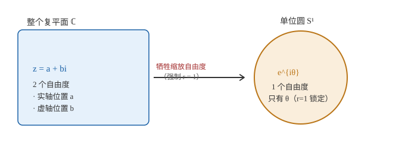
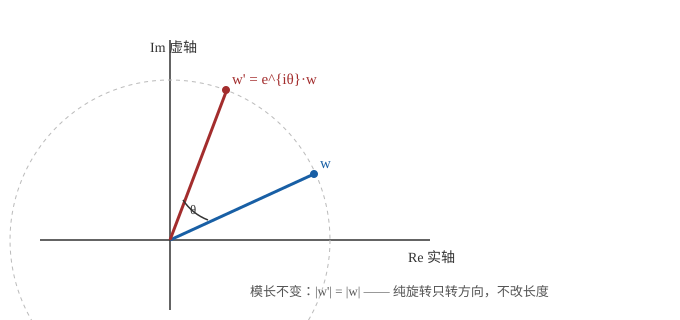

# 复数与二维旋转（最浅引子）

> 一句话：一个复数天生有 2 个自由度（实部/虚部，或模长/辐角）；把它当成"旋转算子"去乘别的向量时，纯旋转只需要 1 个参数（角度），于是我们强制模长 = 1，牺牲掉"缩放"那个自由度。本文先把这件事讲透，再和你 wiki 里已有的 3D 旋转矩阵、四元数内容接上。

!!! note "本文定位与约定"
    这是 `02_代数与几何` 里**最浅的一层引子**，建议在读 [坐标变换与旋转矩阵（推导入门）](02_坐标变换与旋转矩阵.md) 之前先看本篇——它只解决一个更前置的疑问：**"凭什么复数能代表旋转？"** 不涉及 3D、不涉及主动/被动约定（那些在姐妹篇里）。所有结论都是可手算验证的初等式，无外部权威源依赖。

## 一、先定义"自由度"

"自由度"（degree of freedom，DOF）在这里是个很朴素的概念：**要确定一个对象，需要独立指定的实数个数**。

- 平面上的一个点，用坐标 $(x,y)$ 确定，要 2 个数 → **2 个自由度**。
- 一个复数 $z = a + bi$，本质上就是平面上的一个点，同样 **2 个自由度**（实部 $a$、虚部 $b$）。
- 换成极坐标 $z = r\,e^{i\theta}$，用"模长 $r$"和"辐角 $\theta$"描述，还是 **2 个自由度**——只是换了一套坐标。

> 关键：复数**作为一个数/点**，天生就是 2 自由度。这和"它能不能表示旋转"是两件事，别混在一起。

## 二、复数有两种截然不同的身份

同一个复数 $z$，在不同场景里扮演两种角色：

| 身份 | 含义 | 自由度 |
|------|------|--------|
| **表示点 / 向量** | $z$ 自己就是平面上的位置 $w = x + iy$ | 2（完整位置） |
| **表示算子（旋转）** | 用 $z$ 去"乘"别的复数：$w \mapsto z\cdot w$ | 取决于是否约束模长 |

本文核心在第二种身份——**复数被当成一个"操作"，作用到别的向量上**。

## 三、一般复数乘法 = 旋转 + 缩放（2 自由度）

把算子写成极坐标 $z = r\,e^{i\theta}$，作用在向量 $w$ 上：

$$z\cdot w = \big(r\,e^{i\theta}\big)\cdot w = r\cdot\big(e^{i\theta}w\big)$$

拆开看几何意义：

- $e^{i\theta}w$：把 $w$ **转** $\theta$ 角（这是旋转）；
- 外面再乘 $r$：把长度拉成 $r$ 倍（这是**缩放**）。

所以**一般的复数乘法同时干了"转"和"拉"两件事**——它对应的是"旋转 + 等比例缩放"（数学上叫*相似变换 / roto-homothety*），天然带着 **2 个自由度**：一个管角度 $\theta$，一个管缩放 $r$。

## 四、为什么"牺牲了一个自由度"

"纯旋转"的定义很苛刻：**只转方向，绝不改变长度**。

而上面那个算子一旦 $r\neq 1$，就会顺手把长度改掉，这就不是纯旋转了。于是我们**主动强制 $r = 1$**。这一锁，算子退化成

$$z = e^{i\theta} = \cos\theta + i\sin\theta$$

模长被钉死在 1，只剩 $\theta$ 这一个参数 → **1 个自由度**。

> 所谓"牺牲了一个自由度"，牺牲的就是那个**缩放自由度 $r$**。代价（也是好处）：乘法从此不再改变任何向量的长度，只改变方向——而这恰好就是纯旋转的本质。

换句话说：**复数空间是 2 维的，但纯旋转只需要 1 个参数（角度），所以我们把复数"限制"到它的 1 维子集合——单位圆 $S^1$ 上，从而丢掉径向那一维。**

（旁证：旋转矩阵那一侧也是同样的逻辑。一个 $2\times2$ 矩阵有 4 个分量，但"旋转矩阵"要求列向量单位长度且互相垂直、行列式为 $+1$，这施加了 3 个约束，$4 - 3 = 1$ 个自由度。两边殊途同归，都收敛到 1。）

## 五、单位复数如何实现纯旋转（动手算一遍）

让 $z = e^{i\theta} = \cos\theta + i\sin\theta$，把平面上的点 $w = x + iy$ 乘上去：

$$\begin{aligned}
z\cdot w &= (\cos\theta + i\sin\theta)(x + iy) \\
&= \big(x\cos\theta - y\sin\theta\big) \;+\; i\big(x\sin\theta + y\cos\theta\big)
\end{aligned}$$

于是新坐标（实部、虚部分别读作 $x', y'$）是：

$$\boxed{\begin{aligned}
x' &= x\cos\theta - y\sin\theta \\
y' &= x\sin\theta + y\cos\theta
\end{aligned}}$$

## 六、与二维旋转矩阵的对应——完全同一件事

把上式写成矩阵形式，就是教科书里的标准（主动）旋转矩阵：

$$\begin{bmatrix}x'\\y'\end{bmatrix}
=
\begin{bmatrix}\cos\theta & -\sin\theta\\ \sin\theta & \cos\theta\end{bmatrix}
\begin{bmatrix}x\\y\end{bmatrix}
= R(\theta)\,\vec w$$

也就是说：

> **"左乘 $e^{i\theta}$" 与 "左乘矩阵 $R(\theta)$" 在数学上完全等价，只是记法不同。** 复数把矩阵那 4 个数（且带着正交约束）压缩进了一个数 $e^{i\theta}=\cos\theta+i\sin\theta$。

而且"乘法对应复合"也严丝合缝：

$$e^{i\alpha}\,e^{i\beta} = e^{i(\alpha+\beta)} \quad\Longleftrightarrow\quad R(\alpha)\,R(\beta) = R(\alpha+\beta)$$

左边是复数相乘、角度直接相加；右边是矩阵相乘、对应旋转复合。二者是**同一个群（SO(2)）的两种表示**。

> 注意：上面 $R(\theta)=\begin{bmatrix}c&-s\\ s&c\end{bmatrix}$ 是**主动旋转**（向量转、坐标系不动）的形式。你 wiki 里 [坐标变换与旋转矩阵（推导入门）](02_坐标变换与旋转矩阵.md) 的正文改用**被动旋转**，单轴子块是它的转置 $\begin{bmatrix}c&s\\-s&c\end{bmatrix}$——两者互为转置，不是谁错。本文为直观起见先用主动形式。

## 七、一句话总结，并别和 3D 混淆

- 复数 = 2 自由度；纯旋转 = 1 自由度（只需要角度）。
- 用复数"乘"来当旋转算子时，我们**强制模长为 1**，于是牺牲了"缩放"这个自由度，换来了"乘法即旋转复合"的简洁代数结构。
- 单位圆 $S^1$（1 自由度）与 2D 旋转群 SO(2)（1 自由度）之间，是**一一对应**（差 $2\pi$ 视为同一点）。

!!! warning "别把 2D 和 3D 记混"
    很多人学完四元数会以为"复数 / 四元数对旋转都是双重覆盖"。其实 **2D 不是**——单位复数 $\theta$ 和 $\theta+2\pi$ 本来就是同一个点，没有 $\pm q$ 的歧义。真正有"双重覆盖"（单位四元数 $q$ 与 $-q$ 表示同一旋转）的是 **3D 的 SO(3)**。这正是你 wiki 里 [四元数到DCM推导](../../01_基础篇/02b_四元数到DCM推导.md) 与 `四元数双覆盖.svg` 要处理的事——把本篇当作它的 2D 热身即可。

## 关联与延伸

- 姐妹篇（紧接本篇）：[坐标变换与旋转矩阵（推导入门）](02_坐标变换与旋转矩阵.md)（矩阵"看列"视角、主动/被动、3D 旋转矩阵与 DCM）
- 3D 深化：[四元数到DCM推导](../../01_基础篇/02b_四元数到DCM推导.md)
- 系列导读：[前置数学 · 导读](../index.md)
- 外链：[复数 — 维基百科](https://zh.wikipedia.org/wiki/复数)、[旋转矩阵 — 维基百科](https://zh.wikipedia.org/wiki/旋转矩阵)
