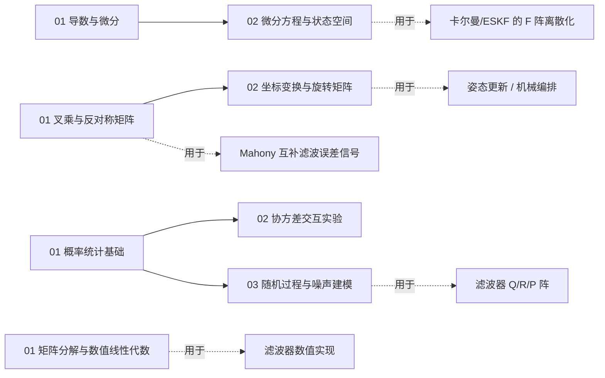

# 前置数学 · 导读

> 这个文件夹是惯导解算的"数学弹药库"，不是按学科（矩阵论/概率论）分类，而是按**它在惯导里服务哪一步**分类。
> 大致结构：**姿态是确定性问题（代数与几何），估误差是随机性问题（概率与随机）**，中间的微积分是共同语言，数值是实现手段。

## 两条腿

惯导解算可以拆成两半，各有各的数学：

| 半边 | 问题性质 | 数学弹药 | 喂给惯导的哪一步 |
|---|---|---|---|
| **算姿态** | 确定性的（坐标、旋转、运动） | 代数与几何 + 微积分 | 姿态更新、机械编排、误差传播 |
| **估误差** | 随机性的（未知、噪声、统计） | 概率与随机 + 矩阵数值 | 卡尔曼 / ESKF、组合导航 |

```
00_前置数学基础/
├── 01_分析与微积分/      共同语言：01 导数与微分 · 02 微分方程与状态空间
├── 02_代数与几何/        姿态的数学（确定性）：01 叉乘与反对称 · 02 坐标变换与旋转
├── 03_概率与随机/        估计的数学（随机性）：00 数学地基速查 · 01 概率统计 · 02 协方差交互 · 03 随机过程
└── 04_数值与实现/        算得动、算得稳：01 矩阵分解与数值线性代数
```

> 编号规则：`00_` = 速查/总览页，`01_02_03_...` = 各子夹顺序号，**每夹独立编号**——以后想加哪块数学，按它在惯导里服务的目标进对应子夹、接着往下排号即可。

## 学习顺序（推荐）

> 不想被依赖绕晕，就按下面走。括号里是"学到惯导哪里时它会被用到"。

1. **代数与几何/01 矢量叉乘与反对称矩阵** →（姿态更新、Mahony）
2. **代数与几何/02 坐标变换与旋转矩阵** →（姿态表示、坐标系，[基础篇 01/02](../01_基础篇/01_坐标系与变换.md) 的数学底座）
3. **分析与微积分/01 导数与微分** →（泰勒展开、线性化，到处用）
4. **分析与微积分/02 微分方程与状态空间离散化** →（误差传播方程、KF 的 F 阵离散化）
5. **概率与随机/01 概率统计基础** →（高斯分布，"从高斯到卡尔曼"）
6. **概率与随机/02 协方差交互实验** →（协方差的几何直觉，动手拖点）
7. **概率与随机/03 随机过程与噪声建模** →（白噪声、随机游走 → ESKF 的 Q 阵）
8. **04_数值与实现/01 矩阵分解与数值线性代数** →（滤波器的数值实现，打磨阶段再看）
9. **数学地基速查页（03_概率与随机/00）**：前置/看基础篇时随用随查，不要求先读

## 依赖关系（谁用谁）



> 虚线箭头是这条数学最终喂进去的惯导环节。哪一步看不懂，就顺着箭头上游回来看数学。

## 外链 Wiki

- [线性代数 — 维基百科](https://zh.wikipedia.org/wiki/线性代数)
- [协方差矩阵 — 维基百科](https://zh.wikipedia.org/wiki/协方差矩阵)
- [高斯分布 — 维基百科](https://zh.wikipedia.org/wiki/正态分布)
- [卡尔曼滤波 — 维基百科](https://zh.wikipedia.org/wiki/卡尔曼滤波)
- [四元数与空间旋转 — 维基百科](https://zh.wikipedia.org/wiki/四元数与空间旋转)

## 关联

- 系列首页：[惯性导航系列首页](../index.md)
- **上桌去用**：[基础篇（坐标系 → Allan 方差）](../01_基础篇/01_坐标系与变换.md) → [解算篇](../02_解算篇/06_机械编排方程.md) → [组合导航篇](../03_组合导航篇/10_卡尔曼滤波基础.md)