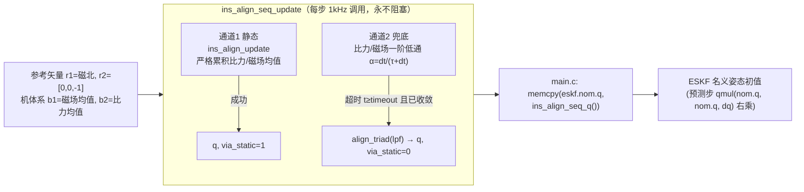

# 08b 本固件静基座粗对准实战（TRIAD + ins_align）

> **系列定位：M2 解算篇 · 08 的工程落地版。** [08 初始对准](08_初始对准.md) 讲清了"为什么要对准、TRIAD 数学、精对准 KF、动基座"的**通用理论**（锚定 PSINS）。本篇把理论落到**我们 AHRS 板固件 `ins_align.c` 的真实代码**——逐函数走读"双矢量 → TRIAD → m2q → 静止均值累积 → 有界状态机 → 注入 ESKF 名义姿态"的完整闭环。
>
> **前置**：姿态的四种表示（尤其 [DCM↔四元数互转](../01_基础篇/02_姿态的四种表示.md) 里 `m2q`/`q2r` 的转置约定与四元数双重覆盖）、[08 初始对准](08_初始对准.md) 的 TRIAD 理论。

---

## 一、一句话：这条闭环干什么

上电后，板子不知道自己朝哪。它先用"重力 + 当地磁场"两个不平行矢量，在**静止（或超时兜底）**条件下粗定出 `body→NED` 的初始四元数，再把它作为 ESKF 的名义姿态初值 `eskf.nom.q`。整条链：



> **🚀 速记闭环链（记住这一条就够用了）**
>
> 双矢量(磁北 + 重力反`[0,0,-1]`) → TRIAD 正交基 → `C = Ms·Mrᵀ` (NED→body) → `m2q(C,q)` [之前学的 m2q/q2r/双重覆盖] → `ins_align_update`(静止均值累积 → 调 `align_triad`) [本节①] → `ins_align_seq`(静态优先 / 超时低通兜底, 永不阻塞) [本节②] → 输出 **body→NED 初始四元数 q**，可直接喂 ESKF15 当名义初值。

---

## 二、数学地基（速记，不重复推导）

只点四个关键点，详细推导见 [02 姿态的四种表示](../01_基础篇/02_姿态的四种表示.md)：

1. **TRIAD 双矢量定姿**：参考系矢量 `r1`=磁北(归一)、`r2`=[0,0,-1](比力=重力反方向，NED z 向下)；机体系 `b1`=磁场均值(归一)、`b2`=比力均值(归一)。第三轴用叉乘 `t3=r1×t2`、`s3=b1×s2` 得到（叉积模长过小说明两矢量近平行 → 退化返回 0）。两组正交基"对拍"就得到姿态。
2. **C = Ms·Mrᵀ**：`Mr` 列=(r1,t2,t3)、`Ms` 列=(b1,s2,s3)，则 `C·r_i = b_i`，`C` 把 NED 坐标映射到 body 坐标（标准旋转矩阵，NED→body）。
3. **m2q 转置约定（最容易踩的坑）**：教科书 `R_std = body→NED (C_b^n)`；本固件 `q2r(q)` 输出的是 `R_stdᵀ = world→body (C_n^b)`（非对角元符号与教科书相反，已逐元素核对）。所以 `m2q` 先按标准公式解出 `q` 的共轭 `(w,-x,-y,-z)`，再取共轭还原，保证 `m2q∘q2r = ±I`。
4. **四元数双重覆盖**：`q` 与 `-q` 表示同一旋转，"互逆"只保证 ±。验证时比 ±，不能比 `==`。

---

## 三、代码走读：ins_align.c

函数链：`ins_static_now` → `align_triad` → `ins_align_update` → `ins_align_seq_init/update`。

### 3.1 小工具（约定）
- `v3_norm`：返回模长（const 只读）；`v3_norm1`：就地归一化（normalize）。
- `v3_cross(a,b,out)`：out = a×b。
- `m3_cols(M, c0,c1,c2)`：把三个矢量当"列"拼成 3×3（行主序 float[9]）。
- `m3_abt(A,B,out)`：out = A·Bᵀ（Bᵀ 才是真转置乘法）。

### 3.2 静止检测 ins_static_now（L109）
单样本判据：`|a| ∈ [9.01, 10.61]`（g±0.8）且 `|ω| ≤ 0.02 rad/s`（≈1.15°/s）。不依赖 IMU 内建状态位，对多厂家 IMU 通用。

### 3.3 核心：align_triad（L157）
见 §二的 1–3。输入 `fmean`/`mmean`/`m_ned`，输出 `q`。退化守卫：`|t2|<1e-6 || |s2|<1e-6 → return 0`。

### 3.4 单样本喂入 ins_align_update（L185）
```c
if (非静止 或 |mag|<1e-6) { 清零 sum_f/sum_m/n; return 0; }   // 任一非静止 → 全清零重来
sum_f += acc; sum_m += mag; n++;
if (n < need_n) return 0;                                     // 累积不够 → 继续
fmean = sum_f/n; mmean = sum_m/n;
if (!align_triad(fmean, mmean, m_ned, q)) { 清零重来; return 0; }
done = 1; return 1;                                           // 上升沿
```
`need_n = need_s/dt`（如 2.0/0.001 = 2000）。喂给 `align_triad` 的是**均值**——静止窗口平均就是为压传感器噪声。

### 3.5 有界状态机 ins_align_seq_*（L221 起）
- `ins_align_seq_init`：设 `timeout_s`、`tau`(默认 4s)、`fb_min_n = tau/dt+1`，建内部静态通道 `st`。
- `ins_align_seq_update`（L250）：每步 `t_elapsed += dt`。
  - **通道1 静态（最优）**：`ins_align_update(&st,...)` 成功 → 拷贝 q、`via_static=1`、`done=1`、返回 1（不等待降级）。
  - **通道2 兜底（并行）**：比力/磁场各自一阶低通 `α = dt/(tau+dt)`；首次 `fb_cnt==0` 直接播种，其后指数滑动；`fb_cnt++`。
  - **超时降级**：`timeout_s>0 && t_elapsed≥timeout_s && fb_cnt≥fb_min_n` → `align_triad(lpf_f, lpf_m, mref, q)`，`done=1`（`via_static` 保持 0）。移动平台上零均值扰动（船摇/垂荡）被低通平均掉 → 降级粗姿态。**永不阻塞**。

---

## 四、常见坑

1. **四元数双重覆盖**：验证 `m2q∘q2r = ±I` 要按 ± 比，不能 `==`（`verify/ins_align/05_test_triad.c` 初版用 9 元 `m_maxdiff` 比 4 元四元数越界误报 FAIL，改 `q_maxdiff` 才过）。
2. **q2r 转置约定**：`q2r` 输出 `C_n^b`（world→body），不是 `C_b^n`。机械编排里转比力要用 `q2r` 的结果（或它再转置）。
3. **静止判据是严格累积**：任一非静止样本就清零重来——所以"先确认静止再对准"。
4. **TRIAD 退化**：近磁极点（磁与垂直近平行）`align_triad` 返回 0，调用方须处理（清零重来）。
5. **降级兜底不是最优**：`via_static=0` 说明走的是低通降级路径，姿态质量弱于静态路径，日志里应区分。
6. **与 08 的"现状"更正**：[08 初始对准 §五](08_初始对准.md) 曾写"固件假设初始姿态已知、没有对准模块"——那是基于更早代码的判断；当前 `ins_align.c` 已实现并接入 `main.c`（`g_align` → `memcpy(eskf.nom.q, ...)`），上电先跑约 2s 静止对准、10s 超时降级。本篇即该模块的真实走读。

---

## 五、自测题

1. TRIAD 为什么需要两个不平行矢量？只给重力能定出完整姿态吗？
2. `m2q` 为什么要"先解标准公式再取共轭"？直接按教科书公式会怎样？
3. `ins_align_update` 里为什么任一非静止样本就清零重来？`need_n` 怎么算？
4. `ins_align_seq_update` 的双通道设计解决了什么问题？`via_static` 有什么用？
5. 对齐输出的 q 注入 ESKF 的哪个字段？为什么是"名义姿态"初值而非直接覆盖？

??? note "📐 参考答案"

    1. 一个矢量只定一个轴（重力定"上"，即水平面），完整姿态需要两个不平行矢量才能叉乘出第三轴。只给重力 → 只能定俯仰/横滚，**航向不可观**（绕重力轴旋转不变）。
    2. 因 `q2r` 输出 `R_stdᵀ`（非对角元反号）。若 `m2q` 不取共轭，解出的会是 `q` 的共轭，`m2q∘q2r` 不闭合。取共轭后能保证互逆到 ±。
    3. 均值只在"整段都静止"时才有意义；中间插一个运动样本会污染均值，故直接清零重来。`need_n = need_s/dt`（秒→样本数，四舍五入）。
    4. 解决"移动平台静态永不满足 → 主循环阻塞假死"的问题。双通道保证有界：静态优先出最优解；超时则用低通平均出的矢量降级出粗姿态。`via_static` 标记走的是哪条路，供日志/质量评估。
    5. 注入 `eskf.nom.q`（名义姿态）。ESKF 是误差状态滤波：名义态给初值，真实姿态 = 名义态 ⊗ 误差态增量；对齐只提供名义初值，后续由量测更新收敛误差。直接覆盖 `nom.q` 之外的内部态会破坏滤波一致性。

---

## 六、关联与延伸

- 上一篇：[08 初始对准](08_初始对准.md)（TRIAD / 精对准 / 动基座 通用理论，PSINS 锚定）
- 下一篇：[09 纯惯导误差传播](09_纯惯导误差传播.md)（失准角 / 速度 / 位置误差怎么增长、舒勒振荡、为什么纯惯导必发散）
- 数学地基：[02 姿态的四种表示](../01_基础篇/02_姿态的四种表示.md)（m2q/q2r 转置约定、双重覆盖）
- 代码：本项目 `Core/Src/ins_align.c`、`Core/Src/main.c:278/369/371`、`verify/ins_align/`（05_test_triad.c 端到端验证）
- 下一步：ESKF 怎么消费这个 q —— `nom.q` 注入、预测步 `qmul(nom.q, nom.q, dq)` 右乘（Solà 右不变误差）、量测更新 H 用 `q2r(nom.q)` 的 `Rm`（world→body）——见 ESKF 篇（待写）。
