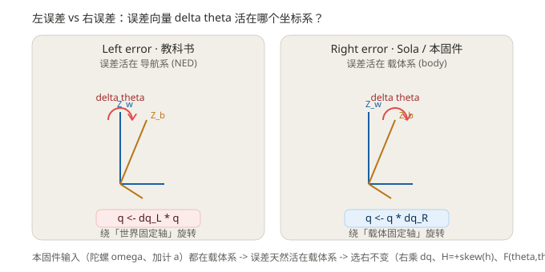

# 09b ESKF 右不变误差：概念篇（右乘 dq / Solà / 对比左误差 EKF）

> **系列定位：M2 解算篇。** 本文是 [08b 静基座粗对准实战](08b_本固件静基座粗对准实战_TRIAD与ins_align.md) 的下游——对准产出的初始四元数喂给 ESKF 之后，ESKF 到底怎么用，尤其"右乘 dq"和"Solà 右不变误差"到底是什么。配套的**代码逐行走读**见后续 09c（计划见文末 §六）。
>
> **术语约定（本篇起生效）**：① 用**载体系**而非"机体系"；② "划船误差"一律改作**划桨误差**。若"划桨误差"是你对"左/右不变误差"的昵称，请告知，我再把"左误差/右误差"统一改称"左/右划桨误差"。

---

## 〇、先对齐：我们在说什么

- **ESKF = Error-State Kalman Filter**。它不直接拿姿态/位置/速度当状态去滤波，而是维护一条"名义轨迹（nominal）+ 一个小误差（error state）"：
  - **名义轨迹** `nom.*` 用非线性运动学往前推，**不进 Kalman 修正**，所以它本身不会发散（只会被模型误差缓慢带偏）。
  - **误差状态** `δx` 才是 Kalman 滤波的对象，被量测更新拉回零附近。
  - 我们固件就是这套： `nom.q` 是名义四元数， `δx` 是 15 维误差。
- **"右不变"只决定一件事**：误差状态是挂在名义姿态的**右边（载体系）**还是**左边（导航系）**。它不改变 ESKF 的大框架，但会改变 $F$、$H$ 的**符号和结构**，进而改变收敛性与一致性。本文把这件事讲透；具体的代码行见 09c。

---

## 一、右乘 dq 的物理含义（从运动学推导）

四元数"加一个小旋转"有两种写法，区别只在**这个小增量是关于哪个坐标系的轴**：

- 增量是关于**载体系**固定轴的小转 → 写 $q_{new}=q\otimes dq$（**右乘**）。
- 增量是关于**导航系**固定轴的小转 → 写 $q_{new}=dq\otimes q$（**左乘**）。

陀螺仪焊死在板子上，测的是**载体系角速度** $\omega^b$，所以连续运动学是

$$\dot q=\tfrac12\,q\otimes[0,\omega^b]$$

离散化一步（把指数映射展成小量 $dq$）：

$$q_{k+1}=q_k\otimes\exp\!\big([0,\tfrac12\omega^b\Delta t]\big)=q_k\otimes dq$$

因此 `qmul(nom.q, nom.q, dq)` 的**右乘**，物理含义就是"绕一根**载体固定轴**，把当前姿态再转一点点"。因为 $\omega^b$ 是载体系量，增量天然贴在右边。

> **反例**：如果陀螺测的是导航系角速度 $\omega^n$，运动学会变成 $\dot q=\tfrac12[0,\omega^n]\otimes q$，那就**左乘**了。我们没有导航系陀螺——所以右乘是这条物理链唯一自然的选择。这也就解释了为什么"右不变"对我们的硬件是默认解，而不是人为硬凑。

---

## 二、什么是 Solà 右不变误差

定义真值 $\bar q$ 与估计（名义） $q$ 之间的小误差四元数，有两种挂法：

| | 定义 | 小角近似 $\delta\theta$ 活在 | 修正时怎么乘 |
|---|---|---|---|
| **左误差**（教科书常见） | $\delta q_L=q^{-1}\otimes\bar q$ | **导航系**（世界系） | $q\leftarrow\delta q_L\otimes q$ |
| **右误差**（Solà / 本固件） | $\delta q_R=\bar q\otimes q^{-1}$ | **载体系** | $q\leftarrow q\otimes\delta q_R$ |

"右不变（right-invariant）"就是 Barrau–Bonnabel 不变 EKF 里、误差定义在**载体 / 右乘侧**的那一支。我们固件预测步右乘 dq、修正也右乘 $\delta q_R$，整条链路是右不变的。

### 2.1 右误差动力学怎么来的（Solà 2017 推导）

设 $\bar q=\delta q_R\otimes q$，且小误差下 $\delta q_R\approx[1,\tfrac12\delta\theta_R]$。

- 真值满足 $\dot{\bar q}=\tfrac12\bar q\otimes[0,\omega_{\bar b}]$（$\omega_{\bar b}$ 为**真值**载体系角速度）。
- 名义满足 $\dot q=\tfrac12 q\otimes[0,\omega_b]$（$\omega_b$ 为含零偏 $b_g$ 的**测量**角速度）。

对 $\bar q=\delta q_R\otimes q$ 求导并代入两边的运动学，可得

$$\dot{\delta q}_R=\tfrac12\,\delta q_R\otimes[0,\omega_{\bar b}-\omega_b]$$

小角下（$\delta q_R\approx[1,\tfrac12\delta\theta_R]$）展开得

$$\dot{\delta\theta}_R=-[\omega_b]_\times\,\delta\theta_R-\delta b_g+n_g$$

这就是右误差的姿态误差动力学：**误差在自己身上"旋转"**（$-\![\omega]_\times$ 项），再被陀螺零偏 $\delta b_g$ 慢慢带偏。

### 2.2 抓"右不变指纹"（从代码一眼认出）

- 姿态误差动力学系数 $F(\theta,\theta)=-[\omega]_\times=-W_x$（**带负号**）——左误差这一项是 **+**$[\omega]_\times$。
- 加速度计量测雅可比 $H(\theta)=\textbf{+skew}(h)$（**+** 号）——左误差是 $-$skew(h)。
- 这两个符号与固件里的 `F(θ,θ)=−Wx`、`H(θ)=+skew(h)` **完全对上**。所以"本固件 = Solà 右不变"不是谁说的，是代码自己写的。

---

## 三、和教科书左误差 EKF 到底差在哪

1. **误差活在哪个系**：左误差把"姿态偏了多少"表达在导航系（直觉像"相对北向偏了几度"）；右误差表达在载体系（"板子自己相对真姿态转了个小角"）。
2. **收敛性 / 可观性（关键差别）**：右不变 EKF 的误差动力学矩阵 $F$ 对姿态部分**与当前估计无关（state-independent）**，因此它对**大初始误差有保证收敛**，且可观性矩阵结构一致（不会出现标准 EKF 那种"某些模式要特定机动才可观"的怪现象）。左误差 EKF 的 $F$ 依赖当前姿态估计，大初始误差下容易发散或收敛慢。这是选右不变最实在的理由——我们的初值来自 TRIAD，本就可能差十几度，右不变更稳。
3. **量测雅可比符号不同**：如上， $+$skew(h) vs $-$skew(h)，直接决定量测更新里残差怎么投影到误差状态。
4. **不是"谁对谁错"**：两者在零误差附近线性化后数值几乎等价；差别在大偏差、弱可观、一致性（consistency）这些工程关心的点上才显现。

---

## 四、本固件 15 维误差状态与 F 结构（指向 09c）

- 状态： $\delta x=[\delta\theta(3),\,\delta b_g(3),\,\delta p(3),\,\delta v(3),\,\delta b_a(3)]$，共 **15 维**。
- 已知 $F$ 块结构（逐行细节见 09c）：

| 块 | 表达式 | 说明 |
|---|---|---|
| $F(\theta,\theta)$ | $-W_x=-[\omega]_\times$ | 右误差指纹（左误差为 $+$） |
| $F(\theta,b_g)$ | $-I$ | 零偏直接带偏姿态 |
| $F(p,v)$ | $+I$ | 速度积分得位置 |
| $F(v,\theta)$ | $-R\cdot A_x$ | 比力在载体系的加速度 $A_x$ 经 $R=C_n^b$ 投影 |
| $F(v,v)$ | $-W_x$ | 角速度耦合进速度 |
| $F(v,b_a)$ | $-R$ | 加速度零偏经 $R$ 投影 |

- 量测：accel 用 $H(\theta)=+$skew(h)（h = 重力在载体系）， $H(b_a)=-I$；mag 常开。
- 修正用 **Joseph** 形式 $P\leftarrow(I-KH)P(I-KH)^T+KRK^T$。朴素 $(I-KH)P$ 会丢掉交叉项、协方差很快坍缩（详见 09c）。

---

## 五、对比图（左误差 vs 右误差）

---

## 六、下一步：逐行走读计划（见 09c）

按"初始注入 → 预测步右乘 → 量测更新 H"的顺序对照 `ins_eskf_15d.c`：

1. **初始注入** `main.c:371`：对准成功后 `memcpy(eskf.nom.q, ins_align_seq_q())`；`ins_eskf_15d.c` 默认 `nom.q=[1,0,0,0]` 兜底；`mech_init` 用 nom.q 把误差状态初始化为零。
2. **预测步右乘** `L260` `qmul(nom.q, nom.q, dq)`：把上面的运动学落到代码，讲 dq 从哪来（$\omega^b$ 积分）、为什么右乘、误差状态怎么随 $F$ 传播。
3. **量测更新 H** `L226 q2r(nom.q, Rm)`：重力项与 accel 量测 $H=+$skew(h) 怎么来、mag 常开、 $+$skew 与右不变怎么呼应、再接 Joseph 协方差。
