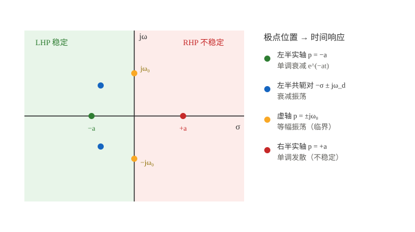
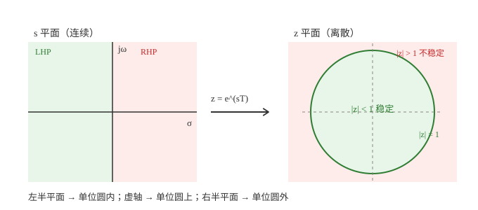

# 自动控制原理符号速览：从 s 开始

> 一句话：`s` 不是"秒"，而是一个把"微分方程"翻译成"代数方程"的变量。看懂 `s`，再回头看 `G(s)`、极点、`ζ`、`ω_n`，整张符号表就能串成一条线。

!!! note "这篇写给谁"
    - **初学者**：刚学自动控制，被 `s`、`G(s)`、`ζ`、`ω_n` 一堆符号劝退。
    - **老学员**：学过但忘了，想快速把符号和直觉捡回来。

    不追求考试推导的严密性，追求"**看到符号知道它在说什么**"。所有公式都可手算验证。

## 〇、先建立一张总图

控制理论只关心三件事：**稳不稳、快不快、准不准**。

```
时域（微分方程）  --拉普拉斯变换-->  s 域（代数）
        |                              |
        |  令 s = jω                    |  采样 z = e^{sT}
        v                              v
   频率响应（Bode）               z 域（离散控制）
```

- **时域**：`y(t)` 怎么随时间变。数学工具是微分方程。
- **s 域**：把微分方程变成代数方程，`s` 就是那个"翻译器"。
- **频域**：令 `s = jω`，看系统对不同频率正弦的放大 / 相移。
- **z 域**：单片机 / 数字控制里，把 `s` 换成 `z`。

## 一、为什么需要 s：把微积分变成代数

### 1.1 一个真实的痛点

RC 低通电路：

```
u(t) ──[ R ]──┬── c(t)
              │
             === C
              │
             GND
```

列方程（KCL）：

$$C\frac{dc(t)}{dt}+\frac{c(t)-u(t)}{R}=0$$

整理成一阶微分方程：

$$RC\frac{dc}{dt}+c=u$$

解它要算积分、带初始条件，很烦。

### 1.2 拉普拉斯变换：换一套代数

定义（了解即可，不用背）：

$$F(s)=\int_0^\infty f(t)e^{-st}\,dt$$

它最要紧的一条性质：**微分变成乘 `s`**。

$$\mathcal{L}\left\{\frac{df}{dt}\right\}=sF(s)-f(0)$$

于是上面的微分方程（零初始条件）直接变成代数方程：

$$RC\,sC(s)+C(s)=U(s)$$

$$(RCs+1)C(s)=U(s)$$

$$\boxed{G(s)=\frac{C(s)}{U(s)}=\frac{1}{RCs+1}}$$

**微分方程 → 代数方程，就这么一下。** 这就是 `s` 存在的全部理由。

### 1.3 常用变换对（当字典查）

| 时域 $f(t)$ | s 域 $F(s)$ | 直觉 |
|---|---|---|
| $\delta(t)$ 冲激 | $1$ | 一瞬间踢一脚 |
| $1(t)$ 阶跃 | $\dfrac{1}{s}$ | 突然扳到某个值 |
| $t$ | $\dfrac{1}{s^2}$ | 匀速爬升 |
| $e^{-at}$ | $\dfrac{1}{s+a}$ | 指数衰减 |
| $\sin(\omega t)$ | $\dfrac{\omega}{s^2+\omega^2}$ | 等幅振荡 |
| $\cos(\omega t)$ | $\dfrac{s}{s^2+\omega^2}$ | 等幅振荡 |
| $\dfrac{df}{dt}$ | $sF(s)-f(0)$ | 微分 = 乘 s |
| $\displaystyle\int_0^t f\,d\tau$ | $\dfrac{F(s)}{s}$ | 积分 = 除 s |

> ⚠️ `1(t)` 和 `u(t)` 都常用来表示"单位阶跃"，但 `u(t)` 也常表示"控制输入"。看到 `u(t)` 先看上下文（见第八节）。

## 二、s 到底是什么：三种等价理解

### 2.1 理解一：微分算子

在传递函数里，`s` 就是"对时间求导"这个动作的代号：

$$s\;\longleftrightarrow\;\frac{d}{dt},\qquad \frac{1}{s}\;\longleftrightarrow\;\int dt$$

所以 `s` 在分母 → 积分；在分子 → 微分。PID 里的 `Ki/s` 是积分，`Kd s` 是微分，就是这么来的。

### 2.2 理解二：复频率 $s=\sigma+j\omega$

这是最重要的几何理解。考虑信号 $e^{st}$：

$$e^{st}=e^{(\sigma+j\omega)t}=e^{\sigma t}\cdot e^{j\omega t}$$

- $e^{j\omega t}$：**转**，角频率 $\omega$，对应振荡；
- $e^{\sigma t}$：**幅度包络**，$\sigma>0$ 发散、$\sigma<0$ 衰减、$\sigma=0$ 等幅。

所以 `s` 的**实部管生死（衰减 / 增长），虚部管节奏（振荡快慢）**：

- `s = jω`（实部为 0）→ 纯正弦，**稳态频率响应**；
- `s = -a`（虚部为 0）→ 纯指数衰减，**一阶系统**；
- `s = -σ + jω` → 衰减振荡，**欠阻尼二阶系统**。

### 2.3 理解三：拉普拉斯变量

`F(s)` 是把整个时间函数"投影"到复频率轴上。`s` 是一张"坐标"，不是某个物理量，**更没有"秒"的单位**。

> ⚠️ 初学者最大的误会：把 `s` 当成 seconds。`s` 的量纲是 1/时间（频率量纲），不是时间。

## 三、传递函数 G(s)：系统的身份证

### 3.1 定义

在**零初始条件**下：

$$G(s)=\frac{Y(s)}{U(s)}$$

画成方框图：

```
U(s) ──► [ G(s) ] ──► Y(s)
```

它只由系统本身（参数、结构）决定，**与输入无关**。所以叫"系统的身份证"。

### 3.2 三个必须会写的例子

**① RC 低通**

$$G(s)=\frac{1}{RCs+1}=\frac{1}{\tau s+1},\qquad \tau=RC$$

- 时间常数 $\tau$ 的单位是秒，极点 $s=-1/\tau$。

**② 质量-弹簧-阻尼**

$$m\ddot{x}+c\dot{x}+kx=F$$

$$G(s)=\frac{X(s)}{F(s)}=\frac{1}{ms^2+cs+k}$$

**③ PID 控制器**

$$u(t)=K_p e(t)+K_i\int e\,dt+K_d\frac{de}{dt}$$

$$C(s)=K_p+\frac{K_i}{s}+K_d s$$

- `Ki/s`：积分（消静差）；`Kd s`：微分（提前预判）。

> 这三条几乎覆盖 80% 的入门题。看到 `s` 在分母别慌，它只是"积分"。

## 四、极点与零点：系统的性格

### 4.1 定义

把 $G(s)$ 写成因式形式：

$$G(s)=K\frac{(s-z_1)(s-z_2)\cdots}{(s-p_1)(s-p_2)\cdots}$$

- **零点** $z_i$：分子为 0 的点；
- **极点** $p_i$：分母为 0 的点。

### 4.2 极点决定"自由响应"和稳定性

极点位置 → 时间响应的形状：



一句话记：**极点全在左半平面（LHP）→ 稳定；只要有一个跑到右半平面（RHP）→ 不稳定；留在虚轴上 → 临界 / 等幅振荡。**

### 4.3 一阶系统：一个极点，一条指数

$$G(s)=\frac{1}{\tau s+1},\qquad p=-\frac{1}{\tau}$$

阶跃响应：

$$y(t)=1-e^{-t/\tau}$$

- $t=\tau$ 时到 63%；
- $t=3\tau$ 到 95%；
- $t=4\tau$ 到 98%（常说的"调节时间"）。

### 4.4 二阶系统：两个参数定性格

标准式：

$$G(s)=\frac{\omega_n^2}{s^2+2\zeta\omega_n s+\omega_n^2}$$

两个符号：

- $\omega_n$：**无阻尼自然频率**（rad/s），系统"想振多快"；
- $\zeta$：**阻尼比**（无量纲），系统"振得起来吗"。

极点：

$$s=-\zeta\omega_n\pm j\omega_n\sqrt{1-\zeta^2}$$

| $\zeta$ | 名称 | 极点位置 | 响应 |
|---|---|---|---|
| $0<\zeta<1$ | 欠阻尼 | 左半共轭复极点 | 衰减振荡（有超调） |
| $\zeta=1$ | 临界阻尼 | 左半实轴重根 | 最快无超调 |
| $\zeta>1$ | 过阻尼 | 左半两个实极点 | 慢，无超调 |
| $\zeta=0$ | 无阻尼 | 虚轴 | 等幅振荡 |

常用指标（欠阻尼）：

- 超调量：$M_p=e^{-\pi\zeta/\sqrt{1-\zeta^2}}$
- 峰值时间：$t_p=\dfrac{\pi}{\omega_n\sqrt{1-\zeta^2}}$
- 调节时间（2%）：$t_s\approx\dfrac{4}{\zeta\omega_n}$

> 记住这个画面：`ζ` 管"刹车"，`ω_n` 管"车速"。`ζ` 越小，超调越大、振荡越久。

### 4.5 零点管什么

零点**不直接决定稳定性**，但会改变响应形状：

- 左半零点：常让响应"起步更快"；
- 右半零点：会先"反向"一下（反调），并带来相位滞后，是控制里的麻烦制造者。

## 五、从 s 到频率响应：令 s = jω

### 5.1 为什么令 s = jω

输入正弦 $u(t)=\sin(\omega t)$ 时，系统稳态输出还是同频正弦，只是幅度和相位变了：

$$G(j\omega)=|G(j\omega)|\,e^{j\angle G(j\omega)}$$

- $|G(j\omega)|$：幅度放大倍数；
- $\angle G(j\omega)$：相位差。

### 5.2 截止频率与 −3 dB

幅度降到 $1/\sqrt2\approx0.707$ 时，对应 **−3 dB**，这个频率叫**截止频率** $\omega_c$。

对 RC 低通：

$$\omega_c=\frac{1}{RC}=\frac{1}{\tau}$$

### 5.3 Bode 图

- 横轴：频率（对数）；
- 纵轴：$20\log_{10}\vert G\vert$（dB）与相位（度）；
- 一个极点 → 高频段斜率 **−20 dB/dec**，相位趋向 −90°。

> `dB` 的两种算法：幅度用 $20\log_{10}$，功率用 $10\log_{10}$。别混。

## 六、从 s 到 z：离散控制（嵌入式必看）

单片机里没有连续时间，只有采样。设采样周期 $T$：

$$z=e^{sT},\qquad s=\frac{1}{T}\ln z$$

映射关系：



- LHP（稳定）→ 单位圆内；
- 虚轴 → 单位圆上；
- RHP（不稳定）→ 单位圆外。

工程上常用**双线性变换（Tustin）**把连续控制器变成离散：

$$s\approx\frac{2}{T}\cdot\frac{z-1}{z+1}$$

所以你在代码里看到的是差分方程，而设计时用的仍是 `s` 域。

## 七、符号速查表（贴墙用）

| 符号 | 读法 | 含义 | 单位 / 量纲 | 常见坑 |
|---|---|---|---|---|
| $s$ | 拉氏变量 / 复频率 | $s=\sigma+j\omega$，微分算子 | 1/s | **不是"秒"** |
| $\sigma$ | 西格玛 | `s` 的实部，衰减 / 增长因子 | 1/s | 也常表示应力 / 奇异值 |
| $j$ | 虚数单位 | $j^2=-1$ | — | 数学用 $i$，电路用 $j$（避开电流） |
| $\omega$ | 欧米伽 | 角频率 | rad/s | $\omega=2\pi f$，别和 $f$ 混 |
| $f$ | 频率 | 每秒周期数 | Hz | $f=\omega/2\pi$ |
| $G(s)$ | 传递函数 | 前向 / 开环传递函数 | — | 不同教材含义可能不同 |
| $H(s)$ | 传递函数 | 反馈 / 闭环（看上下文） | — | 有的书 $H$ 是反馈，有的是被控对象 |
| $\Phi(s)$ / $T(s)$ | 闭环传递函数 | 闭环 $Y/R$ | — | 和采样周期 $T$ 撞名 |
| $\mathcal{L}\{\}$ | 拉普拉斯变换 | 时域 → s 域 | — | 逆变换是 $\mathcal{L}^{-1}$ |
| $Y(s),U(s)$ | 输出 / 输入 | 拉氏域 | — | $U$ 也可能是阶跃 |
| $R(s),E(s)$ | 参考 / 误差 | 常取 $E=R-Y$ | — | 误差定义可能差符号 |
| $C(s)$ | 被控量 / 输出 | 有的书用 $C$ 表示输出 | — | 也常表示控制器 $C(s)$！ |
| $K$ | 增益 | 比例系数 | — | PID 里是 $K_p,K_i,K_d$ |
| $\tau$ | 陶 / 时间常数 | 一阶系统惯性 | s | 和采样周期 $T$ 区分 |
| $\zeta$ | 泽塔 / 阻尼比 | 二阶系统阻尼 | 无量纲 | $0<\zeta<1$ 才有超调 |
| $\omega_n$ | 自然频率 | 无阻尼自然频率 | rad/s | 不是实际振荡频率 |
| $\omega_d$ | 阻尼频率 | $\omega_n\sqrt{1-\zeta^2}$ | rad/s | $\zeta=0$ 时等于 $\omega_n$ |
| $p$ | 极点 | 分母零点 | — | 和 $z$（零点）别混 |
| $z$ | 零点 | 分子零点 | — | **和 z 变换的 $z$ 撞名！** |
| $M_p$ | 超调量 | 峰值超过稳态的百分比 | % | 只在欠阻尼有意义 |
| $t_s$ | 调节时间 | 进入 ±2%（或 ±5%）的时间 | s | 判据不同数值不同 |
| $PM,GM$ | 相位 / 幅值裕度 | 稳定余量 | ° / dB | 常见约定下都为正才稳定 |
| dB | 分贝 | $20\log_{10}\vert G\vert$ | dB | 功率用 $10\log$ |
| $T$ | 采样周期 | 离散系统采样间隔 | s | 和 $T(s)$ 撞名 |
| $\delta(t)$ | 冲激 | 单位冲激 | — | 拉氏变换为 1 |
| $1(t)$ / $u(t)$ | 阶跃 | 单位阶跃 | — | $u(t)$ 也可能是输入！ |

## 八、最容易混的 10 组符号

1. **$s$ vs 秒**：`s` 是复频率，单位 1/s；秒是时间。看到 `s` 先想"求导"。
2. **$s$ vs $j\omega$ vs $z$**：`s` 连续复频率；`jω` 是 `s` 的虚轴（稳态正弦）；`z` 是离散变量。
3. **$u(t)$ 阶跃 vs 输入**：`1(t)` 一定是阶跃；`u(t)` 看上下文。
4. **$z$ 零点 vs $z$ 变换**：同一个字母，两个身份。看它出现在因式里还是 $e^{sT}$ 里。
5. **$T$ 时间常数 vs 采样周期 vs $T(s)$**：`τ` 更常表示时间常数；`T` 在离散系统里是采样周期。
6. **$H(s)$ 反馈 vs 被控对象**：教材不统一，先看方框图。
7. **$G$ 增益 vs 传递函数**：`K` 通常是常数增益，`G(s)` 是函数。
8. **$\omega$ vs $f$**：差 $2\pi$。Bode 图横轴常标 `rad/s`，也可能是 `Hz`，看清。
9. **$K$ vs $K_p/K_i/K_d$**：`K` 是总增益；PID 的三个分量各有自己的名字。
10. **dB 的 20 vs 10**：幅度比用 $20\log$，功率比用 $10\log$。

## 九、一张图收尾

```
                 ┌── 时域：微分方程 ──┐
                 │                    │
            拉普拉斯变换          令 s = jω
                 │                    │
                 v                    v
            s 域：G(s)          频域：G(jω) / Bode
                 │
            采样 z = e^{sT}
                 │
                 v
            z 域：G(z)（数字控制）
```

记住三句话：

- **`s` 是翻译器**：微分 → 乘 `s`，积分 → 除 `s`。
- **极点是性格**：左半稳定、右半发散、虚轴振荡。
- **`ζ` 管刹车、`ω_n` 管车速**：二阶响应形状由它俩定。

## 十、自测题（合上能答才算捡回来）

1. `s` 的单位是什么？为什么不是"秒"？
2. `d/dt` 和 `1/s` 在 s 域分别对应什么运算？
3. RC 低通的传递函数、时间常数、极点各是什么？
4. 二阶系统 $\zeta=0.5,\ \omega_n=10$ rad/s，极点在哪儿？大概超调多少？
5. 极点全在左半平面说明什么？有一个在右半平面呢？
6. 为什么数字控制里要把 `s` 换成 `z`？`z=e^{sT}` 把 LHP 映射到哪儿？
7. `dB` 为什么有时用 20log、有时用 10log？
8. `u(t)` 可能表示哪两种东西？怎么区分？

> 答案都在上面。第 4 题提示：$s=-5\pm j8.66$，$M_p=e^{-\pi\cdot0.5/\sqrt{0.75}}\approx16\%$。

## 关联与延伸

- 本组首页：[自动控制](index.md)
- 数学底座：[导数与微分基础](../../数学基础/02_分析与微积分/01_导数与微分基础.md)、[微分方程与状态空间离散化](../../数学基础/02_分析与微积分/02_微分方程与状态空间离散化.md)
- 相关：[卡尔曼滤波基础](../../惯性导航/03_组合导航篇/10_卡尔曼滤波基础.md)（离散状态空间）
- 外链：[控制理论 — 维基百科](https://zh.wikipedia.org/wiki/控制理论)、[拉普拉斯变换 — 维基百科](https://zh.wikipedia.org/wiki/拉普拉斯变换)
