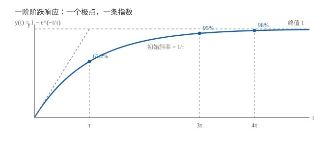
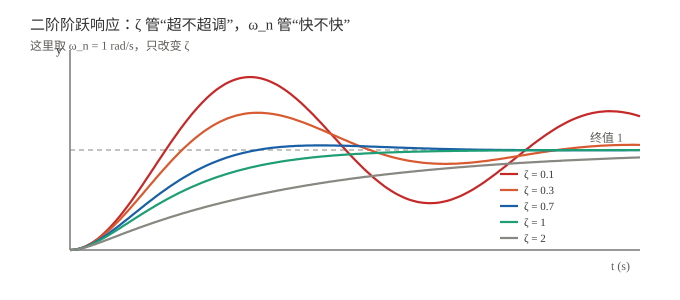
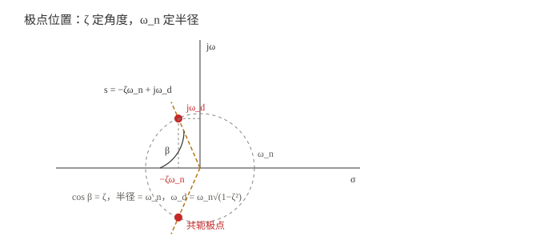

# 一阶与二阶：阶跃响应与指标

> 一句话：一阶看"多快到"（时间常数 $\tau$），二阶看"怎么到"（阻尼比 $\zeta$）和"多快"（自然频率 $\omega_n$）。阶跃响应是控制里最常用的"体检报告"。

!!! note "前置知识"
    - $s$ 域、传递函数、极点零点：[符号与 s 域入门](01_符号与s域入门.md)
    - 拉普拉斯逆变换：[拉普拉斯变换与 s 域](../../数学基础/04_复频域与变换/01_拉普拉斯变换与s域.md)
    - 复数与极点：[复数运算入门](../../数学基础/00_数学语言/03_复数运算入门.md)
    - 微分方程：[微分方程与状态空间离散化](../../数学基础/02_分析与微积分/02_微分方程与状态空间离散化.md)

## 一、为什么看阶跃响应

阶跃 = 突然把目标值扳到某个常值。它最接近工程里的"开机 / 换设定值 / 给一个指令"。

阶跃响应能同时暴露三件事：

| 问题 | 看什么 |
|---|---|
| **稳不稳** | 会不会一直振、会不会发散 |
| **快不快** | 多久进入目标附近 |
| **超不超调** | 会不会冲过头 |

> 所以调系统时，先看阶跃响应，几乎成了肌肉记忆。

## 二、一阶系统：一个极点，一条指数

标准形式：

$$G(s)=\frac{K}{\tau s+1}$$

- $K$：稳态增益；
- $\tau$：**时间常数**（秒）；
- 极点：$p=-1/\tau$（左半实轴）。

单位阶跃响应：

$$y(t)=K\left(1-e^{-t/\tau}\right)$$

### 2.1 三个关键数字

| 时刻 | 到达终值的 | 含义 |
|---|---|---|
| $t=\tau$ | 63.2% | 时间常数 |
| $t=3\tau$ | 95% | 5% 调节时间 |
| $t=4\tau$ | 98% | 2% 调节时间 |

- **初始斜率** $=K/\tau$；这条切线与终值线交于 $t=\tau$。
- **上升时间**（10%→90%）：$t_r\approx2.2\tau$。
- **调节时间**：$t_s(2\%)\approx4\tau$，$t_s(5\%)\approx3\tau$。

### 2.2 工程例子

- RC 充电：$\tau=RC$；
- 电机转速：$\tau$ 由转动惯量和阻尼决定；
- 温度传感器：$\tau$ 由热容和热阻决定。

> 一阶系统**不会超调**——极点是一个实数，响应单调爬升。看到超调，说明至少是二阶。

## 三、二阶系统：两个参数定性格

标准形式：

$$G(s)=\frac{\omega_n^2}{s^2+2\zeta\omega_n s+\omega_n^2}$$

两个符号：

- $\omega_n$：**无阻尼自然频率**（rad/s），系统"想振多快"；
- $\zeta$：**阻尼比**（无量纲），系统"振得起来吗"。

极点：

$$s=-\zeta\omega_n\pm j\omega_n\sqrt{1-\zeta^2}$$

令阻尼频率 $\omega_d=\omega_n\sqrt{1-\zeta^2}$，则极点为 $-\zeta\omega_n\pm j\omega_d$。

### 3.1 四种阻尼

| $\zeta$ | 名称 | 极点位置 | 响应 |
|---|---|---|---|
| $0<\zeta<1$ | 欠阻尼 | 左半共轭复极点 | 衰减振荡（有超调） |
| $\zeta=1$ | 临界阻尼 | 左半实轴重根 | 最快无超调 |
| $\zeta>1$ | 过阻尼 | 左半两个实极点 | 慢，无超调 |
| $\zeta=0$ | 无阻尼 | 虚轴 | 等幅振荡 |
| $\zeta<0$ | 负阻尼 | 右半平面 | 发散（不稳定） |

> 记住画面：**$\zeta$ 管"刹车"，$\omega_n$ 管"车速"**。$\zeta$ 越小，超调越大、振荡越久；$\omega_n$ 越大，整体越快。

### 3.2 欠阻尼的阶跃响应

$$y(t)=1-e^{-\zeta\omega_n t}\left[\cos(\omega_d t)+\frac{\zeta}{\sqrt{1-\zeta^2}}\sin(\omega_d t)\right]$$

也可以写成：

$$y(t)=1-\frac{1}{\sqrt{1-\zeta^2}}e^{-\zeta\omega_n t}\sin(\omega_d t+\varphi),\qquad \varphi=\arccos\zeta$$

- 包络：$e^{-\zeta\omega_n t}$；
- 振荡频率：$\omega_d=\omega_n\sqrt{1-\zeta^2}$；
- $\zeta=1$ 时：$y(t)=1-e^{-\omega_n t}(1+\omega_n t)$。

## 四、三个指标

| 指标 | 公式 | 说明 |
|---|---|---|
| 峰值时间 | $t_p=\dfrac{\pi}{\omega_d}$ | 第一次冲到最高点 |
| 超调量 | $M_p=e^{-\pi\zeta/\sqrt{1-\zeta^2}}$ | 只与 $\zeta$ 有关 |
| 调节时间（2%） | $t_s\approx\dfrac{4}{\zeta\omega_n}$ | 进入 ±2% 并保持 |
| 调节时间（5%） | $t_s\approx\dfrac{3}{\zeta\omega_n}$ | 进入 ±5% 并保持 |
| 上升时间（0→100%） | $t_r=\dfrac{\pi-\beta}{\omega_d}$ | $\beta=\arccos\zeta$ |

> 图里：**$\zeta$ 定角度 $\beta$（$\cos\beta=\zeta$），$\omega_n$ 定半径**。极点越靠左，衰减越快；越靠上，振荡越快。

### 4.1 $\zeta$ 与超调量对照

| $\zeta$ | $M_p$ |
|---|---|
| 0.1 | 72.9% |
| 0.2 | 52.7% |
| 0.3 | 37.2% |
| 0.4 | 25.4% |
| 0.5 | 16.3% |
| 0.6 | 9.5% |
| 0.7 | 4.6% |
| 0.8 | 1.5% |
| 1.0 | 0 |

> 工程上常取 $\zeta=0.4\sim0.8$：超调 25%~1.5%，响应速度和稳定性折中。

## 五、正问题：给参数，估响应

例：$\zeta=0.5,\ \omega_n=4$ rad/s。

- 极点：$-2\pm j3.464$；
- 超调：$M_p=e^{-\pi\cdot0.5/\sqrt{0.75}}\approx16.3\%$；
- 峰值时间：$t_p=\pi/3.464\approx0.907$ s；
- 调节时间（2%）：$t_s\approx4/(0.5\times4)=2$ s；
- 上升时间：$t_r=(\pi-\arccos0.5)/3.464\approx0.605$ s。

**读法**：先看 $\zeta$ 估超调，再看 $\omega_n$ 估速度。

## 六、反问题：给指标，选参数

例：要求 $M_p\le10\%$，$t_s(2\%)\le1$ s。

**第一步：由超调定 $\zeta$**

$$e^{-\pi\zeta/\sqrt{1-\zeta^2}}=0.1\;\Longrightarrow\;\zeta\approx0.59$$

**第二步：由调节时间定 $\omega_n$**

$$t_s\approx\frac{4}{\zeta\omega_n}\le1\;\Longrightarrow\;\omega_n\ge\frac{4}{0.59\times1}\approx6.8\ \text{rad/s}$$

**第三步：写极点**

$$s=-4\pm j5.46$$

取 $\omega_n=6.8$，$\zeta=0.59$，即可满足指标。

> 这就是"指标 → 参数"的常见设计路径。真实系统还要考虑饱和、噪声、执行器带宽，不会只算这一步。

## 七、二阶近似与零点

上面的公式只对**标准二阶**（无零点、无额外极点）严格成立。实际系统里：

- **主导极点对**：离虚轴最近的一对共轭极点，决定响应形状；
- **额外极点**：让响应变慢；
- **零点**：改变超调；右半零点会先"反向"一下（反调）；
- 所以"用二阶公式估高阶系统"是近似，不是精确。

## 八、常见坑

1. **$t_s$ 的 2% / 5% 判据**：同一个系统，$4/(\zeta\omega_n)$ 和 $3/(\zeta\omega_n)$ 差 33%。
2. **$M_p$ 只在欠阻尼有意义**：$\zeta\ge1$ 没有超调。
3. **$\omega_n$ 不是实际振荡频率**：实际是 $\omega_d=\omega_n\sqrt{1-\zeta^2}$。
4. **公式假设标准二阶**：有零点 / 额外极点时，$M_p$ 公式会偏。
5. **阶跃 vs 冲激**：两者响应不同，别混。
6. **rad/s vs Hz**：$\omega_n$ 是 rad/s，换成 Hz 要除 $2\pi$。
7. **一阶不会超调**：看到超调，至少是二阶。
8. **$\zeta<0$ 会发散**：右半平面极点，不是"振得厉害"，是"不稳定"。

## 九、自测题（合上能答才算会）

1. 一阶系统 $\tau=0.5$ s，$t_s(2\%)$ 大约多少？
2. 二阶 $\zeta=0.3$，超调大约多少？
3. 二阶 $\zeta=0.7,\ \omega_n=10$ rad/s，峰值时间大约多少？
4. 要求 $M_p\le5\%$，$\zeta$ 大约取多少？
5. 为什么 $\zeta$ 变小，超调会变大？
6. 一阶系统能不能超调？为什么？
7. $t_s$ 用 2% 和 5% 判据，差多少？
8. 二阶标准式的两个前提是什么？

> 答案都在上面。提示：1）$4\tau=2$ s；2）约 37%；3）$\omega_d=7.14$，$t_p\approx0.44$ s；4）约 0.69。

## 关联与延伸

- 上一篇：[符号与 s 域入门](01_符号与s域入门.md)（$s$、$G(s)$、极点、$\zeta/\omega_n$）
- 下一篇（待写）：**03 Bode 图：频率响应读图**
- 数学工具：[拉普拉斯变换与 s 域](../../数学基础/04_复频域与变换/01_拉普拉斯变换与s域.md)、[频率与傅里叶直觉](../../数学基础/04_复频域与变换/02_频率与傅里叶直觉.md)
- 本组首页：[自动控制](index.md)
