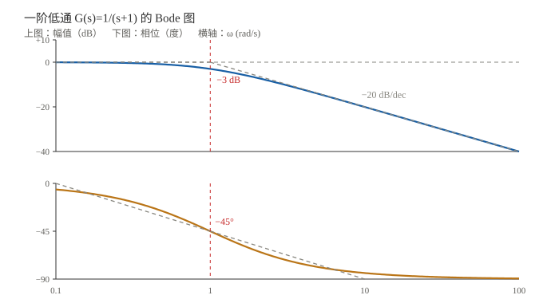
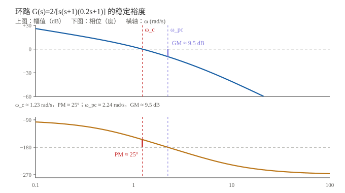

# Bode 图：频率响应读图

> 一句话：Bode 图把系统的频率响应拆成两张图——**幅值（dB）随频率怎么变、相位（度）随频率怎么变**。横轴是对数频率，所以"每十倍频"的斜率一眼就能看出来。

!!! note "前置知识"
    - $s$ 域、传递函数、极点零点：[符号与 s 域入门](01_符号与s域入门.md)
    - 一阶 / 二阶的时域响应：[一阶与二阶：阶跃响应与指标](02_一阶与二阶_时域响应.md)
    - 拉普拉斯与频率：[拉普拉斯变换与 s 域](../../数学基础/04_复频域与变换/01_拉普拉斯变换与s域.md)、[频率与傅里叶直觉](../../数学基础/04_复频域与变换/02_频率与傅里叶直觉.md)

## 一、Bode 图是什么

把 $s=j\omega$ 代进 $G(s)$，得到频率响应 $G(j\omega)$。它有两个信息：

- **幅值** $\vert G(j\omega)\vert$：这个频率的信号被放大 / 衰减多少；
- **相位** $\angle G(j\omega)$：输出相对输入超前 / 滞后多少度。

Bode 图就是：

| 图 | 纵轴 | 横轴 |
|---|---|---|
| 幅频图 | $20\log_{10}\vert G(j\omega)\vert$（dB） | $\log_{10}\omega$ |
| 相频图 | $\angle G(j\omega)$（度） | $\log_{10}\omega$ |

> 横轴用对数：**同样的水平距离 = 同样的倍数**（比如 1→10 和 10→100 一样宽）。所以"−20 dB/dec"在图上是一条直线。

## 二、从 G(jω) 到 Bode

$$G(j\omega)=\left.G(s)\right|_{s=j\omega}$$

- 幅值：$20\log_{10}\vert G(j\omega)\vert$；
- 相位：$\angle G(j\omega)$。

> `dB` 用 20log 是因为幅值是"线性量"；功率才用 10log。别混。

## 三、六个基本因子（背这几条就够）

| 因子 | 幅值渐近线 | 相位 | 转折点 |
|---|---|---|---|
| 常数 $K$ | 平直，$20\log K$ | $0^\circ$ | — |
| 积分 $\dfrac{1}{s}$ | 斜率 $-20$ dB/dec | $-90^\circ$ | — |
| 微分 $s$ | 斜率 $+20$ dB/dec | $+90^\circ$ | — |
| 一阶极点 $\dfrac{1}{1+s/\omega_c}$ | 低频 0，高频 $-20$ dB/dec | $0^\circ\to-90^\circ$（$\omega_c$ 处 $-45^\circ$） | $\omega_c$ |
| 一阶零点 $1+s/\omega_z$ | 低频 0，高频 $+20$ dB/dec | $0^\circ\to+90^\circ$（$\omega_z$ 处 $+45^\circ$） | $\omega_z$ |
| 二阶极点 $\dfrac{1}{1+2\zeta s/\omega_n+s^2/\omega_n^2}$ | 高频 $-40$ dB/dec | $0^\circ\to-180^\circ$ | $\omega_n$（$\zeta<0.707$ 有谐振峰） |

> 组合规则：**幅值斜率相加，相位相加**。所以看到 $1/[s(s+1)]$，就是"积分 −20" + "一阶极点再 −20" = 高频 −40 dB/dec。

## 四、先读一张最简单的：一阶低通

$$G(s)=\frac{1}{s+1},\qquad \omega_c=1\ \text{rad/s}$$

读图：

- **低频**：幅值 0 dB，相位 0°——信号原样通过；
- **转折频率** $\omega_c=1$：幅值 $-3$ dB，相位 $-45^\circ$；
- **高频**：幅值斜率 $-20$ dB/dec，相位趋向 $-90^\circ$。

> 一阶低通就是"低通滤波器"的原型：低频过、高频衰减，转折点附近开始滞后。

## 五、稳定裕度：Bode 图最重要的用途

控制系统通常是**闭环**的，但 Bode 画的是**开环** $G(s)H(s)$。开环的 Bode 图能预测闭环稳不稳，靠的就是两个裕度。

### 5.1 两个频率

| 名称 | 定义 | 记法 |
|---|---|---|
| 增益穿越频率 | 幅值降到 0 dB 的频率 | $\omega_c$（或 $\omega_{gc}$） |
| 相位穿越频率 | 相位到 $-180^\circ$ 的频率 | $\omega_{pc}$ |

### 5.2 两个裕度

$$\text{PM}=180^\circ+\angle G(j\omega_c)$$

$$\text{GM}=-20\log_{10}\vert G(j\omega_{pc})\vert\ \text{(dB)}$$

- **相位裕度 PM**：在 $\omega_c$ 处，相位离 $-180^\circ$ 还有多少"余量"；
- **增益裕度 GM**：在 $\omega_{pc}$ 处，幅值离 0 dB 还有多少"余量"。

### 5.3 判据（最小相位系统）

| 条件 | 含义 |
|---|---|
| $\text{PM}>0^\circ$ 且 $\text{GM}>0$ dB | 闭环稳定 |
| $\text{PM}=0^\circ$ 或 $\text{GM}=0$ dB | 临界 |
| $\text{PM}<0^\circ$ 或 $\text{GM}<0$ dB | 闭环不稳定 |

> 工程经验：**PM 取 $45^\circ\sim60^\circ$，GM 取 $6\sim10$ dB**，兼顾稳定与速度。
> ⚠️ 这套判据针对**最小相位系统**；有右半平面零点 / 纯延迟时，要用 Nyquist 判据。

## 六、完整例子：一个三阶环路

$$G(s)=\frac{2}{s(s+1)(0.2s+1)}$$

从图上读：

| 量 | 数值 | 含义 |
|---|---|---|
| $\omega_c$ | $\approx1.23$ rad/s | 增益穿越 |
| PM | $\approx25^\circ$ | 偏小 |
| $\omega_{pc}$ | $\approx2.24$ rad/s | 相位穿越 |
| GM | $\approx9.5$ dB | 尚可 |

**判断**：系统稳定（PM、GM 都为正），但 **PM 只有 25°，偏小**——闭环阶跃响应会有明显超调和振荡。要改善，可以：

- 降低增益（$\omega_c$ 左移，PM 变大，但变慢）；
- 加相位超前校正（PD / 超前网络）；
- 把第二个极点往右推（减小 $0.2s$ 那项的影响）。

## 七、读图三步（拿到一张 Bode 先看什么）

1. **低频段**：斜率是 0 / −20 / −40 dB/dec？对应 0 / 1 / 2 个积分环节，决定稳态误差的"型别"。
2. **穿越频率 $\omega_c$**：0 dB 点在哪儿？越靠右，闭环带宽越大、响应越快，但抗噪越差。
3. **裕度**：PM / GM 够不够？PM < 45° 就要警惕超调，PM < 30° 基本是"能跑但不好用"。

> 一句话：**低频看型别，中频看速度，高频看裕度。**

## 八、常见坑

1. **dB 用 20log 还是 10log**：幅值 20log，功率 10log。
2. **横轴是对数**：1→10 和 10→100 一样宽；别按线性刻度读。
3. **PM / GM 的符号约定**：本文用"都为正 = 稳定"的常见约定；有些工具/教材符号相反，先看清。
4. **Bode 是开环**：闭环带宽 ≠ 开环 $\omega_c$，但正相关。
5. **最小相位前提**：有右半零点或纯延迟时，PM/GM 判据不够，要 Nyquist。
6. **相位缠绕**：$-270^\circ$ 可能显示成 $+90^\circ$，看连续曲线。
7. **转折频率 ≠ 截止频率**：一阶时二者重合；高阶时 $-3$ dB 点和渐近线拐点不是一回事。
8. **谐振峰**：二阶 $\zeta<0.707$ 时幅值会鼓起一个峰，别当成"系统坏了"。

## 九、自测题（合上能答才算会）

1. 一阶低通的转折频率、$-3$ dB 点、转折处相位各是多少？
2. 一个积分环节的幅值斜率和相位是多少？
3. $G(s)=10/[s(s+1)]$ 的 $\omega_c$ 大约多少？PM 大约多少？
4. PM = 0° 意味着什么？PM < 0° 呢？
5. GM 的定义和单位是什么？
6. 为什么 Bode 横轴用对数？
7. 低频斜率 $-20$ / $-40$ dB/dec 分别说明什么？
8. 最小相位系统的 PM/GM 判据，前提是什么？

> 提示：3）$\omega_c\approx3.08$ rad/s，PM $\approx18^\circ$；4）临界 / 不稳定。

## 关联与延伸

- 上一篇：[一阶与二阶：阶跃响应与指标](02_一阶与二阶_时域响应.md)
- 下一篇（待写）：**04 稳定性与根轨迹**
- 数学工具：[拉普拉斯变换与 s 域](../../数学基础/04_复频域与变换/01_拉普拉斯变换与s域.md)、[频率与傅里叶直觉](../../数学基础/04_复频域与变换/02_频率与傅里叶直觉.md)
- 本组首页：[自动控制](index.md)
