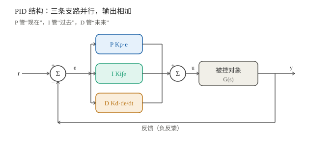
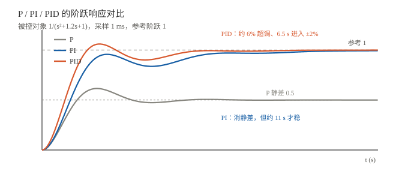

# PID：从 s 域到 C 代码

> 一句话：PID 就是"按现在的误差（P）、过去的累积误差（I）、未来的变化趋势（D）"三路相加。难点不在公式，而在**离散化、限幅、抗饱和、微分滤波**这四件工程事。

!!! note "前置知识"
    - $s$ 域与传递函数：[符号与 s 域入门](01_符号与s域入门.md)
    - 时域指标：[一阶与二阶：阶跃响应与指标](02_一阶与二阶_时域响应.md)
    - 稳定性：[稳定性与根轨迹](04_稳定性与根轨迹.md)
    - 拉普拉斯：[拉普拉斯变换与 s 域](../../数学基础/04_复频域与变换/01_拉普拉斯变换与s域.md)

## 一、PID 是什么

连续时间（并行形式）：

$$u(t)=K_p e(t)+K_i\int_0^t e(\tau)\,d\tau+K_d\frac{de(t)}{dt}$$

拉普拉斯：

$$C(s)=K_p+\frac{K_i}{s}+K_d s$$



另一种常见写法（标准形式）：

$$C(s)=K_p\left(1+\frac{1}{T_i s}+T_d s\right)$$

换算关系：

$$K_i=\frac{K_p}{T_i},\qquad K_d=K_p T_d$$

> ⚠️ 看论文/代码先确认用的是哪套：`Ki`（1/s）还是 `Ti`（s），`Kd`（s）还是 `Td`（s）。混了会差一个量级。

## 二、P / I / D 各自在做什么

| 项 | 管什么 | 调大后 | 副作用 |
|---|---|---|---|
| **P** | 现在的误差 | 响应快、静差小 | 超调、振荡 |
| **I** | 过去的累积误差 | 消除静差 | 超调、积分饱和 |
| **D** | 未来的变化趋势 | 抑制超调、加阻尼 | 放大噪声、微分冲击 |



同一被控对象 $G(s)=1/(s^2+1.2s+1)$、采样 1 ms：

| 控制器 | 参数 | 结果 |
|---|---|---|
| P | $K_p=1$ | 终值 0.5，**静差 0.5** |
| PI | $K_p=1,\ K_i=0.5$ | 终值 0.993，**消静差**，但约 11 s 才稳 |
| PID | $K_p=1.5,\ K_i=0.8,\ K_d=0.3$ | **约 6% 超调、6.5 s 进入 ±2%** |

> 一句话读图：**P 管"到得快"，I 管"到得准"，D 管"别冲过头"**。

## 三、从 s 域到离散：两种写法

设采样周期 $T$，第 $k$ 步误差 $e[k]=r[k]-y[k]$。

### 3.1 位置式（position form）

$$u[k]=K_p e[k]+I[k]+D[k]$$

- 积分（后向欧拉）：$I[k]=I[k-1]+K_i T\,e[k]$
- 积分（梯形）：$I[k]=I[k-1]+\dfrac{K_i T}{2}\big(e[k]+e[k-1]\big)$
- 微分（原始）：$D[k]=K_d\dfrac{e[k]-e[k-1]}{T}$
- 微分（滤波）：$D_f[k]=\alpha D_f[k-1]+(1-\alpha)K_d\dfrac{e[k]-e[k-1]}{T}$，$\alpha=\dfrac{\tau_d}{\tau_d+T}$

特点：**直接算出绝对输出**；需要保存积分状态；抗饱和要额外处理。

### 3.2 增量式（incremental form）

$$\Delta u[k]=K_p(e[k]-e[k-1])+K_i T\,e[k]+\frac{K_d}{T}\big(e[k]-2e[k-1]+e[k-2]\big)$$

$$u[k]=u[k-1]+\Delta u[k]$$

特点：**输出增量**；天然"无扰切换"（手动→自动不必初始化积分）；抗饱和更容易；但丢掉了绝对积分状态，某些场景不好限幅。

### 3.3 微分为什么常对"测量值"求导

如果 $D$ 对误差求导，设定值一阶跃，$de/dt$ 会出现一个巨大的尖峰——**微分冲击（derivative kick）**。

工程做法：**对测量值求导**（设定值不变时，$de/dt=-dy/dt$）：

$$D[k]=-K_d\frac{y[k]-y[k-1]}{T}$$

设定值突变时，微分项不会爆；代价是"设定值变化时没有微分预判"，通常可接受。

## 四、工程上必须处理的四件事

| # | 问题 | 现象 | 解决 |
|---|---|---|---|
| 1 | **积分饱和** | 执行器到限幅，误差还在累积，反向时长时间退不出来 | 积分钳位 / 条件积分 / 反算 |
| 2 | **微分噪声** | 测量噪声被微分放大，输出抖 | 低通滤波（$\tau_d$）/ 减小 $K_d$ |
| 3 | **输出限幅** | 执行器有物理上下限 | `clamp(u, u_min, u_max)` |
| 4 | **采样周期** | $T$ 太大 → 离散近似失真、延迟大 | $T$ 取闭环带宽的 1/10~1/20，且尽量固定 |

**抗积分饱和**最常用的一招是"积分钳位"：算完 P、D 后，把积分项限制在"让总输出刚好不越界"的范围内：

$$I_{\min}=u_{\min}-P-D,\qquad I_{\max}=u_{\max}-P-D$$

再把 $I$ 夹在 $[I_{\min},I_{\max}]$ 之间。简单、有效、无需额外参数。

## 五、C 实现（可直接放到 STM32）

下面这份是**位置式 + 测量值微分 + 一阶滤波 + 积分钳位**，适合 1 kHz 左右的固定周期调用。

```c
typedef struct {
    float kp, ki, kd;
    float T;            /* 采样周期，s */
    float tau_d;        /* 微分滤波时间常数，s；0 表示不滤波 */
    float i_state;      /* 积分项（已经是 Ki∫e，不是原始积分） */
    float d_state;      /* 滤波后的微分项 */
    float y_prev;       /* 上一步测量值 */
    float u_min, u_max; /* 输出限幅 */
    int   inited;       /* 首次调用标志，避免微分冲击 */
} PID;

void pid_init(PID *p, float kp, float ki, float kd,
              float T, float tau_d, float u_min, float u_max)
{
    p->kp = kp; p->ki = ki; p->kd = kd;
    p->T = T; p->tau_d = tau_d;
    p->i_state = 0.0f;
    p->d_state = 0.0f;
    p->y_prev = 0.0f;
    p->u_min = u_min;
    p->u_max = u_max;
    p->inited = 0;
}

float pid_update(PID *p, float ref, float y)
{
    float e = ref - y;

    /* 首次调用：记录测量值，避免 y_prev=0 造成的微分冲击 */
    if (!p->inited) {
        p->y_prev = y;
        p->inited = 1;
    }

    /* P */
    float p_term = p->kp * e;

    /* I：后向欧拉 */
    p->i_state += p->ki * p->T * e;

    /* D：对测量值求导 + 一阶低通 */
    float d_raw = -p->kd * (y - p->y_prev) / p->T;
    float alpha = (p->tau_d > 0.0f) ? (p->tau_d / (p->tau_d + p->T)) : 0.0f;
    p->d_state = alpha * p->d_state + (1.0f - alpha) * d_raw;
    p->y_prev = y;

    /* 抗积分饱和：把积分项夹到“总输出不越界”的范围 */
    float i_min = p->u_min - p_term - p->d_state;
    float i_max = p->u_max - p_term - p->d_state;
    if (p->i_state < i_min) p->i_state = i_min;
    if (p->i_state > i_max) p->i_state = i_max;

    /* 输出限幅 */
    float u = p_term + p->i_state + p->d_state;
    if (u < p->u_min) u = p->u_min;
    if (u > p->u_max) u = p->u_max;
    return u;
}
```

调用：

```c
PID pid;
pid_init(&pid, 1.5f, 0.8f, 0.3f, 0.001f, 0.05f, -1.0f, 1.0f);

/* 1 kHz 定时器中断里 */
float u = pid_update(&pid, ref, meas);
```

> 几个约定：
> - `ki` 的单位是 **1/s**，`kd` 的单位是 **s**；`ki*T` 才是每步增量。
> - `i_state` 存的是**积分项**（已乘 `ki`），不是原始 $\int e$。在线改 `ki` 时要注意这一点。
> - `tau_d=0` 时不滤波；一般取 `tau_d = (0.05~0.2) * T_d` 或几个采样周期。
> - 手动/自动切换时，把 `i_state` 初始化成 `u_current - p_term - d_state`，实现无扰切换。

## 六、整定：先 P，再 I，最后 D

### 6.1 手工整定

1. **P**：$K_i=K_d=0$，逐渐增大 $K_p$，到"轻微等幅振荡"后回退 30%~50%；
2. **I**：加 $K_i$，直到静差消除；过大就减；
3. **D**：加 $K_d$，抑制超调；噪声大就减小或加滤波。

### 6.2 Ziegler-Nichols（临界比例度法）

只加 P，增大到**等幅振荡**，记录临界增益 $K_u$ 与振荡周期 $T_u$：

| 控制器 | $K_p$ | $T_i$ | $T_d$ |
|---|---|---|---|
| P | $0.5K_u$ | — | — |
| PI | $0.45K_u$ | $0.83T_u$ | — |
| PID | $0.6K_u$ | $0.5T_u$ | $0.125T_u$ |

换算：$K_i=K_p/T_i$，$K_d=K_p T_d$。

> ZN 偏激进，适合做**起点**，再按超调/噪声手工微调。

## 七、常见坑

1. **`Ki` 与 `Ti` 混用**：差一个 $K_p$。
2. **离散 `Ki*T` 漏乘**：连续 $K_i$ 直接抄进代码，实际积分速度差 $1/T$ 倍。
3. **积分饱和**：不处理，执行器一限幅就"积分越积越大"，反向时大超调。
4. **微分冲击**：设定值阶跃时 $de/dt$ 爆尖峰；改成对测量值求导。
5. **微分噪声**：不滤波直接把传感器噪声放大；加 $\tau_d$ 或减小 $K_d$。
6. **采样太慢/抖动**：$T$ 不固定，离散近似和积分都不准。
7. **反馈符号**：负反馈写成正反馈，直接发散。
8. **单位不统一**：误差用 rad 还是 deg、输出用 N·m 还是 PWM，增益全变。
9. **无扰切换**：手动切自动时积分没初始化，输出跳变。
10. **执行器死区/饱和**：PID 算得再好，执行器不响应也没用。

## 八、自测题（合上能答才算会）

1. P / I / D 各自解决什么问题？调大有什么副作用？
2. $K_i$ 与 $T_i$、$K_d$ 与 $T_d$ 的关系？
3. 位置式与增量式各有什么优缺点？
4. 为什么积分会饱和？本文的 C 代码怎么抗？
5. 为什么微分要对测量值求导？代价是什么？
6. 采样周期怎么选？太大/太小各有什么问题？
7. ZN 整定的步骤？$K_u$、$T_u$ 是什么？
8. 手动切自动时，怎么做无扰切换？

> 提示：4）积分钳位；5）避免微分冲击，代价是设定值变化时没有微分预判；7）等幅振荡时的增益与周期。

## 在线调参 / 仿真（外部工具）

- **[ControlMePlease](https://controlmeplease.com/)**：单页的“质量-弹簧-阻尼 + PID”仿真器。可调 $m/c/k$、$K_p/K_i/K_d$、目标值、输出限幅；微分带一阶滤波（$N=100$，$T_s=1$ ms），积分在饱和时会暂停。适合快速感受三个增益的手感。
- **[Control Theory Simulator](https://cool-koala.github.io/Control-Theory-Simulator/)**：MIT 开源的 Vite + React 仿真器，内置 99 个控制器原型；支持阶跃 / 正弦 / 方波、执行器饱和、死区、时延、摩擦、噪声，带质量块动画和波形。适合横向对比不同控制器。

> 这两个是外部站点，不在本站维护；如果后续做站内 PID Lab，会把最常用的“质量-弹簧-阻尼 + PID”搬进来，便于离线练习。

## 关联与延伸

- 上一篇：[稳定性与根轨迹](04_稳定性与根轨迹.md)
- 数学工具：[拉普拉斯变换与 s 域](../../数学基础/04_复频域与变换/01_拉普拉斯变换与s域.md)
- 本组首页：[自动控制](index.md)
- 后续（待写）：状态空间与能控能观、数字控制进阶（Tustin / 前馈 / 串级）
