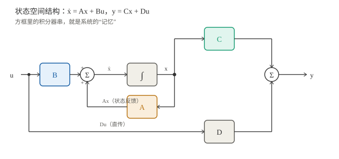
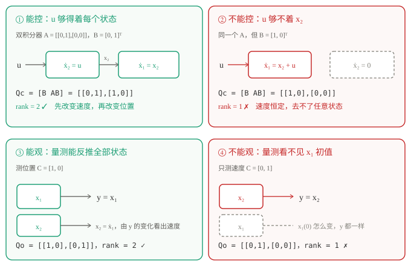

# 状态空间与能控能观

> 一句话：传递函数只描述"输入到输出"，状态空间把系统**内部**摊开——$\dot{\mathbf x}=A\mathbf x+B\mathbf u$。而**能控/能观**回答两个根本问题：我的执行器够不够得着每个状态？我的传感器看不看得见每个状态？

!!! note "前置知识"
    - $s$ 域与传递函数：[符号与 s 域入门](01_符号与s域入门.md)
    - 极点与稳定性：[稳定性与根轨迹](04_稳定性与根轨迹.md)
    - 矩阵、特征值：[向量与矩阵入门](../../数学基础/00_数学语言/02_向量与矩阵入门.md)
    - 矩阵指数与离散化：[微分方程与状态空间离散化](../../数学基础/02_分析与微积分/02_微分方程与状态空间离散化.md)
    - 拉普拉斯：[拉普拉斯变换与 s 域](../../数学基础/04_复频域与变换/01_拉普拉斯变换与s域.md)

## 一、传递函数不够用了

前五篇一直用 $G(s)=Y(s)/U(s)$。它很好用，但有四个硬伤：

| 局限 | 具体表现 |
|---|---|
| **只看得到输入输出** | 系统内部状态可能已经剧烈振荡，端口上却看不出来 |
| **默认零初始条件** | 有初始储能（电容带电、物体有初速度）时不方便 |
| **难推广到 MIMO** | 多输入多输出要写成传递函数矩阵，越写越乱 |
| **零极点对消会骗人** | 一个不稳定模态被对消掉，$G(s)$ 上看不见，系统内部却在发散 |

状态空间把"内部"显式写出来，这四条都解决了。它也是**卡尔曼滤波 / ESKF 的母语**——滤波器估的就是状态 $\mathbf x$。

## 二、状态与状态空间表达式

### 2.1 什么是"状态"

> **状态** = 能完全决定系统未来行为的**最小**变量集合：给定 $\mathbf x(t_0)$ 和 $t\ge t_0$ 的输入 $\mathbf u(t)$，就能唯一算出之后任意时刻的行为。

注意"最小"二字：状态变量个数 = 系统独立储能元件个数 = 微分方程的阶数。质量-弹簧-阻尼是二阶系统（弹簧存势能、质量存动能），所以需要 **2 个**状态变量。

### 2.2 四个矩阵

$$\dot{\mathbf x}=A\mathbf x+B\mathbf u,\qquad \mathbf y=C\mathbf x+D\mathbf u$$

| 符号 | 名称 | 维度 | 作用 |
|---|---|---|---|
| $\mathbf x$ | 状态向量 | $n\times 1$ | 系统的"记忆" |
| $\mathbf u$ | 输入 | $p\times 1$ | 执行器能施加的量 |
| $\mathbf y$ | 输出 | $q\times 1$ | 传感器能测到的量 |
| $A$ | 系统矩阵 | $n\times n$ | 状态自己怎么演化（决定极点） |
| $B$ | 输入矩阵 | $n\times p$ | 输入从哪儿进 |
| $C$ | 输出矩阵 | $q\times n$ | 从状态里挑哪些量测 |
| $D$ | 直传矩阵 | $q\times p$ | 输入直接漏到输出（多数物理系统 $D=0$） |



> 读图：$\int$ 就是"一串积分器"，积分器里存的就是状态。$A$ 把状态反馈到导数端，$B$ 把输入送进来，$C$ 从状态里取输出，$D$ 是直通捷径。

### 2.3 例子：质量-弹簧-阻尼（和前面几篇同一个对象）

$$m\ddot x+c\dot x+kx=F$$

取 $x_1=x$（位置）、$x_2=\dot x$（速度）：

$$\dot x_1=x_2,\qquad \dot x_2=-\frac{k}{m}x_1-\frac{c}{m}x_2+\frac{1}{m}F$$

$$
A=\begin{bmatrix}0&1\\ -\frac{k}{m}&-\frac{c}{m}\end{bmatrix},\quad
B=\begin{bmatrix}0\\ \frac{1}{m}\end{bmatrix},\quad
C=\begin{bmatrix}1&0\end{bmatrix},\quad D=0
$$

代 $m=1,\ c=0.5,\ k=1$：

$$
A=\begin{bmatrix}0&1\\ -1&-0.5\end{bmatrix},\quad
B=\begin{bmatrix}0\\ 1\end{bmatrix},\quad
C=\begin{bmatrix}1&0\end{bmatrix}
$$

**验证它和传递函数是同一件事**：

$$sI-A=\begin{bmatrix}s&-1\\ 1&s+0.5\end{bmatrix},\quad \det(sI-A)=s^2+0.5s+1$$

$$G(s)=C(sI-A)^{-1}B=\frac{1}{s^2+0.5s+1}$$

和 [02 篇](02_一阶与二阶_时域响应.md) 用的对象完全一致。✅已确认

> 选状态不是唯一的：取 $x_1=$ 位置、$x_2=$ 动量 $m\dot x$ 也行，只是 $A,B$ 里的数字变了，**特征值不变**（见 3.2）。

## 三、从传递函数到状态空间

### 3.1 能控标准型（相变量实现）

给定严格真分式

$$G(s)=\frac{b_{n-1}s^{n-1}+\cdots+b_1s+b_0}{s^n+a_{n-1}s^{n-1}+\cdots+a_1s+a_0}$$

一个通用实现是**伴友矩阵**：

$$
A=\begin{bmatrix}
0&1&0&\cdots&0\\
0&0&1&\cdots&0\\
\vdots&&&\ddots&\vdots\\
0&0&0&\cdots&1\\
-a_0&-a_1&-a_2&\cdots&-a_{n-1}
\end{bmatrix},\quad
B=\begin{bmatrix}0\\ \vdots\\ 0\\ 1\end{bmatrix},\quad
C=\begin{bmatrix}b_0&b_1&\cdots&b_{n-1}\end{bmatrix},\quad D=0
$$

二阶验证：$a_0=1,a_1=0.5,b_0=1,b_1=0$ → 正好得到 2.3 里的 $A,B,C$。✅已确认

### 3.2 状态不唯一：相似变换

令 $\mathbf x=T\mathbf z$（$T$ 可逆），则

$$A'=T^{-1}AT,\quad B'=T^{-1}B,\quad C'=CT,\quad D'=D$$

不变的量：**特征值**、**传递函数**、**能控性**、**能观性**。

> 所以"状态"是坐标，"系统"是几何对象；换一组基，$A$ 变样子，物理不变。这和 [坐标变换与旋转矩阵](../../数学基础/01_代数与几何/02_坐标变换与旋转矩阵.md) 是同一个道理。

## 四、状态转移矩阵与解

### 4.1 矩阵指数

$$\Phi(t)=e^{At}=I+At+\frac{A^2t^2}{2!}+\cdots,\qquad \mathcal{L}\{e^{At}\}=(sI-A)^{-1}$$

三条基本性质：$\Phi(0)=I$，$\dot\Phi=A\Phi$，$\Phi(t_1+t_2)=\Phi(t_1)\Phi(t_2)$。

### 4.2 解的分解

$$\mathbf x(t)=\underbrace{e^{At}\mathbf x(0)}_{\text{零输入响应}}+\underbrace{\int_0^t e^{A(t-\tau)}B\mathbf u(\tau)\,d\tau}_{\text{零状态响应}}$$

第一项是"初始储能自己衰减/振荡"，第二项是"输入逼出来的"。传递函数其实只描述第二项（零初始条件），这正是第一节说的局限。

### 4.3 与特征值的关系

若 $A$ 可对角化 $A=V\Lambda V^{-1}$，则 $e^{At}=Ve^{\Lambda t}V^{-1}$，$e^{\Lambda t}=\operatorname{diag}(e^{\lambda_i t})$。

**所以 $A$ 的特征值就是系统极点**，稳定性判据从"$\det(sI-A)=0$ 的根在左半平面"变成"$\operatorname{Re}\lambda_i<0$"，与 [04 篇](04_稳定性与根轨迹.md) 完全一致。✅已确认

## 五、离散化：从 $A$ 到 $A_d$

嵌入式里要按采样周期 $T$ 递推 $\mathbf x[k+1]=A_d\mathbf x[k]+B_d\mathbf u[k]$。

| 方法 | $A_d$ | $B_d$ | 特点 |
|---|---|---|---|
| **精确（ZOH）** | $e^{AT}$ | $\displaystyle\int_0^T e^{A\tau}B\,d\tau$ | 最准，要算矩阵指数 |
| 前向欧拉 | $I+AT$ | $BT$ | 最简单，$T$ 大时可能不稳 |
| 后向欧拉 | $(I-AT)^{-1}$ | $(I-AT)^{-1}BT$ | 稳定但偏阻尼 |
| Tustin / 双线性 | $(I-\frac{AT}{2})^{-1}(I+\frac{AT}{2})$ | $(I-\frac{AT}{2})^{-1}BT$ | 常用，二阶精度 |

**数值例子**（$A=\begin{bmatrix}0&1\\-1&-0.5\end{bmatrix},\ B=\begin{bmatrix}0\\1\end{bmatrix},\ T=0.01$ s）：

| 方法 | $A_d$ | $B_d$ |
|---|---|---|
| 精确 / Tustin | $\begin{bmatrix}0.99995&0.009975\\-0.009975&0.994963\end{bmatrix}$ | $\begin{bmatrix}0.00005\\0.009975\end{bmatrix}$ |
| 前向欧拉 | $\begin{bmatrix}1&0.01\\-0.01&0.995\end{bmatrix}$ | $\begin{bmatrix}0\\0.01\end{bmatrix}$ |

等价关系：$z=e^{sT}$。这里 $\lambda(A)=-0.25\pm j0.968$，而

$$e^{\lambda T}=0.997456\pm j0.009658=\operatorname{eig}(A_d)$$

✅已确认（数值验证，与 [01 篇](01_符号与s域入门.md) 的 $s\to z$ 一节对上）

??? note "可复现的验证代码（Python）"

    ```python
    import numpy as np, math

    A = np.array([[0, 1], [-1, -0.5]])
    B = np.array([[0.], [1.]])
    T, I = 0.01, np.eye(2)

    def expm(M, n=60):                      # 矩阵指数的级数定义
        S, P = np.zeros_like(M), np.eye(M.shape[0])
        for k in range(n):
            S += P / math.factorial(k)
            P = P @ M
        return S

    Ad = expm(A * T)
    S, P = np.zeros((2, 2)), np.eye(2)
    for k in range(60):
        S += P / math.factorial(k + 1)
        P = P @ (A * T)
    Bd = T * S @ B

    print(np.round(Ad, 6), np.round(Bd.ravel(), 6))
    print(np.round(np.linalg.eigvals(Ad), 6))          # 0.997456 ± 0.009658j
    print(np.round(np.exp(np.linalg.eigvals(A)*T), 6))  # 与上一行相同
    ```

## 六、能控性：执行器够得着吗

### 6.1 定义

> 若存在有限时间 $t_1$ 和某个输入 $\mathbf u(t)$，能把状态从**任意** $\mathbf x(0)$ 驱动到**任意** $\mathbf x(t_1)$，则系统**完全能控**。

注意是"任意到任意"，不是"能不能动一下"。

### 6.2 Kalman 秩判据

$$\mathcal{Q}_c=\begin{bmatrix}B&AB&A^2B&\cdots&A^{n-1}B\end{bmatrix},\qquad \operatorname{rank}(\mathcal{Q}_c)=n\ \Longleftrightarrow\ \text{完全能控}$$

$\mathcal{Q}_c$ 是 $n\times np$ 矩阵。直觉：$B$ 是输入直接能推的方向，$AB$ 是"推一下之后经由系统动力学间接能到的方向"，一直乘到 $A^{n-1}B$ 就是全部能到达的方向（Cayley-Hamilton 定理保证 $n$ 项封顶）。



**例 1（能控）**：双积分器 $A=\begin{bmatrix}0&1\\0&0\end{bmatrix},\ B=\begin{bmatrix}0\\1\end{bmatrix}$

$$\mathcal{Q}_c=\begin{bmatrix}0&1\\1&0\end{bmatrix},\quad \operatorname{rank}=2\ ✓$$

物理：$u$ 是力 → 先改变速度 $x_2$ → 速度积分再改变位置 $x_1$，两个状态都够得着。

**例 2（不能控）**：同一个 $A$，但 $B=\begin{bmatrix}1\\0\end{bmatrix}$（$u$ 只进 $\dot x_1$）

$$\mathcal{Q}_c=\begin{bmatrix}1&0\\0&0\end{bmatrix},\quad \operatorname{rank}=1\ ✗$$

物理：$\dot x_2=0$，速度是常数，输入永远改不了它 → 到不了"任意状态"。

**常驻例子**：$m=1,c=0.5,k=1$ 时 $\mathcal{Q}_c=\begin{bmatrix}0&1\\1&-0.5\end{bmatrix}$，$\det=-1\ne0$ → 能控。✅已确认

> 等价的 PBH 判据：对每个特征值 $\lambda_i$ 都要求 $\operatorname{rank}\begin{bmatrix}\lambda_i I-A&B\end{bmatrix}=n$；它还能指出**具体哪个模态**不能控，比秩判据更细。

### 6.3 它决定什么

- 状态反馈 $\mathbf u=-K\mathbf x$ 能**任意配置闭环极点** $\Longleftrightarrow$ $(A,B)$ 能控；
- LQR 有唯一正定解、系统可镇定，也都以能控（或至少可镇定）为前提。

## 七、能观性：传感器看得见吗

### 7.1 定义

> 若由 $[0,t_1]$ 上已知的输入 $\mathbf u(t)$ 和输出 $\mathbf y(t)$，能**唯一确定**初始状态 $\mathbf x(0)$，则系统**完全能观**。

### 7.2 Kalman 秩判据

$$\mathcal{Q}_o=\begin{bmatrix}C\\ CA\\ CA^2\\ \vdots\\ CA^{n-1}\end{bmatrix},\qquad \operatorname{rank}(\mathcal{Q}_o)=n\ \Longleftrightarrow\ \text{完全能观}$$

直觉：$C$ 是直接看到的状态组合，$CA$ 是"状态经过一次演化后出现在输出里"的组合——也就是从输出的**变化率**里能反推出的信息。

**例 3（能观）**：双积分器，测位置 $C=\begin{bmatrix}1&0\end{bmatrix}$

$$\mathcal{Q}_o=\begin{bmatrix}1&0\\0&1\end{bmatrix},\quad \operatorname{rank}=2\ ✓$$

物理：位置在动，$\dot y=x_2$ 直接把速度暴露了。

**例 4（不能观）**：同一个 $A$，只测速度 $C=\begin{bmatrix}0&1\end{bmatrix}$

$$\mathcal{Q}_o=\begin{bmatrix}0&1\\0&0\end{bmatrix},\quad \operatorname{rank}=1\ ✗$$

物理：输出 $y=x_2$ 是常数（$\dot x_2=0$），初始位置 $x_1(0)$ 取多少都不影响 $y$ → 从输出永远猜不出物体在哪。

### 7.3 对偶性

$$(A,B)\ \text{能控}\ \Longleftrightarrow\ (A^T,B^T)\ \text{能观}$$

即"把 $B$ 转置成 $C$、把 $A$ 转置"，两个问题一一对应。所以能控的所有结论（PBH、镇定、极点配置）都有能观侧的镜像（观测器极点配置）。

> ⚠️ 能观 ≠ 估得准。$\mathcal{Q}_o$ 条件数很大（病态）时，理论上可观，但量测噪声会被放大成巨大的状态误差。工程上还要看**可观度**。

## 八、这一篇为什么是卡尔曼/ESKF 的地基

卡尔曼滤波的状态方程就是本文的离散形式：

$$\mathbf x_k=F\mathbf x_{k-1}+B\mathbf u_k+\mathbf w_k,\qquad \mathbf z_k=H\mathbf x_k+\mathbf v_k$$

| 本文概念 | 滤波/控制里的对应 |
|---|---|
| $A$ / $F$ | 状态转移矩阵，误差怎么传播 |
| $B$ | 控制输入（陀螺角速度等） |
| $C$ / $H$ | 量测矩阵，传感器看到状态的哪一部分 |
| **能观性** | 滤波器能不能从量测把状态**估出来**；不可观模态的误差不收敛、协方差不降 |
| **能控性** | 控制器能不能把状态**驱动到目标**；极点配置 / LQR 的前提 |
| 分离原理 | 先按"$\mathbf x$ 可测"设计 $K$，再设计观测器估 $\mathbf x$，两者可分别设计、组合后极点相加 |

**一个嵌入式里天天遇到的例子**：静止的 IMU 用加速度计测重力，只能定出 **roll / pitch**；绕重力轴的 **yaw** 和**陀螺 z 轴零偏**在这个运动状态下是**不可观**的——不管滤波器跑多久，估计都会漂。要让它可观，只能加磁力计/双天线 GNSS 提供水平参考，或者靠机动把姿态激励起来。这和"没有磁力计就做不了含 yaw 的全姿态"是同一句话的两种说法。

> 换句话说：**能观性是先于算法调参的问题**。可观性不够，调 $Q$、$R$ 只是在给一个根本估不出来的量"化妆"。

## 九、常见坑

1. **状态不唯一**：换坐标 $A$ 就变，别把某个具体 $A$ 当成系统本身；特征值才是不变量。
2. **能控/能观是三元组属性**：说的是 $(A,B)$、$(A,C)$，不是单独 $A$ 的性质；换执行器/传感器结论就变。
3. **零极点对消藏模态**：对消掉的模态一定不可控或不可观；传递函数看着稳，内部可能发散。
4. **$D$ 不影响极点与能控能观**：只影响输入输出直通项。
5. **高阶别手算行列式**：用 SVD / `matrix_rank` 判秩，手算容易因数值病态误判。
6. **连续能控 ≠ 离散后还能控**：采样周期选得不好（尤其对称系统），离散化可能把能控性弄丢。
7. **连续稳定 ↔ 离散稳定**：映射是 $z=e^{sT}$，左半平面映到单位圆内；不是简单的 $s\to s$ 替换。
8. **可观 ≠ 估得准**：还要看 $\mathcal{Q}_o$ 条件数与噪声量级。
9. **可镇定 ≠ 能控**：不稳定模态能控即可镇定，稳定的不可控模态可以容忍。
10. **别把能观性和能检测性搞混**：能检测性只要求**不稳定**模态可观，条件更弱。

## 十、自测题（合上能答才算会）

1. 为什么二阶系统需要两个状态变量？多选一组状态可以吗？
2. $A$ 的特征值和传递函数的极点是什么关系？什么时候会不一致？
3. 相似变换后哪些量不变？哪些会变？
4. 精确离散化的 $A_d,B_d$ 公式是什么？前向欧拉差在哪？
5. 写出能控性矩阵，并解释为什么乘到 $A^{n-1}B$ 就够了。
6. 双积分器测速度为什么不能观？测位置为什么能观？
7. 对偶性具体怎么写？它有什么用？
8. 静止 IMU 里哪些姿态量不可观？怎么让它可观？

> 提示：2）无零极点对消时一致；5）Cayley-Hamilton；8）yaw 与陀螺 z 零偏，加磁/双天线或靠机动。

## 关联与延伸

- 上一篇：[PID：从 s 域到 C 代码](05_PID_从s域到C代码.md)
- 数学工具：[向量与矩阵入门](../../数学基础/00_数学语言/02_向量与矩阵入门.md)、[微分方程与状态空间离散化](../../数学基础/02_分析与微积分/02_微分方程与状态空间离散化.md)、[拉普拉斯变换与 s 域](../../数学基础/04_复频域与变换/01_拉普拉斯变换与s域.md)
- 应用：[卡尔曼滤波基础](../../惯性导航/03_组合导航篇/10_卡尔曼滤波基础.md)、[Mahony 滤波分析](../../惯性导航/05_滤波算法精读篇/01_Mahony滤波分析.md)
- 本组首页：[自动控制](index.md)
- 下一篇：[状态反馈、观测器与 LQR](07_状态反馈_观测器与LQR.md)
- 后续（待写）：数字控制进阶（前馈 / 串级）
