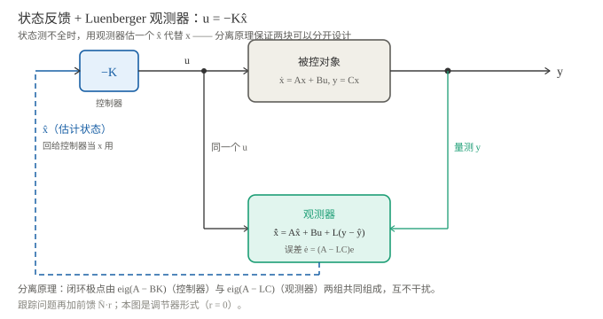
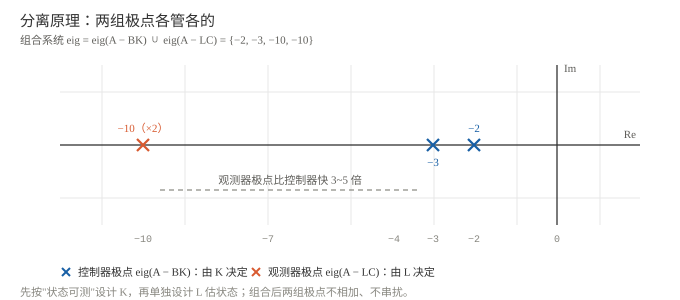
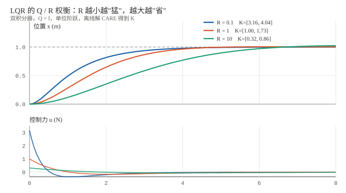

# 状态反馈、观测器与 LQR

> 一句话：06 说"能控/能观"，这一篇把它**兑现**——能控就能用状态反馈 $\mathbf u=-K\mathbf x$ 任意摆布闭环极点；能观就能用观测器把测不到的状态估出来；两者可以**分开设计**（分离原理）。LQR 则回答"极点该摆在哪"，不用拍脑袋。

!!! note "前置知识"
    - 状态空间、能控/能观判据：[06 状态空间与能控能观](06_状态空间与能控能观.md)
    - 极点与稳定性：[04 稳定性与根轨迹](04_稳定性与根轨迹.md)
    - 能控标准型、相似变换：[06 篇 §3](06_状态空间与能控能观.md)
    - 矩阵、特征值：[向量与矩阵入门](../../数学基础/00_数学语言/02_向量与矩阵入门.md)

## 一、06 留下的两个"然后呢"

| 06 的结论 | 本篇兑现成 |
|---|---|
| $\operatorname{rank}(\mathcal{Q}_c)=n$（完全能控） | 状态反馈 $K$ 可把**闭环极点放到任意位置** |
| $\operatorname{rank}(\mathcal{Q}_o)=n$（完全能观） | 观测器 $L$ 可把**估计误差衰减率**放到任意位置 |
| $(A,B)$ 能控 ⟺ $(A^T,B^T)$ 能观 | 控制器与观测器的设计公式互为镜像 |

下面统一用**双积分器**当例子（也是前几篇一直用的对象）：

$$
A=\begin{bmatrix}0&1\\0&0\end{bmatrix},\quad
B=\begin{bmatrix}0\\1\end{bmatrix},\quad
C=\begin{bmatrix}1&0\end{bmatrix}
$$

$\mathcal{Q}_c=\begin{bmatrix}0&1\\1&0\end{bmatrix}$ 秩 2，$\mathcal{Q}_o=\begin{bmatrix}1&0\\0&1\end{bmatrix}$ 秩 2 —— 既能控又能观。✅已确认

## 二、状态反馈与极点配置

### 2.1 基本式子

假设状态全部可测，取

$$\mathbf u=-K\mathbf x,\qquad K\in\mathbb{R}^{p\times n}$$

闭环变成

$$\dot{\mathbf x}=(A-BK)\mathbf x$$

**闭环极点 = $A-BK$ 的特征值**。$K$ 就是我们要设计的"旋钮"。

### 2.2 能控 ⟺ 极点可任意配置

> **定理**：$(A,B)$ 完全能控 $\Longleftrightarrow$ 对任意一组（复极点成对共轭的）期望极点，存在 $K$ 使 $\operatorname{eig}(A-BK)$ 恰好等于它。

为什么？把系统经相似变换化成**能控标准型**，此时 $A-BK$ 是伴友矩阵，其最后一行的 $n$ 个数正好是特征多项式的系数——而 $K$ 恰好直接控制这一行。所以"能控"等价于"$K$ 够得着特征多项式的每个系数"。

> 只能控**部分**模态时，能配置的是能控子空间的极点；其余极点（不可控模态）动不了。若这些不可控极点稳定，系统仍可**镇定**。

### 2.3 例子：把双积分器的极点放到 −2、−3

期望特征多项式：

$$(s+2)(s+3)=s^2+5s+6$$

设 $K=\begin{bmatrix}k_1&k_2\end{bmatrix}$：

$$A-BK=\begin{bmatrix}0&1\\-k_1&-k_2\end{bmatrix},\qquad \det(sI-A+BK)=s^2+k_2s+k_1$$

对比系数得 $k_1=6,\ k_2=5$：

$$K=\begin{bmatrix}6&5\end{bmatrix},\qquad \operatorname{eig}(A-BK)=\{-2,\,-3\}$$

✅已确认（数值验证）

### 2.4 通用公式：Ackermann

不想手算系数时，用**能控性矩阵**一步到位：

$$K=\underbrace{\begin{bmatrix}0&\cdots&0&1\end{bmatrix}}_{1\times n}\mathcal{Q}_c^{-1}\,\varphi_d(A)$$

其中 $\varphi_d(s)$ 是期望特征多项式，$\varphi_d(A)$ 是把它里的 $s$ 换成矩阵 $A$。

**验证**（双积分器，$\varphi_d(A)=A^2+5A+6I=\begin{bmatrix}6&5\\0&6\end{bmatrix}$）：

$$\begin{bmatrix}0&1\end{bmatrix}\begin{bmatrix}0&1\\1&0\end{bmatrix}^{-1}\begin{bmatrix}6&5\\0&6\end{bmatrix}=\begin{bmatrix}6&5\end{bmatrix}$$

和 2.3 手算一致。✅已确认

??? note "为什么 $\varphi_d(A)$ 里会出现矩阵多项式？"

    由 Cayley-Hamilton 定理，$A$ 满足自己的特征方程；Ackermann 公式本质是在能控标准型下把"期望多项式"反解成反馈增益，再经相似变换变回来。工程上直接用 `place(A,B,p)` / `acker(A,B,p)` 即可，高阶时 `place` 比 `acker` 数值更稳。

### 2.5 跟踪问题要加前馈

$\mathbf u=-K\mathbf x$ 是**调节器**（把状态赶回 0）。要让输出跟踪阶跃 $r$，需加前馈：

$$\mathbf u=-K\mathbf x+\bar N r,\qquad \bar N=-\left[C(A-BK)^{-1}B\right]^{-1}$$

对双积分器、$C=[1,0]$，数值算得 $\bar N=k_1$。✅已确认

### 2.6 它和 PID 什么关系

双积分器下 $K=[k_1,k_2]$ 意味着 $u=-k_1x_1-k_2x_2$，也就是**位置比例 + 速度比例（PD）**。所以状态反馈不是取代 PID，而是它的"完整版"：

- PID 只用误差 $e$ 和它的积分/微分；
- 状态反馈用**全部状态**，能独立配置每一个极点；
- PID 的 I 项对应"把积分器增广进状态"（$\mathbf x_{aug}=[x;\ \int e]$），照样可以写成状态反馈。

## 三、状态测不全：Luenberger 观测器

### 3.1 结构

实际往往只有 $q<n$ 个量测。复制一份系统模型，用**量测误差**不断纠正它：

$$\dot{\hat{\mathbf x}}=A\hat{\mathbf x}+B\mathbf u+L(\mathbf y-\hat{\mathbf y}),\qquad \hat{\mathbf y}=C\hat{\mathbf x}$$

$L$ 叫观测器增益，$(\mathbf y-\hat{\mathbf y})$ 叫**新息**（innovation，和卡尔曼里是同一个词）。



### 3.2 误差动力学

定义 $\mathbf e=\mathbf x-\hat{\mathbf x}$，两式相减（$B\mathbf u$ 抵消）：

$$\dot{\mathbf e}=(A-LC)\mathbf e$$

> 关键：$u$ 怎么取**不影响**误差收敛。所以观测器设计可以完全不管控制器。

### 3.3 能观 ⟺ 观测器极点可任意配置

$$\operatorname{eig}(A-LC)\ \xleftrightarrow{\text{对偶}}\ \operatorname{eig}(A^T-C^TL^T)$$

后者正是"$(A^T,C^T)$ 做状态反馈"的闭环矩阵。所以只要 $(A,C)$ 完全能观，用 **Ackermann 公式把 $A\to A^T,\ B\to C^T$** 就能直接算出 $L$。

**例子**：双积分器，只测位置 $C=[1,0]$，期望观测器极点 $-10,-10$：

$$A-LC=\begin{bmatrix}-l_1&1\\-l_2&0\end{bmatrix}\ \Rightarrow\ s^2+l_1s+l_2=(s+10)^2=s^2+20s+100$$

$$L=\begin{bmatrix}20\\100\end{bmatrix},\qquad \operatorname{eig}(A-LC)=\{-10,-10\}$$

✅已确认（数值验证）

> **工程经验**：观测器极点比控制器极点快 **3~5 倍**（本例 10 vs 2~3），让估计误差先收敛，控制器才拿到可信的 $\hat{\mathbf x}$。但别无限快——$L$ 越大越把量测噪声放大进状态估计，这正好是卡尔曼增益在"模型可信 / 量测可信"之间做权衡的原因。

## 四、分离原理

### 4.1 把 $x$ 换成 $\hat x$

$$\mathbf u=-K\hat{\mathbf x}$$

用状态 $\mathbf x$ 和误差 $\mathbf e=\mathbf x-\hat{\mathbf x}$ 作坐标，组合系统：

$$\begin{bmatrix}\dot{\mathbf x}\\ \dot{\mathbf e}\end{bmatrix}=
\begin{bmatrix}A-BK&BK\\ 0&A-LC\end{bmatrix}
\begin{bmatrix}\mathbf x\\ \mathbf e\end{bmatrix}$$

矩阵是**块上三角**，所以

$$\operatorname{eig}(\text{组合})=\operatorname{eig}(A-BK)\ \cup\ \operatorname{eig}(A-LC)$$



**数值验证**（$K=[6,5],\ L=[20,100]^T$）：组合 4×4 矩阵的特征值

$$\{-2,\ -3,\ -10,\ -10\}$$

恰好是两组极点的并集，一个不多一个不少。✅已确认

### 4.2 它的意义

> 先假装状态全可测，设计 $K$；再单独设计 $L$ 把状态估出来；**最后直接把 $\hat{\mathbf x}$ 接进控制器**，闭环极点不会串扰。

这就是为什么工程上可以先把控制律调好，再慢慢加观测器/滤波器。

⚠️ 但要注意：分离原理保证的是**极点和稳定性**，不保证**鲁棒性**。LQG（LQR + 卡尔曼）组合后可能失去纯 LQR 的相位/增益裕度（Doyle 的经典反例）。所以"能分开设计"≠"性能可以分开保证"。

## 五、LQR：极点该摆在哪，让代价函数说了算

### 5.1 性能指标

极点配置要人指定极点位置——凭什么放 $-2,-3$ 而不是 $-10,-10$？LQR 把问题变成**求最优**：

$$J=\int_0^\infty\left(\mathbf x^TQ\mathbf x+\mathbf u^TR\mathbf u\right)dt,\qquad Q\succeq0,\ R\succ0$$

- $Q$：对**状态偏差**的惩罚（大 = 要求更快回到 0）；
- $R$：对**控制能量**的惩罚（大 = 更省执行器）；
- 调 $Q/R$ 就是在"快"和"省"之间划线。

### 5.2 连续时间代数 Riccati 方程（CARE）

最优解是状态反馈 $\mathbf u=-K\mathbf x$，其中

$$A^TP+PA-PBR^{-1}B^TP+Q=0,\qquad K=R^{-1}B^TP$$

$P$ 是对称正定阵，$J_{\min}=\mathbf x(0)^TP\mathbf x(0)$。

### 5.3 双积分器的解析解（$Q=I,\ R=1$）

设 $P=\begin{bmatrix}p_{11}&p_{12}\\p_{12}&p_{22}\end{bmatrix}$，代入 CARE 得三个方程：

$$
\begin{cases}
-p_{12}^2+1=0 & \Rightarrow p_{12}=1\\
p_{11}-p_{12}p_{22}=0 & \Rightarrow p_{11}=p_{22}\\
2p_{12}-p_{22}^2+1=0 & \Rightarrow p_{22}=\sqrt{3}
\end{cases}
$$

$$P=\begin{bmatrix}\sqrt3&1\\1&\sqrt3\end{bmatrix},\qquad K=\begin{bmatrix}1&\sqrt3\end{bmatrix}\approx\begin{bmatrix}1&1.732\end{bmatrix}$$

闭环极点 $-0.866\pm j0.5$，CARE 残差 $4.4\times10^{-16}$。✅已确认

更一般地（$Q=I,\ R=r$）：

$$K=\begin{bmatrix}\dfrac{1}{\sqrt r}&\dfrac{\sqrt{2\sqrt r+1}}{\sqrt r}\end{bmatrix}$$

### 5.4 $R$ 怎么影响响应



| $R$ | $K$ | $u(0)$（单位阶跃） | 闭环极点 | 性格 |
|---|---|---|---|---|
| 0.1 | $[3.162,\ 4.040]$ | 3.162 | $-1.06,\ -2.98$ | 快、费控制 |
| 1 | $[1.000,\ 1.732]$ | 1.000 | $-0.866\pm j0.5$ | 折中 |
| 10 | $[0.316,\ 0.856]$ | 0.316 | $-0.428\pm j0.365$ | 省、慢 |

三条曲线都**无超调**地收敛到 1，$R$ 越小上升越快、初始控制力越大。✅已确认（数值仿真）

> **Bryson 调参规则**（起步用）：$Q_{ii}\approx 1/x_{i,\max}^2$、$R_{jj}\approx 1/u_{j,\max}^2$，即按"能容忍的最大偏差/最大控制量"归一化，再按侧重微调。比盲目试极点靠谱得多。

### 5.5 LQR 的额外好处

连续时间、单输入 LQR 有经典保证：**增益裕度 $[1/2,\infty)$、相位裕度至少 $60^\circ$**（Anderson & Moore）。所以 LQR 不仅最优，还天生抗模型摄动——这是极点配置没有的。

| | 极点配置 | LQR |
|---|---|---|
| 设计输入 | 期望极点位置 | $Q,R$ 权重矩阵 |
| 依赖工程直觉 | 高（极点放哪？） | 中（偏差与能耗的取舍） |
| 多输入系统 | 解不唯一 | 解唯一 |
| 鲁棒性保证 | 无 | 有（连续 LQR） |
| 计算 | Ackermann / `place` | 解 CARE / `lqr` |

## 六、离散实现：嵌入式里跑什么

关键点：**$K$、$L$、$P$ 都离线算好**，在线只做矩阵乘加。

- 路线 A：连续设计 $K,L$ → 按 [06 篇 §5](06_状态空间与能控能观.md) 离散化 $A_d,B_d$ → 直接用；
- 路线 B：直接解**离散** Riccati 方程（DARE）得 $K_d$，再对偶求 $L_d$，采样周期大时更准。

一步预测型观测器 + 状态反馈的 C 骨架（$n=2,\ p=q=1$）：

```c
/* 离线由 MATLAB/Python 算好：Ad[2][2], Bd[2], C[2], K[2], L[2], Nbar */
static float xhat[2] = {0.0f, 0.0f};

float control_step(float u_prev, float y, float r)
{
    /* 1) 新息：量测 - 估计量测 */
    float yhat  = C[0]*xhat[0] + C[1]*xhat[1];
    float innov = y - yhat;

    /* 2) 观测器一步预测：x̂[k+1] = Ad·x̂ + Bd·u + L·(y − ŷ) */
    float n0 = Ad[0][0]*xhat[0] + Ad[0][1]*xhat[1] + Bd[0]*u_prev + L[0]*innov;
    float n1 = Ad[1][0]*xhat[0] + Ad[1][1]*xhat[1] + Bd[1]*u_prev + L[1]*innov;
    xhat[0] = n0; xhat[1] = n1;

    /* 3) 控制律：u = −K·x̂ + Nbar·r，再限幅 */
    float u = -(K[0]*xhat[0] + K[1]*xhat[1]) + Nbar*r;
    if (u >  UMAX) u =  UMAX;
    if (u < -UMAX) u = -UMAX;
    return u;               /* 存起来，下一拍作为 u_prev */
}
```

计算量约 $O(n^2)$ 次乘加，H743 这类带 FPU 的 MCU 上毫无压力。**注意 $u$ 要回传给下一拍的观测器**——漏了这一项，估计会带恒定偏差。

??? note "可复现的验证代码（Python）"

    ```python
    import numpy as np, math

    A = np.array([[0., 1.], [0., 0.]])
    B = np.array([[0.], [1.]])
    C = np.array([[1., 0.]])
    I = np.eye(2)

    # 1) 极点配置 + Ackermann：期望 -2,-3
    Qc = np.hstack([B, A @ B])
    phi = A @ A + 5 * A + 6 * I
    K_acker = (np.array([[0., 1.]]) @ np.linalg.inv(Qc) @ phi)
    print('K =', K_acker.ravel(), 'eig(A-BK) =', np.linalg.eigvals(A - B @ K_acker))

    # 2) 观测器：期望 -10,-10
    L = np.array([[20.], [100.]])
    print('eig(A-LC) =', np.linalg.eigvals(A - L @ C))

    # 3) 分离原理：组合系统极点 = 两组并集
    K = K_acker
    M = np.zeros((4, 4))
    M[:2, :2] = A - B @ K
    M[:2, 2:] = B @ K
    M[2:, 2:] = A - L @ C
    print('combined eig =', np.sort_complex(np.linalg.eigvals(M)))

    # 4) LQR：Q=I, 不同 R，解析解 + CARE 残差
    for r in [0.1, 1., 10.]:
        p12 = math.sqrt(r)
        p22 = math.sqrt(r * (2 * math.sqrt(r) + 1))
        P = np.array([[p22 / math.sqrt(r), p12], [p12, p22]])
        Kq = (B.T @ P) / r
        residual = A.T @ P + P @ A - P @ B @ (B.T @ P) / r + I
        print('R =', r, 'K =', np.round(Kq.ravel(), 4),
              'CARE residual =', np.max(np.abs(residual)))
    ```

    实测输出：`K=[6,5]`、极点 `[-2,-3]`、`[-10,-10]`、组合 `{-10,-10,-3,-2}`、CARE 残差 `4.4e-16`。

## 七、连到卡尔曼 / LQG（和惯导接上）

| 本篇 | 卡尔曼 / 滤波侧 |
|---|---|
| Luenberger 观测器 $\dot{\hat x}=A\hat x+Bu+L(y-\hat y)$ | 卡尔曼滤波：同一个结构，$L$ 换成随时间收敛的 $K_k$ |
| $L$ 由**极点**指定 | $K_k$ 由**过程噪声 $Q_n$ / 量测噪声 $R_n$** 自动算出 |
| 确定性、假设模型精确 | 随机、显式处理噪声，给出估计协方差 $P_k$ |
| LQR（最优控制） | **LQG = LQR + 卡尔曼**，分离原理仍成立 |

> 所以 06 说的"**能观 = 能估**"在这里落地：可观性不足时，观测器增益再怎么调也没用，卡尔曼的协方差也不会降——静止 IMU 的 yaw 与陀螺 z 零偏就是典型例子。

对 AHRS / ESKF 来说，这套语言是天天见的：状态向量里放姿态误差、陀螺零偏、加计零偏，$F$ 阵是误差传播，$H$ 阵是量测映射，$P$/$Q$/$R$ 决定增益。区别只是 ESKF 在流形上做误差状态、并用右不变/左不变约定处理坐标系——但骨架就是本篇的"预测 + 新息修正"。

## 八、常见坑

1. **能镇定 ≠ 能控**：不可控但稳定的模态可以留着；不稳定的必须能控。
2. **高阶别用 Ackermann**：数值病态，用 `place` 或直接用 LQR。
3. **$K,L$ 别混**：$K$ 作用于 $(A,B)$，$L$ 作用于 $(A,C)$；对偶公式里要转置。
4. **观测器太快放大噪声**：快 3~5 倍是起点，噪声大要往回收，或直接上卡尔曼。
5. **限幅别忘了**：状态反馈没有积分项不致 windup，但输出饱和会让实际闭环偏离设计；大幅饱和仍需抗饱和处理。
6. **$u$ 必须回灌观测器**：$B\mathbf u$ 漏了，估计带稳态偏差（第六节代码里最容易漏的一行）。
7. **离散化后重算增益**：$T$ 较大时连续 $K,L$ 直接套到离散系统会失稳，应解 DARE。
8. **$Q,R$ 不是噪声协方差**：LQR 的 $Q,R$ 是**代价权重**；卡尔曼的 $Q_n,R_n$ 是**噪声统计**，名字像、含义完全不同。
9. **分离原理不管鲁棒性**：LQG 组合后可能失去 LQR 的裕度，别想当然。
10. **增广积分要检查能控性**：加 $\int e$ 后系统变 $n+1$ 阶，$(A_{aug},B_{aug})$ 可能不再能控。

## 九、自测题（合上能答才算会）

1. 为什么完全能控就能任意配置闭环极点？不可控模态怎么办？
2. 双积分器要极点 $-2,-3$，$K$ 是多少？写出 $A-BK$。
3. 观测器误差动力学为什么与 $u$ 无关？这带来什么好处？
4. 双积分器只测位置，观测器极点 $-10,-10$ 时 $L$ 是多少？
5. 写出组合系统矩阵，说明为什么极点是两组极点的并集。
6. LQR 的 $Q,R$ 各惩罚什么？$R$ 增大时 $K$、响应速度、控制量怎么变？
7. $Q=I$ 时双积分器的 LQR 增益是多少？CARE 是什么？
8. 在线运行和离线计算各做什么？为什么 $u$ 要回灌观测器？

> 提示：2）$K=[6,5]$；4）$L=[20,100]^T$；6）$R\uparrow\Rightarrow K\downarrow$、变慢、更省；7）$K=[1,\sqrt3]$。

## 关联与延伸

- 上一篇：[状态空间与能控能观](06_状态空间与能控能观.md)
- 数值工具：[矩阵分解与数值线性代数](../../数学基础/05_数值与实现/01_矩阵分解与数值线性代数.md)
- 应用：[卡尔曼滤波基础](../../惯性导航/03_组合导航篇/10_卡尔曼滤波基础.md)、[EKF 与 ESKF 深度对比](../../惯性导航/03_组合导航篇/11_EKF与ESKF.md)、[Mahony 滤波分析](../../惯性导航/05_滤波算法精读篇/01_Mahony滤波分析.md)
- 本组首页：[自动控制](/技术与编程/自动控制/)
- 后续（待写）：数字控制进阶（前馈 / 串级 / 扰动观测器）、卡尔曼与 LQG 的实战落地
