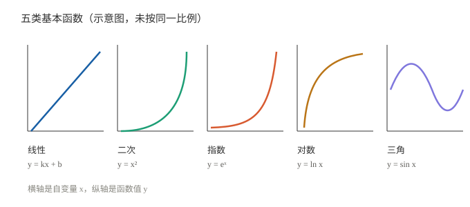

# 函数与图像：工程里最常见的五张脸

> 一句话：函数就是"输入进来、输出出去"的规则；工程里 90% 的现象，最后都落在五类函数上——线性、二次、指数、对数、三角。

## 一、函数是什么

- **定义**：每个输入 $x$ 对应唯一输出 $y=f(x)$。
- **定义域 / 值域**：$x$ 能取哪些值 / $y$ 能落到哪些值。
- **图像**：把所有 $(x, f(x))$ 画出来——看形状比背公式快。

例：传感器输出 $y=kx+b$，输入是物理量，输出是电压，这就是一个线性函数。

## 二、五类基本函数

| 类型 | 形式 | 图像特征 | 工程里在哪 |
|---|---|---|---|
| **线性** | $y=kx+b$ | 直线；$k$ 是斜率 | 标定、比例关系、小范围近似 |
| **二次** | $y=ax^2+bx+c$ | 抛物线；开口 / 顶点 | 能量、误差平方、优化 |
| **指数** | $y=a e^{bx}$ | $b>0$ 爆发增长；$b<0$ 衰减 | RC 充电、衰减、复利 |
| **对数** | $y=\ln x$ | 增长越来越慢 | dB、信息熵、人耳/人眼的感觉量 |
| **三角** | $y=\sin(\omega t+\varphi)$ | 周期振荡 | 交流电、振动、载波、旋转 |

> 记住形状就够了：直线、抛物线、爆炸/衰减、慢爬、波浪。

**怎么读这五张图**：

- 线性：看**斜率**（变化快慢）；
- 二次：看**开口方向**和**顶点**（最小 / 最大值）；
- 指数：看**增长 / 衰减速度**（底数 $>1$ 还是 $<1$）；
- 对数：看**增长越来越慢**；
- 三角：看**周期、振幅、相位**。

## 三、指数与衰减：工程里最重要的一张

$$e^{-t/\tau}$$

- $\tau$：**时间常数**（单位秒）；
- $t=\tau$ 时降到 37%；
- $t=3\tau$ 降到 5%；
- $t=4\tau$ 降到 2%。

**为什么 $e$ 特殊**：$e^x$ 的导数还是 $e^x$——它是"变化率等于自身"的函数。所以微分方程的解里到处是它。

例：RC 充电

$$y(t)=1-e^{-t/\tau},\qquad \tau=RC$$

**手算一遍**：取 $\tau=2$ s，

- $t=2$ s：$y=1-e^{-1}\approx0.632$（63%）；
- $t=6$ s：$y=1-e^{-3}\approx0.950$（95%）；
- $t=8$ s：$y=1-e^{-4}\approx0.982$（98%）。

一句话：**每过 $\tau$，离目标就近 63%**。

## 四、三角与相位

- $\sin$ 和 $\cos$ 是同一个波形，只差 90°；
- 周期 $T=2\pi/\omega$；
- 频率 $f=1/T$；
- 角频率 $\omega=2\pi f$；
- 相位 $\varphi$：波形左右平移。

例：$\sin(\omega t)$ 与 $\cos(\omega t)=\sin(\omega t+\pi/2)$。

## 五、增长谁快

$x$ 很大时：

$$e^x \gg x^n \gg \ln x$$

例：$x=10$ 时，$e^{10}\approx22026$，$10^3=1000$，$\ln 10\approx2.3$。

工程含义：**指数增长/衰减会主导长期行为**；对数增长最慢，所以 dB 用对数把大范围压成小范围。

## 六、图像的三种变换

| 变换 | 写法 | 效果 |
|---|---|---|
| 平移 | $f(x-a)$ | 右移 $a$ |
| 缩放 | $a f(x)$ | 纵向拉伸 $a$ 倍 |
| 翻转 | $-f(x)$ / $f(-x)$ | 上下翻 / 左右翻 |

## 七、常见坑

1. **角度 vs 弧度**：微积分里必须用弧度，$180^\circ=\pi$。
2. **$\ln$ / $\lg$ / $\log_2$**：底不同，差一个常数倍。
3. **$e^x$ 与 $x^n$**：前者底是常数、指数变；后者指数是常数、底变。
4. **周期与频率**：$T=1/f$，$\omega=2\pi f$，三个别混。

## 用在哪里

- 导数 / 积分 → [导数与微分基础](../02_分析与微积分/01_导数与微分基础.md)、[积分与累积直觉](04_积分与累积直觉.md)
- 复数与旋转 → [复数运算入门](03_复数运算入门.md)
- 控制里的一阶 / 二阶响应 → [符号与 s 域入门](../../技术与编程/自动控制/01_符号与s域入门.md)
