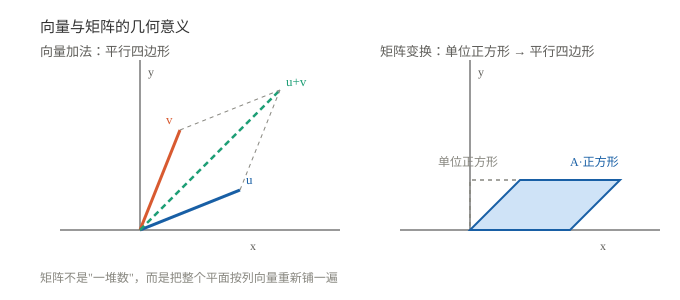

# 向量与矩阵入门

> 一句话：向量是"带方向的数量"，矩阵是"对向量做线性变换的机器"。惯导、控制、卡尔曼滤波，底层全是这两样东西。

## 一、向量：有方向的数量

$$\mathbf v=\begin{bmatrix}x\\y\end{bmatrix}$$

- **加法**：分量分别相加；
- **数乘**：每个分量乘同一个数；
- **点积**：

$$\mathbf u\cdot\mathbf v=u_xv_x+u_yv_y=|\mathbf u||\mathbf v|\cos\theta$$

- **范数（长度）**：$\|\mathbf v\|=\sqrt{x^2+y^2}$；
- **夹角**：$\cos\theta=\dfrac{\mathbf u\cdot\mathbf v}{\|\mathbf u\|\|\mathbf v\|}$。

> 点积 = 一个向量在另一个方向上的投影 × 另一个的长度。正交时点积为 0。

## 二、矩阵：线性变换的机器

$$A=\begin{bmatrix}a&b\\c&d\end{bmatrix}$$

它作用在向量上：

$$A\begin{bmatrix}x\\y\end{bmatrix}=\begin{bmatrix}ax+by\\cx+dy\end{bmatrix}$$

### 2.1 矩阵乘法的两种读法

**读法一（行 × 列）**：结果的第 $i$ 行第 $j$ 列 = 左矩阵第 $i$ 行 · 右矩阵第 $j$ 列。

**读法二（列的线性组合）**：结果的每一列 = 左矩阵的列按右矩阵对应列的系数加权相加。

$$\begin{bmatrix}a&b\\c&d\end{bmatrix}\begin{bmatrix}x\\y\end{bmatrix}=x\begin{bmatrix}a\\c\end{bmatrix}+y\begin{bmatrix}b\\d\end{bmatrix}$$

第二种读法在惯导里更重要：**矩阵的列 = 基向量被送到哪里**。

### 2.2 转置、逆、行列式、秩

| 运算 | 记法 | 含义 | 注意 |
|---|---|---|---|
| 转置 | $A^T$ | 行列互换 | $(AB)^T=B^TA^T$ |
| 逆 | $A^{-1}$ | $AA^{-1}=I$ | 只有方阵且 $\det A\neq0$ 才有 |
| 行列式 | $\det A$ / $\vert A\vert$ | 体积缩放因子 | 为 0 → 不可逆（降维） |
| 秩 | $\operatorname{rank} A$ | 线性无关的行/列数 | 秩 < 阶数 → 不可逆 |

### 2.3 正交矩阵与旋转矩阵

若 $A^TA=I$，则 $A$ 是**正交矩阵**：它保持长度和夹角，只旋转/翻转。

二维旋转矩阵：

$$R(\theta)=\begin{bmatrix}\cos\theta&-\sin\theta\\ \sin\theta&\cos\theta\end{bmatrix}$$

> 这就是 [坐标变换与旋转矩阵](../01_代数与几何/02_坐标变换与旋转矩阵.md) 的主角。旋转矩阵的逆 = 转置。

### 2.4 几何读法：矩阵把正方形变成平行四边形

- 左图：两个向量相加，结果是以它们为邻边的平行四边形的对角线；
- 右图：矩阵 $A$ 把单位正方形映射成平行四边形，**矩阵的列就是两条边的落点**。

### 2.5 矩阵乘矩阵的例子

$$\begin{bmatrix}1&2\\3&4\end{bmatrix}\begin{bmatrix}5&6\\7&8\end{bmatrix}=\begin{bmatrix}1\cdot5+2\cdot7&1\cdot6+2\cdot8\\3\cdot5+4\cdot7&3\cdot6+4\cdot8\end{bmatrix}=\begin{bmatrix}19&22\\43&50\end{bmatrix}$$

### 2.6 秩与线性方程组

对 $A\mathbf x=\mathbf b$：

- $\operatorname{rank}A=n$（满秩）→ 有唯一解；
- 秩不足 → 无解或无穷多解；
- $\det A=0$ ↔ 秩不足 ↔ 不可逆。

## 三、特征值与特征向量

$$A\mathbf v=\lambda\mathbf v$$

- $\mathbf v$：被 $A$ 作用后**方向不变**的向量（特征向量）；
- $\lambda$：长度缩放倍数（特征值）。

直觉：大多数向量被矩阵一作用就转向了，只有特征向量"原地不动，只伸缩"。

求法：解 $\det(A-\lambda I)=0$。

例：对角矩阵 $A=\begin{bmatrix}2&0\\0&3\end{bmatrix}$ 的特征向量就是 $x$ 轴、$y$ 轴的单位向量，特征值分别是 2 和 3——对角矩阵不改变坐标轴方向。

## 四、正定矩阵

若对任意非零向量 $\mathbf x$，都有

$$\mathbf x^T A\mathbf x>0$$

则 $A$ 是**正定矩阵**。

- 对称正定矩阵的特征值全为正；
- 协方差矩阵必须正定（方差不能为负）；
- 卡尔曼滤波里的 $P$、$Q$、$R$ 都要求（半）正定。

## 五、一个 2×2 的例子

$$A=\begin{bmatrix}1&2\\3&4\end{bmatrix},\quad \mathbf x=\begin{bmatrix}1\\1\end{bmatrix}$$

$$A\mathbf x=\begin{bmatrix}1\cdot1+2\cdot1\\3\cdot1+4\cdot1\end{bmatrix}=\begin{bmatrix}3\\7\end{bmatrix}$$

特征值：$\det(A-\lambda I)=(1-\lambda)(4-\lambda)-6=\lambda^2-5\lambda-2=0$，$\lambda=\dfrac{5\pm\sqrt{33}}{2}$。

## 六、常见坑

1. **$AB\neq BA$**：矩阵乘法一般不可交换。
2. **维度要对齐**：$m\times n$ 只能乘 $n\times p$。
3. **逆不一定存在**：行列式为 0 就没有逆。
4. **特征值可以是复数**：旋转矩阵的特征值就是复数。
5. **$A^T$ 与 $A^{-1}$ 不是一回事**：只有正交矩阵才相等。

## 用在哪里

- 叉乘与反对称矩阵 → [矢量叉乘与反对称矩阵](../01_代数与几何/01_矢量叉乘与反对称矩阵.md)
- 坐标变换 → [坐标变换与旋转矩阵](../01_代数与几何/02_坐标变换与旋转矩阵.md)
- 矩阵分解 / 数值 → [矩阵分解与数值线性代数](../04_数值与实现/01_矩阵分解与数值线性代数.md)
- 协方差 → [概率统计基础](../03_概率与随机/01_概率统计基础.md)
