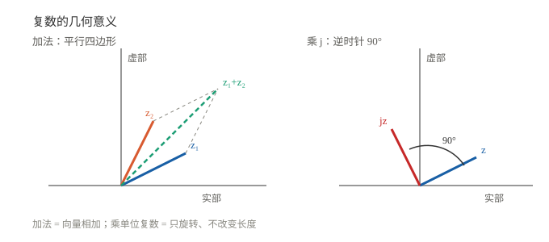

# 复数运算入门

> 一句话：复数 = 实部 + 虚部，$z=a+bj$。它可以看成平面上的点，也可以看成"模长 + 角度"；乘一个复数 = 缩放 + 旋转。

## 一、定义与四则运算

$$z=a+bj,\qquad j^2=-1$$

- 实部 $a=\operatorname{Re}z$，虚部 $b=\operatorname{Im}z$；
- 加减：实部、虚部分别加减；
- 乘法：展开后把 $j^2$ 换成 $-1$。

例：

$$(1+2j)(3-j)=3-j+6j-2j^2=5+5j$$

- 除法：分子分母同乘分母的**共轭**。

$$\frac{1+2j}{3-j}=\frac{(1+2j)(3+j)}{(3-j)(3+j)}=\frac{1+7j}{10}=0.1+0.7j$$

## 二、共轭、模、辐角

| 名称 | 记法 | 定义 | 直觉 |
|---|---|---|---|
| 共轭 | $\bar z$ | $a-bj$ | 关于实轴镜像 |
| 模 | $\vert z\vert$ | $\sqrt{a^2+b^2}$ | 到原点距离 |
| 辐角 | $\arg z$ | $\arctan(b/a)$ | 与实轴夹角 |

性质：$z\bar z=\vert z\vert^2$。

## 三、极坐标与欧拉公式

$$z=r(\cos\theta+j\sin\theta)=r e^{j\theta}$$

其中 $r=\vert z\vert$，$\theta=\arg z$。

**欧拉公式**：

$$e^{j\theta}=\cos\theta+j\sin\theta$$

它是"复数 → 旋转"的桥：$e^{j\theta}$ 就是单位圆上角度 $\theta$ 的点。

## 四、乘除的几何意义

设 $z_1=r_1e^{j\theta_1}$，$z_2=r_2e^{j\theta_2}$：

- **乘法**：模相乘，角相加

$$z_1z_2=r_1r_2\,e^{j(\theta_1+\theta_2)}$$

- **除法**：模相除，角相减

$$\frac{z_1}{z_2}=\frac{r_1}{r_2}e^{j(\theta_1-\theta_2)}$$

所以"乘一个单位复数 $e^{j\theta}$" = **只旋转，不缩放**。这正是 [复数与二维旋转](../01_代数与几何/00_复数与二维旋转.md) 的核心。

### 4.1 看图记

- 左：$z_1+z_2$ 就是向量相加，构成平行四边形；
- 右：乘 $j$ = 逆时针转 90°，长度不变。

## 五、几个必须记住的例子

| 运算 | 结果 | 含义 |
|---|---|---|
| $j^2$ | $-1$ | 定义 |
| $j^3$ | $-j$ | 再乘一次 |
| $j^4$ | $1$ | 转一圈 |
| $(1+j)(1-j)$ | $2$ | 共轭相乘 = 模平方 |
| $e^{j\pi/2}$ | $j$ | 逆时针 90° |
| $e^{j\pi}$ | $-1$ | 转 180° |
| $1/j$ | $-j$ | 分子分母乘 $j$ |
| $(1+j)^2$ | $2j$ | 展开 |
| $\vert 3+4j\vert$ | $5$ | 3-4-5 三角形 |

## 六、工程里的三个用途

- **旋转**：乘 $e^{j\theta}$，只转不改长度；
- **相量**：正弦量用 $re^{j\theta}$ 表示，乘除变成模 / 角运算；
- **阻抗**：$Z=R+jX$，电感和电容的阻抗都带 $j$。

## 七、常见坑

1. **$j$ 不是 $i$**：数学书用 $i$，电路/控制用 $j$（避免和电流 $i$ 混）。
2. **角度单位**：欧拉公式里 $\theta$ 必须是**弧度**。
3. **辐角多值**：$\arg z$ 差 $2\pi$ 都对；工程里常取 $(-\pi,\pi]$。
4. **$\vert z\vert$ 不是绝对值**：是模（长度）。
5. **复数不能比大小**：只有模可以比。

## 用在哪里

- 二维旋转 → [复数与二维旋转](../01_代数与几何/00_复数与二维旋转.md)
- 欧拉公式 / 频域 → [符号与 s 域入门](../../技术与编程/自动控制/01_符号与s域入门.md)
- 三角函数 → [函数与图像](01_函数与图像.md)
