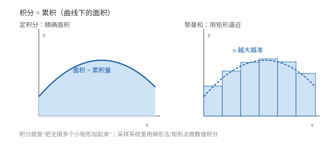

# 积分与累积直觉

> 一句话：导数是"看某一瞬间变化多快"，积分是"把每一瞬间的变化累加起来"。两者互逆。

## 一、积分是什么

- **定积分** $\int_a^b f(x)\,dx$：曲线下的面积，也就是**累积量**；
- **不定积分** $\int f(x)\,dx$：原函数族（带常数 $C$）。

工程里的积分几乎都是"累积"：

| 积分 | 得到 |
|---|---|
| 速度对时间积分 | 位移 |
| 加速度对时间积分两次 | 位置（惯导核心） |
| 功率对时间积分 | 能量 |
| 电流对时间积分 | 电荷 |
| 误差对时间积分 | PID 的 I 项 |

## 二、从"求和"到"积分"

把区间切成 $n$ 个小块，用矩形面积近似：

$$\int_a^b f(x)\,dx=\lim_{\Delta x\to0}\sum_{i=1}^{n} f(x_i)\,\Delta x$$

$\Delta x$ 越小，矩形越细，和越接近真实面积。**积分就是"无限细的求和"**。

### 2.1 一个手算例子

速度 $v(t)=2t$（m/s），求 0~3 s 的位移：

$$s=\int_0^3 2t\,dt=\left[t^2\right]_0^3=9\ \text{m}$$

几何意义：曲线 $y=2t$ 下的三角形面积 $\frac12\cdot3\cdot6=9$。

## 三、微积分基本定理

$$\frac{d}{dx}\int_a^x f(t)\,dt=f(x)$$

$$\int_a^b f'(x)\,dx=f(b)-f(a)$$

一句话：**求导和积分互逆**。所以微分方程可以用积分求解，积分也可以靠求导验证。

## 四、常见积分表

| 函数 | 原函数 |
|---|---|
| $x^n$（$n\neq-1$） | $\dfrac{x^{n+1}}{n+1}+C$ |
| $e^{ax}$ | $\dfrac{e^{ax}}{a}+C$ |
| $\dfrac{1}{x}$ | $\ln\vert x\vert+C$ |
| $\sin x$ | $-\cos x+C$ |
| $\cos x$ | $\sin x+C$ |
| 常数 $k$ | $kx+C$ |

## 五、数值积分（嵌入式常用）

采样系统里没有连续积分，只有离散求和：

| 方法 | 公式 | 特点 |
|---|---|---|
| 矩形法 | $\sum f(x_i)\Delta t$ | 最简单，误差大 |
| 梯形法 | $\sum \dfrac{f(x_i)+f(x_{i+1})}{2}\Delta t$ | 常用，精度够 |
| 辛普森 | 抛物线拟合 | 更准，计算量大 |

> ⚠️ 积分会把噪声一起累积。陀螺积分成角度时，零偏会变成**随时间线性增长**的角度漂移——这就是惯导要不断校正的原因。

## 六、常见坑

1. **不定积分忘 $+C$**：常数项在求导时丢了，积分时要补回来。
2. **定积分是数，不定积分是函数族**：别混。
3. **上下限方向**：$\int_a^b=-\int_b^a$。
4. **积分不是万能的逆运算**：它只能恢复"差"，恢复不了常数。
5. **离散积分 ≠ 连续积分**：采样周期、数值方法都会引入误差。

## 用在哪里

- 导数（反向） → [导数与微分基础](../02_分析与微积分/01_导数与微分基础.md)
- 微分方程 → [微分方程与状态空间离散化](../02_分析与微积分/02_微分方程与状态空间离散化.md)
- PID 的 I 项 → [符号与 s 域入门](../../技术与编程/自动控制/01_符号与s域入门.md)
