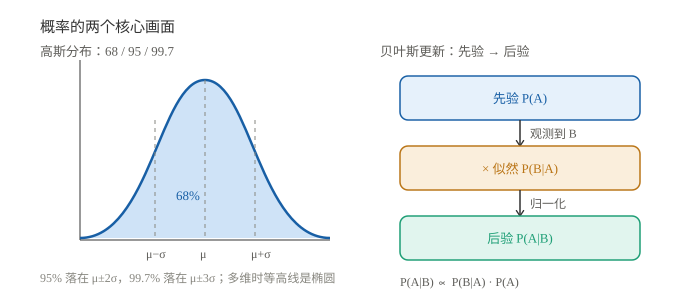

# 概率直觉：从"可能"到"可以算"

> 一句话：概率是给"不确定"配一个 0~1 的刻度；期望是长期平均，方差是波动大小。

## 一、随机变量与分布

- **随机变量**：把随机结果用一个数表示（如传感器读数、测量误差）；
- **离散**：只能取有限/可数个值（骰子、计数）；
- **连续**：可以在区间内取任意值（电压、温度、噪声）；
- **分布**：描述每个值（或区间）出现的概率。

连续随机变量用**概率密度函数** $p(x)$ 描述，落在区间 $[a,b]$ 的概率是面积：

$$P(a\le X\le b)=\int_a^b p(x)\,dx$$

## 二、期望与方差

| 名称 | 记法 | 含义 | 直觉 |
|---|---|---|---|
| 期望 | $E[X]$ | 长期平均 | 重心 |
| 方差 | $\operatorname{Var}(X)$ | 波动大小 | 离散程度 |
| 标准差 | $\sigma$ | 方差的平方根 | 和原量同单位 |

$$\operatorname{Var}(X)=E[(X-\mu)^2]=E[X^2]-\mu^2$$

例：均匀骰子 $E[X]=3.5$；传感器噪声常建模为 $N(0,\sigma^2)$。

## 三、条件概率与贝叶斯

$$P(A\mid B)=\frac{P(A\cap B)}{P(B)}$$

**贝叶斯公式**：

$$P(A\mid B)=\frac{P(B\mid A)\,P(A)}{P(B)}$$

读法：

- $P(A)$：先验（看到证据前的判断）；
- $P(B\mid A)$：似然（假设 A 成立时，看到证据 B 的可能性）；
- $P(A\mid B)$：后验（看到证据后更新的判断）。

> 卡尔曼滤波就是贝叶斯更新的线性高斯版本：先验（预测）+ 似然（观测）→ 后验（修正）。

## 四、独立与不相关

- **独立**：$P(A\cap B)=P(A)P(B)$，一个发生不影响另一个；
- **不相关**：$\operatorname{Cov}(X,Y)=0$，没有线性关系。

关系：**独立 ⇒ 不相关；不相关 ⇏ 独立**（除非联合高斯）。

## 五、高斯为什么到处都是

**中心极限定理**：大量独立的小随机因素叠加，结果近似高斯分布。

$$X\sim N(\mu,\sigma^2),\qquad p(x)=\frac{1}{\sqrt{2\pi}\sigma}e^{-\frac{(x-\mu)^2}{2\sigma^2}}$$

- 68% 落在 $\mu\pm\sigma$；
- 95% 落在 $\mu\pm2\sigma$；
- 99.7% 落在 $\mu\pm3\sigma$。

多维时，$\sigma^2$ 变成**协方差矩阵** $\Sigma$，等高线是椭圆。

### 5.1 一个反直觉的贝叶斯例子

某病患病率 1%，检测准确率 99%（患病测阳 99%，健康测阴 99%）。某人测出阳性，实际患病概率是多少？

$$P(\text{病}\mid +)=\frac{0.99\times0.01}{0.99\times0.01+0.01\times0.99}\approx50\%$$

不是 99%，而是约 50%——因为健康人基数大，假阳性的数量与真阳性相当。这就是"基础率谬误"。

## 六、常见坑

1. **$P(A\mid B)\neq P(B\mid A)$**：这是最经典的混淆。
2. **方差 vs 标准差**：前者是平方量纲，后者和原量同单位。
3. **独立 ≠ 不相关**：不相关只排除线性关系。
4. **$N(\mu,\sigma^2)$ 的第二个参数是方差**，不是标准差。
5. **小样本均值 ≠ 期望**：样本少时波动很大。

## 用在哪里

- 概率统计（更深） → [概率统计基础](../03_概率与随机/01_概率统计基础.md)
- 协方差 → [协方差交互实验](../03_概率与随机/02_协方差交互实验.md)
- 随机过程 → [随机过程与噪声建模](../03_概率与随机/03_随机过程与噪声建模.md)
- 卡尔曼滤波 → [卡尔曼滤波基础](../../惯性导航/03_组合导航篇/10_卡尔曼滤波基础.md)
