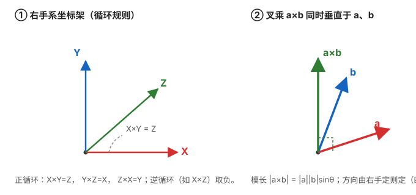
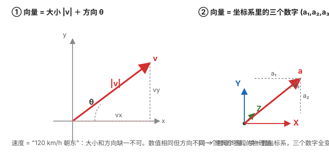
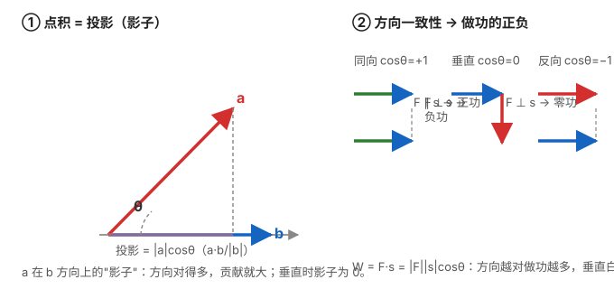
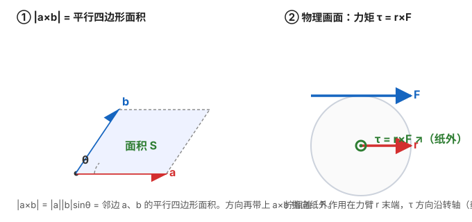
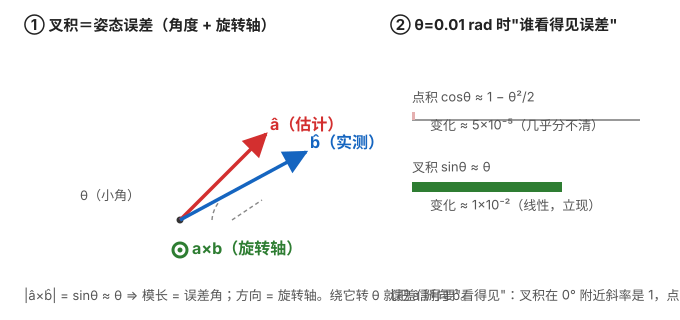

# 矢量叉乘与反对称矩阵

> **来源与可靠性说明**
> 本文是经典线性代数 / 刚体运动学内容，属教科书级标准结论（任意《线性代数》或《机器人学》《多体动力学》教材的"叉积与反对称矩阵"章节均可查到）。全文 ✅ 已用 Python 数值核对四个核心恒等式（见 2.3），可作为后续惯性导航系列共用的数学地基，放心引用。

## 为什么惯导要先搞懂向量、点积与叉乘

在惯性导航里，向量不是抽象概念，而是一天一地的"零件"：坐标化（同一个量在 b 系 / n 系里投影出不同分量）、点积（方向一致性 / 协方差）、叉乘（姿态误差 / 旋转）。本节先给**向量的物理画面**，再依次讲**点积**与**叉乘**：

- **向量坐标化**：位置、速度、比力、角速度都需要投影到某个坐标系才能计算，投影本质就是点积（见 1.2）；
- **角速度积分**：姿态的微小增量来自 $\boldsymbol\omega\,\mathrm dt$，姿态更新（四元数 / 旋转向量）本质是把角速度"叉"进当前姿态；
- **科氏加速度**：旋转系里的附加加速度 $\mathbf a_c = 2\boldsymbol\omega\times\mathbf v$；
- **Mahony / 互补滤波的姿态误差**：估计方向与测量方向做叉积，直接得到"转多少 + 绕哪根轴"的角度误差信号（见 3.1 特写）；
- **`insupdate` 的划桨 / 圆锥项、地球自转项**：都含 $\boldsymbol\omega$ 的叉乘；
- **反对称矩阵 $[\mathbf a]_\times$**：把"叉乘"变成"矩阵乘法"，让它能参与线性代数（合成、求导、进入卡尔曼滤波的状态矩阵）。

所以这篇文章按 **向量 → 点积 → 叉积 → 反对称矩阵** 的顺序把地基讲透，后面拆解 PSINS 时你看到 `cross` / `skew` / `[w]x` 就不会卡。

## 一、向量 → 点积 → 叉积：先物理画面，再公式

### 1.1 向量的物理意义：有大小、有方向的量

惯导里满屏都是向量，先把"向量是什么"的物理画面立起来：

- **定义**：向量 = 有**大小**（模长）有**方向**的量。它可以是看得见的量（位移、速度、力），也可以不是直观的"物理量"（角速度、磁场、误差向量）——只要是"有方向的影响"就由向量承载。
- **惯导里全是向量**：位置 $\mathbf p$、速度 $\mathbf v$、比力 $\mathbf f$、角速度 $\boldsymbol\omega$、重力 $\mathbf g$、地磁 $\mathbf m$——它们同时带大小和方向，丢掉方向就不是同一个量。
- **标量 vs 向量**：速率是"120 km/h"，速度是"120 km/h 朝东"——数值相同方向不同的两个速度是**两个不同的物理量**。做功 $W$ 是标量、力 $\mathbf F$ 是向量，而 $W=\mathbf F\cdot\mathbf s$ 恰好是把两个向量"浓缩"成标量的运算（见 1.2）。
- **向量在坐标系里就是"三个数字"**：选好单位基 $(\mathbf i,\mathbf j,\mathbf k)$，向量写成分量 $(a_1,a_2,a_3)^T$。同一个物理向量换一套坐标系三个数字全变——这正是惯导"坐标系错了全错"的根源（详见 [坐标系与变换](../../惯性导航/01_基础篇/01_坐标系与变换.md)）。
- 两个向量之间只有两种"有意义的问题"：**点积**——它们有多一致（像不像）；**叉积**——它们差多少、怎么转过去。下面 1.2 / 1.3 分别给出答案。

### 1.2 点积：问"它们有多一致"

**定义**（结果是**标量**）：

$$
\mathbf a\cdot\mathbf b = |\mathbf a|\,|\mathbf b|\cos\theta = a_1b_1+a_2b_2+a_3b_3
$$

**直观物理意义**（记住三幅画面）：

1. **投影（影子）**：$\mathbf a\cdot\mathbf b \big/ |\mathbf b|$ 就是 $\mathbf a$ 在 $\mathbf b$ 方向上的投影长度，带正负号。好比太阳垂直照射，看物体在 $\mathbf b$ 这面墙上的"影子"长短。**点积 = 一个向量在另一个方向上"贡献了多少"**。
2. **做功**：$W=\mathbf F\cdot\mathbf s$——只有力在位移方向的分量做功。斜着拉车只算水平分量；力与位移**垂直 = 零功**（$W=0$，提着箱子水平走，竖直的力不做功）；方向反了就做**负功**。
3. **方向一致性**：单位向量点积即 $\cos\theta$：$+1$ 完全同向、$-1$ 完全反向、$0$ 垂直——判断"这俩方向到底像不像"。

**桥到概率篇**：把 $n$ 次观测去均值后当成 $n$ 维向量，**协方差就是中心化后两个向量的点积除以 $n-1$**，相关系数则是归一化后的"夹角余弦"。所以"相关性 = 两个数据向量之间夹角的余弦"——这就是 [数学地基（矩阵·概率·协方差）](../03_概率与随机/00_数学地基速查.md) 里协方差矩阵的几何直觉来源。

### 1.3 叉积：问"差多少、绕哪根轴转"

#### 1.3.1 几何定义

$$
\mathbf a\times\mathbf b \;=\; |\mathbf a|\,|\mathbf b|\,\sin\theta \;\cdot\; \mathbf n
$$

- $|\mathbf a|,|\mathbf b|$ 是模长，$\theta$ 是两向量夹角（$0\le\theta\le\pi$）；
- $\mathbf n$ 是单位向量，**同时垂直于 $\mathbf a$ 和 $\mathbf b$**，方向由**右手定则**确定。

几何上：$\mathbf a\times\mathbf b$ 是一个**矢量**，其方向垂直于 $\mathbf a,\mathbf b$ 张成的平面，大小等于以 $\mathbf a,\mathbf b$ 为邻边的**平行四边形面积**。

#### 1.3.2 代数定义（分量展开）

设 $\mathbf a=(a_1,a_2,a_3)^T,\ \mathbf b=(b_1,b_2,b_3)^T$，则

$$
\mathbf a\times\mathbf b
= \begin{pmatrix}
a_2 b_3 - a_3 b_2\\
a_3 b_1 - a_1 b_3\\
a_1 b_2 - a_2 b_1
\end{pmatrix}
$$

记忆法——写成行列式（按第一行展开即得上式）：

$$
\mathbf a\times\mathbf b
= \begin{vmatrix}
\mathbf i & \mathbf j & \mathbf k\\
a_1 & a_2 & a_3\\
b_1 & b_2 & b_3
\end{vmatrix}
$$

#### 1.3.3 右手定则

握拳：四指从 $\mathbf a$ 弯向 $\mathbf b$（沿较小夹角），大拇指指向就是 $\mathbf a\times\mathbf b$。对标准右手系有循环规则：

$$
\mathbf X\times\mathbf Y=\mathbf Z,\quad
\mathbf Y\times\mathbf Z=\mathbf X,\quad
\mathbf Z\times\mathbf X=\mathbf Y
$$

**逆循环取负**，例如 $\mathbf X\times\mathbf Z = -\mathbf Y$。这正是《坐标变换与旋转矩阵》里"绕 Y 轴符号看起来被转置"的同一套空间拓扑根源——叉乘的循环方向决定了符号。

#### 1.3.4 基本性质

- **反交换**：$\mathbf a\times\mathbf b = -(\mathbf b\times\mathbf a)$
- **分配律**：$\mathbf a\times(\mathbf b+\mathbf c)=\mathbf a\times\mathbf b+\mathbf a\times\mathbf c$
- **与自身叉乘为零**：$\mathbf a\times\mathbf a=\mathbf 0$
- **正交性**：$(\mathbf a\times\mathbf b)\cdot\mathbf a = (\mathbf a\times\mathbf b)\cdot\mathbf b = 0$
- **不满足结合律**：$(\mathbf a\times\mathbf b)\times\mathbf c \neq \mathbf a\times(\mathbf b\times\mathbf c)$
- **混合积**：$\mathbf a\cdot(\mathbf b\times\mathbf c)$ = 以三个向量为棱的平行六面体体积（换序不变号）
- 拉格朗日恒等式：$|\mathbf a\times\mathbf b|^2 = |\mathbf a|^2|\mathbf b|^2 - (\mathbf a\cdot\mathbf b)^2$

#### 1.3.5 直观物理意义：叉积天生就是"旋转"

数学课本给的公式 $\mathbf a\times\mathbf b=|\mathbf a||\mathbf b|\sin\theta\,\mathbf n$ 不够"直觉"。记住下面四个物理画面，之后看到叉积就自动翻译成"**绕哪根轴、转多少**"：

1. **力矩**：$\boldsymbol\tau = \mathbf r\times\mathbf F$。拧瓶盖时"力臂 × 力"，方向沿瓶盖转轴——叉积回答的不只是"这个力多大"，而是"**它会让我怎么转**"。
2. **刚体上一点的速度**：$\mathbf v = \boldsymbol\omega\times\mathbf r$。地球表面任意一点随自转的速度 = 地球角速度叉该点位置；飞机机翼端点的速度 = 机身角速度叉翼展位置。**角速度 × 位置 = 线速度**，这是刚体运动学的万能钥匙。
3. **面积**：$|\mathbf a\times\mathbf b|$ = 以两向量为邻边的平行四边形面积。模长天然携带"两向量错开多少"的信息。
4. **旋转的方向 + 角度**：把 $\mathbf a$ 掰到 $\mathbf b$，旋转轴的方向就是 $\mathbf a\times\mathbf b$（右手定则），对单位向量有 $\sin\theta = |\mathbf a\times\mathbf b| \approx \theta$（小角）。

**对照记法（点积 vs 叉积，一次记牢）**：

| | 点积 | 叉积 |
|---|---|---|
| 问的是 | 两个方向**有多一致** | 两个方向**差多少、绕哪根轴** |
| 结果 | 标量 | 矢量（垂直于两者） |
| 小角行为 | $\cos\theta\approx1-\theta^2/2$（0 处不敏感） | $\sin\theta\approx\theta$（0 处线性敏感） |
| 物理画面 | 影子 / 做功 / 同向性 | 力矩 / $v=\omega\times r$ / 面积 |
| 惯导用途 | 投影、协方差 | 姿态误差、旋转、Mahony |

姿态误差是"差了多大角 + 绕哪根轴"，**只可能用叉积表达**——这正是下节 3.1 里 Mahony 选它的原因。

## 二、反对称矩阵 $[\mathbf a]_\times$

### 2.1 定义：把叉乘"矩阵化"

任何三维叉乘都可以写成"**左乘一个反对称矩阵**"：

$$
\mathbf a\times\mathbf b = [\mathbf a]_\times\,\mathbf b
$$

其中

$$
[\mathbf a]_\times =
\begin{bmatrix}
0    & -a_3 &  a_2\\
a_3 &  0   & -a_1\\
-a_2 &  a_1 &  0
\end{bmatrix}
$$

记忆法：把 $\mathbf a=(a_1,a_2,a_3)$ 的"对面"填进去——主对角恒为 0，第 $(i,j)$ 元等于 $-e_{ijk}a_k$（Levi-Civita 符号）。例如第 $(1,2)$ 元 $= -a_3$，第 $(2,1)$ 元 $= +a_3$，两者互为相反数，这就是"反对称"的来由。

### 2.2 为什么重要

- 把**叉乘**变成**矩阵-向量乘法**，计算机只需做矩阵乘，不用特判分量；
- 能无缝参与线性代数：求逆、合成、对时间求导、塞进状态方程 $\dot{\mathbf x}=\mathbf F\mathbf x$；
- 姿态、角速度、误差全都用 $[\boldsymbol\omega]_\times$ 串起来（见第三节）。

### 2.3 关键性质（已数值验证）

- **反对称**：$[\mathbf a]_\times^T = -[\mathbf a]_\times$（主对角全 0，反对角互为相反数）；
- **自叉为零**：$[\mathbf a]_\times\,\mathbf a = \mathbf 0$；
- **双重反对称恒等式**（推导姿态误差、ESKF 误差状态时反复出现）：

$$
[\mathbf a]_\times[\mathbf b]_\times
= \mathbf b\,\mathbf a^T - (\mathbf a\cdot\mathbf b)\,\mathbf I
$$

> 举例：$\mathbf a=(1,2,3)^T,\ \mathbf b=(4,5,6)^T$ 时，
> $[\mathbf a]_\times=[[0,-3,2],[3,0,-1],[-2,1,0]]$，而 $[\mathbf a]_\times\mathbf b = [-3,6,-3]^T = \mathbf a\times\mathbf b$，与代数定义完全一致；双重反对称恒等式在随机 200 组向量上数值误差均 $<10^{-9}$。

## 三、在惯导 / PSINS 里哪里用（关键联系）

- **角速度积分**：姿态增量 $\delta\boldsymbol\theta \approx \boldsymbol\omega\,\mathrm dt$；四元数增量更新 $\delta\mathbf q$ 里就是拿 $[\boldsymbol\omega]_\times$ 去"叉"当前姿态。
- **旋转的指数映射 / 罗德里格斯公式**：旋转矩阵 $\mathbf R = \exp([\boldsymbol\omega]_\times)$（指到后期卡尔曼 / ESKF，本文先铺垫符号）。
- **科氏加速度**：$\mathbf a_c = 2\boldsymbol\omega\times\mathbf v$。
- **`insupdate` 的划桨 / 圆锥项、地球自转项**：都含 $[\boldsymbol\omega]_\times$。
- **姿态误差的线性化**：ESKF 把误差姿态写成小旋转向量 $\delta\boldsymbol\phi$，其扰动传播里大量出现 $[\mathbf v]_\times$。

### 3.1 特写：Mahony 互补滤波为什么用叉积（角度误差信号）

这正是你问到的场景，也是叉积最有味道的应用。Mahony 的核心一句：加速度计（平稳/慢变时 ≈ 测 $-\mathbf g$）提供重力的"**低频慢参考**"，陀螺积分提供"**短时准**"的姿态；拿参考去纠积分，**靠的就是叉积**。

记 $\mathbf a$ = 姿态递推估计得到的重力方向（单位向量），$\mathbf b$ = 加速度计实测方向（单位向量）：

- **大小**：$|\mathbf a\times\mathbf b| = \sin\theta \approx \theta$（$\theta$ 为两方向夹角，小角近似）→ **模长 = 姿态误差角**；
- **方向**：$\mathbf a\times\mathbf b$ 指向旋转轴（右手定则）→ **绕这根轴转 $\theta$ 就把估计方向掰向测量方向**；
- 于是一个叉积向量同时给了"**错了多少 + 绕哪根轴错**"，乘比例增益 $k_p$ 修正姿态、再 $k_i$ 积分修陀螺常值漂移。

代码层面就是 MahonyAHRS.c 里 `halfex = (ay*halfvz - az*halfvy)` 那几行的姿态误差分量展开（见 [Mahony 滤波分析](../../惯性导航/05_滤波算法精读篇/01_Mahony滤波分析.md)）。

**为什么不用点积？** $\mathbf a\cdot\mathbf b=\cos\theta\approx 1-\theta^2/2$——误差角很小时点积几乎不变（0 处一阶导数为 0，对误差"不敏感"，且丢掉了"绕哪根轴"的方向信息）；叉积 $\sin\theta\approx\theta$ 在 0 处斜率是 1，**小角度线性响应、自带旋转轴**。直观数据：$\theta=0.01\,\text{rad}$ 时，$\cos$ 变化只有 $\sim5\times10^{-5}$，$\sin$ 却给出 $10^{-2}$ 的线性信号。姿态误差的"正确数学对象"是**旋转**不是投影，所以互补滤波、旋转矩阵的测量更新，误差信号都选叉积。

## 四、两个最容易踩的坑

1. **两层中括号不能想当然合并**。$[\mathbf a]_\times\mathbf b = \mathbf a\times\mathbf b$，但 $[\mathbf a]_\times[\mathbf b]_\times$ 是"两个反对称矩阵相乘"，结果是 $\mathbf b\mathbf a^T-(\mathbf a\cdot\mathbf b)\mathbf I$（第二节 2.3），**不是** $\mathbf a\times\mathbf b$ 的叉乘。新手写姿态误差推导时最容易在这里漏掉 $\mathbf b\mathbf a^T$ 项。
2. **反对称 ≠ 正交**（skew-symmetric ≠ orthogonal）。$[\mathbf a]_\times$ 是"反对称"（转置变负），一般**不是**正交矩阵——除非 $\mathbf a=\mathbf 0$，否则 $[\mathbf a]_\times[\mathbf a]_\times^T \neq \mathbf I$。这俩词中文都带"对称"，意思却完全不同，别混。

## 五、与下一篇衔接

- 本文是《坐标变换与旋转矩阵（推导入门）》的数学工具：旋转矩阵的每一列，本质是把某个基向量"叉乘 / 旋转"后的去向；上一篇讲的符号机理，在这里的右手循环规则里能找到根。
- 四元数、旋转向量、ESKF 都会反复用到 $[\cdot]_\times$，建议先在这里把 $[\mathbf a]_\times$ 和双重反对称恒等式记熟。

## 自测题

1. 计算 $[1,0,0]^T\times[0,1,0]^T$，并验证它等于 $[\mathbf e_1]_\times\mathbf e_2$。
2. 写出 $\boldsymbol\omega=(0,0,\Omega)^T$（绕 Z 轴自转）时的 $[\boldsymbol\omega]_\times$，并说明它对应"绕 Z 旋转"的无穷小生成元。
3. 用双重反对称恒等式验证 $[\mathbf a]_\times[\mathbf a]_\times = \mathbf a\mathbf a^T - |\mathbf a|^2\mathbf I$。
4. 判断并解释：$\mathbf a\times\mathbf b$ 一定同时垂直于 $\mathbf a$ 和 $\mathbf b$ 吗？$\mathbf a\cdot(\mathbf a\times\mathbf b)$ 等于什么？
5. Mahony 用叉积而不用点积构造姿态误差，给出两个理由（大小/方向 vs 敏感性）。

## 关联

- [坐标变换与旋转矩阵（推导入门）](02_坐标变换与旋转矩阵.md)
- [数学地基（矩阵·概率·协方差）](../03_概率与随机/00_数学地基速查.md)
- [姿态的四种表示](../../惯性导航/01_基础篇/02_姿态的四种表示.md)
- [协方差交互实验](../03_概率与随机/02_协方差交互实验.md)
- [Mahony 滤波（Mahony Complementary Filter）分析](../../惯性导航/05_滤波算法精读篇/01_Mahony滤波分析.md)（叉积 = 姿态误差信号）
- [一阶互补滤波分析](../../惯性导航/05_滤波算法精读篇/00_一阶互补滤波分析.md)
- [PSINS · Mahony 模式详解](../../惯性导航/04_拆解PSINS篇/PSINS_STM32嵌入式/07_Mahony模式详解.md)
