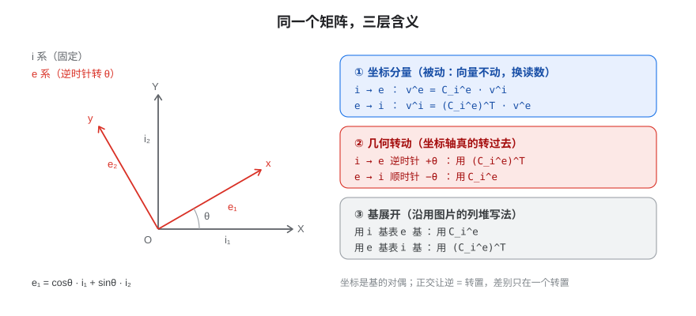

# 基变换与坐标变换：同一个矩阵，为什么有两个方向

> 一句话：把"变换"这个词拆干净之后，**从 i 系到 e 系的「坐标」变换矩阵，与从 e 系到 i 系的「坐标系」变换矩阵，确实是同一个矩阵** $C_i^e$。方向一旦反过来，一律取转置。
>
> 本篇只做**一般线性代数层面的概念辨析**，不重复单轴旋转矩阵、欧拉角合成与姿态更新的推导 —— 那些在 [坐标变换与旋转矩阵（推导入门）](02_坐标变换与旋转矩阵.md) 和 [00b 逐行拆解（PSINS）](../../惯性导航/04_拆解PSINS篇/linebyline/00b_CoordRot.md)。



*图：i 系固定、e 系逆时针转 θ。同一个 $C_i^e$ 在「坐标分量」「几何转动」「基展开」三层里对应的方向并不相同，混淆几乎都来自把其中两层当成一层。*

!!! note "本篇的约定（先立规矩）"
    - **被动旋转**：向量不动、坐标系转。惯导里 99% 的坐标变换（$C_b^n$、$C_n^b$、$C_i^e$）都是被动的；主动旋转（向量转、坐标系钉死）记作 $R_{act}$，与被动矩阵 $R_{pas}$ **互为转置**。
    - **列向量**：坐标一律写成列 $v=[x,y]^T$，矩阵写在左边 $v'=Mv$。
    - **基的排布要显式说明**：教材常把基向量堆成列 $\begin{bmatrix}e_1\\e_2\end{bmatrix}$；也有人拼成行 $[e_1\ e_2]$。两者差一个转置，本篇固定用**列堆**，换写法时明说。
    - **记号**：$C_i^e$ 下标 = 源系、上标 = 目标系，元素 $c_{jk}=e_j\cdot i_k$（方向余弦）。

---

## 一、"变换"其实是三件不同的事

一个几何矢量 $\vec v$ 是客观的，不随坐标系改变；会变的是三样东西：

1. **坐标（分量）**：$v^i=[x_i,y_i]^T$ 与 $v^e=[x_e,y_e]^T$，是两组数字。
2. **基（坐标系）**：$\{i_1,i_2\}$ 与 $\{e_1,e_2\}$，是两组参照轴。
3. **几何转动**：把坐标轴（或刚体）物理地转过去，是一个动作。

"变换矩阵"这四个字在这三层里含义不同：换读数、换参照轴、转动坐标轴，是三件事。绝大多数困惑，来自把"坐标"和"坐标系"当成同一层，却还指望方向一致。

!!! info "先把名词定死（人话版）"
    | 名词 | 是什么 | 换坐标系时 |
    |---|---|---|
    | **矢量** $\vec v$ | 空间里那支箭头，客观存在 | **不变** |
    | **轴** | 一根带方向的参考线（单位向量） | 跟着系换 |
    | **基** | 一组**有序、线性无关、能张满空间**的轴；二维两根、三维三根 | 乘 $P$ |
    | **坐标系 / 标架** | 基 + 原点；惯导里的 i / e / n / b 还带"谁在转、转多快"的物理含义 | 换一套 |
    | **坐标** | 把矢量在这套基上分解得到的**那组数字** | 乘 $P^{-1}$ |

    > 一句话：**矢量是东西，基是尺子，坐标是读数。** 也正因为纯线性空间里默认都过原点，"基变换"和"坐标系变换"常被当成同义词 —— 它们指的不是两个不同操作。

### 1.1 起点：同一个矢量，两组「基 × 坐标」

写坐标时必须带上"在哪组基下"这个前提：单独一个 $(1,0)$ 没有意义，就像单独一个 "100" 不说单位就没有意义。把这件事写成式子，就是全篇的出发点：

$$
\vec v = i_1 x_i + i_2 y_i
= \begin{bmatrix} i_1 & i_2 \end{bmatrix}\begin{bmatrix} x_i\\y_i \end{bmatrix}
= \mathcal I\, v^i
$$

$$
\vec v = e_1 x_e + e_2 y_e
= \begin{bmatrix} e_1 & e_2 \end{bmatrix}\begin{bmatrix} x_e\\y_e \end{bmatrix}
= \mathcal E\, v^e
$$

这里 $\mathcal I=[i_1\ i_2]$、$\mathcal E=[e_1\ e_2]$ 是**把基向量按列拼成的矩阵**（每列一个基向量，基向量本身是列向量），$v^i$、$v^e$ 是列向量坐标。注意这正好说明：**基不必写成行向量**，按列拼矩阵才是主流写法；坐标写成列向量只是为了让矩阵左乘成立。上标 $i/e$ 不是装饰，它标明"这组数字属于哪把尺子"。

两式左边是**同一个几何对象**，所以

$$
\vec v = \mathcal I\, v^i = \mathcal E\, v^e
$$

**基与坐标必须配对着换**：基换成 $\mathcal E=\mathcal I P$，坐标就得换成 $v^e=P^{-1}v^i$，乘积才能保持不变。写全就是四步：

$$
\mathcal E=\mathcal I P
\ \Longrightarrow\
\mathcal I v^i=\mathcal I P v^e
\ \Longrightarrow\
v^i=P v^e
\ \Longrightarrow\
v^e=P^{-1}v^i
$$

旋转时 $P^{-1}=C_i^e$，就是 2.1 的 $v^e=C_i^e v^i$；不依赖正交的一般证明在第四节。**本篇后面关于"同一个矩阵""行拼列堆""主动被动"的所有讨论，都是这四行的注脚。**

!!! example "两组完全不同的读数，装配出同一支箭头（θ=30°）"
    取空间里固定的 $\vec v=i_1=(1,0)$。

    - **i 系**：$v^i=(1,0)$，$\mathcal I v^i = 1\cdot i_1+0\cdot i_2=(1,0)$；
    - **e 系**：$v^e=C_i^e v^i=(0.866,-0.5)$；
    - **还原**：$\mathcal E v^e=0.866\,e_1-0.5\,e_2=0.866(0.866,0.5)-0.5(-0.5,0.866)=(1,0)$ ✅

    换成非正交的剪切 $P=\begin{bmatrix}1&1\\0&1\end{bmatrix}$ 也一样：$v^{old}=(3,2)$、$v^{new}=P^{-1}v^{old}=(1,2)$，而 $\mathcal I v^{old}=(\mathcal I P)v^{new}=(3,2)$。

    > 人话类比：**1 米 = 100 厘米**。单位（基）放大 100 倍，数字（坐标）就缩小 100 倍，乘积（长度）不变 —— 这就是"逆变"。

## 二、从一张图推到底

设 i 系固定，e 系相对 i 系**逆时针**转 $\theta$，记 $c=\cos\theta$、$s=\sin\theta$。由投影几何直接写出 e 系的基在 i 系下的坐标：

$$
e_1 = c\, i_1 + s\, i_2,\qquad e_2 = -s\, i_1 + c\, i_2
$$

堆成列就是教材里常见的形式：

$$
\begin{bmatrix}e_1\\e_2\end{bmatrix}
= C_i^e\begin{bmatrix}i_1\\i_2\end{bmatrix},
\qquad
C_i^e=\begin{bmatrix}c&s\\-s&c\end{bmatrix}
$$

**关键一句**：$C_i^e$ 的第 $(j,k)$ 元是 $c_{jk}=e_j\cdot i_k$，即 **e 系第 j 根轴在 i 系第 k 根轴上的方向余弦**。所以这个矩阵是"一张照片"，记录两套轴互相怎么读，本身不含任何动作。

### 2.1 作用在坐标上：被动的坐标变换

把基向量作为列拼成矩阵 $\mathcal I=[i_1\ i_2]$、$\mathcal E=[e_1\ e_2]$。取 i 系自身为绝对参考，则 $\mathcal I=I$，而

$$
\mathcal E=\begin{bmatrix}c&-s\\s&c\end{bmatrix}=R_{act}(\theta)
$$

同一个矢量满足 $\vec v=\mathcal I v^i=\mathcal E v^e$，于是

$$
v^i=\mathcal E v^e\quad\Longrightarrow\quad
v^e=\mathcal E^{-1}v^i=\mathcal E^{T}v^i=C_i^e\,v^i
$$

**结论 1**：i→e 的**坐标**变换矩阵是 $C_i^e$。

### 2.2 作用在坐标系上：几何转动

- 把坐标轴从 i **逆时针**转 $+\theta$ 得到 e：主动矩阵 $R_{act}(\theta)=\mathcal E=(C_i^e)^T$。
- 把 e 系**转回** i 系（顺时针 $-\theta$）：$R(-\theta)=R_{act}(\theta)^T=C_i^e$。

**结论 2**：e→i 的**坐标系**（几何）变换矩阵也是 $C_i^e$。

这就是"同一个矩阵"的出处：一次是**换坐标读数**，一次是**转坐标轴**；两个动作的方向天然相反，数值却恰好相同。站内 [机械编排方程](../../惯性导航/02_解算篇/06_机械编排方程.md) 的符号表里写着「$C_b^n$ 是 b 系→n 系的**坐标**变换矩阵，也是 n 系→b 系的**坐标系**变换矩阵」，说的是同一件事，不是两套矩阵。

### 2.3 作用在基上：谁表示谁

- **用 i 基表示 e 基**（图片那样列堆）：系数就是 $C_i^e$。
- **用 e 基表示 i 基**（同样列堆）：

$$
\begin{bmatrix}i_1\\i_2\end{bmatrix}
=(C_i^e)^{-1}\begin{bmatrix}e_1\\e_2\end{bmatrix}
=(C_i^e)^T\begin{bmatrix}e_1\\e_2\end{bmatrix}
$$

即 $i_1=c\,e_1-s\,e_2$、$i_2=s\,e_1+c\,e_2$，系数是 **$(C_i^e)^T$，不是 $C_i^e$**。

!!! warning "排布陷阱：列堆改行拼等于换一次转置"
    若把基**拼成行**，上面最后一个式子会写成 $[i_1\ i_2]=[e_1\ e_2]C_i^e$，系数又变回了 $C_i^e$。代数上没错：行拼本身也是正当写法，此时系数确实等于 $C_i^e$。关键是**前后一致** —— 图片用列堆就得配 $(C_i^e)^T$，改成行拼才配 $C_i^e$。看到"同一个矩阵"的推导，先看它把基堆成列还是拼成行。

!!! question "常见误解：坐标必须写成列、基必须写成行？"
    **不需要。** 这是把书写选择误当成了数学规则。分三层看：

    1. **`[e_1\ e_2]` 通常不是"行向量"。** 主流线性代数里每个基向量 $e_j$ 本身是列向量，$\mathcal E=[e_1\ e_2]$ 是**按列拼成的矩阵**（列 = 基向量）。只有把 $e_j$ 当作不写坐标的**形式符号**时，才会出现 $[e_1\ e_2]$ 这样一行符号；它与 $\begin{bmatrix}e_1\\e_2\end{bmatrix}$ 只是同一组符号的两种排法，图片的列堆写法**并没有"打破常规"**。
    2. **行/列是自由的，不是分工。** 两种排法都能写基变换，只要前后一致；换排布的唯一后果是系数矩阵整体转置一次，**描述的仍是同一组基**。用 $\theta=30^\circ$ 验：列堆给出 $e_1=0.866\,i_1+0.5\,i_2$，行拼 $[e_1\ e_2]=[i_1\ i_2](C_i^e)^T$ 展开也给出 $e_1=0.866\,i_1+0.5\,i_2$ —— 一个字没变。
    3. **"同一个矩阵"的原因既不在排布，也不在正交。** 一般地 $\mathcal E=\mathcal I P$ 给出 $v^{new}=P^{-1}v^{old}$，而"用新基表示旧基"是 $\mathcal I=\mathcal E P^{-1}$ —— 两者都是 $P^{-1}$，**对任意可逆 $P$ 恒等**（第四节、第五节展开）。行拼只是让这个 $P^{-1}$ 恰好长成 $C_i^e$ 的样子；换成列堆，系数变成 $P^{-T}$，于是看起来"还要再转置一次"。

    **那正交性到底管什么？** 管的是**"逆 = 转置"**，不是"同一个矩阵"。看一个非正交反例（剪切变换）：

    $$
    P=\begin{bmatrix}1&1\\0&1\end{bmatrix},\qquad
    P^{-1}=\begin{bmatrix}1&-1\\0&1\end{bmatrix},\qquad
    P^{T}=\begin{bmatrix}1&0\\1&1\end{bmatrix}
    $$

    这里 $P^{-1}\ne P^{T}$：坐标变换仍等于反向基变换（都是 $P^{-1}$，与正交无关），但**主动/被动不再互为转置**、DCM 的逆不再等于转置、协变与逆变也不能只靠一个 $^T$ 了事。常见的错，正是把"同一个矩阵"和"互为转置"这两件独立的事绑在一起。

    > 一句话：**排布决定系数矩阵长什么样；正交决定逆是不是转置；而"正向坐标变换 = 反向基变换"两者都不需要。**

## 三、一张表收口（附数值自验）

| 层 | 动作 | 方向 | 用的矩阵 |
|---|---|---|---|
| 坐标分量 | 换读数 | i → e | $C_i^e$ |
| 坐标分量 | 换读数 | e → i | $(C_i^e)^T=C_e^i$ |
| 几何转动 | 坐标轴逆时针 $+\theta$ | i → e | $(C_i^e)^T$ |
| 几何转动 | 坐标轴顺时针 $-\theta$ | e → i | $C_i^e$ |
| 基展开（列堆） | 用 i 基表示 e 基 | — | $C_i^e$ |
| 基展开（列堆） | 用 e 基表示 i 基 | — | $(C_i^e)^T$ |

> 口诀：**同向的「坐标」与反向的「坐标系」是同一个矩阵；方向一反，一律转置。**

取 $\theta=30^\circ$ 做一次纯算术核对：

$$
C_i^e=\begin{bmatrix}0.866&0.5\\-0.5&0.866\end{bmatrix},
\qquad
(C_i^e)^T=\begin{bmatrix}0.866&-0.5\\0.5&0.866\end{bmatrix}
$$

令空间中固定的矢量 $\vec v=i_1=(1,0)$。它在 e 系下的真实投影是 $(e_1\!\cdot\!\vec v,\ e_2\!\cdot\!\vec v)=(0.866,-0.5)$；而 $C_i^e v^i=(0.866,-0.5)$ ✅，$(C_i^e)^T v^i=(0.866,0.5)$ ❌。不用记结论，跑一遍就知道该用哪个。

```python
import math
t = math.radians(30); c, s = math.cos(t), math.sin(t)
C  = [[c, s], [-s, c]]
CT = [[c, -s], [s, c]]
mv = lambda M, v: [M[i][0]*v[0] + M[i][1]*v[1] for i in range(2)]
print(mv(C,  [1, 0]))    # [0.866, -0.5]  -> i→e 坐标变换，正确
print(mv(CT, [1, 0]))    # [0.866,  0.5]  -> 转置，不是这个方向
print([[round(sum(C[i][k]*CT[k][j] for k in range(2)), 6)
        for j in range(2)] for i in range(2)])   # 单位阵：C 正交
```

## 四、为什么天然相反：对偶（不依赖正交）

坐标是基的**对偶**：分量由投影给出 $v_j=e_j\cdot\vec v$。基换一套，同一个矢量的读数必须**反着变**才能表示同一个点。写成一般形式：设 $\mathcal E=\mathcal I P$，则由 $\vec v=\mathcal I v^{old}=\mathcal E v^{new}$ 得

$$
v^{old}=P v^{new}\quad\Longrightarrow\quad v^{new}=P^{-1}v^{old}
$$

而"用新基表示旧基"是 $\mathcal I=\mathcal E P^{-1}$ —— 系数同样是 $P^{-1}$：

$$
v^{new}=P^{-1}v^{old},\qquad \mathcal I=\mathcal E\,P^{-1}
$$

**正向坐标变换与反向基变换用的是同一个 $P^{-1}$，只要 $P$ 可逆就成立，与正交无关。** 这才是"同一个矩阵"的真正来源。

那正交性管什么？管的是**"逆 = 转置"**：当 $P$ 正交时 $P^{-1}=P^T$，于是

- 主动矩阵与被动矩阵互为转置（[02 页 0.4b 岔路口](02_坐标变换与旋转矩阵.md) 的 $R_{pas}=R_{act}^T$）；
- DCM 的逆就是转置，即站内 $C_b^n=(C_n^b)^T$；
- 协变与逆变只差一个 $^T$。

这三件**需要正交**；"同一个矩阵"**不需要**。把两者绑在一起，是本节最容易踩的坑。

!!! warning "正交不等于旋转"
    $Q^TQ=I$ 只保证列单位正交，还要 $\det Q=+1$ 才是旋转；$\det Q=-1$ 是镜像（翻面），此时"逆 = 转置"仍成立但几何意义全变。详见 [01 坐标系与变换](../../惯性导航/01_基础篇/01_坐标系与变换.md)。

## 五、再上一层：过渡矩阵、相似变换、协变与逆变

前面用纯旋转做例子，其实结论对一般的可逆基变换照样成立。下面把 $P$ 放开。

设旧基拼成 $\mathcal I$，新基拼成 $\mathcal E$，定义**过渡矩阵** $P$（它的列 = 新基在旧系下的坐标）：

$$
\mathcal E=\mathcal I P
$$

于是同一矢量 $\vec v=\mathcal I v^{old}=\mathcal E v^{new}$ 给出四条式子：

| 对象 | 变换式 | 用的矩阵 |
|---|---|---|
| 基向量（正向） | $\mathcal E=\mathcal I P$ | $P$ |
| 基向量（反向） | $\mathcal I=\mathcal E P^{-1}$ | $P^{-1}$ |
| 矢量分量（**逆变**） | $v^{new}=P^{-1}v^{old}$ | $P^{-1}$ |
| 线性算子（矩阵） | $A^{new}=P^{-1}A^{old}P$ | 左右各一次，**相似变换** |

**注意第 2、3 行都是 $P^{-1}$** —— 这就是第四节那个恒等式在一般情形下的样子，不要求 $P$ 正交。

**基变则分量反变**：基乘 $P$，坐标乘 $P^{-1}$。矢量分量叫**逆变（contravariant）**；而与基同向变化的量（对偶基、梯度、法向量、行向量）叫**协变（covariant）**，用 $P^T$ 或 $P^{-T}$。

正交时 $P^{-1}=P^T$，逆变与协变的差别退化成"差一个转置"—— 这就是纯旋转问题里这套术语常被藏起来不提的原因，也是第三节表里那些 $^T$ 的由来。非正交时（见 2.3 的剪切反例）就得老老实实算 $P^{-1}$ 与 $P^{-T}$。

!!! example "站内现成的相似变换"
    [02 页第九节](02_坐标变换与旋转矩阵.md) 的 ENU→NED 换轴公式 $C_{NED}=P\,C_{PSINS}\,P'$（$P'=P^T=P^{-1}$）就是一次相似变换：只给坐标轴改名字，物理旋转本身没变。当时没用这个术语，这里补上。

## 六、命名歧义：为什么既叫 "i 到 e" 又能说成 "e 到 i"

$C_i^e$ 的**下标 = 源、上标 = 目标**，是按坐标变换 $v^e=C_i^e v^i$ 命名的，所以叫"i 系到 e 系的变换矩阵"。

但当同一个矩阵作用在**基**上、或用来描述几何转动时，它对应的是"把 e 系转回 i 系"，读起来就成了 "e→i"。两个名字都对 —— 一个说的是**坐标数字**，一个说的是**坐标系本身**。

> **看坐标，读下标→上标；看坐标系，反过来读。**

教材里把 $C_i^e$ 写在基关系式 $\begin{bmatrix}e_1\\e_2\end{bmatrix}=C_i^e\begin{bmatrix}i_1\\i_2\end{bmatrix}$ 旁边、同时标"i 系到 e 系"，就是沿用了坐标变换的名字，容易让人以为方向该一致。把这句话记住，这类图就不会再绕。

## 七、常见坑速查

1. **方向照搬**：把 $C_n^b$ 当 $C_b^n$ 用，结果差一个转置。先问"作用在坐标还是坐标系上"。
2. **主动/被动符号照抄**：不同教材、不同代码库约定不统一，[02 页开头](02_坐标变换与旋转矩阵.md) 有明确提醒，落地以工程约定为准。
3. **基向量列堆 ↔ 行拼**：换了排布没说明，答案会整体转置一次（见 2.3）。
4. **只验正交不验行列式**：镜像也满足 $Q^TQ=I$。
5. **把"基变换"当"相似变换"**：前者是 $\mathcal E=\mathcal IP$（一次 $P$），后者是 $A'=P^{-1}AP$（左右各一次）。
6. **把"同一个矩阵"绑到正交性上**：正向坐标变换 = 反向基变换 = $P^{-1}$，对任意可逆 $P$ 都成立；需要正交的是**另一组**性质 —— 逆 = 转置、主动/被动互为转置、协变逆变只差一个 $^T$（见第四节、2.3 的剪切反例）。

---

## 关联与延伸

- 本篇上游：[向量与矩阵入门](../00_数学语言/02_向量与矩阵入门.md)（线代最小可用集）
- 同层主干：[坐标变换与旋转矩阵（推导入门）](02_坐标变换与旋转矩阵.md) —— 单轴矩阵、欧拉角合成、主动/被动正式对比与交互演示
- 代数侧的姊妹篇：[00b 坐标变换与旋转矩阵（PSINS 逐行拆解）](../../惯性导航/04_拆解PSINS篇/linebyline/00b_CoordRot.md) —— 用"列拼起来"证明被动 = 主动的转置
- 工程约定字典：[01 坐标系与变换](../../惯性导航/01_基础篇/01_坐标系与变换.md)、[惯性导航系列首页](../../惯性导航/index.md)
- 站内同款"一个矩阵两种读法"的原句：[机械编排方程 · 二、符号体系](../../惯性导航/02_解算篇/06_机械编排方程.md)
- 数学底座导读：[数学基础 · 导读](../index.md)

## 关于 AI 初稿的纠偏与补充

> 本篇以一次 AI（DeepSeek）两轮问答草稿为素材，核对后重写。以下是对该初稿的**纠正与增补**，与正文的科普口径区分，单列备查。

| # | 初稿的说法 | 核对结果 | 本文的处理 |
|---|---|---|---|
| 1 | 第 2 节开头说"把 e 系的基向量用 i 系的基向量来表示"，紧接着列的等式却是 $[i_1\ i_2]=[e_1\ e_2]M$ | **文字与公式方向矛盾**：前者是 $\begin{bmatrix}e_1\\e_2\end{bmatrix}=C_i^e\begin{bmatrix}i_1\\i_2\end{bmatrix}$（用 i 表 e），后者是"用 e 表 i"。恰好在"系"字上滑了一跤 | 2.3 把两种"表示"分列，显式标注谁表谁 |
| 2 | 第 1 节坐标用列向量，第 2 节基改行拼，由此得出"e→i 的基变换也是 $C_i^e$" | **代数自洽，但排布中途换过且未声明**：列堆→行拼等于转置一次。统一用列堆时，"用 e 基表 i 基"的系数是 $(C_i^e)^T$ | 约定段固定列向量 + 列堆；2.3 单列排布陷阱警告 |
| 3 | "在正交变换中存在优美的对偶性质：A→B 的坐标变换矩阵永远等于 B→A 的基变换矩阵" | **结论成立，且比初稿说的更普适**：正向坐标变换与反向基变换都是 $P^{-1}$，对任意可逆 $P$ 恒等，**不需要正交**。初稿把原因归给"正交对偶"、又靠换排布来凑，理由是错的；正交性实际只负责"逆 = 转置" | 第四节拆成"对偶恒等"与"逆 = 转置"两层，第五节表格补出反向基变换一行 |
| 4 | 末尾注："把矢量坐标系物理上逆时针旋转对齐到 i 系……会导致矩阵变成转置（属例外）" | **方向与定位都不准**：e 系是 i 系逆时针转 θ，转回去要**顺时针**；且主动/被动是核心机制，不是例外 | 2.2 明确列出两个方向各自的几何转动矩阵 |
| 5 | 未区分"坐标系变换（几何转动）"与"基展开系数" | 两者排布不同：一个用 $C_i^e$，另一个（列堆）用 $(C_i^e)^T$，混用会得出假结论 | 第一节先把"变换"折成三层 |
| 6 | 未提一般（非正交）基变换 | 一般情形下 $\mathcal E=\mathcal IP$、$v^{new}=P^{-1}v^{old}$、$A^{new}=P^{-1}A^{old}P$ 与"同一个 $P^{-1}$"仍成立；变的是 $P^{-1}\ne P^T$，主动/被动不再互为转置、协变逆变不能只靠一个转置 | 第五节补过渡矩阵/相似变换/协变逆变，2.3 用剪切矩阵给反例 |
| 7 | 第二轮回答把"坐标用列、基用行"称为"数学家约定俗成的最本质写法"，并说把基堆成列的写法"打破了常规" | **四处不准**：① 主流教材按**列**拼基矩阵，基向量本身仍是列向量，$[e_1\ e_2]$ 只在把基当形式符号时才是一行符号；② 与同一份初稿的第一轮自相矛盾 —— 那里称列堆是正常基变换；③ 总结称"要求逆（转置）配合行向量基"，与它自己推的 $\mathbf I=\mathbf E C_i^e$（用 $C_i^e$ 本身）矛盾；④ 附加"极其深刻""秒杀"等评价性措辞，不属于数学判断 | 2.3 加「常见误解」框，重申行/列自由、只要前后一致；第一节补名词定义 |
