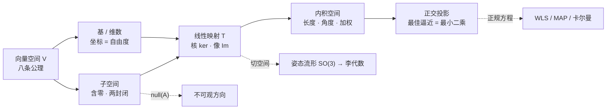

# 向量空间与线性结构：从八条公理到「姿态为什么不能相加」

> 一句话：**能直接加减、能乘系数、能谈「误差」和「平均」的对象，必须活在向量空间里。**
> 误差状态 $\delta x$ 可以加减，姿态 $R$ 却必须走 $\oplus/\ominus$；最小二乘叫「最优」，是因为它是正交投影；某个组合「不可观」，说的是观测矩阵有个非零的零空间。这三件事看着无关，其实是同一套结构。本篇把这套结构补齐。

!!! note "与既有篇的分工（先别重复造轮子）"
    | 篇 | 负责什么 | 本篇不碰什么 |
    |---|---|---|
    | [向量与矩阵入门](../00_数学语言/02_向量与矩阵入门.md) | **怎么算**：加法、点积、行列式、秩、特征值、正定 | 不再教矩阵乘法与行列式计算 |
    | [基变换与坐标变换](./03_基变换与坐标变换.md) | **换基时坐标怎么变**：过渡矩阵、相似变换、主动/被动 | 不再推 $v^{new}=P^{-1}v^{old}$ |
    | [矩阵分解与数值线性代数](../05_数值与实现/01_矩阵分解与数值线性代数.md) | **怎么稳地算**：LU / Cholesky / QR / SVD / 条件数 / Gram–Schmidt 实现 | 不写正交化算法步骤与数值稳定性 |
    | [概率统计基础](../03_概率与随机/01_概率统计基础.md) §4.3 | **正交投影怎么把卡尔曼增益 $K$ 算出来** | 不重复 $K$ 的推导 |
    | [SO(3) 与 SE(3) 李代数最小集](./04_SO3与SE3李代数.md) | $\mathrm{Exp}/\mathrm{Log}$、左右雅可比、BCH、$\oplus/\ominus$ | 不推指数映射，只解释「为什么必须用它」 |
    | **本篇** | **什么样的集合允许线性运算**、线性映射把空间压成什么样、投影为什么是最优 | — |

## 核心要点

- **向量空间不是「一堆箭头的集合」，是一份运算契约**：规定了加法与数乘，并且这套运算满足 8 条规律。封闭性是「运算能定义」的前提，不单列为第 9 条。
- **子空间判定只要三步**：含零、加法封闭、数乘封闭。少了「过原点」，后面所有线性方法都不能用。
- **基 = 坐标系的代数版本**；**维数 = 自由度的严格定义**。$SO(3)$ 是 3 维**流形**，不是 3 维向量空间；只有它在单位元处的**切空间** $\mathfrak{so}(3)$ 才是 3 维向量空间。
- **矩阵就是选定基之后的线性映射**。核 $\ker$ 是被压成零的方向，像 $\mathrm{Im}$ 是真正能到达的部分，$\dim\ker+\dim\mathrm{Im}=\dim V$ 叫秩–零度定理——「不可观方向」就是 $\ker H$ 里的向量。
- **内积给长度和角度**；加权内积 $\langle u,v\rangle_W=u^TWv$ 就是马氏距离的语法。**最小二乘 = 正交投影**，残差垂直于列空间，正规方程只是这条几何事实的坐标写法。
- 结论落地：**凡是出现「加减误差、累加、求平均、高斯分布、卡尔曼」的地方，先确认对象在向量空间里**；不在，就先找切空间。

---

## 一、先看三个工程现场：缺的就是这套定义

### 1.1 「误差状态在切空间里」——切空间凭什么能加减？

ESKF 把姿态误差写成 3 维小量 $\delta\phi$，然后做 $\hat x\leftarrow \hat x+K(z-h(\hat x))$、$P\leftarrow (I-KH)P$。整套加减、协方差、高斯假设都默认 $\delta\phi$ 在一个**能做线性运算的集合**里。真实姿态 $R\in SO(3)$ 却不行：两个旋转矩阵相加一般不再是旋转矩阵，所以才要用 $\mathrm{Exp}$ 把切空间的小量送回流形。详见 [SO(3) 与 SE(3) 李代数最小集](./04_SO3与SE3李代数.md) §一。

> 本篇补的就是那句话背后的**定义**：什么叫「能做线性运算的集合」。

### 1.2 「这个方向不可观」——不可观到底是哪来的？

观测方程 $z=Hx+v$ 里，若存在 $\delta x\neq0$ 使 $H\delta x=0$，那么 $x$ 与 $x+\delta x$ 产生**完全相同**的观测，滤波器永远分不清。所有这样的 $\delta x$ 构成 $H$ 的**零空间**，它是 $\mathbb R^n$ 的一个子空间；它的维数就是不可观方向的个数。这一句在组合导航、初始对准、标定里反复出现，但基础定义此前全库没有。

### 1.3 「最小二乘是最优的」——最优在哪？

$\min_x\lVert Ax-b\rVert^2$ 的解，几何上是把 $b$ **垂直投影**到 $A$ 的列空间上：垂线段最短。所谓「最优」不是玄学，是正交投影定理；正规方程 $A^TAx=A^Tb$ 只是「残差垂直于列空间」写成分量形式。[概率统计基础](../03_概率与随机/01_概率统计基础.md) §4.3 用同一套投影把卡尔曼增益 $K$ 推了出来，本篇只补全它的几何前提。

---

## 二、向量空间：八条公理，逐条配上「工程里管什么」

### 2.1 定义

设 $V$ 是非空集合，$\mathbb F$ 是域（本库一律取 $\mathbb F=\mathbb R$）。在 $V$ 上定义两种运算：

- **加法** $V\times V\to V$：$(u,v)\mapsto u+v$；
- **数乘** $\mathbb F\times V\to V$：$(\alpha,u)\mapsto \alpha u$。

> **封闭性藏在这两行里**：运算的到达域写的是 $V$，就等于要求「算完还在 $V$ 里」。所以标准定义列的是 **8 条运算规律**，而不是 10 条。判**子空间**时必须把封闭性重新单独验一遍，因为那里继承的是大空间的运算，能不能留在小集合里并未保证——§三会踩这个坑。

若对任意 $u,v,w\in V$、$\alpha,\beta\in\mathbb R$ 满足下表 8 条，$(V,+,\cdot)$ 称为**实向量空间**，元素称向量：

| # | 规律 | 写法 | 工程里管什么 / 违反会怎样 |
|---|---|---|---|
| 1 | 加法交换 | $u+v=v+u$ | 累加顺序可换；批量数据求和、分块叠加不必排序 |
| 2 | 加法结合 | $(u+v)+w=u+(v+w)$ | 可以分块累加、并行归约；浮点结合律另有数值误差，那是另一回事 |
| 3 | 零元 | $\exists\,0\in V,\ u+0=u$ | **才谈得上「误差」「残差」「偏差」**——没有零点就没有「差多少」 |
| 4 | 负元 | $\exists\,-u,\ u+(-u)=0$ | 才谈得上「修正量取反」「反馈减去估计」 |
| 5 | 数乘与域乘法相容 | $\alpha(\beta u)=(\alpha\beta)u$ | 增益连乘、单位换算可以合并成一次缩放 |
| 6 | 数乘单位元 | $1\cdot u=u$ | 缩放系数 1 必须真的是「不动」，否则增益 $K$ 的量纲全乱 |
| 7 | 数乘对**向量加法**分配 | $\alpha(u+v)=\alpha u+\alpha v$ | **叠加原理**：线性系统响应可拆、可加，是状态空间与传递函数的地基 |
| 8 | 数乘对**域加法**分配 | $(\alpha+\beta)u=\alpha u+\beta u$ | 两个增益作用在同一误差上可合并；滤波器里各项修正能线性叠加 |

> 第 7、8 条合起来就是**线性性**。所有「线性化」「线性组合」「线性映射」「线性方程」里的「线性」，源头都在这里。

### 2.2 常见向量空间（本库在用的）

| 集合 | 维数 | 本库在哪用 |
|---|---|---|
| $\mathbb R^n$ | $n$ | 15 态误差状态、观测向量、参数向量 |
| 次数 $\le n$ 的多项式 $P_n$ | $n+1$ | 多项式拟合、传感器温漂补偿建模 |
| $m\times n$ 矩阵 $M_{m\times n}(\mathbb R)$ | $mn$ | 协方差阵、信息矩阵、$F/H$ 阵都在这个空间里 |
| 区间上连续函数 $C[a,b]$ | 无穷维 | 信号、连续时间模型（[积分与累积直觉](../00_数学语言/04_积分与累积直觉.md)） |
| $\mathrm{null}(A)=\lbrace x\mid Ax=0\rbrace$ | $n-\operatorname{rank}A$ | 不可观方向、齐次方程解集 |
| $\mathfrak{so}(3)$（反对称矩阵 / 旋转向量） | 3 | [SO(3) 李代数](./04_SO3与SE3李代数.md)，姿态误差的容器 |

> **矩阵也能当向量**：$M_{m\times n}$ 满足全部 8 条（逐元素加、逐元素数乘）。所以「协方差阵相加」「信息矩阵相加」在代数上合法——协方差半正定只是额外约束，不改变它是向量空间这一事实。

### 2.3 常见反例：为什么它们不是向量空间

| 集合 | 违反什么 | 判据 / 数值 | 工程里在哪撞见 |
|---|---|---|---|
| 第一象限 $\lbrace x\mid x_i\ge0\rbrace$ | 数乘封闭（取 $\alpha=-1$） | $-1\cdot(1,1)=(-1,-1)$ 出界 | 非负量（方差、功率、幅值）不能随便加减 |
| 仿射平面 $x_1+x_2=1$ | 零元（$(0,0)$ 不在集合里） | $0$ 不满足约束 | 归一化约束、概率单纯形、带固定偏置的解集 |
| $SO(3)$ 旋转矩阵集合 | 加法封闭 | $R(30^\circ)+R(60^\circ)$ 的 $\det=7.464102$，$\lVert M^TM-I\rVert_F=4.891646$ | **姿态不能相加、不能取算术平均** |
| 单位四元数集合 | 加法与数乘都不封闭 | 两个单位四元数之和一般不再是单位四元数 | 四元数平均要用迭代/特征向量法，不能直接求平均 |
| 概率单纯形 $\sum p_i=1,\ p_i\ge0$ | 零元 + 数乘 | $(0,\dots,0)$ 不满足归一化 | 分布不能直接加权相减（差一个仿射结构） |
| 非零实数集 $\mathbb R\setminus\lbrace0\rbrace$ | 零元 | $0$ 被挖掉了 | 看似「能乘能加」，其实没有加法单位元 |

!!! warning "「不是向量空间」不等于「不能用」"
    它只说明**不能直接套线性运算**，得换工具：$SO(3)$ 用 $\oplus/\ominus$ 与 $\mathrm{Exp}/\mathrm{Log}$（[01/04](./04_SO3与SE3李代数.md)），仿射集用「基点 + 子空间」的写法（§三），概率分布用单纯形上的几何。**误把流形当向量空间，是姿态滤波最经典的一类 bug。**

---

## 三、子空间：三步判定，以及「过原点」为什么不能省

### 3.1 定义与判定

$W\subseteq V$ 若**沿用 $V$ 的加法与数乘**后自身仍是向量空间，就叫 $V$ 的**子空间**。不必重新验 8 条——交换、结合、两条分配律都是从大空间**继承**的，真正要验的只有「运算结果别跑出去」：

$$\boxed{W\le V\iff 0\in W,\quad u,v\in W\Rightarrow u+v\in W,\quad \alpha\in\mathbb R,\ u\in W\Rightarrow \alpha u\in W}$$

| 步骤 | 验什么 | 一句话记忆 |
|---|---|---|
| 1 | $0\in W$ | **必须过原点** |
| 2 | 加法封闭 | 两个解相加还是解 |
| 3 | 数乘封闭 | 解乘任意实数还是解 |

> 三步常合并成一条：$\alpha u+\beta v\in W$（取 $\beta=0,\alpha=0$ 就分别含了数乘与零元）。

### 3.2 反例：非齐次方程的解集不是子空间

$Ax=b\ (b\neq0)$ 的解集若有特解 $x_p$，则全部解为

$$x_p+\mathrm{null}(A)=\lbrace x_p+n\mid An=0\rbrace$$

这是**仿射集**（平移过的子空间），不是子空间：$0$ 不在里面（因为 $A\cdot0=0\neq b$），两个解相加给 $A(x_1+x_2)=2b$ 也不满足方程。真正是子空间的只有**齐次**解集 $\mathrm{null}(A)$。

> 工程落点：卡尔曼里把先验 $\bar x$ 当成「基点」，估计的是增量 $\delta x$——正是把仿射问题搬回子空间处理；[估计与优化基础](../06_估计与优化/01_估计与优化基础.md) §四 的 MAP 增广 WLS 就是这个结构。

### 3.3 交、和、直和与维数公式

子空间的交 $U\cap W$、和 $U+W=\lbrace u+w\mid u\in U,\ w\in W\rbrace$ 仍是子空间，**并集一般不是**（$\mathbb R^2$ 里两条过原点直线的并，加法不封闭）。

$$\dim(U+W)=\dim U+\dim W-\dim(U\cap W)$$

若 $U\cap W=\lbrace0\rbrace$，称 $V=U\oplus W$ 为**直和**，此时每个 $v\in V$ 唯一写成 $v=u+w$。

> 工程落点：把状态拆成「可观部分 $\oplus$ 不可观部分」、「信号 $\oplus$ 噪声子空间」，能这么拆的前提就是直和；否则两部分有重叠，分解不唯一，后续估计会漂。

!!! example "数值自验（$\mathbb R^3$ 里两张过原点平面）"
    $U=\mathrm{span}\lbrace e_1,e_2\rbrace$（$xy$ 平面）、$W=\mathrm{span}\lbrace e_2,e_3\rbrace$（$yz$ 平面）：$\dim U=2$、$\dim W=2$、交集是 $y$ 轴 $\dim(U\cap W)=1$，而 $U+W=\mathbb R^3$ 维数 3。代入公式 $3=2+2-1$ ✅。

> 踩坑提醒：**「子空间」三个字自带过原点**。看到「满足某约束的所有状态」先摸一下零向量在不在；不在，就得先减去一个基点再谈线性方法。

---

## 四、线性组合、张成、基、维数、坐标

### 4.1 五个概念一次排清楚

| 概念 | 定义 | 形状 / 判据 |
|---|---|---|
| **线性组合** | $\sum_i\alpha_i v_i$ | 有限个；系数任意实数 |
| **张成** $\mathrm{span}(S)$ | $S$ 的所有线性组合 | 必是子空间（含 $S$ 的最小子空间） |
| **线性无关** | $\sum_i\alpha_i v_i=0\ \Rightarrow\ \alpha_i=0\ \forall i$ | 方阵情形 $\Leftrightarrow\ \det\neq0$；一般情形看秩 |
| **基** | 线性无关且张满 $V$ | 有序时叫「有序基」，才能和坐标一一对应 |
| **维数** $\dim V$ | 基所含向量个数 | 与选哪组基无关（不变量） |

**坐标**就是在这组基下的系数：$v=\mathcal B\,[v]_{\mathcal B}$，其中 $\mathcal B$ 是把基向量按列拼成的矩阵。换基时坐标怎么变，是 [基变换与坐标变换](./03_基变换与坐标变换.md) 的主题；本篇只强调一句：**「基」这个词在代数上就是「向量空间里的一组坐标参照」，此前全库只在名词表里出现过，没有定义。**

### 4.2 维数 = 自由度，但「3 维」有两种

| 对象 | 是什么 | 能不能加减 |
|---|---|---|
| $\mathbb R^{15}$（ESKF 误差状态） | 15 维**向量空间** | 能 |
| $\mathfrak{so}(3)\cong\mathbb R^3$（旋转向量） | 3 维**向量空间**（切空间） | 能 |
| $SO(3)$（旋转矩阵） | 3 维**流形**（不是向量空间） | 不能，须 $\oplus/\ominus$ |
| $SE(3)$（位姿） | 6 维**流形** | 不能，须 $\oplus/\ominus$ |

!!! warning "「3 维流形」与「3 维向量空间」不是一回事"
    前者只说明**局部**能用 3 个实数参数化（像球面是 2 维流形），不保证全局能做加减。姿态滤波里所有「误差小量」都活在切空间这个**向量空间**，所有「状态本身」都活在流形上——两者靠 $\mathrm{Exp}/\mathrm{Log}$ 来回搬。参见 [SO(3) 与 SE(3) 李代数最小集](./04_SO3与SE3李代数.md) §一、§七。

> 踩坑提醒：**别把「参数个数」当「维数」**。单位四元数有 4 个分量，但带 $\lVert q\rVert=1$ 约束，只有 3 个自由度；旋转矩阵有 9 个元素，也只有 3 个自由度。维数数的是基向量个数，不是数组长度。

---

## 五、线性映射：核、像与秩–零度定理

### 5.1 定义

$T:V\to W$ 称为**线性映射**，若

$$T(u+v)=T(u)+T(v),\qquad T(\alpha u)=\alpha T(u)$$

这正是 §二 第 7、8 条分配律的直接兑现。**矩阵就是选定基之后线性映射的那张表**：$T(x)=Ax$，$A$ 的第 $j$ 列 = 第 $j$ 个基向量被送到哪里（[向量与矩阵入门](../00_数学语言/02_向量与矩阵入门.md) §2.1 的「列的线性组合」读法）。换基时 $A\mapsto P^{-1}AP$，是同一个 $T$ 换了张表（[01/03](./03_基变换与坐标变换.md) §五 的相似变换）。

### 5.2 核与像

$$\ker T=\lbrace v\in V\mid T(v)=0\rbrace\le V,\qquad \mathrm{Im}\,T=\lbrace T(v)\mid v\in V\rbrace\le W$$

- **核**：被 $T$ 压成零的方向 → 信息在这里**丢失了**；
- **像**：$T$ 真正能到达的部分 → 方程 $T(v)=w$ 有解当且仅当 $w\in\mathrm{Im}\,T$。

对 $A\in\mathbb R^{m\times n}$：$\ker A=\mathrm{null}(A)$，$\mathrm{Im}\,A=\mathrm{col}(A)$（列空间），$\dim\mathrm{Im}\,A=\operatorname{rank}A$。

### 5.3 秩–零度定理

$$\boxed{\dim\ker T+\dim\mathrm{Im}\,T=\dim V}\qquad\text{即}\qquad \dim\mathrm{null}(A)+\operatorname{rank}A=n$$

> 读法：**输入空间的总维数，一分不差地分成「被压扁的」和「被保留的」两部分**。矩阵不可能凭空造出自由度，也不能让自由度凭空消失。

### 5.4 工程落点：可观性、可辨识性、为什么正规方程会奇异

| 现象 | 用本节的话说 | 后果 / 处理 |
|---|---|---|
| 组合导航「某个方向不可观」 | $\ker H\neq\lbrace0\rbrace$，存在 $\delta x$ 使 $H\delta x=0$ | $H^TWH$ 奇异、状态沿该方向随噪声游走 → 加机动激励或先验 |
| 标定「参数辨识不出来」 | 设计矩阵 $A$ 秩亏，$\ker A$ 非零 | 解不唯一 → 加约束 / 正则化 / 换激励轨迹 |
| 正规方程 $A^TAx=A^Tb$ 解不出 | $A^TA$ 奇异或接近奇异 | 用 QR / SVD、加阻尼 $\lambda I$（[05/01](../05_数值与实现/01_矩阵分解与数值线性代数.md)、[06/01](../06_估计与优化/01_估计与优化基础.md) §四） |
| 条件数很大 | 不是秩亏，但「最小的那个奇异值」很小 | 数值上几乎不可观；条件数定量见 [05/01](../05_数值与实现/01_矩阵分解与数值线性代数.md) |

!!! example "数值自验"
    取 $A\in\mathbb R^{3\times4}$ 且 $\operatorname{rank}A=2$，SVD 给出 $\dim\mathrm{null}(A)=2$；从零空间取两向量 $u,v$，$\lVert A(u+v)\rVert=4.97\times10^{-16}$、$\lVert A(-2.7u)\rVert\approx0$，且 $2+2=4$ ✅。

> 踩坑提醒：**秩不足 ≠ 数据不够**。更多时候是激励构型没把某些方向「照亮」——例如静止不动时，加速度计零偏与姿态俯仰在任何观测下都耦合，采再久也分不开。这是 $\ker H$ 的结构问题，不是样本量问题。

---

## 六、内积空间：长度、角度与加权

### 6.1 定义

在向量空间上再给一个**内积** $\langle\cdot,\cdot\rangle:V\times V\to\mathbb R$，满足对称（实情形）、对第一个变量线性、正定 $\langle v,v\rangle>0\ (v\neq0)$，就得到**内积空间**。由它诱导

$$\lVert v\rVert=\sqrt{\langle v,v\rangle},\qquad \cos\theta=\frac{\langle u,v\rangle}{\lVert u\rVert\,\lVert v\rVert},\qquad u\perp v\iff\langle u,v\rangle=0$$

**Cauchy–Schwarz**：$\vert\langle u,v\rangle\vert\le\lVert u\rVert\,\lVert v\rVert$；它保证上式右边确实落在 $[-1,1]$，夹角才有定义。

### 6.2 本库常用的三种内积

| 内积 | 写法 | 用在哪 |
|---|---|---|
| 欧氏 | $\langle u,v\rangle=u^Tv$ | 普通距离、$\lVert x\rVert^2=x^Tx$ |
| **加权** | $\langle u,v\rangle_W=u^TWv$，$W\succ0$ | **马氏距离** $\lVert r\rVert_W^2=r^TWr$，卡尔曼 / WLS 的「远近」 |
| Frobenius（矩阵空间） | $\langle A,B\rangle_F=\mathrm{tr}(A^TB)$ | $\lVert A\rVert_F^2$、矩阵拟合残差 |

> 一句话：**换了内积，就换了「什么算近」**。卡尔曼的 $R^{-1}$、WLS 的 $W$ 不是装饰，是重新定义了残差空间的尺子；[估计与优化基础](../06_估计与优化/01_估计与优化基础.md) §三 的信息矩阵 $\Lambda=H^TWH$ 就是这个加权内积在参数空间里的像。

### 6.3 正交基与 Gram–Schmidt

一组两两正交且长度为 1 的基叫**标准正交基** $Q$，满足 $Q^TQ=I$。Gram–Schmidt 是「把任意一组无关向量逐个减去在已有方向上的投影」来造 $Q$ 的方法，结果与 QR 分解等价。**算法步骤与数值稳定性（改良 Gram–Schmidt / Householder）在** [矩阵分解与数值线性代数](../05_数值与实现/01_矩阵分解与数值线性代数.md) §四，本篇只留一句几何：正交基把内积变成普通点积，坐标之间不再互相干扰。

---

## 七、正交投影与最佳逼近：最小二乘的真正来历

### 7.1 投影定理

设 $W\le V$ 是子空间，$b\in V$。存在唯一 $p\in W$ 使

$$\lVert b-p\rVert=\min_{w\in W}\lVert b-w\rVert,\qquad\text{且}\qquad (b-p)\perp W$$

$p$ 叫 $b$ 在 $W$ 上的**正交投影**，$b-p$ 是残差。**垂线段最短**，这就是「最优」的全部理由，不需要任何求导。

### 7.2 正规方程只是这条几何事实的坐标写法

取 $W=\mathrm{col}(A)$，投影 $p=Ax$。残差垂直于列空间即 $\langle a_j,\ b-Ax\rangle=0$ 对每个列向量成立，堆起来就是

$$A^T(b-Ax)=0\quad\Longrightarrow\quad \boxed{A^TAx=A^Tb}$$

加权内积下同理：$A^TW(b-Ax)=0\ \Rightarrow\ A^TWA\,x=A^TWb$，就是 WLS；再加先验项就是 MAP（[06/01](../06_估计与优化/01_估计与优化基础.md) §四）。**这里是几何推导出正规方程，与 [02/02 §6.3](../02_分析与微积分/02_微分方程与状态空间离散化.md) 用矩阵求导推出同一式子，是两条不同的路、同一个答案。**

!!! example "数值自验"
    $A$ 四行两列、$b=(1.1,2.0,3.4,3.9)^T$：`lstsq` 给 $x=(0.15,\ 0.98)^T$，$\lVert A^T r\rVert=4.37\times10^{-15}$；换成 $W=\mathrm{diag}(4,1,0.5,2)$ 后 $x_{WLS}=(0.157219,\ 0.949733)^T$，$\lVert A^TW r\rVert=3.83\times10^{-15}$。残差确实垂直于（加权）列空间 ✅。

### 7.3 四个基本子空间

对 $A\in\mathbb R^{m\times n}$、$r=\operatorname{rank}A$，四个子空间两两配对，正交关系一目了然：

| 子空间 | 所在 | 维数 | 工程含义 |
|---|---|---|---|
| 列空间 $\mathrm{col}(A)$ | $\mathbb R^m$ | $r$ | 模型**能产生的**观测；投影的落点 |
| 左零空间 $\mathrm{null}(A^T)$ | $\mathbb R^m$ | $m-r$ | 与所有模型输出正交的方向；残差住这里 |
| 行空间 $\mathrm{row}(A)=\mathrm{col}(A^T)$ | $\mathbb R^n$ | $r$ | 参数里**能被数据照亮**的部分 |
| 零空间 $\mathrm{null}(A)$ | $\mathbb R^n$ | $n-r$ | **不可观 / 不可辨识**方向 |

$$\mathrm{col}(A)\perp\mathrm{null}(A^T),\qquad \mathrm{row}(A)\perp\mathrm{null}(A),\qquad \mathbb R^n=\mathrm{row}(A)\oplus\mathrm{null}(A)$$

> 这张表把 §1.2 的「不可观」、§5.4 的「秩亏」、§7.1 的「残差」放到同一张图上：**数据只约束行空间那一半，零空间那一半只能靠先验或结构约束**。数值自验：取 $u\in\mathrm{null}(A)$ 与行空间基向量 $v$，$\vert u^Tv\vert=1.38\times10^{-16}$ ✅。

> 踩坑提醒：残差垂直的是**列空间**，不是「每一列都为零」。$A^Tr=0$ 是一个整体条件；逐列去调参数、指望把每一列的误差都消掉，是把它误解成逐点条件了。

---

## 八、数值验证（构建期实算，非手推）

> `numpy` 独立核验：矩阵指数用幂级数自实现，导数用中心差分，最小二乘用 `lstsq` 交叉对拍。全部 ✅。

| 检查项 | 期望 | 实测 |
|---|---|---|
| $R(30^\circ)+R(60^\circ)$ 不是旋转矩阵 | 不在 $SO(3)$ | $\det=7.464102$，$\lVert M^TM-I\rVert_F=4.891646$ ✅ |
| 零空间含零 / 加法封闭 / 数乘封闭 | 三步全过 | $\lVert A(u+v)\rVert=4.97\times10^{-16}$ ✅ |
| 仿射集 $x_1+x_2=1$ 不是子空间 | 不含零、加法不封闭 | ✅ |
| 秩–零度 | $\dim\ker+\dim\mathrm{Im}=\dim V$ | $2+2=4$ ✅ |
| 维数公式 | $\dim(U+W)=2+2-1$ | $3$ ✅ |
| 最小二乘 = 正交投影 | $A^Tr=0$ 且 `lstsq` = 正规方程解 | $4.37\times10^{-15}$ ✅ |
| 加权投影 = WLS | $A^TWr=0$ | $3.83\times10^{-15}$ ✅ |
| 四个基本子空间 | $\mathrm{null}(A)\perp\mathrm{row}(A)$ | $\vert u^Tv\vert=1.38\times10^{-16}$ ✅ |
| Gram–Schmidt | $Q^TQ=I$、$A=QR$ | ✅ |
| 切空间可加、群不可加 | $\mathrm{Exp}(p_1)\mathrm{Exp}(p_2)\neq\mathrm{Exp}(p_1+p_2)$ | 差 $\lVert\cdot\rVert_F=0.024429$ ✅（BCH 一阶项） |

---

## 九、常见坑

1. **把「能加减」当默认**：姿态、单位四元数、概率分布都不能直接加减，先找切空间或仿射结构。
2. **子空间忘了验零元**：「满足约束的解集」常常是仿射集（$Ax=b,\ b\neq0$），不是子空间。
3. **把并集当和**：两个子空间的并一般不是子空间，能拆要用**直和**（交集只有零）。
4. **把数组长度当维数**：旋转矩阵 9 个元素、四元数 4 个分量，都只有 3 个自由度。
5. **把「3 维流形」当「3 维向量空间」**：局部参数化 ≠ 全局线性结构。
6. **把秩亏归咎于数据少**：先看 $\ker H$ 的结构与激励构型，采再久也照不亮的方向要靠机动或先验。
7. **换了内积还用欧氏直觉**：加权最小二乘下的「垂直」是 $A^TWr=0$，不是 $A^Tr=0$。
8. **对矩阵求导时直接套标量链式法则**：中间变量是矩阵时导数是高阶对象，得用微分法 / $\mathrm{vec}$ + Kronecker，见 [多元微积分与矩阵求导](../02_分析与微积分/04_多元微积分与矩阵求导.md) §三。
9. **表格公式里写裸竖线**：Markdown 表格会把 $\vert x\vert$ 的 `|` 当列分隔符，一律写 `\vert x\vert`、$\lVert x\rVert$。

---

## 十、本库术语对照（把散落的词收口）

| 在别处读到的词 | 严格是什么 | 属于本节哪一块 | 出处 |
|---|---|---|---|
| 误差状态 $\delta x$ | $\mathbb R^{15}$ 的向量 | 向量空间 | [11 EKF 与 ESKF](../../惯性导航/03_组合导航篇/11_EKF与ESKF.md) |
| 切空间 $\mathfrak{so}(3)$ | $SO(3)$ 在单位元处的 3 维**向量空间** | 子空间 / 维数 | [01/04 SO(3) 李代数](./04_SO3与SE3李代数.md) |
| $\oplus/\ominus$ | 用 $\mathrm{Exp}/\mathrm{Log}$ 把流形加减搬回切空间 | 流形 ≠ 向量空间 | 同上 |
| 不可观方向 | $\ker H$ 里的非零向量 | 核 | [05/01 矩阵分解](../05_数值与实现/01_矩阵分解与数值线性代数.md) |
| 自由度 | $\dim V$（基向量个数） | 维数 | 本篇 §四 |
| 基 / 过渡矩阵 $P$ | 有序基 / 换基的线性映射 | 基、坐标 | [01/03 基变换与坐标变换](./03_基变换与坐标变换.md) |
| 马氏距离 | 加权内积诱导的范数 | 内积空间 | [06/01 估计与优化基础](../06_估计与优化/01_估计与优化基础.md) |
| 信息矩阵 $\Lambda=H^TWH$ | 加权内积在参数空间的像 | 内积 / 投影 | 同上 |
| 正交投影 / 最佳逼近 | $\min\lVert b-w\rVert$ 的解 | 投影定理 | 本篇 §七、[03/01](../03_概率与随机/01_概率统计基础.md) §4.3 |
| 正规方程 $A^TAx=A^Tb$ | 残差垂直列空间的坐标写法 | 投影 | [02/02 §6.3](../02_分析与微积分/02_微分方程与状态空间离散化.md) |
| 条件数 $\kappa(A)$ | 最大/最小奇异值之比，衡量「几乎秩亏」 | 内积 + 映射 | [05/01](../05_数值与实现/01_矩阵分解与数值线性代数.md) |

---

## 关联

- **上游**：[向量与矩阵入门](../00_数学语言/02_向量与矩阵入门.md)（线代最小可用集）· [符号与记号速查](../00_数学语言/00_符号与记号速查.md)（$\lVert\cdot\rVert$、$\mathrm{rank}$、$\vert\cdot\vert$）
- **同层**：[基变换与坐标变换](./03_基变换与坐标变换.md)（基与坐标怎么换）· [SO(3) 与 SE(3) 李代数最小集](./04_SO3与SE3李代数.md)（不是向量空间的典型，以及怎么补救）· [矢量叉乘与反对称矩阵](./01_矢量叉乘与反对称矩阵.md)（$\mathfrak{so}(3)$ 的具体样子）
- **下游**：[矩阵分解与数值线性代数](../05_数值与实现/01_矩阵分解与数值线性代数.md)（QR / SVD / 条件数怎么算）· [多元微积分与矩阵求导](../02_分析与微积分/04_多元微积分与矩阵求导.md)（线性映射的导数 = 雅可比）· [估计与优化基础](../06_估计与优化/01_估计与优化基础.md)（WLS / MAP / 因子图）
- **应用**：[11 EKF 与 ESKF](../../惯性导航/03_组合导航篇/11_EKF与ESKF.md)（误差状态）· [08 初始对准](../../惯性导航/02_解算篇/08_初始对准.md)（可观测性 / Wahba）
- **层索引**：[数学基础 · 导读](/数学基础/)

## 外链 Wiki

- [向量空间 — 维基百科](https://zh.wikipedia.org/wiki/向量空间)
- [线性映射 — 维基百科](https://zh.wikipedia.org/wiki/线性映射)
- [秩–零化度定理 — 维基百科](https://zh.wikipedia.org/wiki/秩-零化度定理)
- [内积空间 — 维基百科](https://zh.wikipedia.org/wiki/内积空间)
- [正交投影 — 维基百科](https://zh.wikipedia.org/wiki/投影_(线性代数))
- [四个基本子空间 / 线性代数基本定理 — 维基百科](https://en.wikipedia.org/wiki/Fundamental_theorem_of_linear_algebra)
- [Matrix calculus — Wikipedia](https://en.wikipedia.org/wiki/Matrix_calculus)
