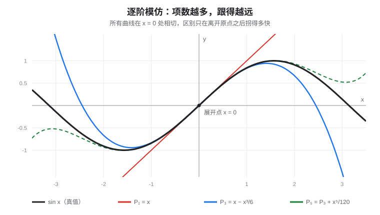
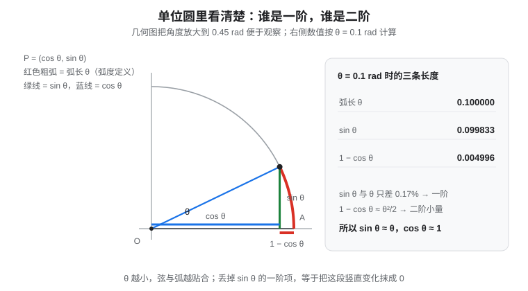
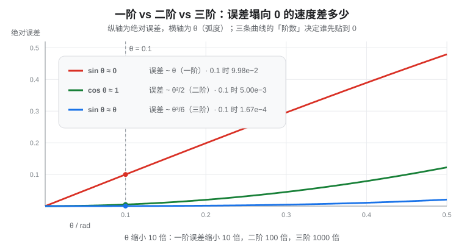

# 泰勒展开：用多项式逐阶模仿一个函数

> 一句话：**用函数在某一点的函数值、一阶导数、二阶导数……造一个多项式，让它在该点附近逐阶地像原函数。** 项数越多，像得越远、越久。
>
> 它是所有「小量近似」的总源头。本文先把这个工具本身讲透（§一～§五），再回到一个很常见的困惑：小角度时为什么写 $\sin\theta\approx\theta,\ \cos\theta\approx1$，而不是 $\sin\theta\approx0,\ \cos\theta\approx1$（§六）。工具讲清楚之后，这个疑问会自己消失。

## 核心要点

- 泰勒公式：$f(x)=\sum\limits_{k=0}^{n}\dfrac{f^{(k)}(a)}{k!}(x-a)^k+R_n(x)$。系数里的 $k!$ 来自「对 $(x-a)^k$ 求 $k$ 次导恰好得到 $k!$」。
- 截断到 $n$ 阶后，**误差量级由下一项控制**：$\sin\theta=\theta+O(\theta^3)$，$\cos\theta=1+O(\theta^2)$。
- 工程里默认的是**统一截断到一阶**：$\sin$ 给出 $\theta$、$\cos$ 给出 $1$，两者是同一条规则的两个结果——$\cos$ 不是「只取零阶」，而是「一阶项系数恰好为 0」。
- $\sin\theta\approx0$ 是自洽的**零阶**近似；问题不在精度高低，而在它把全部一阶变化丢掉了。在物理方程里这往往造成**定性错误**（恢复力整个消失），不是误差大一那么温和。
- 系数 $1$ 只在**弧度制**下成立：角度用度时 $\sin(\theta^\circ)\approx0.01745\,\theta$。

---

## 一、核心思想：让多项式在一点处「逐阶相同」

设 $f(x)$ 在 $x=a$ 附近足够光滑。想用一个 $n$ 次多项式

$$P_n(x)=c_0+c_1(x-a)+c_2(x-a)^2+\cdots+c_n(x-a)^n$$

来近似它。系数怎么选？最自然的办法是**要求 $P_n$ 在 $a$ 处不仅函数值相同，连一阶、二阶……直到 $n$ 阶导数都相同**：

$$P_n(a)=f(a),\quad P_n'(a)=f'(a),\quad P_n''(a)=f''(a),\quad\dots,\quad P_n^{(n)}(a)=f^{(n)}(a)$$

逐阶解出系数：

| 阶数 | 多项式这一阶在 $a$ 处的值 | 令其等于 | 解出 |
|---|---|---|---|
| 0 | $P_n(a)=c_0$ | $f(a)$ | $c_0=f(a)$ |
| 1 | $P_n'(a)=c_1$ | $f'(a)$ | $c_1=f'(a)$ |
| 2 | $P_n''(a)=2c_2$ | $f''(a)$ | $c_2=f''(a)/2!$ |
| 3 | $P_n^{(3)}(a)=6c_3$ | $f^{(3)}(a)$ | $c_3=f^{(3)}(a)/3!$ |

一般地，对 $(x-a)^k$ 求 $k$ 次导得到常数 $k!$；**比它次的低次项**求 $k$ 次导后全变成 0；**比它高的项**求完 $k$ 次导仍带着 $(x-a)$ 因子，代入 $x=a$ 也是 0。于是 $P_n^{(k)}(a)=k!\,c_k$，即

$$\boxed{c_k=\frac{f^{(k)}(a)}{k!}}$$

代回去就是**泰勒公式**：

$$\boxed{
f(x)=f(a)+f'(a)(x-a)+\frac{f''(a)}{2!}(x-a)^2+\cdots+\frac{f^{(n)}(a)}{n!}(x-a)^n+R_n(x)
}$$

取 $a=0$（最常用）就是**麦克劳林展开**：

$$f(x)=f(0)+f'(0)x+\frac{f''(0)}{2!}x^2+\cdots+\frac{f^{(n)}(0)}{n!}x^n+R_n(x)$$

!!! tip "「逐阶模仿」到底在模仿什么"
    - $P_0=f(a)$：一条**水平线**，只对齐「高度」；
    - $P_1=f(a)+f'(a)(x-a)$：一条**切线**，再对齐「斜率」，这就是导数篇里的最佳线性逼近；
    - $P_2$：再对齐「弯曲程度」（二阶导）；$P_3$：再对齐「弯曲的变化」……

    每多一项，多项式就在 $a$ 附近多贴合一层，能「跟上」原函数的范围也越宽。下图把这件事画出来：

> 读图要点：黑线是 $\sin x$ 真值；红色 $P_1=x$ 只在原点附近贴合；蓝色 $P_3=x-\dfrac{x^3}{6}$ 明显跟得更远；绿色 $P_5$ 又更远一截。**所有曲线都在 $x=0$ 处相切，区别只在离开原点之后拐得多快。**

前置知识（导数定义、最佳线性逼近 $f(x_0+h)=f(x_0)+f'(x_0)h+o(h)$、泰勒公式的一般形式）见同层 [导数与微分基础](01_导数与微分基础.md)（§五、§十）。本篇不重复这些推导，只讲「展开本身怎么用」。

---

## 二、余项：为什么可以「截断」

写无穷多项不现实，实际用的一定是有限项加一个余项。常见的**拉格朗日余项**：

$$R_n(x)=\frac{f^{(n+1)}(\xi)}{(n+1)!}(x-a)^{n+1},\qquad \xi \text{ 介于 } a \text{ 与 } x \text{ 之间}$$

它说明：**截断后的误差量级由「下一项」决定**。若只关心量级，用 $O$ 记号更省事：

$$f(x)=\sum_{k=0}^{n}\frac{f^{(k)}(a)}{k!}(x-a)^k+O\!\left((x-a)^{n+1}\right)$$

在 $a=0$、$x=\theta$ 很小的情形，$\theta^{n+1}$ 比 $\theta^n$ 小得多，所以丢掉高阶项的代价可控。例如

$$\sin\theta=\theta-\frac{\theta^3}{6}+O(\theta^5),\qquad \cos\theta=1-\frac{\theta^2}{2}+O(\theta^4)$$

!!! warning "三个容易混的地方"
    1. **$O$ 与 $o$**：$O(h^n)$ 是「不超过 $h^n$ 量级」，$o(h^n)$ 是「比 $h^n$ 高阶」（比值趋于 0）。导数篇里的一阶逼近写 $+o(h)$，是比 $O(h^2)$ 更弱、但已足够的表述。
    2. **泰勒多项式 ≠ 泰勒级数**：有限项公式只要求 $n$ 阶可导；把项数加到无穷并要求级数收敛**且等于原函数**，需要函数在该点**解析**。二者不是一回事。
    3. **光滑不等于解析**：经典反例 $f(x)=e^{-1/x^2}\ (x\neq0),\ f(0)=0$，在 $x=0$ 处各阶导数全为 0，泰勒级数恒等于 0，却只在 $x=0$ 处等于 $f$。工程里常用的 $e^x,\sin x,\cos x,\ln(1+x)$ 都解析，不会遇到这种病态，但概念上要分清。

**收敛范围**也随函数而变：$e^x,\sin x,\cos x,\sinh x,\cosh x$ 的级数对全体实数收敛；几何级数、二项式、对数、反三角则有各自的半径（见 §三表格）。超出收敛域，项数加得再多也不会靠近真值。

---

## 三、常用展开表

以下默认在 $x=0$ 处展开（麦克劳林），角度一律用弧度。

| 函数 | 展开式 | 收敛范围 | 分母规律 |
|---|---|---|---|
| $e^x$ | $1+x+\dfrac{x^2}{2!}+\dfrac{x^3}{3!}+\cdots=\sum\limits_{n\ge0}\dfrac{x^n}{n!}$ | 全体实数 | 阶乘 $n!$ |
| $\sin x$ | $x-\dfrac{x^3}{3!}+\dfrac{x^5}{5!}-\cdots$ | 全体实数 | 奇次阶乘 $(2n+1)!$ |
| $\cos x$ | $1-\dfrac{x^2}{2!}+\dfrac{x^4}{4!}-\cdots$ | 全体实数 | 偶次阶乘 $(2n)!$ |
| $\sinh x$ | $x+\dfrac{x^3}{3!}+\dfrac{x^5}{5!}+\cdots$ | 全体实数 | 奇次阶乘，全正 |
| $\cosh x$ | $1+\dfrac{x^2}{2!}+\dfrac{x^4}{4!}+\cdots$ | 全体实数 | 偶次阶乘，全正 |
| $\dfrac{1}{1-x}$ | $1+x+x^2+x^3+\cdots$ | $\vert x\vert<1$ | 无（几何级数） |
| $\dfrac{1}{1+x}$ | $1-x+x^2-x^3+\cdots$ | $\vert x\vert<1$ | 无 |
| $\ln(1+x)$ | $x-\dfrac{x^2}{2}+\dfrac{x^3}{3}-\cdots$ | $-1<x\le 1$ | 普通整数 $n$ |
| $\arctan x$ | $x-\dfrac{x^3}{3}+\dfrac{x^5}{5}-\cdots$ | $\vert x\vert\le 1$ | 奇数 $2n+1$ |
| $(1+x)^\alpha$ | $1+\alpha x+\dfrac{\alpha(\alpha-1)}{2!}x^2+\cdots$ | 一般 $\vert x\vert<1$ | 阶乘（广义二项式） |
| $\tan x$ | $x+\dfrac{x^3}{3}+\dfrac{2x^5}{15}+\dfrac{17x^7}{315}+\cdots$ | $\vert x\vert<\pi/2$ | 无简单规律，记前两项 |
| $\arcsin x$ | $x+\dfrac{x^3}{6}+\dfrac{3x^5}{40}+\dfrac{5x^7}{112}+\cdots$ | $\vert x\vert<1$ | 无简单规律，记第一项 |

常用特例（$\alpha=\tfrac12,-\tfrac12,-1$）：

$$\sqrt{1+x}=1+\frac{x}{2}-\frac{x^2}{8}+\frac{x^3}{16}-\frac{5x^4}{128}+\cdots$$

$$\frac{1}{\sqrt{1+x}}=1-\frac{x}{2}+\frac{3x^2}{8}-\frac{5x^3}{16}+\cdots$$

$$\frac{1}{1+x}=1-x+x^2-x^3+\cdots \quad(\text{正是 } \alpha=-1 \text{ 的二项式展开})$$

### 3.1 $\sin$ 与 $\cos$：导数循环直接给出系数

在 $x=0$ 处逐阶代值：

| $k$ | 0 | 1 | 2 | 3 | 4 | 5 |
|---|---|---|---|---|---|---|
| $\sin^{(k)}(0)$ | 0 | 1 | 0 | $-1$ | 0 | 1 |
| $\cos^{(k)}(0)$ | 1 | 0 | $-1$ | 0 | 1 | 0 |

于是

$$\sin x=0+1\cdot x+\frac{0}{2!}x^2+\frac{-1}{3!}x^3+\cdots=x-\frac{x^3}{6}+\frac{x^5}{120}-\cdots$$

$$\cos x=1+0\cdot x+\frac{-1}{2!}x^2+\frac{0}{3!}x^3+\cdots=1-\frac{x^2}{2}+\frac{x^4}{24}-\cdots$$

注意 $\sin$ 的偶数阶导数在 0 处**全为 0**，$\cos$ 的奇数阶导数在 0 处**全为 0**——这就是「正弦只含奇次幂、余弦只含偶次幂」的来源，也是 §六 那个疑问的根。

### 3.2 $\ln(1+x)$ 与 $\arctan x$：分母为什么不是阶乘

这两支最容易被误记成 $n!$。其实它们**不是靠求导得到的，而是靠逐项积分得到的**：

$$\frac{1}{1+t}=1-t+t^2-t^3+\cdots \ \xrightarrow{\ \int_0^x\ }\ \ln(1+x)=x-\frac{x^2}{2}+\frac{x^3}{3}-\frac{x^4}{4}+\cdots$$

$$\frac{1}{1+t^2}=1-t^2+t^4-\cdots \ \xrightarrow{\ \int_0^x\ }\ \arctan x=x-\frac{x^3}{3}+\frac{x^5}{5}-\cdots$$

积分一次给 $t^n$ 带来一个除以 $n+1$，所以分母是**普通整数**，永远不会冒出阶乘。

### 3.3 $\sinh$ 与 $\cosh$：从 $e^x$ 里「筛」出来

$$\cosh x=\frac{e^x+e^{-x}}{2},\qquad \sinh x=\frac{e^x-e^{-x}}{2}$$

把 $e^x$ 与 $e^{-x}$ 的展开相加，奇次项全部抵消、偶次项翻倍再除 2；相减则反过来。这个技巧同时解释了「为什么双曲函数没有交错符号」——符号来自 $e^{-x}$ 的 $(-1)^n$，被组合方式筛掉了。

---

## 四、怎么记：四条线索 + 一个兜底

| 线索 | 规则 | 例子 |
|---|---|---|
| **① 奇偶性 → 幂次** | 奇函数只含奇次幂，偶函数只含偶次幂 | $\sin,\sinh,\tan,\arctan,\arcsin$ 奇；$\cos,\cosh$ 偶；$e^x$ 非奇非偶，什么次幂都有 |
| **② 出身 → 分母** | 逐阶求导得来的是阶乘；逐项积分得来的是普通整数；几何级数没有分母 | $e^x,\sin,\cos$ 阶乘；$\ln,\arctan$ 普通整数；$\frac{1}{1-x}$ 无分母 |
| **③ 符号** | $e^x,\sinh,\cosh,\frac{1}{1-x}$ 全正；$\sin,\cos,\ln(1+x),\arctan,\frac{1}{1+x}$ 正负交替 | 交替与否由 $(-1)^n$ 是否出现决定 |
| **④ 忘了就现场求导** | 只算 $f(0),f'(0),f''(0),f^{(3)}(0)$ 四项 | 见 §3.1 的表 |

口诀可以压成一句：

> **指数全正阶乘；正弦奇次交错阶乘；余弦偶次交错阶乘；对数反正切普通分母；几何级数无分母；二项式看 $\alpha$。**

---

## 五、低阶近似速查表

小量 $x\ll 1$ 时，按需要选截断阶数：

| 函数 | 保留到一阶 | 保留到二阶／三阶 | 「下一项」量级 |
|---|---|---|---|
| $e^x$ | $1+x$ | $1+x+\dfrac{x^2}{2}$ | $O(x^3)$ |
| $\sin x$ | $x$ | $x-\dfrac{x^3}{6}$ | $O(x^5)$ |
| $\cos x$ | $1$ | $1-\dfrac{x^2}{2}$ | $O(x^4)$ |
| $\tan x$ | $x$ | $x+\dfrac{x^3}{3}$ | $O(x^5)$ |
| $\ln(1+x)$ | $x$ | $x-\dfrac{x^2}{2}$ | $O(x^3)$ |
| $(1+x)^\alpha$ | $1+\alpha x$ | $1+\alpha x+\dfrac{\alpha(\alpha-1)}{2}x^2$ | $O(x^3)$ |
| $\dfrac{1}{1-x}$ | $1+x$ | $1+x+x^2$ | $O(x^3)$ |
| $\sqrt{1+x}$ | $1+\dfrac{x}{2}$ | $1+\dfrac{x}{2}-\dfrac{x^2}{8}$ | $O(x^3)$ |

!!! note "最重要的一条使用纪律：阶数要一致"
    同一个式子里出现的每个量，都要**截断到同一阶**。若问题需要二阶精度，$\cos\theta$ 就必须写成 $1-\dfrac{\theta^2}{2}$，不能图省事继续用 $1$；反过来，若只是做一阶线性化，就不要在某个角落偷偷塞进一个 $\theta^2$ 项。

    这条纪律正是下一节那个疑问的钥匙。

---

## 六、小角度近似：$\boldsymbol{\cos\theta \approx 1,\ \sin\theta \approx \theta}$（$\theta$ 单位：弧度）

前提：$\theta \ll 1\ \text{rad}$（一般小于 5°～10°，即小于0.087266rad～0.17453rad 就可以用）

### 6.1 先立统一规则：大家都截断到一阶

工程里的「小角度近似」从来不是「每个函数各自取最低非零项」这种随意操作，而是**对所有参与的量统一截断到一阶**，即一律套用

$$f(\theta)\approx f(0)+f'(0)\,\theta$$

把两个函数代进去：

| 函数 | $f(0)$ | $f'(0)$ | 一阶截断 $f(0)+f'(0)\theta$ |
|---|---|---|---|
| $\sin\theta$ | $0$ | $1$ | $\theta$ |
| $\cos\theta$ | $1$ | $0$ | $1$ |

**结论**：$\sin\theta\approx\theta$ 与 $\cos\theta\approx1$ 是**同一条公式跑出来的两行**，没有任何不对称。$\cos$ 的那个 $1$ 不是「只取到零阶」，而是「一阶项的系数恰好等于 0，所以一阶截断的结果仍然是 1」。

### 6.2 那 $\sin\theta\approx0,\ \cos\theta\approx1$ 是什么

那是**一致地截断到零阶**（只保留 $f(0)$）：$\sin\to0$、$\cos\to1$。数学上完全自洽，也没有算错。

问题在于判据根本不是「哪个更精确」，而是「**要不要保留一阶变化**」。看相对误差：

- $\sin\theta\approx\theta$：$\dfrac{\sin\theta-\theta}{\sin\theta}\approx-\dfrac{\theta^2}{6}\to0$，$\theta$ 越小，相对误差越趋于 0；
- $\sin\theta\approx0$：误差是 $\sin\theta\approx\theta$，与真值**同量级**，相对误差恒为 $100\%$，再怎么缩小 $\theta$ 也不会改善（相对意义上）。

所以零阶近似不是「精度差一点」，而是**根本没有逼近这个函数的相对行为**——它只回答了「这一点在哪」，没回答「往哪边变、变多快」。

### 6.3 数值证据

（下列数值按弧度计算，已独立核对）

| $\theta$ | $\sin\theta$ | $\vert\sin\theta-\theta\vert$ | $\theta^3/6$ | $\vert\sin\theta-0\vert$ | $\cos\theta$ | $\vert\cos\theta-1\vert$ | $\theta^2/2$ |
|---|---|---|---|---|---|---|---|
| 0.01 | 0.009999833 | 1.667e-07 | 1.667e-07 | 1.000e-02 | 0.999950000 | 5.000e-05 | 5.000e-05 |
| 0.05 | 0.049979169 | 2.083e-05 | 2.083e-05 | 4.998e-02 | 0.998750260 | 1.250e-03 | 1.250e-03 |
| 0.10 | 0.099833417 | 1.666e-04 | 1.667e-04 | 9.983e-02 | 0.995004165 | 4.996e-03 | 5.000e-03 |
| 0.20 | 0.198669331 | 1.331e-03 | 1.333e-03 | 1.987e-01 | 0.980066578 | 1.993e-02 | 2.000e-02 |
| 0.50 | 0.479425539 | 2.057e-02 | 2.083e-02 | 4.794e-01 | 0.877582562 | 1.224e-01 | 1.250e-01 |

三件事值得注意：

1. 误差列与理论列 $\theta^3/6$、$\theta^2/2$ 几乎重合，**「误差由下一项控制」是可以直接算出来验证的**；
2. $\theta=0.1$ 时 $\sin\theta\approx\theta$ 的误差 $1.67\times10^{-4}$，而 $\sin\theta\approx0$ 的误差 $9.98\times10^{-2}$，差了约 600 倍；
3. **反直觉**：同样在 $\theta=0.1$，$\cos\theta\approx1$ 的误差 $5.0\times10^{-3}$ 比 $\sin\theta\approx\theta$ 的误差大 30 倍。因为 $\sin$ 截断到一阶后下一项是三阶，$\cos$ 截断到一阶后下一项是二阶。**按绝对误差，$\sin$ 的近似反而更准**——这也说明「$\cos$ 取了零阶、所以 $\sin$ 也该取零阶」的对称直觉是错的。

> 读第二张图：$\sin\theta\approx0$ 的误差是一条**一阶直线**，另两条分别是**二阶、三阶抛物线/立方曲线**；$\theta\to0$ 时后者塌向 0 的速度快得多。这就是「保留一阶项」在图形上的全部含义。

### 6.4 奇偶性才是根：最低非零项的次数

把 §3.1 的结论再往前推一步：

- $\sin$ 是**奇函数** ⟹ 在 0 处 $f(0)=0$，且只含奇次幂 ⟹ **最低非零项是 1 次项** $\theta$；
- $\cos$ 是**偶函数** ⟹ 在 0 处 $f'(0)=0$，且只含偶次幂 ⟹ **最低非零项是 0 次项（常数）** $1$。

于是「保留最低非零项」这条规则同时给出 $\sin\to\theta$、$\cos\to1$。表面看起来一个取了一阶、一个取了零阶，其实是**奇函数与偶函数在原点处的结构差异**，不是两套标准。而 §6.1 的「统一截断到一阶」与这里的「保留最低非零项」在数值上完全一致——两种说法是同一件事的两个视角。

### 6.5 为什么物理上必须保留一阶：这是定性问题

这点比数值精度重要得多。以单摆为例：

$$\ddot\theta+\frac{g}{l}\sin\theta=0$$

- 用 $\sin\theta\approx\theta$：得到 $\ddot\theta+\dfrac{g}{l}\theta=0$，**简谐振动**，$\omega_n=\sqrt{g/l}$——摆动现象、周期、线性控制全在；
- 用 $\sin\theta\approx0$：得到 $\ddot\theta=0$，**恢复力整个消失**，摆不再摆，方程描述的物理现象被抹掉了。

同样的结构在别处反复出现：

- **小角度旋转矩阵** $R\approx I+[\boldsymbol\theta]_\times$ 的一阶项来自 $\sin\theta\approx\theta$；若把 $\sin$ 当 0、$\cos$ 当 1，$R$ 直接退化成单位阵，姿态误差、雅可比、可观性分析全部失效。见 [矢量叉乘与反对称矩阵](../01_代数与几何/01_矢量叉乘与反对称矩阵.md) 与 [纯惯导误差传播](../../惯性导航/02_解算篇/09_纯惯导误差传播.md)；
- **Mahony 滤波**用 $\lVert\boldsymbol a_{\text{meas}}\times\boldsymbol a_{\text{est}}\rVert\approx\theta$ 当误差信号，靠的也是 $\sin\theta\approx\theta$；写成 0 则误差信号恒为 0，滤波器不工作。见 [Mahony 滤波分析](../../惯性导航/05_滤波算法精读篇/01_Mahony滤波分析.md)；
- **EKF / ESKF** 的一阶线性化（雅可比 $F=\partial f/\partial x$）本质上就是把整套非线性方程统一截断到一阶。见 [EKF 与 ESKF](../../惯性导航/03_组合导航篇/11_EKF与ESKF.md) 与 [微分方程与状态空间离散化](02_微分方程与状态空间离散化.md)。

> 一句话：**零阶近似把「变化」抹掉了，一阶近似才留下线性响应。** 物理和工程里用小角度近似，图的是把非线性方程变成可解的线性方程，而不是图一个「数值上差不多」。

### 6.6 弧度不是可选项

$\lim\limits_{\theta\to0}\dfrac{\sin\theta}{\theta}=1$ 这个极限依赖**弧度的定义**（弧长 ÷ 半径），几何上就是单位圆里弧长与竖直弦长在 $\theta\to0$ 时趋于相等（见单位圆示意图）。若把 $\theta$ 当成「度」：

$$\sin(\theta^\circ)=\sin\!\left(\frac{\pi}{180}\theta\right)\approx\frac{\pi}{180}\theta\approx0.01745\,\theta$$

线性系数不再是 1。所以 $\sin\theta\approx\theta$ 是**弧度制下的结论**，不是与单位无关的恒等式；用度就必须带上 $\pi/180$。

### 6.7 需要更高精度时

$$\sin\theta=\theta-\frac{\theta^3}{6}+O(\theta^5),\qquad \cos\theta=1-\frac{\theta^2}{2}+O(\theta^4)$$

若问题需要二阶精度（例如保留 $\theta^2$ 项的误差分析、能量计算），$\cos\theta$ 必须补上 $-\dfrac{\theta^2}{2}$，只写 $1$ 就不够了。注意两个 $O$ 的阶数不同：丢掉 $\sin$ 的下一项误差是三阶，丢掉 $\cos$ 的下一项是二阶。

---

## 七、使用清单

1. **角度用弧度**；用度就要显式带上 $\pi/180$。
2. **看清展开点与收敛域**：$a\neq0$ 时所有幂都是 $(x-a)^k$；$\frac{1}{1-x}$、$\ln(1+x)$、$(1+x)^\alpha$、$\arctan x$、$\arcsin x$ 有收敛半径限制。
3. **阶数一致**：同一个式子里所有近似量截断到同一阶（§五）。
4. **误差由下一项控制**，区分绝对误差与相对误差（§6.3）。
5. **别在大角度硬套**：$\theta=0.5\ \text{rad}\approx28.6^\circ$ 时 $\sin\theta\approx\theta$ 已有约 $2\%$ 误差，$\cos\theta\approx1$ 误差达 $12\%$。
6. **往哪儿用**：本站惯性导航系列（误差传播、雅可比、Mahony）、[自动控制 01 符号与 s 域](../../技术与编程/自动控制/01_符号与s域入门.md) 的传递函数线性化，都建立在这一节的一阶截断上。

---

## 八、一句话总结

$$\boxed{\text{泰勒展开：用各阶导数造多项式，逐阶模仿函数}}$$

$$\boxed{\sin\theta\approx\theta,\quad \cos\theta\approx1\quad(\text{统一截断到一阶})}$$

$\sin\theta\approx0$ 没有算错，它只是零阶近似；把它放进需要线性响应的物理方程里，丢掉的不是精度，而是现象本身。

---

## 纠偏与补充

> 本节针对几个流传很广、但不够准确的说法做修正与深化。上面的公式与数值均已独立核对（依据见 §6.3 与 §3.1 的导数值表）。

1. **「$\sin\theta\approx0$ 只是零阶近似，精度低」**——「零阶近似」定性正确，但「精度低」这个归因容易误导。真正的差别是**相对误差是否随 $\theta\to0$ 收敛**：$\sin\theta\approx\theta$ 的相对误差 $\sim-\theta^2/6\to0$，$\sin\theta\approx0$ 的相对误差恒为 100%。这不是精度档次，是「有没有逼近函数的相对行为」。

2. **「$\cos\theta\approx1$ 是零阶近似，$\sin\theta\approx\theta$ 是一阶近似，两者阶数不同」**——数值上都是对的，但因果讲反了。工程做法是**先统一截断到一阶**，再分别代入；$\cos$ 的一阶项系数为 0，结果才看起来像零阶。把两者说成「用了两套不同阶数」，会让人以为 $\sin$ 也可以同样降一阶写成 0，疑问正是由此产生。

3. **「角度必须用弧度」**——常只给结论不给原因。补充：系数 1 来自弧度定义下的极限 $\sin\theta/\theta\to1$（弧长与弦长之比），用度时线性系数变成 $\pi/180\approx0.01745$。这是单位问题，不是约定问题。

4. **「误差由下一项决定」**——需补上「绝对误差」与「相对误差」的区分，以及 $\sin$ 与 $\cos$ 的阶数不同：$\sin\theta\approx\theta$ 的绝对误差 $\sim\theta^3/6$（三阶），$\cos\theta\approx1$ 的绝对误差 $\sim\theta^2/2$（二阶）。由此得到一个反直觉但可验证的结论：**一阶截断下 $\sin$ 的近似比 $\cos$ 更准**。

5. **$O$ 记号的阶数别写串**：$\sin\theta=\theta+O(\theta^3)$、$\cos\theta=1+O(\theta^2)$，不能都写成 $O(\theta^2)$。原因是奇偶性——$\sin$ 只有奇次幂，去掉 $\theta$ 之后下一个是 $\theta^3$。

6. **分母规律要给「出身」**：把 $\ln(1+x)$、$\arctan x$ 的分母记成「普通整数」只是记忆术，真正原因是它们由几何级数**逐项积分**得到（§3.2），而不是逐阶求导，因此不会出现 $n!$。补上这层，表格就不必死记。

7. **「泰勒级数就是函数」**——只对解析函数成立。光滑函数可以各阶导数都存在、泰勒级数却恒为 0（$e^{-1/x^2}$ 反例，§二）。工程常用函数都解析，但要区分「有限项泰勒公式 + 余项」与「无穷级数相等」这两件事。

8. **线性化里 $\sin$ 与 $\cos$ 要一起换**：单摆、旋转矩阵、EKF 雅可比里两者常常同时出现。只改 $\sin$ 不改 $\cos$（或反过来），等于混用了不同截断阶数，得到的方程组阶数不自洽。

---

## 关联

- **前置**：[导数与微分基础](01_导数与微分基础.md)（§五 最佳线性逼近、§十 泰勒公式一般形式）
- **同层**：[微分方程与状态空间离散化](02_微分方程与状态空间离散化.md)（矩阵指数 $e^{F\Delta t}$ 的泰勒截断、雅可比线性化）
- **上层**：[数学基础 · 导读](/数学基础/)
- **应用**：[纯惯导误差传播](../../惯性导航/02_解算篇/09_纯惯导误差传播.md) · [EKF 与 ESKF](../../惯性导航/03_组合导航篇/11_EKF与ESKF.md) · [Mahony 滤波分析](../../惯性导航/05_滤波算法精读篇/01_Mahony滤波分析.md) · [矢量叉乘与反对称矩阵](../01_代数与几何/01_矢量叉乘与反对称矩阵.md) · [自动控制 01 符号与 s 域](../../技术与编程/自动控制/01_符号与s域入门.md)

## 外链 Wiki

- [泰勒公式 — 维基百科](https://zh.wikipedia.org/wiki/泰勒公式)
- [泰勒级数 — 维基百科](https://zh.wikipedia.org/wiki/泰勒级数)
- [解析函数 — 维基百科](https://zh.wikipedia.org/wiki/解析函数)
- [小角度近似 — 维基百科](https://en.wikipedia.org/wiki/Small-angle_approximation)
- [二项式定理 — 维基百科](https://zh.wikipedia.org/wiki/二项式定理)
