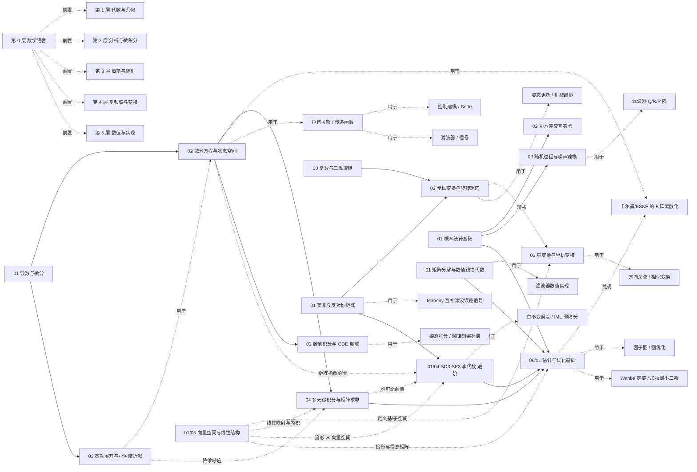

# 数学基础 · 导读

> 这里是**惯导、自动控制、信号处理共用的数学底座**——不绑定某一门课。
> 结构不是按"学科名"堆的，而是按**从语言到应用的七层**：先会读会算（第 0 层），再描述空间（1）、变化（2）、不确定性（3）、频率（4），落到计算（5），最后收口到"怎么从数据反推未知量"（6）。

## 七个层级

| 层 | 组 | 回答什么问题 | 什么时候看 |
|---|---|---|---|
| **0** | 数学语言 | 符号怎么读？函数/矩阵/复数/积分/概率怎么算？ | 符号都忘了，从这里开始 |
| **1** | 代数与几何 | 空间、方向、旋转怎么描述？**什么样的集合允许加减**？ | 姿态、坐标、图形、可观性 |
| **2** | 分析与微积分 | 变化、运动、动态、多元函数怎么描述？ | 微分方程、控制、滤波、线性化 |
| **3** | 概率与随机 | 不确定、噪声、估计怎么算？ | 卡尔曼、组合导航 |
| **4** | 复频域与变换 | 信号里有哪些频率？$s$ 域怎么描述动态？ | 控制、滤波、信号处理 |
| **5** | 数值与实现 | 怎么在计算机里稳定、准确地算？ | 打磨、移植、嵌入式 |
| **6** | 估计与优化 | 有了模型和数据，怎么反推未知量？用什么准则、怎么迭代？ | 卡尔曼增益的来历、Wahba 定姿、因子图 |

```
数学基础/
├── 00_数学语言/          第 0 层：符号 · 函数 · 矩阵 · 复数 · 积分 · 概率
├── 01_代数与几何/        第 1 层：复数旋转 · 叉乘 · 坐标变换 · 基变换辨析 · 向量空间与线性结构 · SO(3)/SE(3) 李代数（进阶）
├── 02_分析与微积分/      第 2 层：导数 · 泰勒展开/小角度 · 微分方程/状态空间 · 多元微积分/矩阵求导
├── 03_概率与随机/        第 3 层：数学地基（跨层速查）· 概率统计 · 协方差 · 随机过程
├── 04_复频域与变换/      第 4 层：拉普拉斯 / s 域 · 傅里叶 / 频谱 · 采样
├── 05_数值与实现/        第 5 层：矩阵分解 · 数值积分与 ODE 离散
└── 06_估计与优化/        第 6 层：MLE/MAP → WLS → Gauss-Newton/LM → 因子图
```

> **编号规则**：`00_` = 速查/总览页，`01_02_03_...` = 层内顺序号，**每层独立编号**。层号与主题的抽象层次一致。

### 编号对照表（查「某某篇」是谁，看这里）

!!! warning "引用规范：一律写「层/篇 + 短标题」，不写裸编号"
    正文提到另一篇时写成 `[02/03 泰勒展开 §二]`、`[01/02 坐标变换 §三]` 这样。
    **原因**：层内号只在本层唯一——`03_` 在 4 个层里都有、`02_` 在 5 个层里都有。历史上「02 篇」曾同时指 `01/02 坐标变换与旋转矩阵` 和 `02/02 微分方程与状态空间离散化`，同一句话在不同页里是两篇不同的文章。
    **为什么不再加一套全局序号**：文件名已经带层内号，再引入「第 N 篇」就得两处同步维护，增删一篇全库引用都要跟着改；`层/篇` 二元组本身已经全局唯一，且不随增删漂移。

| 层 | `00` | `01` | `02` | `03` | `04` | `05` |
|---|---|---|---|---|---|---|
| **0** 数学语言 | 符号与记号速查 | 函数与图像 | 向量与矩阵入门 | 复数运算入门 | 积分与累积直觉 | 概率直觉 |
| **1** 代数与几何 | 复数与二维旋转 | 矢量叉乘与反对称矩阵 | 坐标变换与旋转矩阵 | 基变换与坐标变换 | SO(3)·SE(3) 李代数（进阶） | 向量空间与线性结构 |
| **2** 分析与微积分 | — | 导数与微分基础 | 微分方程与状态空间 | 泰勒展开与小角度近似 | 多元微积分与矩阵求导 | — |
| **3** 概率与随机 | 数学地基速查（跨层） | 概率统计基础 | 协方差交互实验 | 随机过程与噪声建模 | — | — |
| **4** 复频域与变换 | — | 拉普拉斯变换与 s 域 | 频率与傅里叶直觉 | — | — | — |
| **5** 数值与实现 | — | 矩阵分解与数值线代 | 数值积分与 ODE 离散 | — | — | — |
| **6** 估计与优化 | — | 估计与优化基础 | — | — | — | — |

> 例：`02/03` = 第 2 层第 03 篇 = [泰勒展开与小角度近似](02_分析与微积分/03_泰勒展开与小角度近似.md)；`01/02` = 第 1 层第 02 篇 = [坐标变换与旋转矩阵](01_代数与几何/02_坐标变换与旋转矩阵.md)。读懂这一行，正文里所有 `[层/篇 ...]` 就不用再猜。

!!! warning "层号是「主题归属」，不是严格的阅读顺序（三处例外，别被绕晕）"
    1. **`01/04 SO(3) 与 SE(3) 李代数` 是进阶页**：虽然按主题归在第 1 层，但它的真实前置是第 2 层的**矩阵指数**（`02/02`）与**多元微积分/雅可比**（`02/04`）。建议读完第 2 层再回头看，本篇在「进阶 / 按需」里单列。
    2. **`03/00_数学地基速查` 是跨层速查**：内容是矩阵 + 协方差，不是第 3 层的概率入门；按学习顺序放在第 3 层末尾作查阅用。
    3. **`06/01 估计与优化基础` 依赖较广**：需要 `02/04`（梯度/海森）、`05/01`（QR/条件数）、`01/04`（$\oplus/\ominus$）。第 6 层是**收口层**，不是零基础起点。
    下面「学习顺序」按**依赖关系**排，与目录编号不完全一致是正常的。

## 从哪开始？（30 秒自测）

| 你的状态 | 从这里开始 |
|---|---|
| 看到 $\Sigma$ / $\partial$ / $\nabla$ / $\int$ 就发懵 | [符号与记号速查](00_数学语言/00_符号与记号速查.md) |
| 矩阵乘法、特征值忘了 | [向量与矩阵入门](00_数学语言/02_向量与矩阵入门.md) |
| 复数只会 $a+bi$，不会极坐标 | [复数运算入门](00_数学语言/03_复数运算入门.md) |
| 导数 / 积分只剩模糊印象 | [导数与微分基础](02_分析与微积分/01_导数与微分基础.md) + [积分与累积直觉](00_数学语言/04_积分与累积直觉.md) |
| 分不清小角度该写 $\sin\theta\approx\theta$ 还是 $\sin\theta\approx0$ | [泰勒展开与小角度近似](02_分析与微积分/03_泰勒展开与小角度近似.md) |
| 「雅可比 / 海森 / 矩阵求导」只会套公式、说不清布局约定 | [多元微积分与矩阵求导](02_分析与微积分/04_多元微积分与矩阵求导.md) |
| 分不清"求积"和"ODE 推进"，不知道 RK4 该用在哪 | [数值积分与 ODE 离散](05_数值与实现/02_数值积分与ODE离散.md) |
| 概率只记得"正态分布"四个字 | [概率直觉](00_数学语言/05_概率直觉.md) |
| 拉普拉斯 / 频率 / 采样忘了 | [拉普拉斯变换与 s 域](04_复频域与变换/01_拉普拉斯变换与s域.md) + [频率与傅里叶直觉](04_复频域与变换/02_频率与傅里叶直觉.md) |
| 分不清"坐标变换"和"坐标系变换" | [基变换与坐标变换](01_代数与几何/03_基变换与坐标变换.md) |
| 说不清「向量空间 / 子空间 / 秩」是什么，或不懂为何姿态不能相加、最小二乘为何最优 | [向量空间与线性结构](01_代数与几何/05_向量空间与线性结构.md) |
| 不懂 ESKF 为什么非要在"切空间"里定义误差 | [SO(3) 与 SE(3) 李代数最小集](01_代数与几何/04_SO3与SE3李代数.md) |
| 卡尔曼增益 $K$ 只会抄、不知道从哪推出来 | [估计与优化基础](06_估计与优化/01_估计与优化基础.md) §四 |
| 这些都还行，想直接学姿态 | [复数与二维旋转](01_代数与几何/00_复数与二维旋转.md) |

## 学习顺序（推荐）

> 不想被依赖绕晕，就按下面走。括号里是"它会在哪儿派上用场"。第 0 层不必全读，缺什么补什么。

**第 0 层 · 数学语言（按需补）**

1. [符号与记号速查](00_数学语言/00_符号与记号速查.md) — 随用随查
2. [函数与图像](00_数学语言/01_函数与图像.md) — 五类基本函数
3. [向量与矩阵入门](00_数学语言/02_向量与矩阵入门.md) — 线代最小可用集
4. [复数运算入门](00_数学语言/03_复数运算入门.md) — 四则 / 极坐标 / 欧拉
5. [积分与累积直觉](00_数学语言/04_积分与累积直觉.md) — 累积与数值求积
6. [概率直觉](00_数学语言/05_概率直觉.md) — 期望 / 方差 / 贝叶斯 / 高斯

**第 1 层 · 代数与几何（确定性）**

7. [复数与二维旋转](01_代数与几何/00_复数与二维旋转.md) — 旋转的最直观入门
8. [矢量叉乘与反对称矩阵](01_代数与几何/01_矢量叉乘与反对称矩阵.md) — 姿态更新、Mahony
9. [坐标变换与旋转矩阵](01_代数与几何/02_坐标变换与旋转矩阵.md) — 姿态表示、主动/被动约定
10. [基变换与坐标变换](01_代数与几何/03_基变换与坐标变换.md) — 坐标 / 基 / 几何转动三层辨析
11. [向量空间与线性结构](01_代数与几何/05_向量空间与线性结构.md) — 把前面反复用到的「基 / 秩 / 线性无关」补上定义：八条公理、子空间、**流形 ≠ 向量空间**、秩–零度、正交投影。**只想知道「为什么姿态不能相加」的话，随时可跳读这一篇**

**第 2 层 · 分析与微积分（变化）**

12. [导数与微分基础](02_分析与微积分/01_导数与微分基础.md) — 导数 / 最佳线性逼近（泰勒公式一般形式在 §十）
13. [泰勒展开与小角度近似](02_分析与微积分/03_泰勒展开与小角度近似.md) — 逐阶逼近 / 余项 / 光滑度 / 为什么 $\sin\theta\approx\theta$
14. [微分方程与状态空间离散化](02_分析与微积分/02_微分方程与状态空间离散化.md) — 矩阵指数 / $F_d,Q_d$ / §六 矩阵求导速查 / §3.7 时变 $A(t)$ 与 Magnus / §3.8 稳态
15. [多元微积分与矩阵求导](02_分析与微积分/04_多元微积分与矩阵求导.md) — 梯度 / 雅可比 / 海森 / 多元泰勒 / **混合布局辨析** / §3.4–3.7 六类矩阵求导与链式法则边界

**第 3 层 · 概率与随机（不确定性）**

16. [概率统计基础](03_概率与随机/01_概率统计基础.md) — 高斯 / 协方差 / 贝叶斯
17. [协方差交互实验](03_概率与随机/02_协方差交互实验.md) — 几何直觉
18. [随机过程与噪声建模](03_概率与随机/03_随机过程与噪声建模.md) — 白噪声 / 随机游走 → Q 阵
19. [数学地基速查](03_概率与随机/00_数学地基速查.md) — **跨层速查**，随用随查

**第 4 层 · 复频域与变换（频率）**

20. [拉普拉斯变换与 s 域](04_复频域与变换/01_拉普拉斯变换与s域.md) — 微分方程 → 代数 / 传递函数
21. [频率与傅里叶直觉](04_复频域与变换/02_频率与傅里叶直觉.md) — 频谱 / 采样 / 混叠

**第 5 层 · 数值与实现（算得动）**

22. [矩阵分解与数值线性代数](05_数值与实现/01_矩阵分解与数值线性代数.md) — LU / Cholesky / QR / 特征分解 / SVD / 条件数
23. [数值积分与 ODE 离散](05_数值与实现/02_数值积分与ODE离散.md) — Euler / RK4 / 稳定性 / 步长 / 几何积分

**第 6 层 · 估计与优化（把工具收口成解法）**

24. [估计与优化基础](06_估计与优化/01_估计与优化基础.md) — MLE/MAP → WLS → **MAP = 卡尔曼更新** → Gauss-Newton/LM → 因子图 / Schur 补

**进阶 / 按需（前置跨层，别硬插在上面）**

25. [SO(3) 与 SE(3) 李代数最小集](01_代数与几何/04_SO3与SE3李代数.md) — 主题归第 1 层，但**读完 11、14、15、23 再看**：$\mathrm{Exp}/\mathrm{Log}$、左右雅可比、BCH、$\oplus/\ominus$；是 ESKF 右不变误差与 IMU 预积分的共同语言

## 依赖关系（谁用谁）



> 虚线是"典型去向"；**跨层的三条粗线**（`A2→G4`、`A4→G4`、`G4→OPT`）就是上面「三处例外」的图形化。`G5`（向量空间）是新补的**结构地基**：它往 `G3` 给「基」的定义、往 `A4` 给「线性映射」、往 `G4` 给「流形不是向量空间」的辨析、往 `OPT` 给「投影 / 信息矩阵」。哪一步看不懂，顺着箭头上游回来看数学。

## 层间接口速查（最容易断链的地方）

| 从 | 到 | 接口是什么 |
|---|---|---|
| 第 1 层 向量空间 / 内积 | 第 5 / 6 层 QR、正规方程、马氏距离 | 正交投影定理；加权内积 $\langle u,v\rangle_W=u^TWv$ 就是信息矩阵 |
| 第 1 层 $[\cdot]_\times$ | 第 2 层 $\dot R=R[\omega]_\times$ | 反对称矩阵把叉乘变成矩阵乘 |
| 第 2 层 一阶泰勒 | 第 1 / 6 层 $\mathrm{Exp}\approx I+[\phi]_\times$、雅可比 | 线性化的统一语言 |
| 第 2 层 二阶泰勒 / 海森 | 第 6 层 Gauss-Newton | 丢掉二阶残差项 |
| 第 3 层 高斯 / 协方差 | 第 6 层 MAP / WLS | 马氏距离 = 加权残差平方和 |
| 第 5 层 QR / Cholesky / SVD | 第 6 层 正规方程 / 信息矩阵 | 病态时怎么稳地解 |
| 第 1 层 $\oplus/\ominus$ + 第 5 层 ODE | 第 6 层 流形优化 / 预积分 | 状态在流形、增量在切空间 |

## 外链 Wiki

- [线性代数 — 维基百科](https://zh.wikipedia.org/wiki/线性代数)
- [协方差矩阵 — 维基百科](https://zh.wikipedia.org/wiki/协方差矩阵)
- [高斯分布 — 维基百科](https://zh.wikipedia.org/wiki/正态分布)
- [拉普拉斯变换 — 维基百科](https://zh.wikipedia.org/wiki/拉普拉斯变换)
- [傅里叶变换 — 维基百科](https://zh.wikipedia.org/wiki/傅里叶变换)
- [卡尔曼滤波 — 维基百科](https://zh.wikipedia.org/wiki/卡尔曼滤波)
- [四元数与空间旋转 — 维基百科](https://zh.wikipedia.org/wiki/四元数与空间旋转)
- [最小二乘法 — 维基百科](https://zh.wikipedia.org/wiki/最小二乘法)

## 推荐阅读（入口已核对）

> 本库是**面向惯导 / 控制 / 状态估计的工程数学底座**，不是数学系课程。下面只列与七层直接对应、且入口已实际核对过的资源，每条注明「对应哪层 / 为什么值得读」。更抽象的内容单列在末尾「边界之外」，**别误读成待补清单**——本库真正的留白见「尚未成篇」。

### 可视化与系统入门

| 资源 | 形式 | 对应层 | 为什么值得读 |
|---|---|---|---|
| [3Blue1Brown · 线性代数的本质](https://www.3blue1brown.com/topics/linear-algebra) | 视频 + 在线讲义（英文；国内平台有官方中文版） | 1、5 | 把「张成 / 基 / 列空间 / 零空间 / 特征向量 / 抽象向量空间」讲成几何直觉，正好补 [01/05 向量空间与线性结构](01_代数与几何/05_向量空间与线性结构.md) 的可视化 |
| [MIT 18.06 Linear Algebra · Gilbert Strang](https://ocw.mit.edu/courses/18-06-linear-algebra-spring-2010/) | 公开课 34 讲，免费 | 1、5、6 | Lec 9–10 讲四个基本子空间、15–16 讲投影与最小二乘、23 讲 $e^{At}$，与本库 §五·§七 和 [02/02 微分方程](02_分析与微积分/02_微分方程与状态空间离散化.md) 一一对应 |
| [Mathematics for Machine Learning](https://mml-book.com)（[免费 PDF](https://mml-book.github.io/book/mml-book.pdf)） | 教材，免费 | 1、2、3、6 | 第 2 / 4 / 5 / 6 / 7 章（线代、矩阵分解、向量微积分、概率、连续优化）几乎是本库七层的「教科书版」 |
| [zartbot · 从高中数学到代数几何](https://zartbot.github.io/algebra_geometry_tutorials/)（[仓库](https://github.com/zartbot/algebra_geometry_tutorials)） | 中文静态教程，约 66 章 / 9 阶段，配大量 SVG | 0–2 | **stage0–1**（函数、向量与矩阵、向量空间、线性映射、内积空间、极限 / 微分 / 积分 / 多元微积分）与本库第 0–2 层重合度最高，适合补几何直觉与查漏 |

### 工具书与速查

| 资源 | 形式 | 对应层 | 为什么值得读 |
|---|---|---|---|
| [The Matrix Cookbook](https://www.math.uwaterloo.ca/~hwolkowi/matrixcookbook.pdf)（Petersen & Pedersen） | PDF 公式速查 | 2 | 矩阵求导、迹、行列式、逆的公式大全；[02/02 §六](02_分析与微积分/02_微分方程与状态空间离散化.md) 与 [02/04 §3.6](02_分析与微积分/04_多元微积分与矩阵求导.md) 的扩大版 |
| [The Matrix Calculus You Need For Deep Learning](https://arxiv.org/abs/1802.01528)（Parr & Howard） | 教程论文 | 2 | 从标量导数一路推到雅可比，**专门辨析布局约定**，正对应 [02/04 §3.5](02_分析与微积分/04_多元微积分与矩阵求导.md) 的混合布局坑 |
| [Matrix calculus — Wikipedia](https://en.wikipedia.org/wiki/Matrix_calculus) | 词条 | 2 | numerator / denominator / mixed 三套约定的权威对照表 |
| [Convex Optimization · Boyd & Vandenberghe](https://web.stanford.edu/~boyd/cvxbook/) | 教材，官网免费 | 6 | 最小二乘、Newton 法、对偶与 Schur 补的严格版，[06/01 估计与优化基础](06_估计与优化/01_估计与优化基础.md) 的进阶 |

### 与惯导 / 状态估计主线直接相关

| 资源 | 形式 | 对应层 | 为什么值得读 |
|---|---|---|---|
| [A micro Lie theory for state estimation in robotics](https://arxiv.org/abs/1812.01537)（Sola 等，CC BY-NC-SA） | 论文约 15 页 | 1、6 | $\oplus/\ominus$、左右雅可比、伴随、BCH 的「机器人版最小集」，是 [01/04 SO(3)/SE(3)](01_代数与几何/04_SO3与SE3李代数.md) 的核心参考 |
| [Quaternion kinematics for the error-state Kalman filter](https://arxiv.org/abs/1711.02508)（Sola） | 技术报告 | 1、6 | ESKF 误差状态、四元数扰动与雅可比的完整推导；本库误差状态篇的严格版 |
| [State Estimation for Robotics · Barfoot](https://asrl.utias.utoronto.ca/~tdb/bib/barfoot_ser17.pdf)（第一版作者托管 PDF，免费） | 教材 | 6 | 用矩阵李群统一处理滤波、位姿图优化、IMU 预积分；第 8 章 Matrix Lie Groups 正是本库第 6 层的应用落点 |

### 边界之外（明确不纳入本库）

zartbot 的 **stage2–7**（抽象代数：群环域 → 拓扑 → 范畴论 → 交换代数 → 古典 / 现代代数几何 → 代数几何 × 深度学习 / LLM）面向代数几何与大模型几何方法研究，本库七层**完全用不到**。列在这里只为标明「看过目录、知道边界在哪」，不是待补清单。

!!! warning "引用约定"
    zartbot 仓库声明「**仅用于个人学习与教学交流用途；引用其中文字、SVG 或公式编排请注明来源**」。本库只借其**章节目录与概念名**做覆盖度对照，不复制文字、SVG 与公式编排；日后若要引用其图或段落，须单独注明来源并确认许可。

## 用在哪里（应用层入口）

- **惯性导航**：[系列首页](../惯性导航/index.md) ｜ 从 [坐标系与变换](../惯性导航/01_基础篇/01_坐标系与变换.md) 进入，再到 [机械编排](../惯性导航/02_解算篇/06_机械编排方程.md) 与 [组合导航](../惯性导航/03_组合导航篇/10_卡尔曼滤波基础.md)
- **自动控制**：[符号与 s 域入门](../技术与编程/自动控制/01_符号与s域入门.md)（拉普拉斯、传递函数、极点零点、ζ/ω_n）
- **信号处理 / 滤波**：从 [频率与傅里叶直觉](04_复频域与变换/02_频率与傅里叶直觉.md) 进入（采样、频谱、混叠）
- **估计 / 优化**：从 [估计与优化基础](06_估计与优化/01_估计与优化基础.md) 进入，再接 [10 卡尔曼滤波基础](../惯性导航/03_组合导航篇/10_卡尔曼滤波基础.md)、[08 初始对准](../惯性导航/02_解算篇/08_初始对准.md)（Wahba）

> 这张"数学底座"不隶属于任何一门课；应用层各篇通过"前置知识"链接回这里，避免重复。
> ⚠️ **本篇只给地基**：「因子图 / IMU 预积分」的**应用实现篇**仍待补，落点在惯性导航系列（该系列已把它列为高优先级缺口），本篇不代替。

## 尚未成篇（明确留白，避免误以为已覆盖）

| 缺口 | 现状 | 建议落点 |
|---|---|---|
| 因子图 / IMU 预积分**应用篇** | 第 6 层只给数学工具，没有具体实现 | [惯性导航系列](../惯性导航/index.md) 组合导航篇 |
| 变分推断的完整推导 | 第 6 层 §八 只给边界（点估计 vs 分布近似） | 需要时在第 6 层另开 |
| 随机微分方程 / 伊藤积分 | 第 3 层只到随机过程与 $Q_c\to Q_d$ | 需要时在第 3 层另开 |
| 张量 / 多重线性代数专篇 | [01/05](01_代数与几何/05_向量空间与线性结构.md) 只到内积与投影；[02/04](02_分析与微积分/04_多元微积分与矩阵求导.md) §3.7 只用 $\mathrm{vec}$ + Kronecker 处理四阶导数 | **明确不补**：本库不需要张量指标运算，需要时再开 |
| 线性方程组求解专篇 | 解法已散在 [05/01](05_数值与实现/01_矩阵分解与数值线性代数.md)（LU/QR/SVD）与 [01/05](01_代数与几何/05_向量空间与线性结构.md) §三（解集结构） | **明确不补**：不单设高斯消元教程 |
