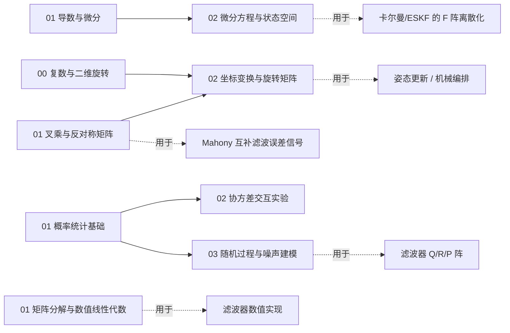

# 数学基础 · 导读

> 这里是**惯导、自动控制、信号处理共用的数学底座**——不绑定某一门课，按"它在解决哪类问题"分区。
> 一句话结构：**描述确定性问题用代数与几何，处理随机性问题用概率与随机，微积分是共同语言，数值是实现手段。**

## 两条主线

工科里绝大多数"数学不够用"的场景，可以归成两条主线：

| 主线 | 问题性质 | 数学工具 | 典型去向 |
|---|---|---|---|
| **描述确定性的世界** | 坐标、旋转、运动、变化率 | 代数与几何 + 微积分 | 姿态解算、机械编排、控制建模、机构运动 |
| **处理不确定性的世界** | 噪声、误差、估计、决策 | 概率与随机 + 矩阵数值 | 卡尔曼 / ESKF、信号滤波、组合导航、参数估计 |

```
数学基础/
├── 01_分析与微积分/      共同语言：01 导数与微分 · 02 微分方程与状态空间
├── 02_代数与几何/        确定性的几何：00 复数与二维旋转 · 01 叉乘与反对称 · 02 坐标变换与旋转
├── 03_概率与随机/        不确定性的数学：00 数学地基速查 · 01 概率统计 · 02 协方差交互 · 03 随机过程
└── 04_数值与实现/        算得动、算得稳：01 矩阵分解与数值线性代数
```

> 编号规则：`00_` = 速查/总览页，`01_02_03_...` = 各子夹顺序号，**每夹独立编号**——以后想加哪块数学，按它服务的对象进对应子夹、接着往下排号即可。

## 学习顺序（推荐）

> 不想被依赖绕晕，就按下面走。括号里是"它会在哪儿派上用场"。

1. **代数与几何/00 复数与二维旋转** →（旋转的最直观入门，接 3D 四元数）
2. **代数与几何/01 矢量叉乘与反对称矩阵** →（姿态更新、Mahony）
3. **代数与几何/02 坐标变换与旋转矩阵** →（姿态表示、坐标系，[惯性导航·基础篇](../惯性导航/01_基础篇/01_坐标系与变换.md) 的数学底座）
4. **分析与微积分/01 导数与微分** →（泰勒展开、线性化，到处用）
5. **分析与微积分/02 微分方程与状态空间离散化** →（误差传播、控制建模、KF 的 F 阵离散化）
6. **概率与随机/01 概率统计基础** →（高斯分布，"从高斯到卡尔曼"）
7. **概率与随机/02 协方差交互实验** →（协方差的几何直觉，动手拖点）
8. **概率与随机/03 随机过程与噪声建模** →（白噪声、随机游走 → ESKF 的 Q 阵）
9. **04_数值与实现/01 矩阵分解与数值线性代数** →（滤波器的数值实现，打磨阶段再看）
10. **数学地基速查页（03_概率与随机/00）**：随用随查，不要求先读

## 依赖关系（谁用谁）



> 虚线箭头是这条数学的典型去向。哪一步看不懂，就顺着箭头上游回来看数学。

## 外链 Wiki

- [线性代数 — 维基百科](https://zh.wikipedia.org/wiki/线性代数)
- [协方差矩阵 — 维基百科](https://zh.wikipedia.org/wiki/协方差矩阵)
- [高斯分布 — 维基百科](https://zh.wikipedia.org/wiki/正态分布)
- [卡尔曼滤波 — 维基百科](https://zh.wikipedia.org/wiki/卡尔曼滤波)
- [四元数与空间旋转 — 维基百科](https://zh.wikipedia.org/wiki/四元数与空间旋转)

## 用在哪里（应用层入口）

- **惯性导航**：[系列首页](../惯性导航/index.md) ｜ 从 [坐标系与变换](../惯性导航/01_基础篇/01_坐标系与变换.md) 进入，再到 [机械编排](../惯性导航/02_解算篇/06_机械编排方程.md) 与 [组合导航](../惯性导航/03_组合导航篇/10_卡尔曼滤波基础.md)
- **自动控制**：[符号与 s 域入门](../技术与编程/自动控制/01_符号与s域入门.md)（拉普拉斯、传递函数、极点零点、ζ/ω_n）
- **信号处理 / 滤波**（待补）：采样、频谱、数字滤波器——与 `s` 域共用同一套语言

> 这张"数学底座"不隶属于任何一门课；应用层各篇通过"前置知识"链接回这里，避免重复。
