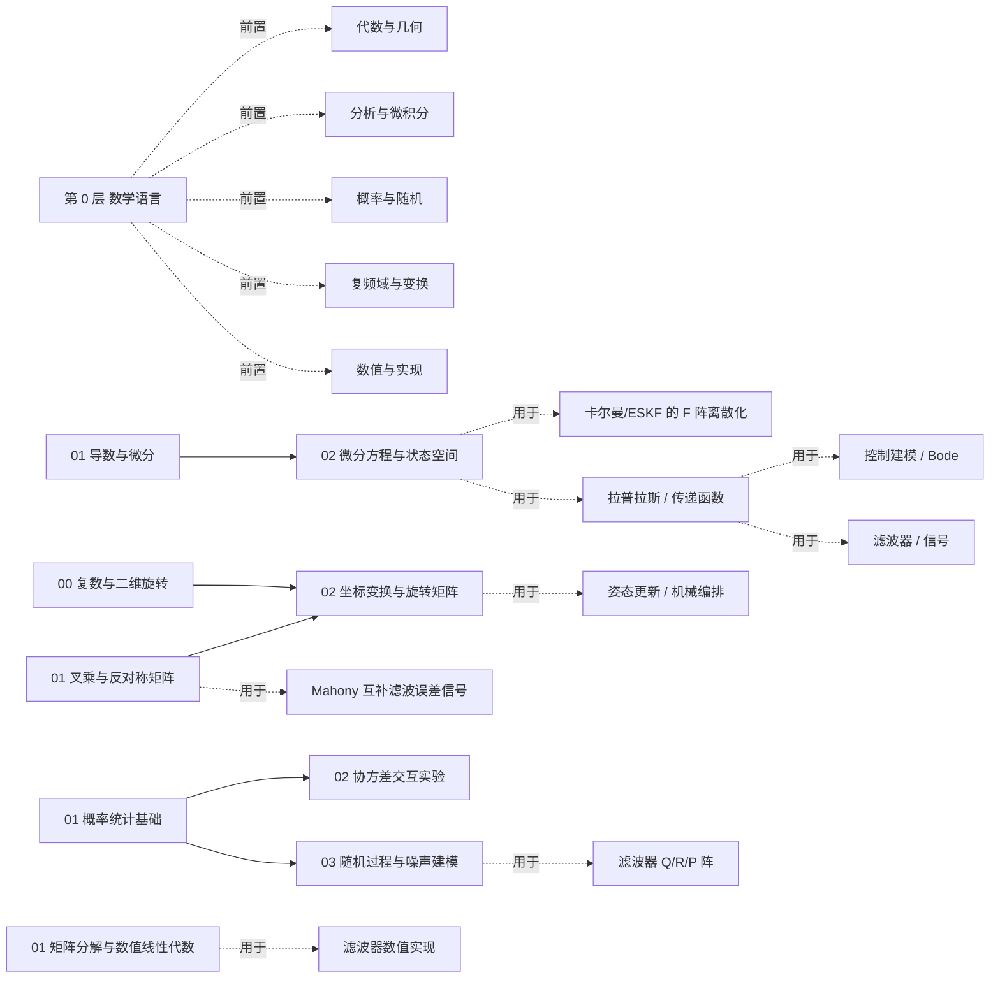

# 数学基础 · 导读

> 这里是**惯导、自动控制、信号处理共用的数学底座**——不绑定某一门课。
> 结构不是按"学科名"堆的，而是按**从语言到应用的六层**：先会读会算（第 0 层），再描述空间（1）、变化（2）、不确定性（3）、频率（4），最后落到计算（5）。

## 六个层级

| 层 | 组 | 回答什么问题 | 什么时候看 |
|---|---|---|---|
| **0** | 数学语言 | 符号怎么读？函数/矩阵/复数/积分/概率怎么算？ | 符号都忘了，从这里开始 |
| **1** | 代数与几何 | 空间、方向、旋转怎么描述？ | 姿态、坐标、图形 |
| **2** | 分析与微积分 | 变化、运动、动态怎么描述？ | 微分方程、控制、滤波 |
| **3** | 概率与随机 | 不确定、噪声、估计怎么算？ | 卡尔曼、组合导航 |
| **4** | 复频域与变换 | 信号里有哪些频率？$s$ 域怎么描述动态？ | 控制、滤波、信号处理 |
| **5** | 数值与实现 | 怎么在计算机里稳定地算？ | 打磨、移植、嵌入式 |

```
数学基础/
├── 00_数学语言/          第 0 层：符号 · 函数 · 矩阵 · 复数 · 积分 · 概率
├── 01_代数与几何/        第 1 层：复数旋转 · 叉乘 · 坐标变换
├── 02_分析与微积分/      第 2 层：导数 · 微分方程 / 状态空间
├── 03_概率与随机/        第 3 层：数学地基 · 概率统计 · 协方差 · 随机过程
├── 04_复频域与变换/      第 4 层：拉普拉斯 / s 域 · 傅里叶 / 频谱 · 采样
└── 05_数值与实现/        第 5 层：矩阵分解
```

> 编号规则：`00_` = 速查/总览页，`01_02_03_...` = 层内顺序号，**每层独立编号**。层号与学习顺序一致。

## 从哪开始？（30 秒自测）

| 你的状态 | 从这里开始 |
|---|---|
| 看到 $\Sigma$ / $\partial$ / $\nabla$ / $\int$ 就发懵 | [符号与记号速查](00_数学语言/00_符号与记号速查.md) |
| 矩阵乘法、特征值忘了 | [向量与矩阵入门](00_数学语言/02_向量与矩阵入门.md) |
| 复数只会 $a+bi$，不会极坐标 | [复数运算入门](00_数学语言/03_复数运算入门.md) |
| 导数 / 积分只剩模糊印象 | [导数与微分基础](02_分析与微积分/01_导数与微分基础.md) + [积分与累积直觉](00_数学语言/04_积分与累积直觉.md) |
| 概率只记得"正态分布"四个字 | [概率直觉](00_数学语言/05_概率直觉.md) |
| 拉普拉斯 / 频率 / 采样忘了 | [拉普拉斯变换与 s 域](04_复频域与变换/01_拉普拉斯变换与s域.md) + [频率与傅里叶直觉](04_复频域与变换/02_频率与傅里叶直觉.md) |
| 这些都还行，想直接学姿态 | [复数与二维旋转](01_代数与几何/00_复数与二维旋转.md) |

## 学习顺序（推荐）

> 不想被依赖绕晕，就按下面走。括号里是"它会在哪儿派上用场"。第 0 层不必全读，缺什么补什么。

**第 0 层 · 数学语言（按需补）**

1. [符号与记号速查](00_数学语言/00_符号与记号速查.md) — 随用随查
2. [函数与图像](00_数学语言/01_函数与图像.md) — 五类基本函数
3. [向量与矩阵入门](00_数学语言/02_向量与矩阵入门.md) — 线代最小可用集
4. [复数运算入门](00_数学语言/03_复数运算入门.md) — 四则 / 极坐标 / 欧拉
5. [积分与累积直觉](00_数学语言/04_积分与累积直觉.md) — 累积与数值积分
6. [概率直觉](00_数学语言/05_概率直觉.md) — 期望 / 方差 / 贝叶斯 / 高斯

**第 1 层 · 代数与几何（确定性）**

7. [复数与二维旋转](01_代数与几何/00_复数与二维旋转.md) — 旋转的最直观入门
8. [矢量叉乘与反对称矩阵](01_代数与几何/01_矢量叉乘与反对称矩阵.md) — 姿态更新、Mahony
9. [坐标变换与旋转矩阵](01_代数与几何/02_坐标变换与旋转矩阵.md) — 姿态表示、坐标系

**第 2 层 · 分析与微积分（变化）**

10. [导数与微分基础](02_分析与微积分/01_导数与微分基础.md) — 泰勒 / 线性化
11. [微分方程与状态空间离散化](02_分析与微积分/02_微分方程与状态空间离散化.md) — 误差传播 / 控制建模 / KF 的 F 阵

**第 3 层 · 概率与随机（不确定性）**

12. [概率统计基础](03_概率与随机/01_概率统计基础.md) — 高斯 / 协方差
13. [协方差交互实验](03_概率与随机/02_协方差交互实验.md) — 几何直觉
14. [随机过程与噪声建模](03_概率与随机/03_随机过程与噪声建模.md) — 白噪声 / 随机游走 → Q 阵
15. [数学地基速查](03_概率与随机/00_数学地基速查.md) — 随用随查

**第 4 层 · 复频域与变换（频率）**

16. [拉普拉斯变换与 s 域](04_复频域与变换/01_拉普拉斯变换与s域.md) — 微分方程 → 代数 / 传递函数
17. [频率与傅里叶直觉](04_复频域与变换/02_频率与傅里叶直觉.md) — 频谱 / 采样 / 混叠

**第 5 层 · 数值与实现（算得动）**

18. [矩阵分解与数值线性代数](05_数值与实现/01_矩阵分解与数值线性代数.md) — 滤波器的数值实现

## 依赖关系（谁用谁）



> 虚线箭头是"典型去向"。哪一步看不懂，就顺着箭头上游回来看数学。

## 外链 Wiki

- [线性代数 — 维基百科](https://zh.wikipedia.org/wiki/线性代数)
- [协方差矩阵 — 维基百科](https://zh.wikipedia.org/wiki/协方差矩阵)
- [高斯分布 — 维基百科](https://zh.wikipedia.org/wiki/正态分布)
- [拉普拉斯变换 — 维基百科](https://zh.wikipedia.org/wiki/拉普拉斯变换)
- [傅里叶变换 — 维基百科](https://zh.wikipedia.org/wiki/傅里叶变换)
- [卡尔曼滤波 — 维基百科](https://zh.wikipedia.org/wiki/卡尔曼滤波)
- [四元数与空间旋转 — 维基百科](https://zh.wikipedia.org/wiki/四元数与空间旋转)

## 用在哪里（应用层入口）

- **惯性导航**：[系列首页](../惯性导航/index.md) ｜ 从 [坐标系与变换](../惯性导航/01_基础篇/01_坐标系与变换.md) 进入，再到 [机械编排](../惯性导航/02_解算篇/06_机械编排方程.md) 与 [组合导航](../惯性导航/03_组合导航篇/10_卡尔曼滤波基础.md)
- **自动控制**：[符号与 s 域入门](../技术与编程/自动控制/01_符号与s域入门.md)（拉普拉斯、传递函数、极点零点、ζ/ω_n）
- **信号处理 / 滤波**：从 [频率与傅里叶直觉](04_复频域与变换/02_频率与傅里叶直觉.md) 进入（采样、频谱、混叠）

> 这张"数学底座"不隶属于任何一门课；应用层各篇通过"前置知识"链接回这里，避免重复。
