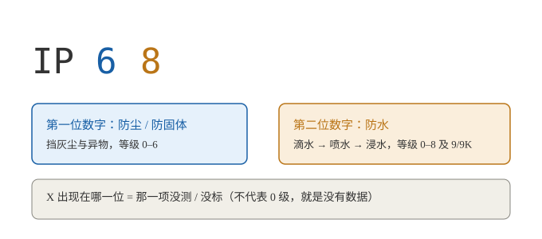

# IP 防尘防水等级（IPXX 到底怎么看）

> 一句话：`IP` 后面两位数字，**第一位是防尘（0–6），第二位是防水（0–8，另有 9/9K 高温高压喷水）**；`X` 表示该项没测 / 没标。数字越大通常越强，但**防水 8 级的条件由厂商自定，而 9K（喷射）与 7/8（浸水）测的压根不是同一件事**——所以别只盯着数字比大小，要看厂商标的具体条件。

!!! note "来源与可靠性说明"
    本篇素材整理自一次 AI（DeepSeek）的问答草稿，由我结合 IEC 60529 / ISO 20653 的资料**逐条核对后重写**。正文按科普口径写；**对该 AI 初稿的纠偏与补充**集中在文末单独一节，建议别跳过。



## 一、IP 是什么

**IP = Ingress Protection（ingress = 侵入）**，是国际电工委员会 **IEC 60529** 定义的一套"外壳防护等级"，用来描述设备外壳挡住**固体异物**（灰尘、手指、工具）和**液体**（滴水、喷水、浸水）的能力。

写法是 `IP` + 两位数字，必要时再加可选字母：

```text
IP 6 8
  │ │
  │ └── 第二位：防水（0–8，另有 9/9K）
  └──── 第一位：防固体 / 防尘（0–6）
```

- **第一位**：防固体异物与防尘，**0–6**。
- **第二位**：防水，**0–8**（高温高压喷水另记为 **9** 或 **9K**，见第三节）。
- **`X`**：这一项**没测试 / 没评级 / 不适用**。例如 `IPX8` 只标了防水 8 级，防尘压根没说。
- **可选字母**（不常见，了解即可）：
  - 附加字母 `A/B/C/D`：防人体部位或工具触及危险部件（手背 / 手指 / 工具 / 金属线）。
  - 补充字母：`H` 高压设备、`M` 防水测试时设备在动、`S` 防水测试时设备静止、`W` 户外耐候。
  - **`K`**：来自 ISO 20653（车规），见第三节。

> ⚠️ 顺带一提：IP 后面的数字**不是"等级越高就自动覆盖低等级"**的套餐，每一项都是独立的测试条目。这点在后面讲误区时会再提。

## 二、第一位数字：防尘与防固体（0–6）

| 等级 | 防护对象 | 通俗理解 |
|---|---|---|
| **0** | 无防护 | 完全没做防护 |
| **1** | ≥ 50 mm 的固体 | 挡住手背等大面积意外接触 |
| **2** | ≥ 12.5 mm 的固体 | 挡住**手指**伸进去 |
| **3** | ≥ 2.5 mm 的固体 | 挡住螺丝刀、粗导线等工具 |
| **4** | ≥ 1.0 mm 的固体 | 挡住细导线、小虫子 |
| **5** | **防尘（dust-protected）** | 允许少量灰尘进入，但**不能影响设备正常工作** |
| **6** | **尘密（dust-tight）** | **完全无灰尘进入**（滑石粉密封箱抽负压测试） |

!!! warning "5 和 6 别混：这是最常被忽略的一档"
    **5 级不是"完全不进灰"**，而是"进一点没关系，但不能影响运行"。只有 **6 级（尘密）** 才是一粒灰都进不去。

    手机 / 手表标 `IP6X` 的那个"6"才是尘密；标 `IP5X` 的产品在沙尘环境里用久了，内部是会积灰的。

## 三、第二位数字：防水（0–8，外加 9/9K）

| 等级 | 防护对象 | 典型测试条件（简化） |
|---|---|---|
| **0** | 无防护 | — |
| **1** | 垂直滴水 | 垂直滴水，水量约 1 mm/min，约 10 分钟 |
| **2** | 倾斜 15° 滴水 | 外壳倾斜 15°，同样滴水 |
| **3** | 淋水 / 喷雾 | 与垂直方向成 60° 以内喷水（摆管或喷头） |
| **4** | 溅水 | **任意方向**溅水 |
| **5** | 喷水 | 6.3 mm 喷嘴，约 12.5 L/min，距离 2.5–3 m |
| **6** | 强烈喷水 | 12.5 mm 喷嘴，约 100 L/min，距离 2.5–3 m |
| **7** | **短时浸水** | 浸入约 **1 m** 深，**30 分钟**（清水、静态） |
| **8** | **持续浸水** | 条件**由厂商规定**，应**严于 7 级**（更深 / 更久；常见 1.5 m 30 min 到数米数小时不等） |
| **9 / 9K** | **高温高压喷水** | 80 °C 热水，**80–100 bar（8–10 MPa）**，流量 14–16 L/min，喷嘴距 10–15 cm，0°/30°/60°/90° 各喷约 30 s |

### 关于 9K：它其实不属于 IEC 60529 原本的体系

这是最容易写错的一处，特地单列：

- **`IP69K`** 来自 **ISO 20653**（道路车辆电气设备的防护等级，前身是德国 **DIN 40050-9**），那个 **K** 就是它的出身标记。**IEC 60529 里本来没有 9K**。
- IEC 60529 后来的版本（Ed. 2.2）**新增了"9"这一级**（写作 `IP69` / `IPx9`，**不带 K**），测试内容基本等同于 IPx9K 的高压热水喷射。
- 所以市面上会看到 `IP69`、`IP69K`、`IP6K9K` 三种写法，**严格来说不能互相默认等同**——工程上要按厂商标注的**具体标准与版本**去核，别只看标签。

!!! warning "9K（喷射）与 7/8（浸水）互不涵盖"
    它们测的是**完全不同的物理条件**：

    - **7/8 级** = **静态水压**（泡在深水里，压力缓慢而均匀）；
    - **9K 级** = **动态冲击力 + 热冲击**（近距离高温高压水柱直接打在密封缝上）。

    一个靠软密封扛住深水静压的产品，密封可能反被高压水柱**冲开**；反之，靠硬密封扛住喷射的产品，未必能在长时间静压下保持密封。

    这正是工业产品常见**双标 `IP68/IP69K`** 的原因——两个测试各自独立通过，**谁也不蕴含谁**。

## 四、X 是什么意思

`X` 只表示"这一项没测 / 没标"，**不代表 0 级，也不代表"很差"**，就是**没有数据**。

- `IPX8`：只声明防水 8 级，**防尘等级未标明**。
- `IP6X`：只声明防尘 6 级，**防水等级未标明**（常见于工业传感器、连接器）。
- `IPX7` 与 `IP67` 不是一回事——后者额外保证了尘密。

## 五、常见组合速查

| 标注 | 含义 | 能不能泡水 |
|---|---|---|
| `IP54` | 防尘 5 级 + 防溅水 4 级 | ❌ 只能防溅，不能泡 |
| `IP65` | 尘密 + 防喷水 | ❌ 能扛水柱冲，不代表能泡 |
| `IP67` | 尘密 + 短时浸水（1 m / 30 min） | ✅ 可短时意外落水 |
| `IP68` | 尘密 + 持续浸水（**条件看厂商**） | ✅ 但"多深多久"必须查厂商标注 |
| `IPX8` | 只标防水 8 级，防尘没说 | ✅ 防水层面同 8 级 |
| `IP69K` | 尘密 + 高温高压喷水 | ❌ **不涵盖浸水**，需要浸水能力得看是否另有 IP67 / IP68 标注 |

## 六、几个必须知道的误区

1. **`IP68` 不一定比 `IP67` "全面更强"** —— 8 级的具体水深 / 时长**由厂商自定**。A 厂的 IP68（1.5 m / 30 min）和 B 厂的 IP68（3 m / 24 h）差得很远。**跨品牌比较"68"这个数字没有意义**，要比就比厂商公开的具体条件。
2. **喷射（9K）与浸水（7/8）是两码事** —— 见第三节的警告框，别以为"9 最大，所以 9K 最防水"。
3. **防水 ≠ 防所有水** —— 测试用的是**清水**。海水（腐蚀）、泳池水（余氯）、肥皂水 / 洗发水（表面活性剂会降低水的表面张力）、热水与蒸汽、高压水枪，都可能超出测试范围。**而且绝大多数厂商的保修条款并不覆盖液体损坏。**
4. **静态浸水 ≠ 能游泳 / 冲浪 / 用水龙头冲** —— IPX7 / X8 是**静态**泡水测试。游泳划水、冲浪、花洒冲洗都带**动态水压**，不在测试范围内；洗澡的热水蒸汽更是另一回事。
5. **防水能力会衰减** —— 摔过、拆修过、密封圈老化、反复冷热循环之后，防护性能都可能下降。一部用了两年的"IP68"手机，不该再当新机的防水能力用。
6. **`IPX8` ≠ `IP68`** —— 前者防尘没标，后者保证尘密 6 级。

!!! tip "手表上的 5ATM / 10ATM 又是什么？"
    那是**另一套标准**（ISO 22810 日常防水表 / ISO 6425 潜水表），用"大气压"标称静态水压，和 IP 体系**不能直接比大小**。

    比如 `5ATM` 大致对应 50 m **静态**水柱压力，但它**不代表**能戴着潜水或洗热水澡；而一部 `IP68` 的手机和一块 `5ATM` 的手表，两者测法不同，不存在"谁更高"的简单换算。**别把两套标准混着比。**

## 七、实用建议（选购 / 使用时）

- **看具体条件，不看数字**：买之前翻厂商标注的"X m / X 分钟"，而不是只看 IP68 这个标签。
- **区分"防泼溅"和"能泡水"**：`IPX4` 只能防溅，`IPX7/8` 才能泡。日常防雨防泼溅，`IPX4/IPX5` 通常就够了。
- **泡水场景要留余量**：会接触海水 / 泳池水的话，用完**用清水冲洗并擦干**（残留盐分会腐蚀密封与接口）。
- **热水 / 蒸汽 / 高压水枪，一律当"没有防护"来处理。**
- **别迷信"防水保修"**：IP 等级是**实验室新机的测试结果**，不是终身质保。

---

## 关于 AI 初稿的纠偏与补充

> 本篇以一次 AI（DeepSeek）问答草稿为素材，核对后重写。以下是对该初稿的**纠正与增补**，与正文的科普口径区分，单列备查。

| # | 初稿的说法 | 核对结果 | 本文的处理 |
|---|---|---|---|
| 1 | "防水等级 0~9K"，把 9K 一并归给 IEC 60529 | **不够准确**。带 `K` 的 `IP69K` 出自 **ISO 20653**（原 DIN 40050-9，车规）；IEC 60529 新版（Ed. 2.2）新增的是**不带 K 的 9**（`IP69` / `IPx9`）。两者测试实质相近，但**标准归属与写法不同** | 第三节单列说明，并提示 `IP69 / IP69K / IP6K9K` 不宜默认等同 |
| 2 | 未提及 9K 与浸水的关系 | **9K（喷射）与 7/8（浸水）互不蕴含**，这正是工业品常见双标 `IP68/IP69K` 的原因 | 新增警告框 + 误区第 2 条 |
| 3 | 基本只讲防水，防尘部分缺失 | 标题是"防尘防水等级"，**第一位数字（0–6）必须补齐**；且 **5 级（防尘）≠ 6 级（尘密）** 最易混淆 | 新增第二节整节 + 警告框 |
| 4 | 未提手表的 ATM 标注 | `5ATM / 10ATM` 属 **ISO 22810 / ISO 6425**，与 IP 体系**不可直接比较**，是用户侧最高频的混淆点之一 | 新增提示框 |
| 5 | 未区分静态 / 动态水压 | IPX7 / X8 是**静态浸水**；游泳、冲浪、花洒属动态水压，不在测试范围 | 新增误区第 4 条 |
| 6 | "数字越大，通常防水能力越强" | 在 **0–6** 范围内基本成立；但 **8 的条件厂商自定**、**9K 与 7/8 属不同维度**，不能简单跨维度比大小 | 正文改为"通常更强，但要看厂商标的具体条件"，并在误区第 1 条展开 |

## 关联与延伸

- 本组首页：[标准与认证](index.md)
- 所在分区：[杂记 / Notes](../../博客/杂记.md)
- 外链：[IP code — Wikipedia（英文）](https://en.wikipedia.org/wiki/IP_code)
