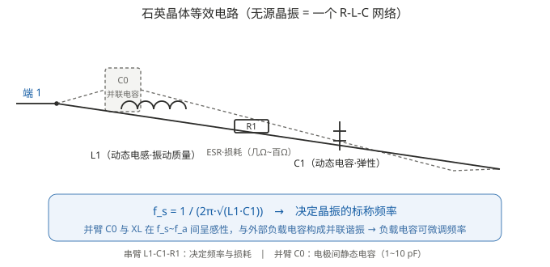

# 01 有源 vs 无源，二脚三脚四脚各是什么

> 本系列第 1 篇。先把「晶振 / 振荡器」「有源 / 无源」「二脚 / 三脚 / 四脚」这三组最基础也最容易被绕晕的概念彻底分清。**核心区别一句话：无源晶振是石头，有源振荡器是「石头 + 电路」；引脚数量反映的是封装里装了什么和怎么接。**

---

## 1. 先厘清两个名字：晶振 / 振荡器

在中文资料里「晶振」这个词被用得很混，实际上它指两种完全不同的东西：

| 中文俗称 | 英文 | 本质 | 是否自带振荡电路 |
|---|---|---|---|
| **无源晶振**（常简称为「晶振」「晶体」） | Quartz Crystal（石英晶体） / Crystal Resonator | 一片石英谐振器，等效于一个 **无源器件**（R-L-C 网络） | ❌ 不自带，必须由外部电路驱动振荡 |
| **有源晶振**（常简称为「振荡器」） | Crystal Oscillator / XO（时钟振荡器） | 石英晶体 + **内置振荡放大电路** 的完整模块 | ✅ 自带，通电即可输出方波时钟 |

⚠️ 最重要的一个语义陷阱：**「无源」不是「不耗电」**。「无源晶振」指它是一个**不需要电能就能被激励振荡的谐振器件**，但它本身并不会「发出」时钟——它只有在外部振荡电路（通常是 MCU 内部的振荡放大器）驱动下，才会在它的谐振频率上振荡。而「有源晶振」内部把这段振荡电路也做进去了，所以**上电即出波形**。

用一句话帮助记忆：

- **无源晶振**：像一口钟。你给它一下（激励），它按自己的固有频率振。
- **有源晶振**：像一台带电源的报时钟。通上电，它自己啪嗒啪嗒走。

> ⚠️ 在 STM32 上，这两种硬件对应 CubeMX 里**两个不同的 HSE 模式**：无源 → `Crystal/Ceramic Resonator`，有源 → `BYPASS Clock Source`。具体怎么选、选错会怎样，见 [05 篇](05_STM32CubeMX配置-有源与无源.md)。

---

## 2. 为什么 MCU 都爱外接「无源晶振」

现在几乎所有 MCU 的典型接法都是**外部挂一颗无源晶振 + 两颗负载电容**，而不是直接买有源振荡器。原因是：

1. **成本**：同样频率，无源晶振几分钱到几毛钱，有源振荡器贵一个数量级。
2. **功耗**：MCU 请求停止时钟时（如低功耗睡眠），可以直接关掉内部振荡器电路，晶振自然停振；有源振荡器关不掉，常通更耗电。
3. **频率灵活性**：振荡电路中的反馈电阻、负载电容、放大器参数都由 MCU 内部设计好，外面只需配晶振和两颗电容，方案成熟。

所以无源晶振虽然「不会自己振荡」，但恰好是**和 MCU 内部振荡器配合得最好的方案**——MCU 做放大器，晶振做选频网络，两颗电容负责把振荡频率拉到标称值附近（详见 [02 篇](02_负载电容.md)）。

### 2.1 无源晶振的等效电路（它凭什么振荡）

一块石英晶振可以等效成一个 R-L-C 串并联网络：

- **$C_0$（并联电容）**：两片电极之间形成的静态电容，通常在 1~10 pF 量级。
- **$L_1$、$C_1$（动态电感电容）**：来自石英片的机械振动特性，决定了**串联谐振频率** $f_s = 1/(2\pi\sqrt{L_1C_1})$。
- **$R_1$（动态电阻 / ESR）**：石英振动时的机械损耗，通常在几 Ω ~ 一百多 Ω 之间；**ESR 越大，越难起振**，是选型的关键指标之一。

晶振工作在**并联谐振附近**（串联谐振频率 $f_s$ 和反谐振频率 $f_a$ 之间）时，对外呈**感性**，与外部负载电容一起构成并联谐振回路，振荡频率被「微调」到标称频率。这正是后面 [02 篇](02_负载电容.md) 里负载电容能改变实际振荡频率的物理基础。

---

## 3. 二脚、三脚、四脚：引脚数量在说什么

「二脚 / 三脚 / 四脚」其实是两种不同维度混在一起的说法，拆开看就不晕了。

### 3.1 无源晶振：2 引脚 + 外壳接地脚

一个无源晶振**只靠两个引脚**参与电气工作（并联到 MCU 的振荡输入输出两端）。剩下你看到的「第 3、4 脚」，大多数是**散热 / 屏蔽用的外壳接地脚**：

| 封装形态 | 引脚布局 | 说明 |
|---|---|---|
| 直插（HC-49S 等） | 2 脚 | 只有两个电气引脚，金属外壳固定着 |
| 贴片 3 脚（3225 等） | 2 电气脚 + 1 接外壳 | 多出来的脚接 PCBA 的 GND 焊盘，用于机械固定与电磁屏蔽 |
| 贴片 4 脚（3225 / 5032 等） | 2 电气脚 + 2 接外壳 | 同外壳接地，只是封装做了两个接地焊盘 |

所以无源晶振的本质永远是 **2 个电气引脚 + 外壳地**。看封装图时，左右两侧相对的那两脚（通常是对称分布）就是它的两个电气引脚，剩下的都是外壳地。✅ 绝大多数晶振 datasheet 都会明确标注「GND 焊盘」与「X1 / X2（或 IN / OUT）」。

### 3.2 有源振荡器：功率脚 + 输出脚 + 使能脚

有源振荡器因为内部有放大电路，**引脚数量由供电与输出接口决定**，最常见的配置：

| 引脚类型 | 说明 |
|---|---|
| **VCC** | 电源，通常 1.8 V / 2.5 V / 3.3 V 分档 |
| **GND** | 地 |
| **OUT（时钟输出）** | 直接输出方波，无需外部负载电容 |
| **EN / OE** | （可选）使能 / 输出控制，芯片进入三态或关闭；不用的直接接 VCC 或悬空（看规格）|

- **四脚有源振荡器**（最常见，如 3225 / 7050 封装）：VCC、GND、OUT、EN。
- **三脚有源振荡器**（少见，一般小体积）：VCC、GND、OUT（省掉使能脚）。

### 3.3 一眼识别的实战技巧

原理图里怎么区分「无源晶振」和「有源振荡器」？看**接入方式**，比看名字更可靠：

| 特征 | 无源晶振（晶体） | 有源振荡器（XO） |
|---|---|---|
| 原理图符号 | 一个矩形框 + 两根引线 | 一个矩形框 + **标注 VCC / GND / OUT** |
| 接入点 | 接在 MCU 的 **OSC_IN / OSC_OUT**（或 XIN / XOUT）两脚之间 | OUT 只接 **一个** 时钟输入脚，另外接电源 |
| 需要负载电容 | 通常需要两颗（详见 02 篇） | 不需要，直接出波形 |
| 上电即出时钟 | ❌ 需要 MCU 内部振荡器驱动 | ✅ 是 |

> ⚠️ 易错点：有些原理图把有源振荡器画成 4 脚长方体，把无源晶振画成 2 脚圆柱/扁片。但**贴片无源晶振也是 4 脚长方体**，此时 4 脚里只有 2 脚是电气脚，和「4 脚有源振荡器」完全不同——识别依据永远是接法（有没有电源脚），不是形状。

---

## 4. 为什么飞控上会见到「24M 有源晶振」

回到系列引言里的例子：STM32H743 飞控有人用 24M 有源晶振。这是因为：

- H7 这类高性能 MCU 的时钟树对振荡器要求高（高主频、USB、以太网对时钟精度敏感，见 [03 篇](03_频率公差与稳定度.md)）。
- 有源振荡器**起振快、波形干净、频率精度由器件厂保证**，且**省去了外部负载电容的设计与调试**（不需要算 CL1/CL2，见 [02 篇](02_负载电容.md)）。
- 代价是成本更高、功耗更高、还多一路电源——所以**不是所有板子都愿意为它买单**，这就解释了「有人 8M 加电容、有人 24M 有源」这类看似随机的差异，本质是**成本 / 功耗 / 精度三者的取舍**。

---

## 5. 常见误区清单

| 误区 | 正解 |
|---|---|
| 无源晶振不耗电，所以更省 | 无源晶振本身不耗电，但驱动它的 MCU 振荡电路耗电；有源晶振是常通的 |
| 无源晶振接上电就能出波形 | ❌ 它需要 MCU 内部振荡器驱动才振荡；有源晶振才上电即出波形 |
| 4 脚的都是有源 | ❌ 4 脚无源晶振很常见，其中只有 2 脚是电气脚 |
| 晶振 = 振荡器 | 中文里「晶振」常混用，严谨说法：晶体（Crystal）≠ 振荡器（Oscillator）|
| 有源振荡器不需要电容所以更好 | 省了设计麻烦，但代价是成本与功耗；低速 MCU 用无源晶振更优 |

---

## 6. 参考

- ST, AN2867 *Oscillator design guide for STM8AF/AL/S, STM32 MCUs/MPUs*（Pierce 振荡器设计权威指南，含石英晶体等效电路模型）
- 石英晶体等效电路与频率公式：Wikipedia, *Crystal oscillator* — https://en.wikipedia.org/wiki/Crystal_oscillator
- ⚠️ 器件级参数（ESR、$C_0$、引脚配置）以具体型号 datasheet 为准。