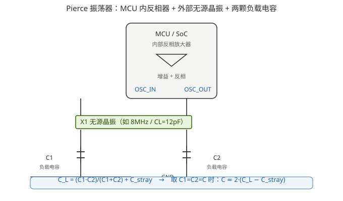

# 02 负载电容：为什么有人加、有人不加

> 本系列第 2 篇。回答系列引言里的核心困惑：**CH582M 接 32M 无源晶振不配负载电容都能用，STM32H743 飞控却有人加 20pF、有人加 12pF、还有人不加，为什么？** 答案藏在一个参数里：**负载电容 $C_L$（Load Capacitance）**。

---

## 1. 负载电容是什么：一个「晶振说了算」的数值

当你拿一颗无源晶振，datasheet 上除了频率（如 8 MHz），必定还有一个参数叫 **负载电容 $C_L$（Load Capacitance）**，常见值是 6 pF / 12 pF / 20 pF / 22 pF 等。例如：

- WCH 官方对 CH58x 系列推荐晶振参数：**32 MHz / 12 pF / 10 ppm（无源）** ✅；低频 32.768 kHz 推荐 **12.5 pF / 20 ppm** ✅
- ST Nucleo-H743 板载晶振 X3：**25 MHz / 6 pF / 20 ppm**（NDK NX2016SA）✅

**$C_L$ 的意思是：晶振厂商在生产时，已经把石英片按「外接这个电容值时，实际振荡频率等于标称频率」来校准。** 换句话说，**只有当你给这个晶振接上准确的负载电容，它才振荡在标称频率上**；接的电容不对，振荡频率就会偏（拉偏）。

> 这里很重要：**$C_L$ 不是让你直接在两脚之间焊一颗电容**，而是指「晶振从外面看进去，等效串联的总电容」。它由**两颗外接电容的串联 + 寄生电容**共同构成，详见第 2 节。

---

## 2. 典型接法：两颗电容 $C_1$、$C_2$

MCU 的无源晶振电路几乎都是 **Pierce 振荡器**拓扑：

- MCU 内部有一个反相放大器，两个引脚 **OSC_IN / OSC_OUT**（部分芯片叫 XIN/XOUT、XI/XO）接晶振两端；
- 外部在晶振两端各放一颗电容 **$C_1$、$C_2$**，另一头都接到 **GND**；
- 晶振本身不直接接地，它跨接在 OSC_IN 和 OSC_OUT 之间。

### 2.1 计算公式（务必记住这条）

外部负载电容 $C_L$ 与 $C_1$、$C_2$ 及寄生电容 $C_{stray}$ 的关系是：

$$
C_L = \frac{C_1 \times C_2}{C_1 + C_2} + C_{stray}
$$

其中 $C_{stray}$ 是 PCB 走线、引脚、焊盘的寄生电容，**经验值约 2 ~ 5 pF**。工程上通常取 $C_1 = C_2 = C$，且忽略剩下来的小量，公式简化为：

$$
C_L \approx \frac{C}{2} + C_{stray} \quad\Rightarrow\quad C \approx 2\,(C_L - C_{stray})
$$

### 2.2 手算一遍：8M 晶振配多少

假设晶振 $C_L = 12\ \text{pF}$，估 $C_{stray} \approx 2\ \text{pF}$：

$$
C = 2 \times (12 - 2) = 20\ \text{pF}
$$

→ 所以你会看到飞控用 8M/12pF 晶振时配 **两颗 20pF**。✅ 这也正好对上 ST AN2867 里的经典例子：$C_L=12\text{pF}$、$C_{stray}=2\text{pF}$，则 $C_1=C_2=20\text{pF}$。

那「12pF 电容」哪来的？如果晶振 $C_L = 8\ \text{pF}$、$C_{stray} \approx 2\ \text{pF}$，则：

$$
C = 2 \times (8 - 2) = 12\ \text{pF}
$$

→ **是这颗晶振的 $C_L$ 更小（要求更小的负载），所以配 12pF。** 结论：**看搭配用多大电容，本质是看晶振 datasheet 的 $C_L$ 是多少**，而不是拍脑袋。20pF 和 12pF 不是互相矛盾的两种选择，它们配的是不同 $C_L$ 的晶振。

### 2.3 为什么有人「不加电容」也能工作

不加电容 = 只有寄生的 $C_{stray}$（2~5 pF 量级）和 MCU 引脚本身的输入电容在起作用。此时电路**仍然可能起振**（因为 MCU 内部振荡器增益足够大，很容易满足起振条件），但**振荡频率会偏离标称值**——晶振在「错误的负载」下振荡，频率被拉偏几十到上百 ppm 都有可能。对 UART、SPI、内部逻辑这类对频率不敏感的场景，拉偏几十 ppm 无所谓，所以「跳过电容板子也能跑」。但对 BLE、USB、以太网、RTC 时钟这种要求频率精度的场景，**电容不配对 = 频率不准 = 功能异常**（详见 [03 篇](03_频率公差与稳定度.md) 关于 BLE ±62.5ppm 的讨论）。

> ⚠️ 所以「别人的板子不加电容也能用」**不代表可以不设计**。要判断一个板子为何不加电容，看两种可能：
> 1. 芯片**内置了可配置的负载电容**（下节的主角 CH582M 就是这一类）；
> 2. 板子对频率精度无所谓，能跑就行（不推荐在产品上这么干）。

---

## 3. 重点案例：CH582M 为什么「不用加」负载电容

这是系列引言里最让人困惑的一条，官方答复非常明确：

> **CH58x 无需外贴晶振匹配电容，芯片内置了可软件调节的匹配电容。** ✅（沁恒官网技术社区，TECH_Hy）

具体来说，CH58x 的 32 MHz 高速晶振和 32.768 kHz 低速晶振各有**片上可调电容阵列**，通过库函数配置：

- 高速：`HSECFG_Capacitance(HSECap_XX)`，XX 例如 `HSECap_16p` / `HSECap_20p` 等；
- 低速：`LSECFG_Capacitance(LSECap_21p)` 等。

于是公式里的「$C_1$、$C_2$ 两颗外接电容」被**移到芯片内部**，封装成可编程的电容量（典型几 pF 到二十几 pF 档位）。所以你只需：

1. 选一颗 datasheet 标注 $C_L$ 合适的 32 MHz 无源晶振（WCH 推荐 12 pF / 10 ppm）；
2. 原理图上**只在 X32MI / X32MO 之间跨接晶振，不画电容**；
3. 软件里把内部负载电容配到与晶振 $C_L$ 匹配（默认复位值通常可直接用，如 12pF 晶振用默认 16pF 即可，也可按公式调到 20pF 档）。✅

这是「省物料」和「简化原理图」的典型做法——**把被动元件的职责搬到数字芯片里**。它有一个额外好处：软件可以在量产时微调电容，优化频率误差，而不用换硬件。

---

## 4. 那「24M 有源晶振」又是怎么回事（03 预告）

有源振荡器内部已经有一颗晶体 + 振荡电路 + **内部负载电容**，**器件厂在出厂时就把 $C_L$ 配好了**。外部不需要算 $C_1/C_2$，OUT 引出一根线直接进 MCU 时钟输入脚即可。所以「有源晶振免负载电容」和「CH582M 内置电容免外接」是**两种不同豁免**，但结果都是原理图上「只有晶振、没有电容」。

| 方案 | 负载电容谁提供 | 谁保证频率 | 典型代价 |
|---|---|---|---|
| 无源晶振 + 两颗外接电容 | 外部 $C_1/C_2$ | 工程师设计 | 要算电容、占板面积 |
| 无源晶振 + 芯片内置可调电容（CH58x） | MCU 内部 | 软件配置 | 依赖芯片是否支持 |
| 有源振荡器（24M/25M XO） | 器件内部 | 器件厂 | 贵、耗电 |

---

## 5. 常见误区清单

| 误区 | 正解 |
|---|---|
| 负载电容 = 在晶振两脚并一颗电容 | ❌ 是「外接两电串联 + 寄生」之和，标配是两颗接地的 $C_1$、$C_2$ |
| 20pF 电容配 20pF 负载晶振 | ❌ 两颗 20pF 串联=10pF + 寄生 ≈12pF，配的是 $C_L$=12pF 的晶振 |
| 不加电容 = 更好的设计（省料） | ❌ 只是频率精度要求不高时的权宜；需要精度时必须有正确负载 |
| 有源振荡器和内置电容晶振一回事 | 都是免外接电容，但前者是器件厂配好、后者是 MCU 软件配 |
| 电容越大越容易起振 | ❌ 电容过大反而下拉起振难度并漂移频率；应在 datasheet $C_L$ 附近取值 |

---

## 6. 参考

- 沁恒官方技术社区：《CH583M 的晶振两边的匹配电容选型》— wch.cn/bbs/thread-136880-1.html（CH58x 内置可调匹配电容、公式 $(C_1\times C_2)/(C_1+C_2)+C_3$、推荐 32MHz 12pF 10ppm）✅
- 沁恒官方技术社区：《关于 CH582 晶振参数的选择》— wch.cn/bbs/thread-97339-1.html（复位值 16pF、评估板 32MHz 10ppm 12pF）✅
- ST, AN2867 §3.3 Load capacitance（$C_L$ 定义与外接电容计算，含 12pF→2×20pF 示例）✅
- ST, NUCLEO-H743ZI UM2407（25 MHz / 6 pF / 20 ppm 晶振 X3，NDK NX2016SA）✅
- ⚠️ $C_{stray}$ 经验估 2~5 pF；批量设计建议采用 ST AN2867 的三步法（初算 → 实测 → 微调）。