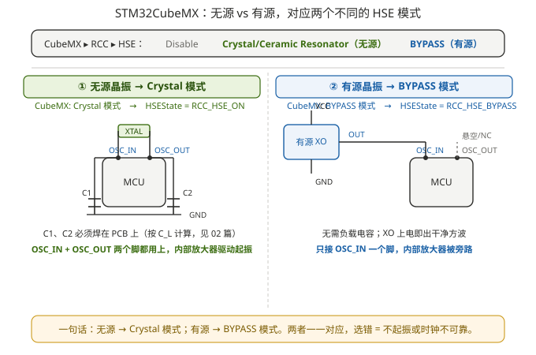

# 05 STM32CubeMX 配置：有源 / 无源怎么选模式

> 本系列第 5 篇（补全）。把 [01 篇](01_有源与无源-晶振与振荡器.md) 里「有源 / 无源」的概念，落到 **STM32CubeMX 的一个下拉菜单**上。原理图选了哪种时钟源，CubeMX 里就必须对应选哪个模式；**选错 = 不起振或时钟不可靠**。这是硬件设计和软件配置必须对齐的地方。

---

## 1. CubeMX 里 HSE 的三个选项

打开 STM32CubeMX → **Pinout & Configuration → System Core → RCC**，看 **High Speed Clock (HSE)** 这个下拉框，里面只有三种选择：

| 选项 | 对应硬件 | 内部振荡放大器 | 外部还要什么 |
|---|---|---|---|
| **Disable** | 不用 HSE，时钟来自 HSI（内部 RC） | — | 什么都不接 |
| **Crystal / Ceramic Resonator**（晶体/陶瓷谐振器）| **无源晶振** | ✅ 启用，驱动外部晶体起振 | 晶振 + 两颗负载电容（C1、C2） |
| **BYPASS Clock Source**（旁路时钟源）| **有源晶振 / 外部时钟** | ❌ 旁路（关闭），只接收外部时钟 | 有源振荡器（VCC/GND/OUT）或直接时钟线，无需负载电容 |

> ⚠️ 命名小差异：老版 CubeMX 写 **"BYPASS Clock Source"**；新版 CubeMX2（STM32C0 / H5 / H7 等）简化为 **"Bypass"**，**"Crystal/Ceramic Resonator"** 简化为 **"Crystal/Ceramic"**。意思完全一样，别被字面迷惑。

核心一句话：**无源晶振 → 选 Crystal 模式；有源晶振 → 选 Bypass 模式。** 这个选择等价于在生成的代码里给 `RCC_OscInitStruct.HSEState` 赋不同的值（见第 5 节）。



---

## 2. 无源晶振 → Crystal / Ceramic Resonator 模式

当你板子上焊的是 [01 篇](01_有源与无源-晶振与振荡器.md) 讲的**无源晶振**（两颗脚跨在 OSC_IN/OSC_OUT 之间，外加两颗负载电容），CubeMX 就选这个：

- MCU 内部的反相放大器被**启用**，它和外部晶体、C1/C2 一起构成 [02 篇](02_负载电容.md) 的 Pierce 振荡器；
- **OSC_IN 和 OSC_OUT 两个脚都要接到晶振两端**；
- **负载电容 C1、C2 仍要老老实实在 PCB 上焊**——CubeMX 只负责把内部放大器打开，不会替你焊电容。选了 Crystal 模式却没放电容，等于 [02 篇](02_负载电容.md) 说的「方案 B'」，频率会被拉偏。

> ✅ 这对应 [04 篇](04_实战复盘-CH582M与STM32H743晶振方案.md) 里 STM32H743 飞控的「8M + 20pF / 12pF」方案：硬件是无源晶振 + 外接电容，CubeMX 选 Crystal 模式。

---

## 3. 有源晶振 → BYPASS Clock Source 模式

当你板子上用的是 [01 篇](01_有源与无源-晶振与振荡器.md) 讲的**有源振荡器**（XO，本身已含完整振荡电路，OUT 脚直接出时钟），CubeMX 必须选 Bypass：

- 有源晶振的 **OUT 只接 MCU 的 OSC_IN**（一个脚）；
- **OSC_OUT 脚悬空（NC）或改作普通 GPIO**——因为内部放大器已被旁路，这个脚不再参与振荡；
- 有源晶振自己需要 **VCC / GND** 供电（注意电平匹配：给 3.3 V 的 MCU 选 3.3 V 输出的 XO）；
- 不需要任何负载电容，OUT 出来就是干净方波。

> ✅ 这对应 [04 篇](04_实战复盘-CH582M与STM32H743晶振方案.md) 里「24M / 25M 有源晶振」方案：硬件是 XO，CubeMX 选 Bypass 模式。

⚠️ **为什么有源晶振不能选 Crystal 模式？** Crystal 模式会让 MCU 把 OSC_OUT 当成「驱动晶体的一端」去推信号，而此时 OSC_OUT 上并没有晶体，只有空脚；同时你又从 OSC_IN 灌进一个现成时钟——内部放大器在「想驱动一个不存在的晶体」，外部 XO 在「想推一个已被内部放大器占用的脚」，两边打架，**结果是不起振或时钟抖动超差**。所以：**硬件是有源的，模式必须是 Bypass，没有第二种合法选法。**

> 进阶：H7 系列在 Bypass 模式下还能选 `HSEEXT` 指定外部时钟是模拟还是数字电平，普通方波时钟保持默认即可——不影响本篇结论。

---

## 4. 配错会怎样：一张故障对照表

| 硬件实际 | CubeMX 选的模式 | 结果 |
|---|---|---|
| 无源晶振 | Crystal | ✅ 正常起振 |
| 无源晶振 | Bypass | ❌ 内部放大器被旁路，没人驱动晶体 → **不起振**；MCU 可能退回 HSI 或卡在时钟就绪等待 |
| 有源晶振 | Bypass | ✅ 正常，直接吃外部时钟 |
| 有源晶振 | Crystal | ❌ 内部放大器与 XO 输出冲突 → 时钟不稳定 / 抖动大 / 偶发起振失败 |

> 判断顺序很机械：**先看原理图是无源还是有源 → 再选模式**。和 [04 篇](04_实战复盘-CH582M与STM32H743晶振方案.md) 第 5 节的「30 秒检查清单」是同一逻辑，只是从软件侧再确认一遍。

---

## 5. 落到代码：HAL 里就是一行 HSEState

CubeMX 选完模式，生成的 `SystemClock_Config()` 里，区别就在这一行：

```c
RCC_OscInitStruct.OscillatorType = RCC_OSCILLATORTYPE_HSE;

// 无源晶振：Crystal / Ceramic Resonator 模式
RCC_OscInitStruct.HSEState = RCC_HSE_ON;        // ← 内部放大器驱动晶体

// 有源晶振：BYPASS Clock Source 模式
// RCC_OscInitStruct.HSEState = RCC_HSE_BYPASS;  // ← 内部放大器旁路，直接收外部时钟

RCC_OscInitStruct.PLL.PLLSource = RCC_PLLSOURCE_HSE;
// ... PLL 倍频设置 ...
HAL_RCC_OscConfig(&RCC_OscInitStruct);
```

- `RCC_HSE_ON` 底层是清掉 `RCC_CR` 的 `HSEBYP` 位、置 `HSEON` 位：让内部放大器工作；
- `RCC_HSE_BYPASS` 底层是置 `HSEBYP` 位：把内部放大器旁路，OSC_IN 当纯输入。

> 如果你不用 CubeMX、手敲寄存器，记住这个映射就不会错：**无源 = ON，有源 = BYPASS**。低速外部时钟（32.768 kHz LSE）同理：`RCC_LSE_ON` 对应无源 32.768 晶振，`RCC_LSE_BYPASS` 对应有源 32.768 振荡器。

---

## 6. 启动时间差异（模式背后的物理，CubeMX 不显示）

| | Crystal 模式（无源）| Bypass 模式（有源）|
|---|---|---|
| 起振来源 | MCU 内部放大器把晶体「推」起来 | XO 上电即出稳定波形 |
| 启动时间 | ms 级（需等晶体幅度建立）| µs 级（上电即稳）|
| 频率精度 | 由晶体 + 负载电容决定（见 02 / 03 篇）| 由 XO 器件厂出厂校准保证 |
| 抗干扰 | 受 PCB 布局、温度、电容匹配影响 | 强（独立器件，干净输出）|

这就是为什么 [04 篇](04_实战复盘-CH582M与STM32H743晶振方案.md) 里飞控愿意为「24M 有源」多花几毛钱和几毫瓦——Bypass 模式配 XO，起振快、波形干净、精度稳，适合 USB / 以太网 / 高精度采样这类对时钟敏感的场合。

---

## 7. 回到你的三个真实例子

| 板子 | 时钟源 | 硬件类型 | CubeMX 应选 | 代码 HSEState |
|---|---|---|---|---|
| CH582M 评估板 | 32M 无源晶振（内部已含可调负载电容）| 无源 | （CH582 是 RISC-V，**没有 CubeMX**；用 WCH 工具链，`HSECFG_Capacitance()` 配内部电容，见 [04 篇](04_实战复盘-CH582M与STM32H743晶振方案.md)）| — |
| STM32H743 飞控（8M 派）| 8M 无源 + 20pF / 12pF | 无源 | **Crystal / Ceramic Resonator** | `RCC_HSE_ON` |
| STM32H743 飞控（24M 派）| 24M / 25M 有源 XO | 有源 | **BYPASS Clock Source** | `RCC_HSE_BYPASS` |

一句话收口：**CubeMX 的模式不是随便选的，它是原理图时钟方案在软件里的镜像——无源选 Crystal，有源选 Bypass，二者一一对应。**

---

## 8. 常见误区清单

| 误区 | 正解 |
|---|---|
| 有源晶振也能选 Crystal 模式 | ❌ 必须 Bypass，否则内部放大器与 XO 冲突，不起振或抖动 |
| Bypass 模式也要焊负载电容 | ❌ 有源 XO 出厂已校准，OUT 直进 OSC_IN，无需 C1 / C2 |
| CubeMX 选了 Crystal 就自动配好电容 | ❌ CubeMX 只开内部放大器，电容要自己在 PCB 上焊 |
| OSC_OUT 在有源方案里也要接 | ❌ Bypass 模式下 OSC_OUT 悬空或作 GPIO |
| 模式选错只是频率不准 | ❌ 轻则退回 HSI、重则完全不起振，系统直接跑飞 |

---

## 9. 参考

- ST, AN2867 *Oscillator design guide for STM8AF/AL/S, STM32 MCUs/MPUs*（HSE 晶体模式、负载电容三步法、Pierce 拓扑）✅
- ST, RM0433 *STM32H743 Reference Manual* §RCC_CR：`HSEON` / `HSEBYP` 位定义（Crystal vs Bypass 的寄存器本质）✅
- ST 社区：CubeMX HSE "Crystal/Ceramic" vs "Bypass" 配置说明（含 `RCC_HSE_ON` / `RCC_HSE_BYPASS`）✅
- 沁恒 CH58x 硬件设计：内部可调负载电容、`HSECFG_Capacitance()`（CH582 无 CubeMX，走 WCH 工具链）✅
- ⚠️ 不同 STM32 系列 CubeMX 下拉文案略有差异（"BYPASS Clock Source" vs "Bypass"），以你所用 CubeMX 版本为准；但「无源→Crystal、有源→Bypass」的映射不变。
