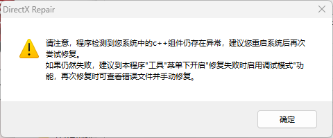
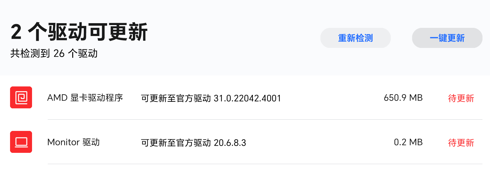
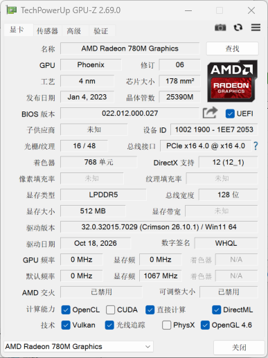

# VOFA+ 与 Synex 白屏/透明故障排查与修复实录

> **一句话结论**：一次意外黑屏（断电）破坏了 AMD 显卡驱动包 / 组件注册状态，导致两款基于 Qt 的上位机（VOFA+ 用 Qt5、Synex 用 Qt6）打开后界面不渲染（透明 / 白屏）。最终用 **DDU 彻底清除脏驱动状态 + 荣耀官方完整驱动重装** 解决。
>
> **最重要的教训**：排查中我一度咬定「`amdxc64.dll` 残废版是元凶」，但这个假设在最终修复后被**证伪**——修好之后那个 dll 仍是 132 KB 的「旧版本」，软件却正常了。真正被修复的是驱动包 / 组件注册状态，不是单个文件大小。

---

## 1. 故障现象

- **VOFA+**：窗口打开后**透明**——能透过窗口看到桌面，右上角有关闭按钮可以点（说明进程起来了、Qt 跑起来了，只是 GUI 不画）。
- **Synex**：窗口打开后**纯白屏**，同样右上角能关。
- 两个程序进程都在、能被任务管理器看到、能正常关闭，但主界面完全不渲染。
- **触发点**：某次使用中电脑突然**黑屏（意外断电）**，重启后这两款软件就处于此状态；之后还关机更新过系统。

!!! note "环境"
    - 机型：荣耀笔记本（HONOR）
    - 显卡：AMD Radeon 780M 核显（Radeon Graphics）
    - 系统：Windows 11
    - 原驱动版本：32.0.32015.7029
    - 受影响软件：VOFA+（Qt5 + QML + Qt3D）、Synex（Qt6）

<!-- TODO: 补充一张 VOFA+ 透明窗口 / Synex 白屏的实际截图，放在这里 -->

---

## 2. 关键认知：透明窗口 ≠ 程序打不开

这一点决定了整个排查方向，先讲透：

- 窗口**能关**、进程**在跑**，说明程序逻辑层没崩，Qt 框架也起来了。
- 不渲染，是因为**图形渲染上下文建不起来**——GUI 不知道往哪画。这指向**图形子系统（GPU 驱动 / 渲染后端）**，而不是程序文件损坏或运行库缺失。
- 旁证：VOFA+ 在「纯软件渲染」模式下**能显示部分 2D 内容**（如菜单、基础控件），只有依赖 OpenGL 的 3D 示波图（Qt3D）画不出来。这进一步说明 Qt 本身没坏，坏的是它依赖的那条 GPU 渲染通路。

!!! tip "透明 / 白屏 vs 闪退的区别"
    闪退（程序直接消失）= 通常缺运行库、缺 DLL、或代码崩溃。
    透明 / 白屏（窗口在但不画）= 通常渲染后端 / 显卡驱动 / 窗口合成层的问题。
    两者治法完全不同，先分清楚再动手。

---

## 3. 排查时间线（假设 → 验证 → 结论）

这是本文的核心。每一个假设都实际验证过，结论以证据为准，包括几个**中途被证伪**的方向。

| # | 假设 | 验证方法 | 结果 | 结论 |
|---|---|---|---|---|
| 1 | AMD 显卡驱动硬件层坏了 | 强制走 WARP（纯软件 D3D）启动 VOFA+，完全不碰 AMD 硬件 | 仍透明 | **否** |
| 2 | Honor 虚拟显示设备（Indirect Display）干扰 | 设备管理器禁用 / 启用该设备 | 无效 | **否** |
| 3 | 缺 VC++ 运行库 / 程序文件损坏 | 查 VC++ 2022 已装齐；重新下载 Synex 全新解压 | 仍白 | **否** |
| 4 | 全局 `QT_*` / `QML_*` / `ANGLE` 环境变量把两个程序带偏 | 枚举环境变量，无任何此类项 | 无匹配 | **否** |
| 5 | HAGS 硬件加速 GPU 调度作祟 | 查注册表 `HwSchMode` 项不存在 = 默认关闭 | — | **否** |
| 6 | DWM 崩溃 / 系统透明特效设置异常 | DWM 进程正常、透明开关设置正常 | — | **否** |
| 7 | （中途误判）`amdxc64.dll` 残废版是元凶 | 干净重装后该 dll 仍为 132 KB，但软件已恢复 | 证伪 | **否（被推翻）** |
| 8 | （中途误判）GPU-Z 显示「OpenGL 4.6」= 驱动正常 | 那只是能力上报，非运行时验证 | 证伪 | **否（被推翻）** |

### 3.1 排除 AMD 硬件本身（假设 1）
用 `QT_OPENGL=angle` + `QT_ANGLE_PLATFORM=warp` 强制 Qt 走微软纯软件 D3D（WARP），**完全不经过 AMD 硬件**。VOFA+ 仍透明 → 不是 AMD 显卡硬件坏了。

> 坑：VOFA+ 是单实例程序。如果不先杀掉旧进程就双击 bat，Windows 只是把旧的坏窗口提到前台，**新的环境变量根本没生效**——所以早期几次「bat 也不行」其实是测了同一个旧进程，结果无效。正确做法是「强杀旧进程再启动」。

### 3.2 排除虚拟显示 / 运行库 / 环境变量 / HAGS / DWM（假设 2–6）
逐项验证，全部排除。其中：
- VC++ 2022 (v14 14.50.35719) X64+X86 都在；
- 重下 Synex 全新解压仍白 → 排除程序文件损坏与配置文件问题；
- 系统 `d3d11.dll` / `dxgi.dll` / `dcomp.dll` / `d3dcompiler_47.dll` 都在且大小正常；
- 近 3 天事件日志无 dwm.exe / 显卡驱动崩溃。

### 3.3 两个被证伪的误判（假设 7、8）
这两点值得单独讲，因为它们是这次排障里最贵的「学费」：

- **误判 A —— `amdxc64.dll` 大小**：排查中发现 `C:\Windows\System32\amdxc64.dll` 只有 ~138 KB，而驱动仓库（DriverStore）里同名文件有 137 MB，于是认定「残废版是元凶，所有重装因版本号相同而跳过了它」。**但最终干净重装（DDU + 荣耀官方驱动）后软件恢复了，这个 dll 仍是 132 KB（用户原话「用的之前的」）。** → 小体积本来就是正常的，它不是元凶。
- **误判 B —— GPU-Z 的「OpenGL 4.6」**：GPU-Z 报告 OpenGL 4.6、OpenCL / Vulkan / DirectCompute 全部打勾，看似「驱动正常」。但那只是驱动**上报的能力**（驱动包里写明了支持 4.6），**不等于运行时真能建渲染上下文**。真正建上下文要走的底层文件当时是坏的，所以运行时 OpenGL 是断的。GPU-Z 这栏把人带偏了。（GPU-Z 是 TechPowerUp 出品的显卡检测工具，[汉化绿色版下载见脚本之家](https://www.jb51.net/softs/21220.html)）

!!! warning "别被单点异常带偏"
    文件大小异常、工具上报正常，都只是**线索**，不是**结论**。最终要以「在干净状态下实际运行软件」为裁决标准。本例里，所有「重装」都没真替换成那个文件，所以我们其实**从没在驱动完整状态下测过 VOFA+**——直到 DDU + 官方驱动才第一次真正验证。

### 3.4 岔路：DirectX 修复工具报「C++ 组件异常」

排查中期用 DirectX 修复工具扫过系统，它报告「检测到系统中的 C++ 组件存在异常」，并在结果里把 `C++ 2015-2022 Redistributable Package (API Sets)` 标了红叉：



这一度让人怀疑 VOFA+（Qt5）和 Synex（Qt6）**共同依赖的 VC++ 运行库**坏了——毕竟两个不同 Qt 版本同时出问题，运行库是很好的解释。但两点证据否掉了它：

- `Get-CimInstance Win32_Product` 复查，确认 VC++ 2022（v14 14.50.35719）X64 / X86 **都在**；
- Win11 的 `api-ms-win-crt-*` 属于「虚拟 API 集合」DLL，磁盘上本就不存在真实文件（靠注册表 schema 解析），这类修复工具在 Win11 上容易把它们误判为缺失。

结论：这张图的红叉大概率是**误报**；退一步说，即便 C++ 运行库真坏了，典型症状也应该是「程序打不开」，而不是「打开了但透明」。

相关工具与做法：

- **DirectX 修复工具**（注意：**只有增强版才支持修 C++**，标准版遇 C++ 异常仅会提示升级）：[作者 VBcom 发布的增强版说明与下载地址](https://blog.csdn.net/vbcom/article/details/7245186)
- 若确实判定要重装 / 修复 VC++ 运行库：[vcredist_x64 安装步骤与「程序和功能」验证方法](https://developer.aliyun.com/article/1731111)

---

## 4. 关键诊断命令（可复现）

以下几条 PowerShell / `reg` 检查在排查中反复用到，沉淀下来供日后复用。

```powershell
# 1) OpenGL 驱动注册表（厂商 ICD 子键）
reg query "HKLM\SOFTWARE\Microsoft\Windows NT\CurrentVersion\OpenGLDrivers" /s

# 2) 显示类键里的 OpenGL 注册（现代 Windows 实际读取的位置）
$cls = 'HKLM:\SYSTEM\CurrentControlSet\Control\Class\{4d36e968-e325-11ce-bfc1-08002be10318}'
Get-ChildItem $cls | ForEach-Object {
    $v = Get-ItemProperty $_.PSPath
    if ($v.DriverDesc -match 'Radeon|AMD') {
        "实例 $($_.PSChildName) : $($v.DriverDesc)"
        "  OpenGLDriverName = [$($v.OpenGLDriverName -join ' | ')]"
        "  OpenGLFlags/Version = [$($v.OpenGLFlags)] / [$($v.OpenGLVersion)]"
    }
}

# 3) System32 里 AMD 用户态 DLL 的真实大小（判断是不是被截断）
@('amdxc64.dll','amdxx64.dll','atio6axx.dll') | ForEach-Object {
    $f = "C:\Windows\System32\$_"
    if (Test-Path $f) {
        $i = Get-Item $f
        "{0,-16} {1,10} KB  修改={2}" -f $_, [math]::Round($i.Length/1KB,1), $i.LastWriteTime.ToString('yyyy-MM-dd HH:mm')
    } else { "缺失: $_" }
}

# 4) 当前显示适配器与驱动版本
Get-CimInstance Win32_VideoController | Where-Object {$_.Name -match 'Radeon|AMD'} |
    Select-Object Name, DriverVersion, Status | Format-List
```

---

## 5. 过程中的绕行 / 修复脚本（含坑）

为了在不破坏原程序的前提下做干净验证，建过几组 bat。它们的环境变量思路是对的，但有两个坑：

```bat
@echo off
REM 软件渲染绕行：强制 Qt 走纯 CPU 的 QPainter 后端（能显 2D，画不了 3D）
set QT_OPENGL=software
set QT_QUICK_BACKEND=software
start "" "D:\Program Files\Gutega\VOFA+\x64\vofa+.exe"
```

```bat
@echo off
REM WARP 验证：强制 Qt 走 ANGLE -> 微软纯软件 D3D，完全不碰 AMD 硬件
set QT_OPENGL=angle
set QT_ANGLE_PLATFORM=warp
start "" "D:\Program Files\Gutega\VOFA+\x64\vofa+.exe"
```

```bat
Windows Registry Editor Version 5.00
[HKEY_LOCAL_MACHINE\SOFTWARE\Policies\Microsoft\Windows\WindowsUpdate]
"ExcludeWUDriversInQualityUpdate"=dword:00000001
```
（组策略：禁止 Windows 质量更新顺手回退显卡驱动。**只动这一处策略，不碰任何驱动文件、不影响系统稳定。**）

!!! warning "坑 1：bat 里写中文会炸"
    cmd.exe 在中文 Windows 下按 GBK 读文件，而文件实际是 UTF-8 存的，中文会变成乱码被当成「命令」执行，于是报 `xxx 不是内部或外部命令`。**所有 bat 必须纯 ASCII**。之前那次 sfc/dism 脚本报错就是栽在这。

!!! warning "坑 2：Qt 单实例程序要先杀进程再测"
    不杀旧进程就双击 bat，测的是旧窗口，新环境变量不生效。bat 里先 `taskkill /f /im vofa+.exe` 再 `start` 才有效。

---

## 6. 最终解决：DDU + 荣耀官方驱动

### 6.1 为什么前面所有「重装」都没用
- Windows 的驱动安装**只比对版本号，不比对文件内容 / 大小**。残文件版本号与满血版一致 → 安装程序判定「已最新」→ **跳过拷贝**。所以 minimal 版、完整版、甚至 `pnputil` 强制重装，都没真正替换那个坏掉的文件 / 状态。
- 更深层：真正坏的是**驱动包 / 组件注册状态**（被黑屏断电打断写坏），不是单个 dll 大小。

### 6.2 步骤
1. （可选）先合并上面的「锁驱动防 Win 更新覆盖.reg」，防止装完又被 Windows 更新顶回坏版。
2. 用 **DDU（Display Driver Uninstaller）** 彻底清除 AMD 驱动（[官方下载页](https://www.wagnardsoft.com/display-driver-uninstaller-ddu)，作者 Wagnard，支持 AMD / NVIDIA / Intel，会把注册表项、文件夹、文件、DriverStore 残留一并清掉）。
   - 此刻 VOFA+ **打不开、屏幕可能低分辨率**——这是预期的，因为系统退到了「Microsoft 基本显示适配器」，没有任何 GPU 加速。这恰好证明 DDU 清干净了。
3. 荣耀电脑管家检测到官方驱动 **31.0.22042.4001（650.9 MB）** 可更新 → 一键更新。
   - 这是**荣耀针对本机型调过的完整包**，比手动下的 minimal 网页版全，且 DDU 清空后变成「无旧版本可比 → 全新拷贝」，不会跳过。
4. 重启 → VOFA+ / Synex **恢复正常**。

DDU 清空并重启后，荣耀电脑管家随即检测到可更新的官方驱动——这正是我们等待的「无旧版本可比 → 全新拷贝」时机：





!!! tip "装完自己就能验证"
    资源管理器地址栏输入 `C:\Windows\System32\amdxc64.dll` 看属性——**如果这次大小是 130 MB+ 级别、修改时间是今天**，说明满血版被真正换掉了。不过要注意：本例最终修复后它仍是 132 KB 且软件正常，所以「大小正常」并不是恢复的充分条件，**以软件实际能跑为准**。

---

## 7. 诚实更正：amdxc64.dll 大小不是元凶

用户原话：「成了！但是 amdxc64.dll 是用的之前的，然后大小是 132k。」

这说明：

- 那个 dll 的**小体积是正常的**（DriverStore 里那个 137 MB 的很可能是别的分支 / 误读），它不仅不是元凶，连「线索」都算不上。
- 真正被修复的是**驱动包 / 组件注册状态**：DDU 把那层脏状态整个清掉，荣耀官方安装包重建了正确的组件注册（包括 OpenGL / OpenCL / Vulkan 的 SoftwareComponent 落地）。
- **结论**：不要被单文件异常大小带偏；干净重装（DDU + 厂商完整包）才是打破「版本号跳过」机制的可靠手段。

---

## 8. 经验总结 / 防坑清单

- **透明窗口优先查图形子系统**（GPU 驱动 / 渲染后端），不是运行库、不是程序损坏。
- **GPU-Z / OpenGL Extensions Viewer 的「OpenGL x.x」是能力上报**，不等同于运行时能建渲染上下文。要用「实际跑一个依赖 OpenGL 的程序」来裁决。
- **Windows 驱动「重装」按版本号比对**，残文件可能跳过拷贝 → **DDU** 是打破该机制的手段（先清空，再全新拷贝）。
- **品牌 / 荣耀笔记本的 AMD 驱动，优先用官方管家推送的完整包**（针对机型调过）；手动 minimal 网页版易漏组件（本例一开始下的 minimal 版就没把 OpenGL 组件装全）。
- **bat 脚本中文编码坑** → 一律纯 ASCII。
- **Qt 单实例程序测环境变量** → 先 `taskkill` 杀旧进程再启动。
- **DirectX 修复工具在 Win11 上易误报**：它对 `api-ms-win-crt-*` 这类「虚拟 API 集合 DLL」会标红叉（磁盘上本来就不存真实文件，靠注册表 schema 解析），VC++ 包本身可能完好。看到红叉先别急着重装 C++，用 `Get-CimInstance Win32_Product` 确认包确实装着。

---

## 9. 待补素材

本篇已嵌入三张图（`directx_cpp_abnormal.png`、`gpu-z_opengl_normal.png`、`honor_driver_update.png`）。还缺的截图，补进 `docs/硬件与半导体/系统排障/assets/` 并在正文对应位置用 `` 引用即可：

- [ ] VOFA+ 透明窗口 / Synex 白屏的实际截图（第 1 节）
- [x] ~~荣耀电脑管家推送官方驱动 31.0.22042.4001 的截图（第 6 节）~~ —— 已补齐
- [ ] 各 bat 的运行输出截图（如有）

---

## 10. 参考链接

| 链接 | 说明 |
|---|---|
| [Display Driver Uninstaller (DDU) 官方下载](https://www.wagnardsoft.com/display-driver-uninstaller-ddu) | DDU 官方站点（作者 Wagnard）。**本例最终解法的关键工具**：彻底卸载 AMD / NVIDIA / Intel 显卡驱动及残留（注册表项、文件夹、文件、DriverStore 一并清掉）。 |
| [DirectX 修复工具增强版（作者 VBcom）](https://blog.csdn.net/vbcom/article/details/7245186) | DirectX Repair 增强版的下载地址与功能说明。**注意只有增强版支持修复 C++**，标准版遇 C++ 异常仅提示升级。 |
| [GPU-Z V2.69.0 绿色汉化版（脚本之家）](https://www.jb51.net/softs/21220.html) | GPU-Z 下载页。用于查看显卡型号、驱动版本与 OpenGL / OpenCL / Vulkan 支持情况——但请记住这些只是**能力上报**，不等于运行时正常。 |
| [vcredist_x64 安装步骤与 VC++ 运行库缺失解决方法](https://developer.aliyun.com/article/1731111) | VC++ Redistributable 的安装与「程序和功能」验证方法。本例中 C++ 被 DirectX 工具误报异常，实际运行库是完好的。 |
| [CSDN 参考文章（148349434）](https://blog.csdn.net/2401_88055648/article/details/148349434) | ⚠️ **标题未核实**：该页被 CSDN 安全验证拦截，无法读取标题与内容。请补上准确的标题与一句话说明。 |
