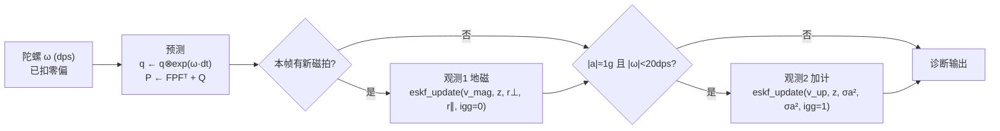

# proc_eskf.c 数学拆解

> [!abstract] 一句话
> 这是**一个 3 维姿态误差 ESKF（AHRS）**，不是惯导。零偏外挂、没有速度/位置，所以它覆盖"姿态解算"，不覆盖"机械编排"。数学主线干净，但**注释与代码多处不一致**，必须按代码读。

---

## 1. 仓库定位

| 维度 | 实际情况 |
|---|---|
| 平台 | 沁恒 CH32H417 双核 RISC-V + LSM6DSV16X + MMC5983MA + BMP388 + GPS |
| 工程亮点 | 双核分工；陀螺 SPI-DMA 中断 **8 kHz**；小核采集+时戳，大核跑算法 |
| 算法核心 | `proc_eskf.c`：ESKF，状态**只有 3 维姿态误差** |
| 观测量 | 地磁（单位矢量）+ 加计重力（只修倾斜，不修偏航） |
| 零偏/标度 | 在 ESKF **之外**处理（`proc_gyro_bias.c`、`proc_tune.h`） |
| 验证手段 | PC 端复刻 `pc_chain.exe` + `magmap.py`，可 A/B 对照 |
| 本质 | **AHRS / 姿态滤波器**，不是 INS |
| 许可 | GPL-3.0（传染性 copyleft） |

> [!tip] 最值钱的部分
> 不是算法本身，而是**"数据落盘 → PC 复刻 → 单一判据 A/B"** 这套方法论，以及被记录下来的失败尝试。

### 覆盖范围与本轮学习目标

| 环节 | 覆盖 | 说明 |
|---|---|---|
| 采集与时戳 | ✅ | 双核 8 kHz 链路 |
| 标定补偿 | 🟡 部分 | 零偏/标度/磁，均不在 EKF 状态内 |
| **姿态解算** | ✅ | ← 本轮重心 |
| 机械编排 | ❌ | 无速度/位置/地球自转/运输率/重力模型递推 |
| 组合导航 | ❌ | 无 GNSS/INS 融合 |

---

## 2. 读前必看：文件头是过期的

| 文件头（L1–35）写的 | 代码实际 |
|---|---|
| "重力牵引已关闭" | `ESKF_USE_GRAVITY 1`，且 `#if ESKF_USE_GRAVITY` → **重力观测在跑** |
| "唯一观测：地磁" | 有**两个**观测：地磁 + 加计 |
| "启动即 identity，静止时残差 0" | 已改为 `eskf_build_q0` 构造 R0，**不再是 identity** |

> [!warning] 读这个仓库的第一条纪律
> **以宏定义和可执行代码为准，不要信文件头注释。**
> 同一份文件里，"重力牵引已关闭"和"1 = 开启（本版）"同时存在。

---

## 3. 状态与总体结构

**状态**：只有 3 维姿态误差 $\delta\theta \in \mathbb{R}^3$；标称状态为四元数 $q=(w,x,y,z)$（Hamilton，代表**体→导航**旋转 $R(q)$）。

**没有的东西**：零偏（外挂）、速度、位置。



> [!important] 关键实现细节
> 观测是**顺序施加**的，不是联合更新。每次 `eskf_update` 跑完立刻改 $q$ 和 $P$，下一次观测看到的是已更新过的新状态。这个细节很容易被忽略。

---

## 4. 三个四元数原语

### 4.1 `nav_to_body`：h = Rᵀ(q)·v

$$
h = R(q)^{\mathsf T}\, v_{\text{nav}} \qquad\text{（导航系矢量 → 体坐标）}
$$

按列写成 `out[i] = Σ_j R[j][i]·v[j]`，即取 R 的第 $i$ 列。这是"观测预测值"的来源。

### 4.2 `q_body_rotate`：q ← q ⊗ exp(v)

**为什么必须右乘**：误差状态 $\delta\theta$ 定义在**体坐标**下。左乘等价于"把旋转轴镜像"——镜像轴会影响转到多少度就错多少度。

> [!bug] 真实故障指纹（仓库记录）
> 绕 z 转 14.94°/29.88°/44.82°/59.76° 时，误差累积 10.19/20.23/29.97/39.24°（比例恒定 ≈ 2/3）。这是左乘的典型特征。

> [!tip] 值得抄的写法
> 代码直接展开 Hamilton 乘积（`dw,dx,dy,dz` 那段），而不是手写各项符号。手写符号极易出错，这里是值得照搬的工程习惯。

---

## 5. 观测方程与 H 矩阵

### 5.1 残差

$$
r = z - h, \qquad r \leftarrow r - (r\cdot h)\,h
$$

第二步关键：**残差沿 $h$ 的分量没有信息**。观测是单位矢量，模长固定，沿 $h$ 方向是伪自由度。先投影掉，后面的 $S^{-1}$、$K$ 都只在 2 维子空间工作。

### 5.2 H 矩阵推导

$$
\begin{aligned}
h(\delta\theta) &= R(q\otimes \exp(\delta\theta))^{\mathsf T} v_{\text{nav}} \\
&= R(\exp(\delta\theta))^{\mathsf T} R(q)^{\mathsf T} v_{\text{nav}} \\
&\approx (I - [\delta\theta]_\times)\, h \\
&= h + h\times\delta\theta \;=\; h + [h]_\times \delta\theta
\end{aligned}
$$

$$
\boxed{\;\frac{\partial h}{\partial \delta\theta} = [h]_\times =
\begin{bmatrix}
0 & -h_z & h_y\\
h_z & 0 & -h_x\\
-h_y & h_x & 0
\end{bmatrix}\;}
$$

### 5.3 数值验证（自算，已验证）

用 $\varepsilon$ 差分（任意姿态 $q$，任意参考矢量 $v_{\text{nav}}$，步长 $1\times10^{-6}$ rad）：

| 对照 | 最大偏差 |
|---|---|
| 数值 Jacobian vs $+[h]_\times$ | **4.808e-07** ✅ 吻合 |
| 数值 Jacobian vs $-[h]_\times$ | 1.923e+00 ❌ 差一个数量级 |

> [!danger] 最大的坑：注释与代码符号相反
> 代码注释原话是 `H = [h]× 的负形`，但代码**实际写入的是标准 $+[h]_\times$**，而且只有 `+` 才与"右乘 + $h=R^{\mathsf T}v$"这套约定自洽。
> 注释里的"负形"是跟另一份 PC 代码 `make_skew()` 的命名遗留。
> **照注释去改符号，滤波就反了**——这正是注释里记录的"转的轴向错"历史故障。

---

## 6. 各向异性观测噪声 R

$$
S = H P H^{\mathsf T} + R_{\text{obs}}, \qquad
R_{\text{obs}} = r_\perp (I - hh^{\mathsf T}) + r_\parallel (hh^{\mathsf T})
$$

$hh^{\mathsf T}$ 是沿 $h$ 的投影算子，$I-hh^{\mathsf T}$ 是 $\perp h$ 的投影算子。所以：

| 方向 | 可观测性 | 取值 |
|---|---|---|
| $\perp h$ | 真实可观测 | 地磁 0.44°，加计 0.1312°（均为实测拟合） |
| $h$ | 不可观测 | 地磁 4.00°，加计同 $\sigma_a$ |

**物理含义**：给不可观方向灌大方差 = 让滤波器自己别去用它。

> [!tip] 通用技巧
> 这比"事后把 K 那一列清零"干净得多，因为它保持 $S$ 可逆、$P$ 更新一致。值得记住的写法。

---

## 7. Q 的构造（全篇最值得学）

$$
\underbrace{Q_{\theta\theta} = \sigma_g^2\,dt}_{\text{随机游走 ARW}}
\;+\;
\underbrace{2\,k_s^2\,\theta_{\text{rot}}\,|\omega|\,dt}_{\text{确定性标度误差}}
$$

| 符号 | 含义 | 取值 |
|---|---|---|
| $\sigma_g$ | 角度随机游走 ARW | $3.6943\times10^{-5}$ rad/√s（由手册 0.127 °/√hr 换算） |
| $k_s$ | 陀螺标度误差 | $7.5\times10^{-5}$（75 ppm） |
| $\theta_{\text{rot}}$ | 累计转角 $\sum|\omega|dt$ | 逐帧累加 |

### 7.1 为什么第二项长这样

标度误差是**确定性**误差，不是随机的：

$$
\theta_{\text{err}} = k_s\,\theta_{\text{rot}}
\quad\Longrightarrow\quad
\text{Var} = (k_s\theta_{\text{rot}})^2
$$

$$
\frac{d}{dt}\left[(k_s\theta_{\text{rot}})^2\right]
= 2k_s^2\theta_{\text{rot}}\frac{d\theta_{\text{rot}}}{dt}
= 2k_s^2\theta_{\text{rot}}|\omega|
$$

积分回去正好 $P = (k_s\theta_{\text{rot}})^2$ ✅ 自洽。

### 7.2 他们一开始写错的方式（极有教学价值）

写成 $Q = (k_s|\omega|dt)^2$ 再逐帧累加 ⟹ 那是**随机游走建模** ⟹ 积分得 $\propto N$ 而非 $\propto N^2$ ⟹ $\sigma$ 差 $\sqrt N \approx 300$ 倍。

> [!failure] 后果链条（仓库实测记录）
> ```
> P 撒谎（偏小 300 倍）
> ⟹ S = HPHᵀ + R 塌到 R
> ⟹ NIS = resid²/(P+R) ≈ 9330 ≫ 阈值
> ⟹ 每帧拒绝 ⟹ 重力门永久锁死
> ```

> [!important] 本段的核心教训
> **P 必须"诚实"** —— 它是对真实误差量级的自报。
> P 说谎一次，任何基于 $\chi^2$ 的门都会反过来把真实误差判成粗差，形成自锁。
> 这就是作者反复写"P 是一致性诊断量，不是可以随便拧的旋钮"的原因。

补充：$F = I - [\omega]_\times dt$ 的符号在右乘误差约定下是对的 ✅

---

## 8. 更新步里四个"非常规"处理

### (a) NIS 与 χ²(2) 归一

$$
d = r^{\mathsf T}S^{-1}r, \qquad rd = \sqrt{d/2}
$$

**为什么除以 2 而不是 3**：残差已投影到 $\perp h$ 的 **2 维**子空间，$d\sim\chi^2(2)$。

> [!success] 这一步做对了
> 很多实现会犯"用了 3 维观测却按 2 维投影，然后还按 3 维算门限"的错误。

### (b) IGG-III 三段鲁棒权

$$
w = \begin{cases}
1, & rd < K_0\\
\dfrac{K_0}{rd}\left(\dfrac{K_1-rd}{K_1-K_0}\right)^2, & K_0 \le rd < K_1\\
W_{\min}, & rd \ge K_1
\end{cases}
\qquad K_0=1,\;K_1=3,\;W_{\min}=10^{-3}
$$

实现细节：$K \leftarrow w\cdot K$ 是**通过缩放 $P H^{\mathsf T}$ 实现**的，不是重算 $S$ ⟹ 估计与协方差**同步**受限，一致性不破。

另有"强制恢复"：连续被压到 $\le 0.1$ 的帧数超 1900 ⟹ 强制放行一次 $w=1$，防止"真实大误差被当粗差"的永久锁死。

### (c) 单帧限幅必须作用在增益上

> [!warning] 这是全篇最精妙的一条
> ```
> ❌ 只截断 dx：
>    P 仍按全额增益收缩，姿态却几乎不动
>    ⟹ 倾斜方差被压到近零，真实误差还在
>    ⟹ S = HPHᵀ+R 塌掉 ⟹ NIS 爆大 ⟹ 永久拒绝
>
> ✅ 按比例缩放整个 K（dx 与 KH 同步缩放）
> ```

实测数字（仓库记录）：

| 时刻 | 倾斜 1σ | resid | NIS | 结果 |
|---|---|---|---|---|
| t=16 s | 12.72° | 10.62° | 0.70 | 门开 ✅ |
| t=20 s | 0.36° | 9.07° | 635 | 此后 100% 拒绝 ❌ |

> **通用结论**：估计和协方差必须同步受限。

### (d) 去除偏航注入

$$
dx \leftarrow dx - (dx\cdot h)\,h
$$

重力观测秩 2，零空间是 $h$（= 偏航方向）。虽然 $r \perp h$，但 $K = P H^{\mathsf T} S^{-1}$ 中**左乘 $P$ 会把 $P$ 在"可观子空间 ↔ 不可观方向"之间的互协方差带进来**，于是 $dx$ 长出沿 $h$ 的分量——凭空修正一个没有任何传感器观测的方向。

实测后果：8~10 s 被灌入 **6.2° 偏航台阶**。

> [!bug] 失败尝试记录（这是最值钱的部分）
> 他们试过更激进的"二维更新 + 冻结 P 子块"：
> - 结果 **$P$ 失去正定性**（出现负对角元，$|$非对角$|/$对角 达 0.99）
> - 大运动时发散，已撤销
>
> **结论**：可观测性约束**不能**靠冻结协方差子块实现。正确方向是 OC-EKF（改 $H/\Phi$ 使线性化系统可观测性与非线性系统一致），或 Joseph 形式 + 秩 1 的 PSD 安全修正。

> [!caution] 这里有个一致性缺口
> 最后 $P \leftarrow (I-KH)P$（不是 Joseph 形式）——注意这与 (d) **冲突**：$dx$ 被投影了，$P$ 却按未投影的 $K$ 更新。
> 作者自己也知道这是"只改估计、不动协方差"的折中，严格讲破坏了一致性。这是本实现最"不标准"的地方。

---

## 9. 启动位姿构造 —— 复算发现一个数学问题

### 9.1 代码做了什么

```c
zb = a_mean/|a_mean|                  // 体的"上"，实测
yb = normalize(um - (um·zb)·zb)       // 磁场在水平面的分量方向
xb = zb × yb
R0 = [xb; yb; zb]                     // 按行，体→导航
q0 = R0 的四元数（分支法，处理 tr<0）
v_mag = R0 · um   ,   v_up = (0,0,1)
```

### 9.2 复算结果（已验证：纯代数，与输入无关）

把我原样复刻的实现喂三组合成 $(a_{\text{mean}}, u_{\text{mean}})$：

| 算例 | det(R0) | 启动磁残差 | 启动重力残差 |
|---|---|---|---|
| 例1 水平、某轴 ⊥ 磁场（退化） | **−1** | 0.0000° | 0.0000° |
| 例2 上电带倾斜 | **−1** | **21.06°** | **12.98°** |
| 例3 大倾角 | **−1** | **88.34°** | **32.78°** |
| 按**文件注释**给的顺序（$x̂$=normalize$(u_m-\dots)$，$ŷ=ẑ\times x̂$，$R_0=[x̂;ŷ;ẑ]$） | **+1** | 0.0000° | 0.0000° |

### 9.3 代数解释

$$
x_b = z_b \times y_b \;\Longrightarrow\; x_b \times y_b = -z_b
$$

所以 $(x_b, y_b, z_b)$ 构成**左手系**，$\det R_0 = -1$，它**不是旋转矩阵**。

$$
R_0 \text{ 非正当正交} \Rightarrow \text{分支法四元数提取无法复现 } R_0
\Rightarrow (q_0, v_{\text{mag}}) \text{ 不自洽}
\Rightarrow \text{启动残差非零（非退化姿态下十几到几十度）}
$$

注释自己给出的顺序是右手系，残差恰好为 0 ⟹ **代码相对它自己的设计说明，把 $x_b$/$y_b$ 两个角色写反了**。

> [!question] 例1 的 0° 是陷阱
> 例1 的 0° 是退化巧合：磁场和重力在体 x 轴上都没分量，所以那一列的镜像被"看不见"。
> 这类"错误被测量方向掩盖"正是最危险的情形——静止时看不出来，一转动就整体错向。

### 9.4 证据分级

> [!success] 已验证
> 代码顺序的 $\det=-1$；注释顺序的 $\det=+1$；两种顺序下启动残差分别为"非零(数十度)/恰好零"。

> [!warning] 未验证
> 输入是**合成数据**，不是他们的 `.bin` 录制。所以这不构成"仓库现在就是错的"的定论，只能算**一个可复现的核查线索**。

方向一致性：与已记录的两条缺陷（启动窗内 `mag_resid` 上报约 60°、绝对航向对不上世界系）吻合。也可能正是 README 那条"重力通道已验证正确"只对**旧的 identity 机制**成立、而新磁参考路径未重验的原因。

> [!todo] 建议的核查动作
> 拿任意一份录制 → `pc_chain` 输出第 0 帧 $q$ 与链内 $v_{\text{mag}}$ → 算
> $$\angle\!\left(\frac{a_g}{|a_g|},\; R^{\mathsf T}(q)\,v_{\text{up}}\right)$$
> 若不为 0，说明启动位姿确实不自洽。

---

## 10. 与标准 ESKF 的差异清单

| 项 | 本仓库 | 标准做法 |
|---|---|---|
| 状态 | 3 维姿态误差 | 6（+零偏）/ 15（+速度位置）/ 18 |
| 零偏 | 外挂滤波器，**不在**状态里 | 放进状态由 EKF 估 |
| Q | ARW + 确定性标度项（∝θ²） | 通常只有噪声项 |
| R | 各向异性投影算子 | 常为各向同性 |
| 鲁棒 | IGG-III + 强制恢复 | 常为 χ² 门 + 直接拒绝 |
| 一致性 | dx 投影去不可观分量（破坏严格一致性） | OC-EKF：改 H/Φ 保持一致 |
| P 更新 | $(I-KH)P$ | 常用 Joseph 形式保正定 |
| 观测 | 每次**顺序**施加 | 常合并成一次批量更新 |

---

## 11. 精读顺序（本轮重心 = 姿态解算）

- [x] `proc_eskf.c` 数学主线（本篇）
- [ ] `proc_gyro_bias.c` —— 为什么零偏放在 ESKF 之外
- [ ] `proc_attitude.c` —— 上电标定期那条并行链路（只在 `eskf_ready()==0` 时活跃）
- [ ] `proc_mag.c` / `proc_mag_corr.c` —— 磁链与 SET/RESET
- [ ] `docs/IGG-III稳健权设计记录.md`
- [ ] `docs/地磁结论信任登记表.md` —— "结论引用闸门"工程纪律

---

## 12. 必须补的对照（否则会学到偏门做法）

> [!note] 为什么必须对照
> 本仓库是 3 维纯姿态、零偏外挂、部分注释自相矛盾——属于**精简/实验性**做法。

| 层次 | 推荐 | 目的 |
|---|---|---|
| 基础 | Mahony / Madgwick | 建立"无磁可定倾斜、无加计不能定偏航"的可观测性直觉 |
| 进阶 | 15 维 ESKF（零偏进状态） | 理解分工差异带来的取舍 |
| 完整 | PX4 `EKF2`、ArduPilot `AP_NavEKF` | 完整机械编排 + 组合导航 |
| 基线 | Adafruit "AHRS Fusion of 9 DoF Sensors" | 当对照基线 |

**结论**：把这个仓库当"真实工程踩坑记录 + 方法论范本"读，把标准滤波器当"正确姿势"学，两条腿走。

---

## 13. 下一步安排（可扩展）

- [ ] **①续**：拆 `proc_gyro_bias.c` + `proc_attitude.c`，凑成完整的上电→运行时序
- [ ] **②**：方案 A 采购清单 + PC 端复刻脚本骨架（数据落盘 → 重放 → A/B 判据）
- [ ] **③**：写最小可跑的 Python 参考实现（3 维 ESKF，含各向异性 R、χ²(2) 门、增益限幅）

---

## 附录 A：H 符号验证脚本

```python
import math

def qmul(a, b):
    return [a[0]*b[0]-a[1]*b[1]-a[2]*b[2]-a[3]*b[3],
            a[0]*b[1]+a[1]*b[0]+a[2]*b[3]-a[3]*b[2],
            a[0]*b[2]-a[1]*b[3]+a[2]*b[0]+a[3]*b[1],
            a[0]*b[3]+a[1]*b[2]-a[2]*b[1]+a[3]*b[0]]

def qexp(v):
    a = math.sqrt(sum(x*x for x in v))
    if a < 1e-12: return [1, 0, 0, 0]
    e = [x/a for x in v]
    sh, ch = math.sin(a*0.5), math.cos(a*0.5)
    return [ch, e[0]*sh, e[1]*sh, e[2]*sh]

def R_of_q(q):
    w, x, y, z = q
    return [[1-2*(y*y+z*z), 2*(x*y-w*z),   2*(x*z+w*y)],
            [2*(x*y+w*z),   1-2*(x*x+z*z), 2*(y*z-w*x)],
            [2*(x*z-w*y),   2*(y*z+w*x),   1-2*(x*x+y*y)]]

def RTv(q, v):
    R = R_of_q(q)
    return [sum(R[j][i]*v[j] for j in range(3)) for i in range(3)]

q = [0.8, 0.1, -0.5, 0.3]
n = math.sqrt(sum(x*x for x in q)); q = [x/n for x in q]
vnav = [0.1, 0.5, 0.85]
h0 = RTv(q, vnav)

eps = 1e-6
J = [[0.0]*3 for _ in range(3)]
for k in range(3):
    v = [0.0, 0.0, 0.0]; v[k] = eps
    hp = RTv(qmul(q, qexp(v)), vnav)
    for i in range(3):
        J[i][k] = (hp[i] - h0[i]) / eps

skew_h = [[0.0, -h0[2], h0[1]],
          [h0[2], 0.0, -h0[0]],
          [-h0[1], h0[0], 0.0]]

dm = max(abs(J[i][k]-skew_h[i][k]) for i in range(3) for k in range(3))
print(f"与 +[h]× 的最大偏差 = {dm:.3e}")   # 应 ~1e-7
```

## 附录 B：启动位姿复算脚本（核心片段）

```python
def build_q0(a_mean, u_mean):
    def norm(v):
        n = math.sqrt(sum(x*x for x in v))
        return [x/n for x in v], n

    zb, _ = norm(a_mean)
    um, _ = norm(u_mean)

    dp = sum(um[i]*zb[i] for i in range(3))
    yb = [um[i] - dp*zb[i] for i in range(3)]
    yb, _ = norm(yb)
    xb = [zb[1]*yb[2]-zb[2]*yb[1],
          zb[2]*yb[0]-zb[0]*yb[2],
          zb[0]*yb[1]-zb[1]*yb[0]]

    R0 = [[xb[0], xb[1], xb[2]],
          [yb[0], yb[1], yb[2]],
          [zb[0], zb[1], zb[2]]]

    det = (R0[0][0]*(R0[1][1]*R0[2][2]-R0[2][1]*R0[1][2])
         - R0[0][1]*(R0[1][0]*R0[2][2]-R0[2][0]*R0[1][2])
         + R0[0][2]*(R0[1][0]*R0[2][1]-R0[2][0]*R0[1][1]))
    return R0, det   # 代码顺序 -> -1

# 反例：按注释顺序（x̂ 取磁水平分量，ŷ = ẑ × x̂）则 det = +1
```

---

## 附录 C：原文链接

- [README](https://github.com/Tokisaki3333/h415-LSM6DSV16XTR)
- [proc_eskf.c](https://github.com/Tokisaki3333/h415-LSM6DSV16XTR/blob/main/V5F/User/src/proc_eskf.c)
- [proc_tune.h](https://github.com/Tokisaki3333/h415-LSM6DSV16XTR/blob/main/V5F/User/inc/proc_tune.h)
- [接力文档_20261014_地磁与ESKF](https://github.com/Tokisaki3333/h415-LSM6DSV16XTR/blob/main/docs/%E6%8E%A5%E5%8A%9B_20261014_%E5%9C%B0%E7%A3%81%E4%B8%8EESKF.md)
- [地磁工作交接_20261015](https://github.com/Tokisaki3333/h415-LSM6DSV16XTR/blob/main/%E5%9C%B0%E7%A3%81%E5%B7%A5%E4%BD%9C%E4%BA%A4%E6%8E%A5_20261015.md)

#复盘 #待验证
